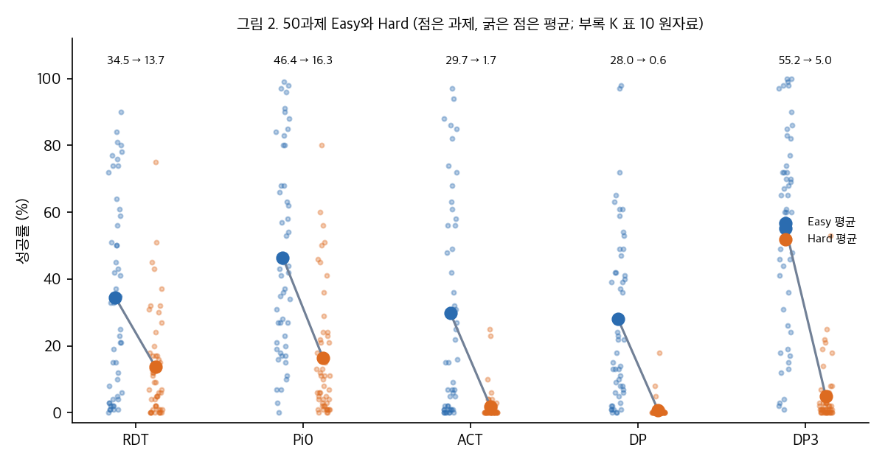
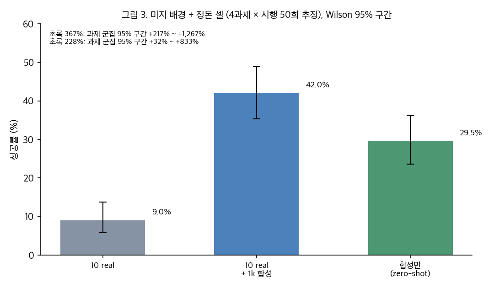
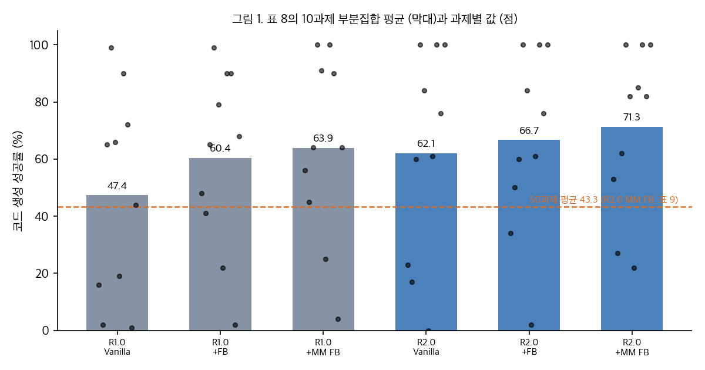

> **논문:** Tianxing Chen 외 (교신 Ping Luo, Yao Mu). *RoboTwin 2.0: A Scalable Data Generator and Benchmark with Strong Domain Randomization for Robust Bimanual Robotic Manipulation.* ICML 2026 포스터, arXiv:2506.18088 (v2, 2025-08-27).
> 공식 코드(MIT, RoboTwin-Platform/RoboTwin)는 얕게 받아서 정적으로만 읽었고, 실행하거나 설치하지 않았습니다. 논문 그림은 arXiv non-exclusive 라이선스라서 싣지 않았습니다. 아래 그래프는 우리가 원자료에서 그린 것입니다.

## 이 논문이 하려는 것

양팔 조작 정책을 학습하려면 데이터가 많아야 하고, 실물 시연은 비쌉니다. RoboTwin 2.0은 시뮬레이션에서 데이터를 대량으로 만드는 파이프라인을 제시합니다. 세 부분입니다. 첫째, 다중모달 LLM이 과제 코드를 쓰고 시뮬레이션 피드백으로 고칩니다. 둘째, 객체 731개 (147 범주)에 파지점과 언어 설명을 붙인 라이브러리 RoboTwin-OD를 만듭니다. 셋째, 청소물 배치, 조명, 배경 질감, 탁상 높이, 언어를 바꾸는 다섯 축 도메인 랜덤화를 씁니다.

벤치마크 설정도 분명합니다. 과제당 깨끗한 시연 50개로 학습하고, 깨끗한 장면 (Easy)과 랜덤화된 장면 (Hard)에서 과제당 100회 평가합니다. 50개 과제, 다섯 로봇, 정책 다섯 개 (ACT, DP, DP3, RDT, Pi0)를 비교합니다.

## 숫자를 다시 계산해 보니

**표 값은 대부분 맞습니다.** 벤치마크 Easy/Hard 평균, 파지 표, 사전학습 표의 평균과 상대 향상을 원자료에서 다시 계산했더니 소수 첫째 자리에서 일치했습니다. 벤치마크에서 RDT는 Easy 34.5%에서 Hard 13.7%로, Pi0는 46.4%에서 16.3%로 떨어집니다. 과제 단위 쌍체 검정으로 보면 이 낙폭은 우연으로 보기 어렵습니다.

*그림 2: 50과제의 Easy(파랑)와 Hard(주황) 성공률. 점 하나가 과제 하나이고, 굵은 점은 평균입니다. 논문 부록 K 표 10의 원자료로 그렸습니다.*

**그러나 초록의 두 숫자는 좁은 근거 위에 있습니다.** 초록의 "367%"와 "228%"는 실세계 실험에서 미지 배경 + 정돈 셀 하나에서 나옵니다. 10개 실연만 쓴 기준선은 9.0%이고, 합성 1,000개를 더한 모델은 42.0%입니다. 42.0을 9.0으로 나누면 4.67, 즉 +367%입니다. 합성만 쓴 모델은 29.5%이므로 +228%입니다. 이 셀은 과제 4개에 셀당 시행 50회로 보입니다 (논문은 시행 수를 밝히지 않았고, 2%씩 올라가는 값으로 추정했습니다). 과제 4개를 다시 뽑아 보는 군집 부트스트랩으로 구간을 잡으면, 첫 숫자는 +217%에서 +1,267%까지, 둘째 숫자는 +32%에서 +833%까지 흔들립니다.

*그림 3: 실세계 4과제, 미지 배경 + 정돈 셀의 성공률과 Wilson 95% 구간. 초록의 두 상대 향상이 이 셀에서 나온다는 것을 보여 줍니다.*

**코드 생성 수치는 부분집합의 숫자입니다.** 표 1의 ASR 71.3%는 RoboTwin 1.0과 2.0이 둘 다 지원하는 10개 과제의 평균입니다. 같은 논문의 50개 과제 평균은 43.3%입니다 (표 9). 10개 과제 부분집합은 전체보다 쉬운 쪽이었습니다. 초록의 "10.9%"는 두 구성을 섞어서 나온 값입니다. 같은 구성끼리 비교하면 7.4%p입니다.

*그림 1: 표 8의 10과제 막대 (평균)와 과제별 점. 파란 막대는 RoboTwin 2.0, 회색은 1.0입니다. 주황 점선은 50과제 평균 43.3%입니다.*

## 공식 코드를 읽어 보니

공식 저장소는 MIT 라이선스이고, 평가 스크립트가 잘 갖춰져 있습니다. 하지만 세 가지가 논문과 다르게 되어 있습니다.

1. **평가 시 건너뛰기.** 평가 스크립트의 기본 설정은 전문가 검사를 켭니다. 시드마다 전문가 코드를 먼저 돌리고, 전문가가 실패하거나 플래너가 불안정하면 그 장면을 건너뜁니다. 보고된 성공률의 분모는 건너뛰지 않은 장면입니다. 건너뛴 장면 수는 논문에 없습니다. Hard 장면에서 전문가가 더 많이 실패한다면, Easy와 Hard는 서로 다른 장면 집합에서 평가된 것이 됩니다.
2. **Easy와 Hard의 언어 분할.** 논문은 두 설정이 "평가 조건만 다르다"고 씁니다. 저장소의 설정 파일을 보면 Easy는 `seen` 언어, Hard는 `unseen` 언어로 평가합니다. 낙폭에 장면 효과와 언어 효과가 함께 들어 있습니다.
3. **탁상 높이.** 논문은 높이를 "균등하게 무작위화"한다고 씁니다. 코드는 높이를 0에서 3 cm 아래로만 낮춥니다. 올리는 방향은 없습니다.

데이터 수집도 성공한 에피소드만 저장합니다. 10만 궤적은 전부 전문가가 성공한 궤적이라는 뜻입니다. 논문에는 이 문장이 없습니다.

## 구현 가능성: 이 맥에서는 어디까지

이 맥은 Apple M4 Pro, 24 GiB, MPS입니다. CUDA가 없습니다. 저장소 설치 스크립트는 CUDA 기반 cuRobo v0.7.8을 소스에서 빌드합니다. 그래서 시뮬레이션 기반 평가와 전문가 실행은 이 맥에서 확인하지 못했습니다. 정책 학습 (RDT, Pi0, 9,600 궤적 사전학습), 실세계 실험, 코드 생성 루프 (외부 API 필요)도 이 맥에서는 할 수 없습니다.

**판정: 논문 수치의 재현은 불가능합니다. 표 재계산과 코드의 정적 대조는 완료했습니다.** 시뮬레이터 평가 한 과제를 맥에서 돌리는 것은 CUDA 의존성을 먼저 확인해야 합니다. 노력은 설치 포함 수 일로 추정하지만, 측정하지 않은 추정입니다.

## 정리

RoboTwin 2.0은 양팔 데이터와 벤치마크를 한곳에 모았다는 점에서 유용합니다. 표는 대체로 정확하고, 공식 코드는 공개되어 있습니다. 읽을 때 주의할 것은 세 가지입니다. 초록 수치는 좁은 셀에서 나오고, 공식 평가는 전문가가 실패한 장면을 빼며, Easy와 Hard는 언어 설정도 다릅니다. 이 세 가지를 알고 비교하면 됩니다.

## 열린 질문 (저자에게 물을 것)

- Easy와 Hard에서 건너뛴 장면은 각각 몇 개인가요?
- 실세계 셀의 시행 수와 시드 분산은 얼마인가요?
- 초록의 367%와 228%는 어떤 셀의 값인가요?
- 탁상 높이 변화에 올리는 방향도 있나요?

## 자료

- [통합 리포트 PDF](report/report_public.pdf)
- [01. 논문 분석: RoboTwin 2.0](analysis/01_paper_analysis.md)
- [02. 선행연구, 계보, 관련 자료](analysis/02_prior_work.md)
- [03. 수치 재계산과 일관성 검사](analysis/03_analysis.md)
- [04. 코드 대조: 논문 ↔ 공식 저장소 (RoboTwin-Platform/RoboTwin)](analysis/04_code_verification.md)
