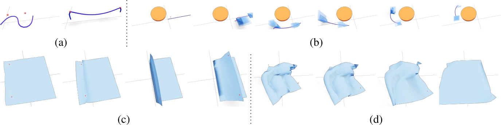
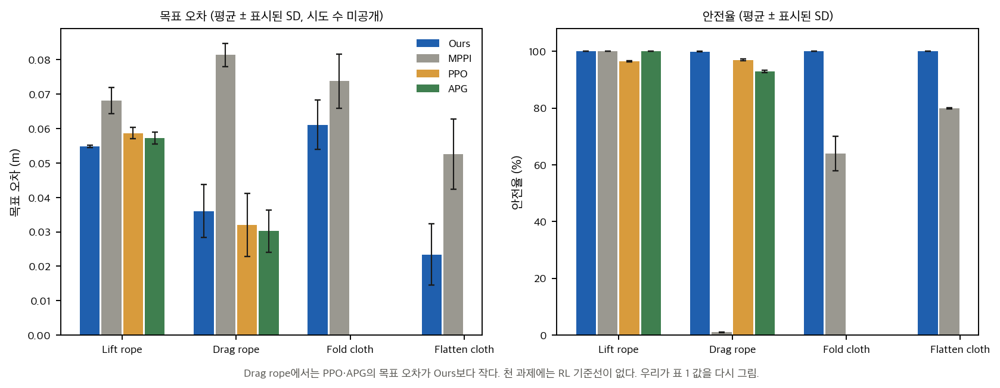
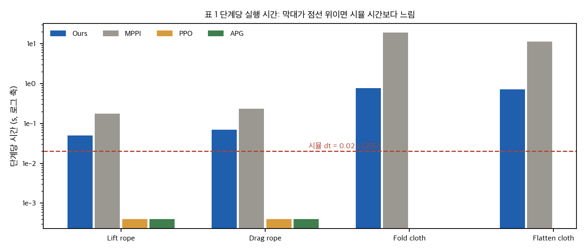
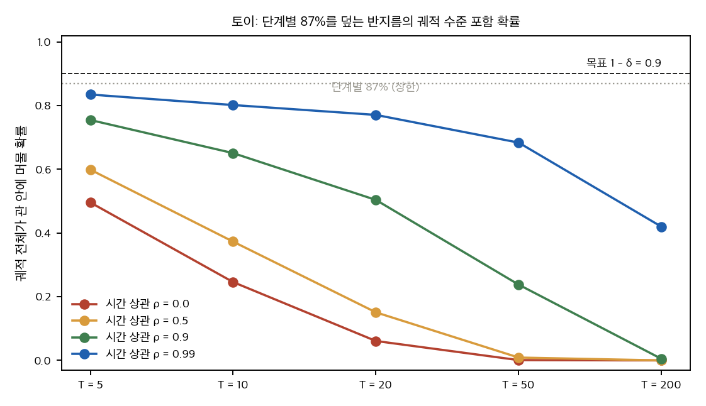
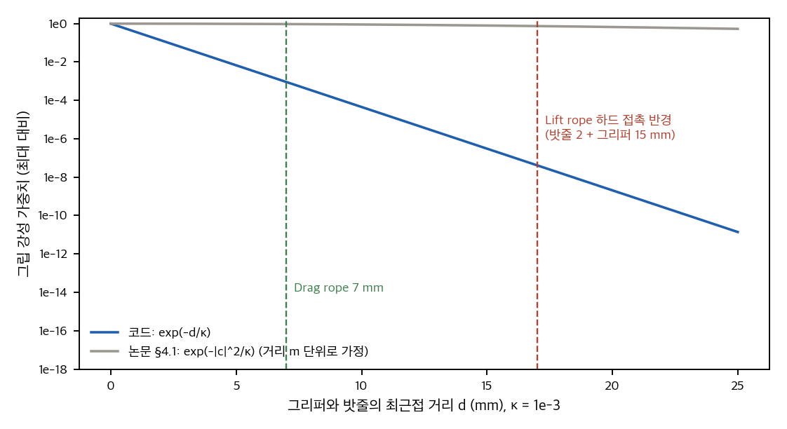
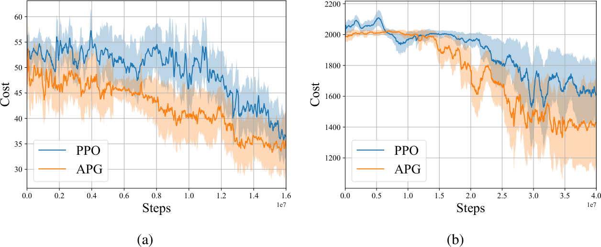
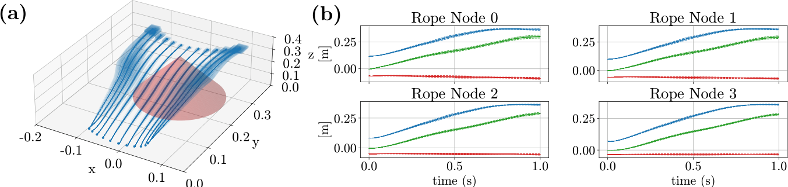

> **논문:** Wei-Chen Li, Jeffrey Fang, Sasanka Polisetti, Yuexi Song, Glen Chou. *Robustness without Wrinkles: Parallel Simulation and Robust MPC for Certified Deformable Manipulation.* CoRL 2026 스포트라이트, arXiv:2606.14188 (v1, 2026-06-12).
> 공식 코드는 GitHub trustworthyrobotics/CORD-SLS(최상위 라이선스 없음, `planners/gpu_sls`만 MIT)에 있습니다. 코드는 커밋 `77e82b4`를 **정적으로만** 읽었고 실행하지 않았습니다. 논문 그림 세 장은 CC BY 4.0으로 출처를 적어 실었고, 나머지 그래프는 우리가 논문 표 값으로 다시 그린 것입니다.

## 논문이 묻는 것

밧줄과 천 같은 변형체를 조작할 때 접촉이 생기기 전에는 제어가 물체에 영향을 주지 않아 기울기가 사라집니다. 논문은 이를 **접촉 평활화**로 풉니다. 순방향 시뮬레이션은 비평활 동역학 그대로 두고 기울기만 평활한 대리값을 쓰는 방식입니다. 그 위에 GPU 병렬 **출력 피드백 시스템 수준 합성(SLS) 견고 MPC**를 올리고, 지각과 모델 오차의 상계는 **정합 예측(CP)**으로 교정해 도달 가능 관(tube)을 만듭니다. 정리 1은 "지각 상태 관을 지각 오차 반지름 ρ만큼 부풀리면 참 상태 관이 된다"고 말합니다.

*그림: 논문 그림 2 (네 과제 시뮬레이션: (a) 밧줄 들기, (b) 밧줄 끌기, (c) 천 접기, (d) 천 펴기). © 저자, CC BY 4.0, 출처 arXiv:2606.14188 (v1).*

## 표 1에서 읽은 것

표 1은 네 과제에서 CORD-SLS를 MPPI, PPO, APG와 비교합니다. 논문에는 **시도 수, 시드 수, ±의 정의, 안전율의 정의가 없습니다.** 그래서 ±를 SD로 보고 n = 5–100 가정별로 Welch 검정을 했습니다.

*그래프: 우리가 표 1 값으로 다시 그린 목표 오차(평균 ± 표시된 SD)와 안전율입니다. 시도 수는 논문에 없습니다.*

- **밧줄 끌기에서 RL의 목표 오차가 더 작습니다.** Ours 0.0360, PPO 0.0320, APG 0.0302입니다. n = 5–10이면 우연과 구별되지 않지만 n = 30이면 APG가 유의하게 낮습니다(p = 0.002). 초록의 "task success"에서 능가한다는 말은 이 표로 지지되지 않고, 과제 성공 자체를 측정하지 않았습니다.
- **안전율은 에피소드 단위일 수 없습니다.** 99.9%와 96.5%를 에피소드 비율로 만들려면 시도가 667회, 57회 이상이어야 합니다. 단계 비율로 읽어야 정합적입니다.
- **"millisecond-speed"는 밧줄에서 수십 밀리초입니다.** 단계당 시간은 밧줄 50–70 ms, 천 0.71–0.76 s입니다.

*그래프: 표 1 단계당 시간(로그 축)과 코드의 시뮬 dt = 0.02 s입니다. 우리가 그린 그래프입니다.*

코드의 `time_step`이 0.02 s이므로 밧줄은 시뮬 시간보다 2.5–3.5배, 천은 36–38배 느립니다. RL 정책의 추론(0.4 ms)은 Ours보다 125–175배 빠르므로 속도 우위는 MPPI에 대해서만 말할 수 있습니다.

## 시뮬레이터 비교

본문의 "최대 700배, 2000배"는 산술로는 맞습니다(718배, 2224배). 그러나 DaXBench **밧줄(MPM)** 기준의 값이고, 가장 가까운 이산 탄성 막대 구현 DEFORM에는 45배, 410배이며 천은 1.4배, 11배입니다. 부록의 정확도 비교에서 DEFORM이 7% 낮은 오차(0.0139 대 0.0150)는 n = 100이면 유의하고(p = 0.027) n = 30이면 아닙니다. 학습된 잔차를 붙이면 차이가 사라집니다.

## 정합 예측: 87%를 덮는 반지름은 궤적 보장이 아닙니다

하드웨어에서 무작위 제어 100번으로 교정하고 "반올림한 반지름 0.03 m가 잔차의 87%를 덮는다"고 적었습니다. 논문의 규칙은 궤적 수준 오류율 δ를 호라이즌 T로 나누는 것(δ̄ = δ/T)인데, 이 설정에서는 세 가지가 문제입니다.

- n = 100이면 유한한 분위수를 얻는 최소 δ̄가 1/101이므로 δ ≥ T/101이 필요합니다.
- 단계별 오류율이 13%이면 합집합 상계가 0.13 T라 T ≥ 8에서 1을 넘습니다. 보장이 공허합니다.
- 표 3의 SD(0.0040)는 같은 100개라면 필요한 최소 SD 0.0058과 양립하기 어렵습니다(데이터가 같은지는 논문에 없습니다).

작은 numpy 토이(잔차를 평균 0.015 m 로그정규로 가정)로 확인했습니다. 올바른 CP는 목표 0.9를 지킵니다(0.91–0.97). 87% 반지름은 단계 오차가 독립이면 길이 10 궤적이 관 안에 머물 확률이 25%, 50 단계이면 0.1%이고, 시간 상관이 0.99 정도로 매우 높아야 80% 근처가 유지됩니다.

*그래프: 토이, 단계별 87%를 덮는 반지름의 궤적 수준 포함 확률(20,000회 모의, 로그정규 잔차 가정, 시간 상관 ρ). 우리가 그린 그래프입니다.*

정리 1 자체의 증명은 두 줄(q = q̄ − e, ‖e‖ ≤ ρ)이라 맞습니다. 문제는 그 전제인 "지각 상태 관의 포함 확률 ≥ 1 − δ"를 교정이 주지 못한다는 점입니다.

## 공식 코드와 논문

저장소에는 시뮬레이터, 벤치마크 네 과제와 네 방법, GPU-SLS 사본이 있습니다. 정합 예측, 지각(SAM3, TAPNext++), 하드웨어 제어, 표 2·3의 DEFORM 비교 코드는 없습니다. 정적으로 읽어 다음을 확인했습니다.

- **SLS 단계가 벤치마크에서 꺼져 있습니다.** 모든 설정이 `enable_fastsls=False`이고, `gpu_sqp.py`의 `use_nominal = not(enable_fastsls) or ...`이 참이 되어 백오프가 0인 공칭 QP만 풉니다. `enable_output_feedback`는 어디서도 켜지지 않습니다. 표 1의 "Ours"가 제약 있는 공칭 MPC로 읽힙니다. 논문 하루 전 초기 커밋도 같습니다. 실행으로 확인하지는 않았으므로 저자 확인이 필요합니다.
- **평가는 무잡음 완전 모델입니다.** 실행도 계획과 같은 `step`을 쓰고 외란을 주입하지 않으며, 계획에 넣는 외란은 6e-5로 하드웨어 CP 반지름의 1/500입니다. 들기, 접기, 펴기의 제약은 속도와 그립 한계뿐이고 기록되는 제어는 클립 전 명령입니다.
- **접촉 평활화가 논문과 다릅니다.** 그리퍼 부착 가중치가 논문의 `exp(−‖c‖²/κ)`가 아니라 `exp(−d/κ)`(κ = 1 mm)입니다.

*그래프: 접촉 평활화 가중치. 코드의 exp(−d/κ)와 논문 §4.1의 exp(−‖c‖²/κ)(거리 m 단위 가정), 그리고 하드 접촉 반경입니다. 우리가 그린 그래프입니다.*

감쇠 길이가 1 mm라 하드 접촉 반경(들기 17 mm)에서 가중치가 4e-8, 초기 그리퍼 높이 50 mm에서는 2e-22입니다. 접촉 전 기울기는 몇 mm 안에서만 유효하고, 접촉 발견에는 초기 제어(하강과 닫기)가 함께 한 것으로 보입니다. 지면 접촉은 논문의 볼록 원뿔 QP가 아니라 벌점 힘 한 번의 선형 풀이이고, 평활 계수에 0.0이 곱해져 꺼져 있습니다.

- **RL 기준선 설정**: PPO 총 타임스텝은 코드 기본값이 APG의 1/8이고 시연은 한 궤적이며, APG도 같은 시연으로 BC 사전학습을 합니다. MPPI의 장애물 벌점은 비용의 약 1% 이하이고, 표의 MPPI 평가 횟수는 코드의 호라이즌과 맞지 않습니다.
- **맞는 것**: 순방향 비평활 + 기울기 평활(straight-through), 1단계 암묵 미분, SLS와 APG의 평가 횟수 산술, 병렬 스캔 규칙.

병렬 스캔은 따로 확인했습니다. 임의의 선형 시변 계통에서 식 (13)의 순차 칼만 재귀와 식 (16)–(17)의 결합 규칙을 비교하면 최대 오차가 1e-15이고 이진 트리 결합도 같습니다. 단, 원소 정의의 인덱스가 내려가는 표기라 "나중 단계를 왼쪽에" 두는 순서로 읽어야 하며, 본문의 오름차순 표기를 그대로 읽으면 틀립니다.

## 이 글의 한계

코드는 실행하지 않았습니다(정적 읽기). 표 1의 시도 수가 없어 p 값은 n 가정별 조건부 값입니다. 토이의 잔차 분포와 시간 상관은 가정입니다. 정리 1의 "high-probability"는 교정이 어떤 δ 분배를 따르는지에 달려 있는데 논문에 T, δ, 교정 데이터가 없습니다. 하드웨어 결과는 시도 수와 성공률이 없는 정성 시연이라 평가하지 못했습니다.

논문의 수치 재현은 이 맥(Apple M4 Pro, CUDA 없음)에서 불가능합니다. 하드웨어와 GPU 학습이 필요하고, 지각과 제어 코드가 저장소에 없습니다. 참고로 논문의 학습 곡선은 다음과 같습니다.

*그림: 논문 그림 6 (PPO와 APG의 학습 곡선: (a) 밧줄 들기, (b) 밧줄 끌기). 가로축이 1.6e7, 4e7 스텝이라 코드 기본 PPO 예산(2M, 5M)과 다릅니다. © 저자, CC BY 4.0, 출처 arXiv:2606.14188 (v1).*

출력 피드백 롤아웃(그림 3)은 롤아웃 횟수와 잡음 크기가 적혀 있지 않고 그 설정이 저장소에 없습니다.

*그림: 논문 그림 3 (출력 피드백 밧줄 궤적 (a)와 견고 관 (b)). © 저자, CC BY 4.0, 출처 arXiv:2606.14188 (v1).*

## 자료

- [통합 리포트 PDF](report/report_public.pdf)
- [01. 논문 분석: Robustness without Wrinkles / CORD-SLS (arXiv:2606.14188)](analysis/01_paper_analysis.md)
- [02. 선행연구와 관련 저장소](analysis/02_prior_work.md)
- [03. 수치 재계산, 일관성 검사, 토이 실험](analysis/03_analysis.md)
- [04. 공식 코드 대조와 구현 가능성](analysis/04_code_verification.md)
