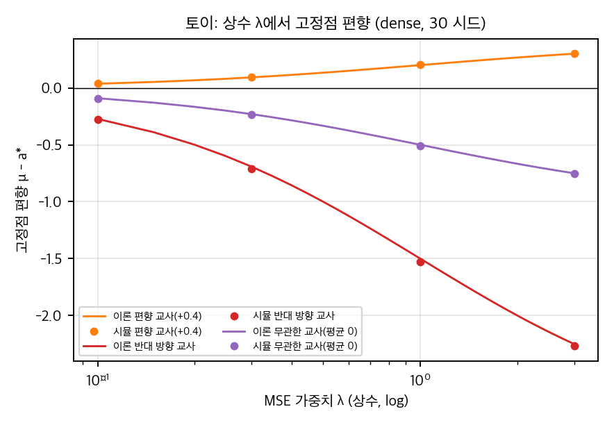
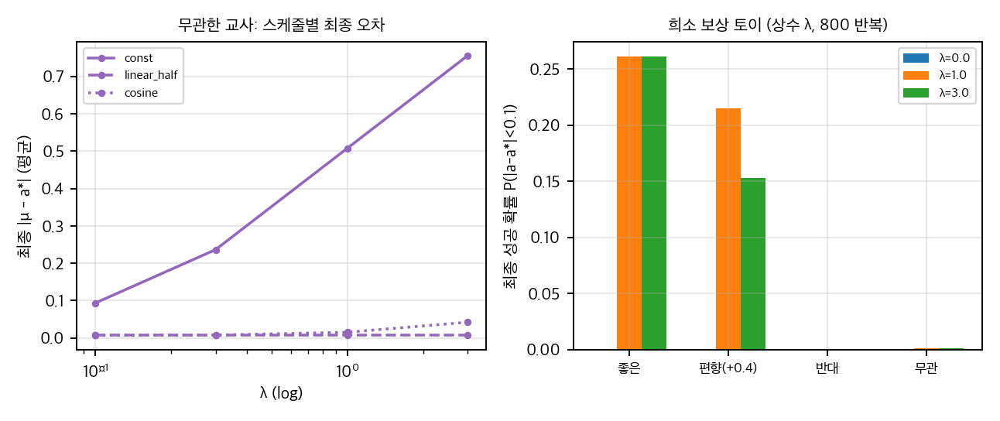
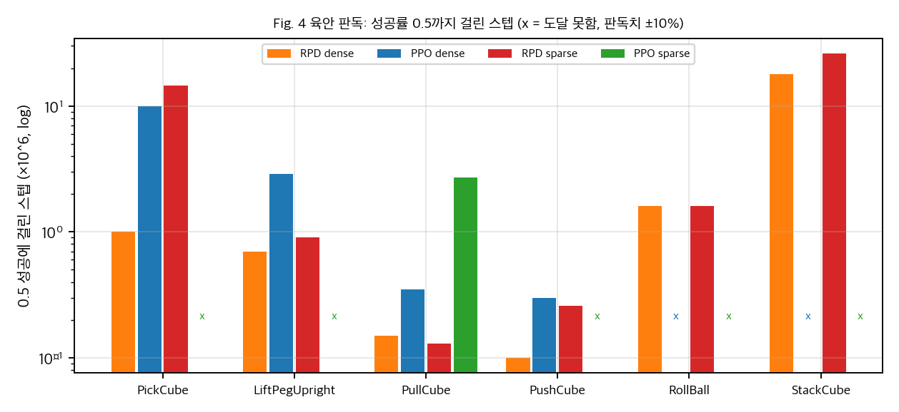

# RPD 분석: PPO에 교사 VLA 행동을 당기는 항 하나를 더하면

RPD(Refined Policy Distillation)는 VLA를 교사로 두고 PPO 학생의 행동 평균을 교사 행동 샘플에 제곱 오차로 당깁니다. 손실에 항이 하나 추가되는 방법이라 구현은 간단합니다. 이 글은 논문과 공식 코드를 정적으로 읽고, 곡선을 육안으로 판독했으며, CPU 토이로 교사 항의 편향을 확인한 결과입니다. 재현은 하지 않았습니다.

## 무엇을 주장하나

- PickCube에서 0.5 성공에 도달하는 시점은 RPD가 약 0.15×10^7, PPO가 약 0.9×10^7 스텝입니다(육안 판독).
- 끝 시점 성공률 차이는 작습니다. 1.25×10^7에서 RPD 약 0.80, PPO 약 0.72입니다.
- 교사가 0%인 카메라 변경 PushCube에서도 RPD가 PPO보다 높습니다(Octo 교사 기준 약 0.98 대 0.35).

## 확인한 것

그래프: 토이의 고정점 편향. 점은 시뮬레이션(30 시드), 선은 이론 λ/(1+λ)·(t̄ - a*). 합성 데이터.

교사 항을 상수 가중치 λ로 두면 고정점은 μ_fix = (a* + λt̄)/(1+λ)가 됩니다. 교사가 틀리면 편향이 λ/(1+λ)·(t̄ - a*)만큼 남습니다. 토이는 이 식을 0.01 이내로 맞췄습니다. 교사가 쓸모없으면(평균 0) 상수 λ에서 학습이 막힙니다. 감쇠 스케줄을 쓰면 편향은 사라지지만 느려집니다.

그래프: 토이의 스케줄별 최종 오차(왼쪽)와 희소 보상 성공 확률(오른쪽). 교사가 없으면 희소 보상은 학습되지 않습니다.

그래프: 논문 Fig. 4를 육안으로 읽은 0.5 성공 도달 스텝(×10^6, 로그 축). 판독 오차는 약 ±10%이고 시드별 값은 없습니다.

## 짚어 둘 점

- **교사 질의는 스텝당 8회입니다.** 논문은 상태당 교사 샘플이 한 번이라고 씁니다. 공식 코드는 학습 에폭마다 같은 상태를 다시 질의합니다. 환경 스텝만 세면 이 비용이 빠집니다.
- **유의성은 제한적입니다.** 시드 5개와 곡선 음영뿐입니다. 끝 시점 차이 0.08은 시드 SD가 0.05 근처일 때 경계선입니다.
- **무관 교사 대조가 없습니다.** "낮은 성공률 교사도 탐색 방향을 준다"는 해석은 검증되지 않았습니다.
- **재현 환경이 까다롭습니다.** 교사 서버 의존성이 커밋 없이 지정되어 있고, 현재 HEAD와 호환되지 않습니다.

## 재현할 수 있는가

공식 재현은 NVIDIA GPU가 있어야 합니다. 시뮬이 GPU로 고정되어 있고, OpenVLA 교사는 다중 GPU가 필요합니다. 이 분석의 CPU 작업은 토이와 판독에 한정했습니다. 손실 항만 옮기는 것은 쉽습니다. 교사 서버와 GPU 시뮬이 실제 노력입니다.

## 출처

- 논문: arXiv:2503.05833 (v2). 비독점 배포 라이선스입니다. 논문 그림은 이 글에 넣지 않았습니다.
- 공식 코드: Refined-Policy-Distillation/RPD (Apache-2.0), 커밋 10becdf (2025-07-18).
- 교사 서버: RobotControlStack/vlagents (Apache-2.0). 2025-07-18 상태 `f51338c`를 기준으로 정적으로 읽었습니다.

## 자료

- [통합 리포트 PDF](report/report_public.pdf)
- [01. 논문 분석: Refined Policy Distillation (RPD)](analysis/01_paper_analysis.md)
- [02. 선행연구와 관련 저장소](analysis/02_prior_work.md)
- [03. 재계산, 유도, 토이](analysis/03_analysis.md)
- [04. 코드 대조: 논문 ↔ Refined-Policy-Distillation/RPD](analysis/04_code_verification.md)
