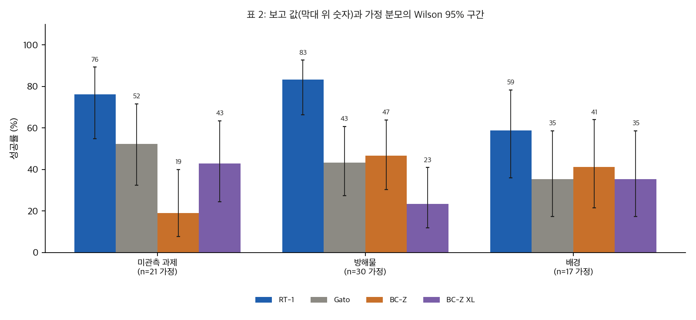
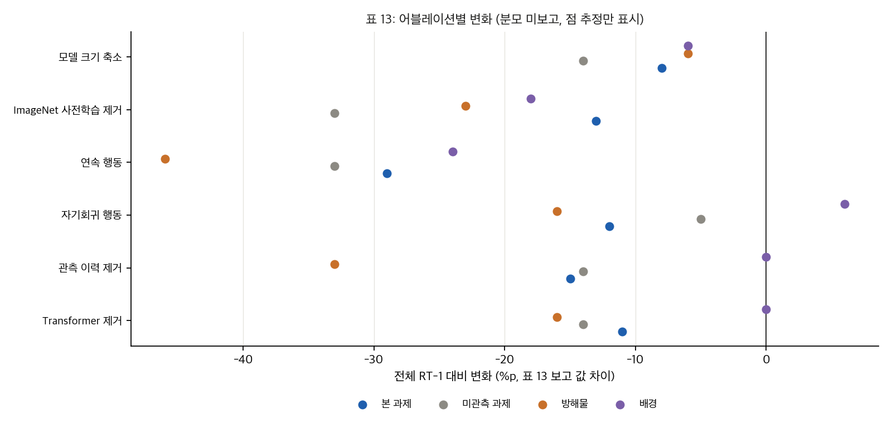
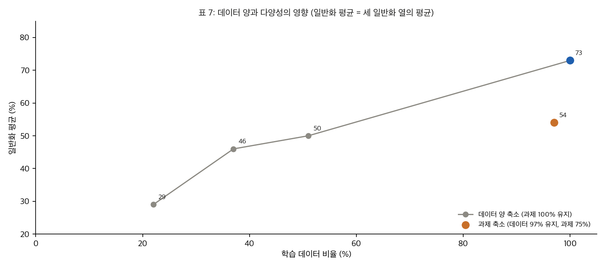

# RT-1 보고 수치 재계산과 일관성 검사 (03)

재현(학습, 추론)은 하지 않았습니다. 이 문서는 논문 표의 숫자를 다시 계산하고, 표끼리·본문과 맞춰 본 결과입니다. 계산은 `analysis/recompute.py`(표준 라이브러리만 사용), 결과는 `analysis/recompute_results.json`, 그래프는 `analysis/plot_figures.py`입니다. 검정은 양측 Fisher 정확검정, 차이의 구간은 Newcombe(Wilson 기반) 95%입니다.

**가장 중요한 한계:** 논문은 표 2, 3, 7, 13의 **분모(시행 수)를 대부분 보고하지 않습니다**. 그래서 아래의 검정 중 일부는 "분모를 이렇게 가정하면"이라는 조건부입니다. 가정 분모는 표 값과 **반올림 일치**를 조건으로 찾았습니다(V1). 이 방법은 분모를 확정하지 못하고, 가능한 분모의 범위를 줍니다.

## 1. 요약

| 번호 | 확인한 것 | 결과 |
|---|---|---|
| V1 | 표 2 백분율과 분모 | 미관측 과제는 n=21이 네 값을 모두 맞춤. D.1의 53은 RT-1 76%와 맞지 않음. 배경은 n=17이 맞으며 본문의 22·D.1의 18과 다름 |
| V2 | 표 7 "All" 열 | 세 일반화 열의 평균과 반올림 일치 (5행 모두) |
| V3 | 표 13 방해물 "All" | 쉬움·중간·어려움의 단순 평균과 다름 (RT-1: 83 대 88). 시행 가중 평균으로 보이지만 분모가 없어 확인 못함 |
| V4 | "%"의 뜻 | 대부분 %p. 초록의 "25%"(미관측)는 본문 §6.2의 "24%"와 다름 |
| V5 | 주요 비교 검정 (n 가정) | 미관측: 대 BC-Z p=0.0005, 대 Gato p=0.20(유의하지 않음). 방해물: 대 BC-Z p=0.006, 대 Gato p=0.003 |
| V6 | 어블레이션 검정 (n 가정) | 방해물에서 사전학습 제거 p=0.08, 이력 제거 p=0.013. 미관측에서 사전학습 제거 p=0.058 |
| V7 | 표 4 (분모 미보고) | 미관측 기술 7% 대 33%는 n에 따라 p=0.005–0.58. 결론 유보 |
| V8 | 표 6 장기 과제 (n=15 확정 가능) | 주방2에서 RT-1 10/15 대 BC-Z 2/15 p=0.008. 주방1에서 10/15 대 8/15는 p=0.71 (유의하지 않음) |
| V9 | 표 5 빈 피킹 (n=72 명시) | 28/72 대 16/72, 차이 16.7%p [1.6, 30.7], p=0.046. 얇은 유의 |
| V10 | 파라미터 수 | Transformer 8층은 코드 설정으로 18.9M로 계산되어 본문 19M과 맞음 |
| V11 | 추론 속도 배수 | 자기회귀 36 ms 대 15 ms = 2.4배. 본문 "2배 이상"과 맞음 |
| V12 | 부록 D.4 파라미터 축소 | "35M→21M (40%)"와 "31M→25M, 40%"가 같은 문단에 있음. 뒤 것은 19%. **내부 모순** |
| V13 | 중복 표 | 표 4=표 9, 표 5=표 10, 표 6=표 11 (값 동일). 표 1과 모델 카드도 같음 |

## 2. 분모 역산 (V1)

표 2의 백분율을 정수 횟수로 바꿀 수 있는 분모 n을 찾았습니다(네 값이 모두 `round(100k/n)`과 일치하는 n).

| 열 | 표 값 (RT-1, Gato, BC-Z, BC-Z XL) | 일치하는 n (5–60) | 해석 |
|---|---|---|---|
| 미관측 과제 | 76, 52, 19, 43 | **21**, 42, 54, 58 | 본문 §6.1·§6.2의 "21개"와 맞음. 53은 불가능 (RT-1 76%를 낼 k가 없음) |
| 방해물 | 83, 43, 47, 23 | **30**, 47, 53, 60 | 본문 §6.1의 "30회"와 맞음. 즉 30은 과제 수가 아니라 시행 수 |
| 배경 | 59, 35, 41, 35 | **17**, 34, 37, 46, 49, 51, 54 | 본문의 "22 과제"와 맞지 않음. D.1의 6×3=18과도 맞지 않음 |
| 본 과제 | 97, 65, 72, 56 | 150–250 범위 대부분 가능 | 분모 확정 불가 |

부록 표 8은 **53행**입니다(재계산, 행 세기). 그런데 표 2의 미관측 백분율은 21개 기준으로만 맞습니다. 그러므로 표 2는 53개 전체가 아닌 21개 부분집합(또는 다른 집합)으로 계산되었을 가능성이 큽니다. 논문에서 확인할 수 없어 **저자 질문**으로 둡니다(`04` 질문 목록).

## 3. 표 7 "All"과 표 13 "All" (V2, V3)

- 표 7의 "All" = 일반화 세 열(미관측, 방해물, 배경)의 평균으로 보입니다. 다섯 행 모두 반올림 일치: 전체 (76+83+59)/3 = 72.7 → 73, 51% 데이터 50.0, 37% 데이터 46.3, 22% 데이터 28.7 → 29, 과제 축소 54.0.
- 표 13의 방해물 "All"은 쉬움·중간·어려움의 단순 평균과 다릅니다. RT-1 83 대 88, Gato 43 대 48, BC-Z 47 대 58, BC-Z XL 23 대 30. 모든 행에서 단순 평균이 더 높습니다. 시행 수로 가중한 평균이면 설명되지만, 분모가 없으므로 확인하지 못했습니다. 본문 §6.1의 "방해물 30회"와 쉬움 0·2·5, 중간 9, 어려움 9 개 조건을 합친 것이라면, 쉬움에 시행이 많고 어려움에 적으면 가중 평균은 83에 가까워질 수 있습니다.

## 4. "%"와 %p (V4)

| 비교 | %p 차이 | 상대 차이 |
|---|---|---|
| 본 과제, RT-1 대 BC-Z (97 대 72) | 25 | 34.7% |
| 본 과제, RT-1 대 Gato (97 대 65) | 32 | 49.2% |
| 미관측, RT-1 대 Gato (76 대 52) | 24 | 46.2% |
| 방해물, RT-1 대 BC-Z (83 대 47) | 36 | 76.6% |
| 배경, RT-1 대 BC-Z (59 대 41) | 18 | 43.9% |

- 초록은 "25%, 36%, 18% better"라고 씁니다. 방해물 36과 배경 18은 %p로 맞지만, 초록의 미관측 "25%"는 %p로 계산하면 **24**입니다(§6.2는 "24% more"라고 씀). 작은 불일치입니다.
- §6.2의 "25% more than BC-Z, 32% more than Gato"는 상대 비율이 아니라 %p입니다. 상대 비율로 읽으면 35%, 49%로 과장됩니다.

## 5. 주요 검정 (V5, n 가정)

*그림 1. 표 2 보고 값(막대 위 숫자)과 가정 분모(미관측 21, 방해물 30, 배경 17)의 Wilson 95% 구간. 분모는 V1의 역산이며 논문이 보고한 값이 아닙니다.*

| 비교 (가정 n) | 차이 (%p) | 95% 구간 | Fisher p |
|---|---|---|---|
| 미관측, RT-1 대 BC-Z (21) | 57.1 | [27.3, 74.6] | 0.0005 |
| 미관측, RT-1 대 Gato (21) | 23.8 | [-4.9, 47.8] | 0.20 |
| 방해물, RT-1 대 BC-Z (30) | 36.7 | [12.6, 55.6] | 0.006 |
| 방해물, RT-1 대 Gato (30) | 40.0 | [15.7, 58.5] | 0.003 |
| 장기 주방2, RT-1 대 BC-Z (15, 표 6) | 53.3 | [18.3, 73.9] | 0.008 |
| 장기 주방1, RT-1 대 BC-Z (15, 표 6) | 13.3 | [-19.8, 42.8] | 0.71 |
| 빈 피킹, 혼합 대 EDR만 (72, 명시) | 16.7 | [1.6, 30.7] | 0.046 |

**해석:** 미관측 과제에서 RT-1은 BC-Z보다 확실히 좋지만, **Gato와의 차이는 n=21 가정에서 유의하지 않습니다**. 본문은 "모든 기준선보다 크게 낫다"고 쓰므로, Gato 대비 주장은 약합니다(표 2 점추정은 맞지만 불확실성이 큽니다). 장기 과제 주방1에서 BC-Z와의 차이는 유의하지 않습니다. 저자는 이를 "RT-1 best"로 씁니다. 방향은 맞지만 n=15에서는 확실하지 않습니다.

## 6. 어블레이션 검정 (V6, n 가정)

| 비교 (가정 n) | 차이 | Fisher p |
|---|---|---|
| 방해물, 사전학습 제거 대 전체 (30) | 60 대 83 | 0.084 |
| 방해물, 이력 제거 대 전체 (30) | 50 대 83 | 0.013 |
| 미관측, 사전학습 제거 대 전체 (21) | 43 대 76 | 0.058 |
| 미관측, 연속 행동 대 전체 (21) | 43 대 76 | 0.058 |

- 논문은 "ImageNet 사전학습이 미관측 일반화를 33% 낮춘다"고 씁니다. 이것은 **33%p**이고(상대로는 43%), 그 차이의 p는 n=21 가정에서 0.058입니다. 방향은 일관되지만 "확실하다"고 말하기는 어렵습니다.
- "이력이 방해물 강건성에 주로 영향을 준다"는 서술은 n=30 가정에서 가장 강한 증거입니다(p=0.013).

## 7. 표 4 시뮬레이션 흡수 (V7, 분모 미보고)

시뮬레이션 전용 객체와 미관측 기술에 대해 "7%에서 33%"라고 씁니다. 분모를 n으로 두면 p는 다음과 같습니다.

| 가정 n | 10 | 20 | 30 | 50 |
|---|---|---|---|---|
| 미관측 기술 7% 대 33%의 p | 0.58 | 0.044 | 0.021 | 0.005 |

실제 실험 크기에 따라 결론이 달라집니다. 분모를 공개하지 않으면 "향상이 유의하다"는 주장을 검증할 수 없습니다. 실제 세계의 "실제 객체 92 대 90" 차이(-2)는 어떤 n에서도 유의하지 않으므로, 데이터 흡수 주장의 "손실 없음" 부분은 방향으로 맞습니다.

## 8. 장기 과제 SayCan (V8, n=15 확정)

표 6의 값은 모두 15의 배수로 맞습니다(계획 87 = 13/15, 실행 67 = 10/15, 13 = 2/15, 53 = 8/15, 33 = 5/15, 47 = 7/15, 73 = 11/15). 그러므로 분모 15는 표 6의 값으로 확인되었습니다.

- 주방1과 주방2에서 RT-1의 실행 성공률이 같습니다 (10/15 대 10/15, p=1.0). 논문은 "visible drop 없음"이라고 쓰고, 이 해석은 맞습니다. 다만 15개 과제 한 세트이므로 일반화 폭은 좁게 봐야 합니다.
- 표 6의 "계획 87%" 대 원 SayCan "73%"는 다른 프롬프트이므로 직접 비교가 아닙니다(저자도 이 점을 적었습니다).

## 9. 빈 피킹 (V9, 분모 72 명시)

16/72 = 22.2%, 28/72 = 38.9%로 표 5의 22%, 39%와 맞습니다. 차이 16.7%p, 구간 [1.6, 30.7], p=0.046입니다. 이 결과는 **얇은 유의**이며, 한 번의 시행 세트(72회)에 기댄 결과입니다. 분류 시행이 여러 번 있었는지, 실험을 반복했는지는 논문에 없습니다.

## 10. 파라미터 수와 계산 비용 (V10–V12)

- Transformer 한 층: MHA(key_dim=128, 헤드 8, 입력 512) 2,100,736 + LayerNorm 2개 2,048 + 피드포워드 Dense(512) 262,656 = **2,365,440**. 8층 합계 18,923,520. 출력 Dense(256) 131,328를 더하면 **19.05M**으로 본문 19M과 맞습니다. 위치 임베딩과 입력 Dense는 계산에서 뺐습니다. 코드의 layer_size=128은 헤드당 키 차원이므로 MHA 투영 폭이 1024입니다(`04` D5).
- 전체 35M은 토큰화기 16M을 계산하지 않았으므로 확인하지 못했습니다.
- 자기회귀 행동의 추론 시간: 36 ms 대 15 ms = 2.4배. 본문은 "more than 2x"라고 씁니다. 맞습니다.
- 부록 D.4 "35M→21M"은 40% 감소와 맞습니다. 그러나 같은 문단의 "31M→25M을 40% 줄였다"는 19.4% 감소이므로 틀렸습니다(V12). 두 문장 중 하나가 잘못되었습니다.

## 11. 그래프 두 장 (보고 값)

*그림 2. 표 13 보고 값에서 전체 RT-1을 뺀 차이(%p). 분모가 없으므로 점 추정만 그렸습니다. 사전학습과 연속 행동 제거가 가장 큰 하락을 보입니다.*

*그림 3. 표 7의 일반화 평균 대 학습 데이터 비율. 과제를 25% 줄이고 데이터는 97%만 남긴 경우(54)가 데이터를 49% 줄인 경우(51%, 50)와 비슷합니다. 논문의 "데이터 다양성이 양보다 중요하다"는 결론은 이 차이가 4점 정도임을 감안해서 읽어야 합니다.*

## 12. 재계산하지 못한 것

- 본 과제 97%의 분모(시행 수)와 실제 시행 기록.
- 표 3 실제 주방의 L1·L2·L3 분모. 3단계가 있으므로 분모 조합은 많지만, 평균 70 한 값으로는 확정할 수 없습니다.
- 표 4·표 5의 기준 시행 수(표 5의 혼합 평가 분모는 명시되지 않음).
- 기준선(Gato, BC-Z)의 학습과 재구현. 코드가 없어서 검증 불가.
- 데이터 통계(130k 에피소드의 기술별 분포)는 데이터 없이 확인할 수 없습니다.
