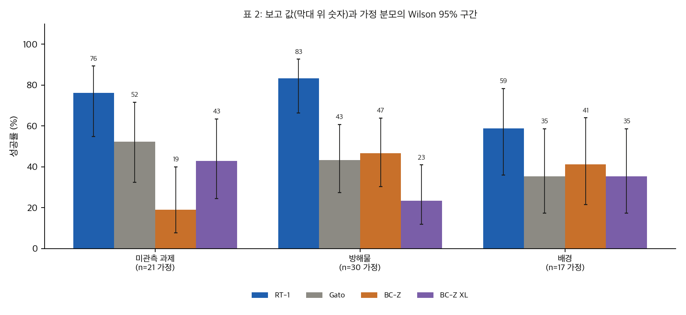
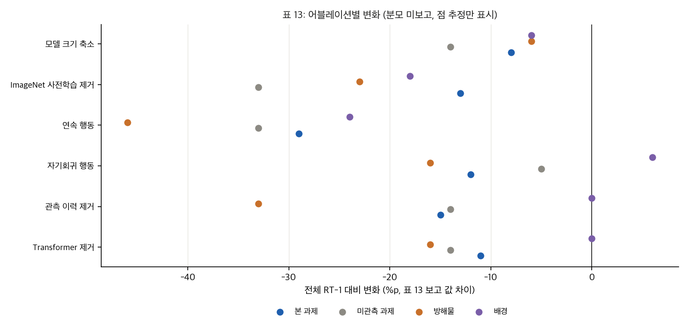
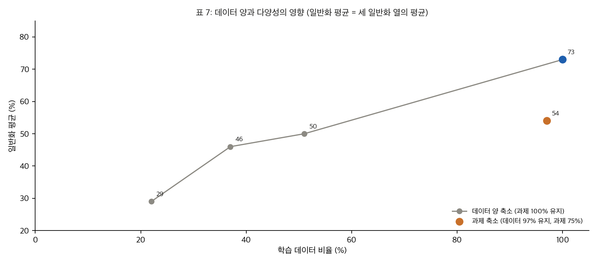

> **논문:** Brohan 외. *RT-1: Robotics Transformer for Real-World Control at Scale.* RSS 2023 (arXiv:2212.06817 v2, 2023-08-11).
> 공식 코드는 GitHub `google-research/robotics_transformer` (Apache-2.0, 아카이브됨)에 있습니다. 이 글의 그래프는 논문 표 값으로 우리가 그린 것입니다. 논문 그림은 싣지 않습니다.

## 한 줄 요약

RT-1은 행동을 256개 빈으로 나눈 토큰으로 바꾸고, 이미지와 언어를 작은 Transformer 한 개로 처리합니다. 실로봇 데이터 130k 시연에서 700개 이상의 지시를 수행합니다. 다만 논문 표의 시행 수가 대부분 빠져 있어, 차이의 크기는 가정 없이 말하기 어렵습니다.

## 방법: 이미지, 언어, 행동을 토큰으로

- 6장의 이미지 이력을 ImageNet으로 미리 학습한 EfficientNet-B3에 넣습니다. 언어 지시의 임베딩으로 FiLM 층을 조절합니다. 이때 FiLM의 가중치는 0으로 시작해 사전학습 특징이 깨지지 않게 합니다.
- 81개 토큰을 TokenLearner로 이미지당 8개로 줄이고, 48개 토큰을 8층 Transformer에 넣습니다.
- 행동 11개 차원(팔 7, 기지 3, 모드 1)을 각각 256 빈으로 나눠 범주형 교차엔트로피로 예측합니다.

이 구조는 3 Hz 제어를 목표로 합니다. 토큰 수를 줄이고 토큰을 재사용해 추론을 빠르게 만들었습니다. 보고된 속도는 100 ms 이내입니다.

## 결과: 방향은 분명하지만 분모가 없습니다

*그림 1. 표 2의 보고 값(막대 위 숫자)과 가정 분모(미관측 과제 21, 방해물 30, 배경 17)의 Wilson 95% 구간. 분모는 표 값과 반올림이 맞는 값으로 역산한 것이며 논문이 보고한 값이 아닙니다.*

- **미관측 과제:** RT-1 76, BC-Z 19. 차이는 유의합니다(n=21 가정, p=0.0005). 반면 Gato 52와의 차이는 유의하지 않습니다(p=0.20).
- **방해물:** RT-1 83, BC-Z 47, Gato 43. 두 비교 모두 유의합니다(n=30 가정, p=0.006과 0.003).
- **장기 과제(SayCan, 15개 과제):** 주방2에서 RT-1 10/15, BC-Z 2/15로 유의합니다(p=0.008). 주방1에서는 10/15 대 8/15로 유의하지 않습니다(p=0.71).

*그림 2. 표 13 보고 값에서 전체 RT-1을 뺀 차이(%p). 분모가 없어 점 추정만 그렸습니다. ImageNet 사전학습과 연속 행동 제거가 가장 큰 하락을 보입니다.*

*그림 3. 표 7의 일반화 평균과 데이터 양. 과제를 25% 줄이고 데이터는 97%만 남긴 경우(54)가 데이터를 절반 가까이 줄인 경우(50)와 비슷합니다. 데이터 다양성이 양보다 중요하다는 주장의 근거입니다. 차이가 몇 점에 불과하므로 방향으로만 읽는 것이 맞습니다.*

## 읽을 때 조심할 점

- 초록의 "25%, 36%, 18% 나은 일반화"는 대부분 **백분율 포인트**입니다. 상대 비율로 읽으면 과장됩니다. 미관측 과제의 25는 본문에서 24로 씁니다.
- 부록 표 8에는 미관측 과제가 53개 있지만, 표 2의 백분율은 21개 기준으로 맞습니다.
- 학습률, 배치 크기, 스텝 수, 장치가 논문에 없습니다. 코드 설정에서 학습률 1e-4(Adam)만 확인됩니다.
- 부록 D.4는 같은 문단에서 파라미터 축소를 "35M→21M (40%)"과 "31M→25M을 40%"로 두 번 씁니다. 뒤의 것은 19%입니다.

## 공식 코드와 구현 가능성

공식 코드는 모델 구조가 논문과 대체로 맞습니다. 256 빈, 8층, FiLM 0 초기화, EfficientNet-B3 300, TokenLearner 8 토큰이 코드에서 확인됩니다. Transformer 층의 파라미터를 설정으로 계산하면 19.05M으로 논문의 19M과 맞습니다. 반면 학습 루프와 데이터 로더, 행동 차원 명세, 원시 이미지 크롭 설정은 코드에 없습니다. 체크포인트 세 개는 공개되어 있습니다.

**이 맥(Apple M4 Pro, 24 GiB, CUDA 없음)에서 학습 재현은 불가능합니다.** 학습에는 GPU와 대규모 로봇 데이터가 필요하고, 실로봇 평가는 장비가 필요합니다. 구조를 PyTorch로 다시 짜서 형태를 검사하는 것은 가능합니다(1–2주, 추정). 공식 체크포인트 추론은 TensorFlow 설치 후 CPU로 가능할 것으로 봅니다(추정, 미확인).

## 출처

- 논문: Brohan 외, arXiv:2212.06817 v2 (abs 페이지의 라이선스는 nonexclusive-distrib 1.0). RSS 2023 공식 proceedings 목록에서 제목과 저자를 확인했습니다.
- 공식 코드: https://github.com/google-research/robotics_transformer (Apache-2.0). 이 글의 코드 대조는 커밋 4569641 기준의 정적 읽기입니다. 실행하지 않았습니다.
- 그래프와 분석 문서는 우리가 만들었습니다. 가중치와 데이터셋은 받지 않았습니다.

## 자료

- [통합 리포트 PDF](report/report_public.pdf)
- [RT-1 논문 분석 (01)](analysis/01_paper_analysis.md)
- [RT-1 선행연구와 관련 자료 (02)](analysis/02_prior_work.md)
- [RT-1 보고 수치 재계산과 일관성 검사 (03)](analysis/03_analysis.md)
- [RT-1 논문과 공식 코드 대조 (04)](analysis/04_code_verification.md)
