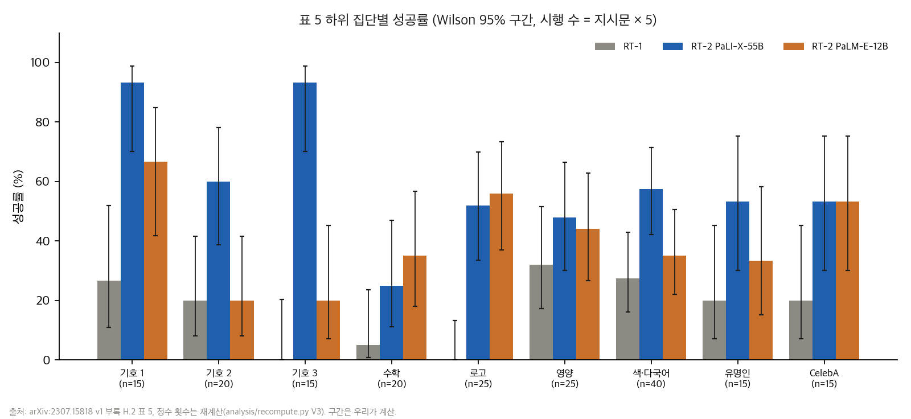
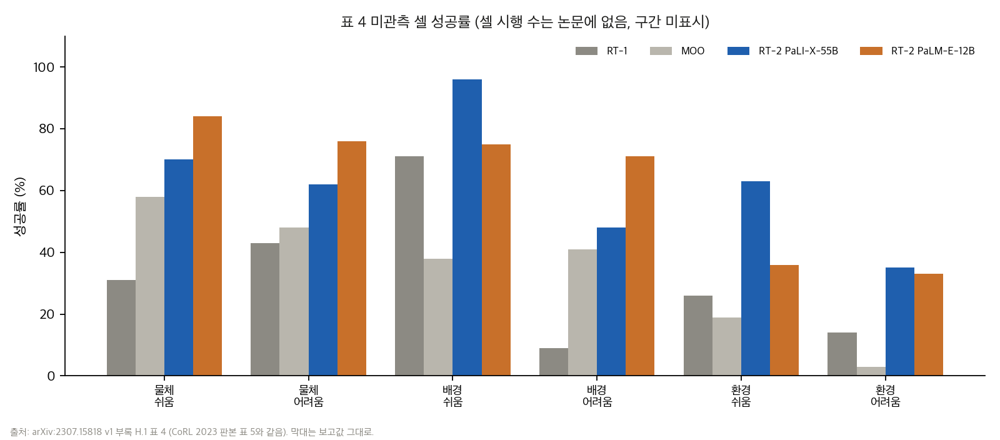
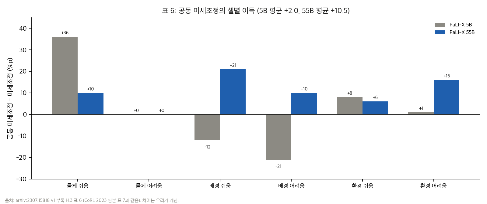

# 03. 수치 재계산과 일관성 검사

재현(학습, 추론 실행)은 하지 않았습니다. 논문 표의 정수 값만 가지고 평균, 구간, 검정을 다시 계산하고, 표 사이와 본문 사이를 맞춰 봤습니다. 계산 스크립트는 `analysis/recompute.py`(scipy, 1초 미만), 결과는 `analysis/recompute_results.json`, 그림은 `analysis/plot_figures.py`입니다. 기준 판본은 arXiv v1이고, CoRL 2023 판본의 표 5·6·7과 표 1도 같은 값임을 확인했습니다(01 §0).

반올림은 0.5를 올리는 방식(half-up)으로 통일했습니다. 논문 자체도 관례가 섞여 있어서(V1 참고) 1점 차이는 반올림으로 봅니다.

검사 번호는 V1–V9입니다(01–04의 C 번호는 `04_claim_verification.md`의 주장 번호입니다).

## 1. 표 4의 미관측 평균 (V1)

| 모델 | 여섯 셀 평균 | 보고 | 판정 |
|---|---|---|---|
| R3M | 11.67 | 12 | 일치 |
| VC-1 | 10.00 | 10 | 일치 |
| RT-1 | 32.33 | 32 | 일치 |
| MOO | 34.50 | 35 | 일치 (반올림 올림) |
| RT-2-PaLI-X-55B | 62.33 | 62 | 일치 |
| RT-2-PaLM-E-12B | 62.50 | 62 | 1점 차 (반올림 내림) |

MOO는 34.5를 35로, PaLM-E는 62.5를 62로 적었습니다. 같은 논문 안에서 .5 처리가 다릅니다. 영향은 없습니다.

## 2. 표 6의 평균과 표 4의 교차 검사 (V2)

| 모델 | 여섯 셀 평균 | 보고 | 판정 |
|---|---|---|---|
| PaLI-X 5B, 처음부터 | 9.33 | 9 | 일치 |
| PaLI-X 5B, 미세조정 | 41.67 | 42 | 일치 |
| PaLI-X 5B, 공동 미세조정 | 43.67 | 44 | 일치 |
| PaLI-X 55B, 미세조정 | 51.83 | 52 | 일치 |
| **PaLI-X 55B, 공동 미세조정** | **62.33** | **63** | **불일치** |

- 표 6(CoRL 판본 표 7)의 55B 공동 미세조정 행은 셀 값이 표 4의 RT-2-PaLI-X-55B 행과 같은데, 평균은 **63**입니다(표 4는 62). 셀 평균은 62.33이므로 표 6의 평균이 한 점 높습니다. 같은 모델을 두 번 보고하면서 다른 값을 적은 것입니다. 작은 차이지만, 표 간 정합성의 증거입니다.

## 3. 표 5의 정수 검사 (V3)

부록 F.2 표 3(CoRL 판본 표 4)의 지시문 수와 "각 지시문 5회"라는 설명으로 하위 집단 시행 수 n을 잡았습니다. 기호 1: 3개 → n = 15, 기호 2: 4개 → 20, 기호 3: 3개 → 15, 수학: 4개 → 20, 로고: 5개 → 25, 영양: 5개 → 25, 색·다국어: 8개 → 40, 유명인: 3개 → 15, CelebA: 3개 → 15. 합계 38개 지시문, 방법당 190회.

- 모든 방법의 모든 하위 집단 값은 이 n에서 정수 성공 횟수로 설명됩니다(V3). 예: RT-2-PaLI-X-55B 기호 1 93% = 14/15, 색·다국어 58% = 23/40(57.5 → 58).
- VC-1 색·다국어 13%는 5/40 = 12.5%로, half-up에서만 맞습니다. 이것도 반올림 관례 문제입니다.
- 결론: 표 5의 하위 집단 시행 수는 내부적으로 일관됩니다. 이 n이 표 4의 셀 n과 같은지는 알 수 없습니다(§6).

| 방법 | 하위 집단 성공 횟수 (기호 1, 2, 3 / 수학, 로고, 영양, 색 / 유명인, CelebA) |
|---|---|
| RT-1 | 4, 4, 0 / 1, 0, 8, 11 / 3, 3 |
| RT-2-PaLI-X-55B | 14, 12, 14 / 5, 13, 12, 23 / 8, 8 |
| RT-2-PaLM-E-12B | 10, 4, 3 / 7, 14, 11, 14 / 5, 8 |

## 4. 표 5 평균 열의 정의 (V4)

| 방법 | 보고 전체 | 범주 단순 평균 | 시행 가중 평균 | 성공 / 시행 |
|---|---|---|---|---|
| RT-2-PaLI-X-55B | 60 | 60.25 | **57.37** | 109 / 190 |
| RT-2-PaLM-E-12B | 40 | 40.39 | 40.00 | 76 / 190 |
| RT-1 | 17 | 17.31 | 17.89 | 34 / 190 |
| VC-1 | 11 | 11.47 | 11.58 | 22 / 190 |

- 보고된 "Average" 열은 **하위 집단 평균의 단순 평균**입니다(기호 82 = (93+60+93)/3). 집단 안의 하위 집단은 시행 수가 달라도 같은 가중치를 받습니다. 시행 가중으로 보면 PaLI-X 55B 전체는 57.4%입니다.
- 결론(방향)은 바뀌지 않습니다. 다만 "60%"라는 숫자는 정의에 따라 2.6점 차이가 납니다. 본문에 정의가 없습니다.

## 5. 창발 능력의 검정 (V5, V5b)

시행 190회를 독립으로 본 Fisher 정확검정과, 지시문 묶음(하위 집단 9개)을 짝으로 본 검정을 같이 봤습니다. 같은 지시문 집합을 모든 방법에 썼기 때문에 짝 검정이 맞는 구조이고, 시행 단위 검정은 지시문 안의 상관을 무시해서 과신할 수 있습니다.

| 비교 | 시행 기준 차이 (%p) | Newcombe 95% | Fisher p | 하위 집단 짝 (+/−/0) | 짝 t p | Wilcoxon p |
|---|---|---|---|---|---|---|
| PaLI-X 55B 대 RT-1 | +39.5 | [30.1, 47.8] | 1.5e-15 | 9/0/0 | 0.0008 | 0.0039 |
| PaLM-E 12B 대 RT-1 | +22.1 | [13.1, 30.7] | 2.9e-6 | 8/0/1 | 0.004 | 0.012 |
| PaLI-X 55B 대 PaLM-E 12B | +17.4 | [7.3, 26.9] | 0.001 | 6/2/1 | 0.058 | 0.069 |

- PaLI-X 55B와 PaLM-E 12B 모두 RT-1보다 높습니다. 하위 집단 9개가 모두 같은 방향인 것은 Wilcoxon 정확 검정의 최소 p(0.0039)와 같습니다. 이 결과는 강합니다.
- PaLI-X와 PaLM-E의 차이는 시행 단위로는 p=0.001이지만, 하위 집단 짝 검정으로는 p=0.058입니다. 그래서 "PaLI-X가 더 낫다"는 약한 결론입니다. 논문은 이 비교를 검정하지 않았습니다.
- **배수 주장:** 보고 평균 기준 60/17 = 3.5배, 시행 가중 기준 57.4/17.9 = 3.2배입니다. 본문의 "3배 넘게"는 맞습니다. 부록 H.2의 "2–3배 더 좋다"는 PaLI-X에 맞지 않고, PaLM-E(40/17 = 2.4배)에 맞습니다.
- 수학 항목에서 PaLM-E가 PaLI-X보다 높다는 설명은 7/20 대 5/20이고, Fisher p = 0.73입니다. 방향을 말할 수 없는 차이입니다.

그림 1은 하위 집단별 성공률과 Wilson 95% 구간입니다(시행 수가 확정된 표 5만 그림).

## 6. 표 4 셀 크기 (V6, V8)

표 4는 셀 시행 수를 보고하지 않습니다. 부록 F.2는 "지시문마다 1–5회"라고만 씁니다. 표 2(CoRL 판본 표 3)의 지시문 수를 세면 다음과 같습니다(내 계수, `recompute.py`의 K_CELL).

| 셀 | 지시문 수 k | 1회씩이면 n = k | 5회씩이면 n = 5k |
|---|---|---|---|
| 물체 쉬움 | 10 | 10 | 50 |
| 물체 어려움 | 21 | 21 | 105 |
| 배경 쉬움 | 12 | 12 | 60 |
| 배경 어려움 | 17 | 17 | 85 |
| 환경 쉬움 | 45 | 45 | 225 |
| 환경 어려움 | 33 | 33 | 165 |

- **V6 (공통 n 탐색):** 여섯 모델의 보고값을 모두 설명하는 공통 n을 찾았습니다. 물체 쉬움은 k에서 5k 사이에 **공통 n이 없습니다**. 모델마다 다른 시행 수를 썼거나, 지시문 집합이 표와 다르다는 뜻입니다. 나머지 셀은 후보가 여럿이라 정보가 적습니다(배경 쉬움 n ∈ {24, 48, 52, 55, 56}, 배경 어려움 n ∈ {58, 66, 69, 75, 79, 80}).
- **V8 (셀별 검정):** RT-2-PaLI-X-55B 대 RT-1을 셀마다 Fisher로 비교했습니다.

| 셀 | 보고 (55B 대 RT-1) | p, n = k | p, n = 5k |
|---|---|---|---|
| 물체 쉬움 | 70 대 31 | 0.18 | 0.00027 |
| 물체 어려움 | 62 대 43 | 0.35 | 0.0085 |
| 배경 쉬움 | 96 대 71 | 0.22 | 0.00025 |
| 배경 어려움 | 48 대 9 | 0.057 | 2e-8 |
| 환경 쉬움 | 63 대 26 | 0.0013 | 3.5e-15 |
| 환경 어려움 | 35 대 14 | 0.09 | 1e-5 |

- 셀 하나의 차이는 시행이 1회씩일 때 대부분 유의하지 않습니다. 5회씩이면 모두 유의합니다. 셀 크기가 해석을 바꿉니다.
- 여섯 셀 평균(미관측 평균 62 대 32)의 방향은 어떤 n에서도 같습니다. 셀 단위 주장("모든 셀에서 우월")은 시행 수 없이 말할 수 없습니다.
- **지시문 수와 "over 280 tasks"의 차이:** 표 2를 세면 미관측 지시문은 138개입니다(1회씩 138, 5회씩 690). 본문의 "over 280 tasks"는 평균 약 2회 실행과 맞을 수 있지만, 근거가 없습니다. 질문 항목입니다(`04_claim_verification.md`의 C9).

그림 2는 표 4의 여섯 셀 값입니다(셀 크기가 없어서 구간은 그리지 않음).

## 7. 공동 미세조정의 효과 (V9)

| 크기 | 셀별 차이 (공동 - 미세조정, %p) | 평균 | 부호 (+/0/−) |
|---|---|---|---|
| 5B | +36, 0, −12, −21, +8, +1 | +2.0 | 3 / 1 / 2 |
| 55B | +10, 0, +21, +10, +6, +16 | +10.5 | 5 / 1 / 0 |

- 55B에서는 공동 미세조정이 일관되게 낫습니다. 5B에서는 방향이 섞여 있고 평균 차이는 2점입니다. 논문의 "크기와 관계없이 더 낫다"(§4.3)는 5B에서 약합니다.
- 셀 크기가 모르는 상태이므로 이 검사는 방향만 말합니다.

그림 3은 셀별 차이입니다.

## 8. Language-Table (V7)

| 비교 | 가정 | 차이 (점) | z | p |
|---|---|---|---|---|
| 대 BC-Zero (72 ± 3) | ±를 표준오차 | +18 | 1.72 | 0.085 |
| 대 RT-1 (74 ± 13) | ±를 표준오차 | +16 | 0.98 | 0.33 |
| 대 LAVA (77 ± 4) | ±를 표준오차 | +13 | 1.21 | 0.23 |
| 대 BC-Zero | ±를 표준편차, n = 3 가정 | +18 | 2.99 | 0.003 |
| 대 RT-1 | ±를 표준편차, n = 3 가정 | +16 | 1.69 | 0.09 |
| 대 LAVA | ±를 표준편차, n = 3 가정 | +13 | 2.09 | 0.037 |

- 본문은 "significant performance boost"라고 씁니다(§4.1). 검정은 없습니다. ±의 뜻과 시행 수가 없어서 p값은 가정에 따라 0.003에서 0.33까지 움직입니다. 판단할 수 없습니다.
- n = 3은 임의로 고른 값이고, 정규근사를 썼습니다(n이 작아서 근사가 거칩니다).

## 9. 나머지 점검

| 항목 | 본문 주장 | 재계산 | 판정 |
|---|---|---|---|
| 학습 과제 수 | "over 200 tasks" (§4.1) | 부록 F.1 개수 36 + 35 + 35 + 48 + 18 + 36 = 208 | 일치 |
| 미관측 과제 수 | "over 280 tasks" (§4.1) | 표 2 계수 138 | 불일치 가능 (§6) |
| 전체 시행 수 | "6k evaluation trials" (§1) | 창발 평가만 190 × 4 = 760. 나머지 셀 크기 미보고 | 확인 불가 |
| 미관측 대 RT-1·MOO | "~2배" (§4.1) | 62 / 32.3 = 1.9, 62 / 34.5 = 1.8 | 일치 |
| 미관측 대 나머지 | "~6배" (§4.1) | 62 / 10 = 6.2 (VC-1), 62 / 11.7 = 5.3 (R3M) | 대략 일치 |
| 창발 대 RT-1 | "3배 넘음" (§4.2) | 3.5배 (보고), 3.2배 (시행 가중) | 일치 |
| 창발 대 RT-1 | "2–3배" (부록 H.2) | PaLI-X 3.2–3.5배, PaLM-E 2.4배 | PaLI-X는 범위 밖 |
| 55B 공동 미세조정 평균 | 62 (표 4), 63 (표 6) | 셀 평균 62.33 | 표 6이 한 점 높음 (§2) |
| 추론 주파수 | 55B 1–3 Hz, 5B ~5 Hz (§3.3) | 측정 자료 없음 | 확인 불가 |
| 사고 연쇄 효과 | 정성 (§4.4) | 정량 평가 없음 | 확인 불가 |

## 10. 한계

- 모든 입력은 반올림된 정수입니다. 셀 값마다 ±0.5점의 불확실성이 있습니다.
- 시행 단위의 원자료(성공, 실패, 지시문별 결과, 판정 기준)가 없습니다. 지시문 묶음 수준의 분산은 추정할 수 없습니다.
- 재계산은 본문 표에 적힌 값에 대한 것입니다. 본문 이외의 그림(그림 4, 그림 6)은 읽지 않았습니다.
