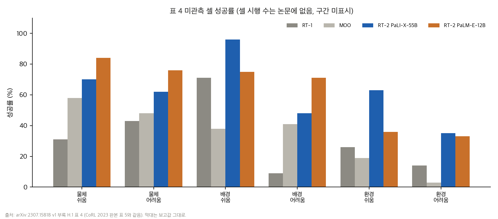
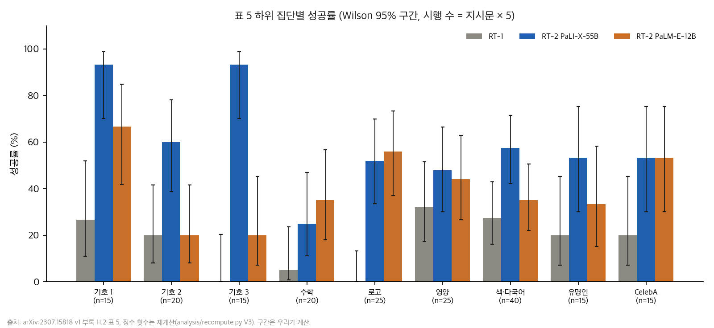
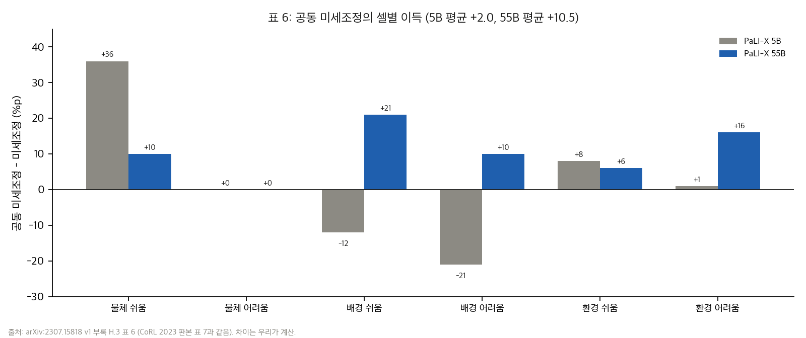

> **논문:** Brohan 외. *RT-2: Vision-Language-Action Models Transfer Web Knowledge to Robotic Control.* CoRL 2023 (PMLR 229:2165–2183), arXiv:2307.15818 (v1, 2023-07-28).
> 공식 코드와 가중치는 공개되지 않았습니다. 이 글은 논문의 보고 수치를 다시 계산하고 주장과 대조한 것입니다. 논문 그림은 싣지 않고, 우리가 보고 수치로 그린 그래프만 씁니다.

## 한 줄 요약

행동을 VLM의 출력 어휘에 있는 토큰으로 쓰면, 웹에서 배운 지식이 로봇 정책으로 옮겨 갑니다. 다만 논문의 표에서 확인되는 것은 방향이고, 정도는 셀 시행 수를 알아야 말할 수 있습니다.

## 방법: 행동을 문장으로

RT-2는 로봇 행동을 여덟 개 정수로 씁니다. 종료 명령, 위치 세 축, 회전 세 축, 그리퍼 열림입니다. 연속 값은 256 구간으로 나눠 구간 번호를 씁니다. "1 128 91 241 5 101 127" 같은 문자열이 한 번의 행동입니다. 입력은 "Q: 이 로봇은 무엇을 해야 하나? A:" 같은 시각 질의응답 형식입니다.

PaLI-X는 정수 토큰이 있어서 번호를 그대로 씁니다. PaLM-E는 정수 토큰이 없어서 가장 적게 쓰는 토큰 256개를 덮어씁니다. 같은 방식을 OpenVLA도 씁니다. 학습은 웹 시각 질의응답 데이터와 로봇 데이터를 한 배치에 섞는 **공동 미세조정**입니다. 로봇 데이터는 배치의 절반 정도를 차지합니다(PaLI-X 50%, PaLM-E 66%).

## 결과 1: 로봇 데이터에 없던 물체와 배경

표 4의 미관측 평균은 PaLI-X 55B와 PaLM-E 12B 모두 62이고, RT-1은 32, MOO는 35입니다. 그래서 "약 2배"라는 본문 주장은 맞습니다(1.8–1.9배).

*그림 1. 표 4의 미관측 여섯 셀 성공률. 막대 값은 논문 보고값입니다. 셀 시행 수가 없어서 구간은 그리지 않았습니다.*

다만 셀의 시행 수가 없습니다. 지시문을 1회씩 돌렸다면 셀 하나의 차이는 대부분 유의하지 않고, 5회씩 돌렸다면 모두 유의합니다. 여섯 셀 평균의 방향은 어떤 가정에서도 같습니다.

## 결과 2: 창발 능력

창발 평가는 기호 이해, 추론, 사람 인식으로 나뉩니다. 지시문 38개를 각 5회씩, 방법마다 190회 돌렸습니다. 보고된 평균은 PaLI-X 55B가 60%, RT-1이 17%입니다.

이 평균은 하위 집단의 단순 평균입니다. 시행 수로 가중하면 PaLI-X 55B는 57.4%(109/190), RT-1은 17.9%(34/190)입니다. 두 정의 모두 "3배 넘게"라는 결론을 지지합니다.

*그림 2. 표 5의 하위 집단별 성공률과 Wilson 95% 구간. 시행 수는 지시문 수 × 5입니다. 구간은 우리가 계산했습니다.*

시행 기준 Fisher 검정으로 차이는 39.5%p [30.1, 47.8], p = 1.5e-15입니다. 지시문 묶음 기준으로도 하위 집단 아홉 개가 모두 같은 방향이고, Wilcoxon 정확 검정의 최소 p(0.0039)입니다. 이 차이는 강합니다.

## 결과 3: 공동 미세조정과 크기

공동 미세조정이 미세조정보다 낫다는 주장은 55B에서만 확실합니다. 55B는 여섯 셀 중 다섯 셀에서 낫고 평균 차이는 10.5점입니다. 5B는 평균 2.0점이고 방향이 섞여 있습니다.

*그림 3. 표 6의 셀별 차이(공동 미세조정 - 미세조정). 5B와 55B 모두 우리가 계산했습니다.*

## 불일치와 빠진 정보

- **표 간 불일치:** 표 6의 55B 공동 미세조정 평균은 63입니다. 같은 셀 값으로 표 4의 같은 모델은 62입니다. 셀 평균은 62.3입니다.
- **"over 280 tasks":** 부록 표의 미관측 지시문을 세면 138개입니다. 숫자가 맞지 않습니다.
- **Language-Table의 "significant":** 표 1의 ±가 무엇인지 적혀 있지 않고, 검정도 없습니다. 표준오차로 보면 LAVA 대비 p = 0.23입니다.
- **창발 평균의 정의:** 본문에 없습니다. 단순 평균입니다.

## 이 맥에서 구현할 수 있는가

RT-2 자체는 재현할 수 없습니다. 가중치가 없고, 55B 모델은 TPU 클라우드를 전제로 합니다.

방법은 소형 공개 VLM으로 구현할 수 있습니다. 행동 토큰화와 출력 제약은 CPU에서 확인할 수 있습니다. 소형 모델의 추론 지연은 맥에서 잴 수 있습니다. 공동 미세조정 학습에는 GPU가 필요합니다. 노력은 CPU 쪽 2–3일, 맥 지연 측정 1주, GPU 한 설정 수일에서 2주로 추정합니다(측정하지 않은 추정입니다).

## 참고

- 논문: https://arxiv.org/abs/2307.15818 (CoRL 2023 판본은 수치가 같고 표 번호만 다릅니다)
- 프로젝트 페이지: https://robotics-transformer2.github.io/
- 권리: arXiv 라이선스는 nonexclusive-distrib 1.0이고, 원문에 저작권 고지가 있습니다. 그래서 논문 그림은 싣지 않았습니다.

## 자료

- [통합 리포트 PDF](report/report_public.pdf)
- [01. 논문 분석: RT-2 (arXiv:2307.15818)](analysis/01_paper_analysis.md)
- [02. 선행연구와 관련 자료](analysis/02_prior_work.md)
- [03. 수치 재계산과 일관성 검사](analysis/03_analysis.md)
- [04. 주장 대조 (공식 코드 없음)](analysis/04_claim_verification.md)
