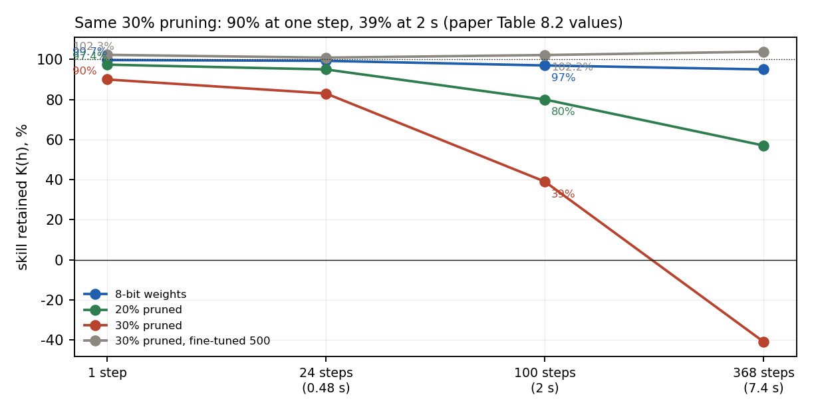
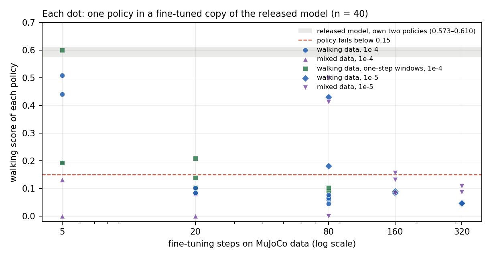
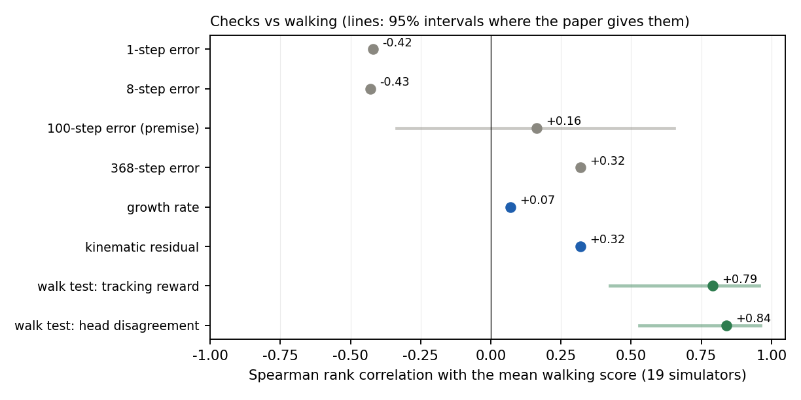

> **논문:** Joyjeet Singh. *Auditing a Learned Simulator for Legged Robots: The Robotic World Model on ANYmal D.* arXiv:2611.23118 (v1, 2026-11-17). 학회 표기 없음. 공식 코드는 GitHub `joyjeet-singh/rwm`(Apache-2.0)과 `joyjeet-singh/rwm-robot-level`에 있습니다. 이 글의 그래프는 저자가 쓴 결과 파일을 바탕으로 우리가 다시 그렸습니다.

## 논문이 묻는 것

다리 로봇 정책을 학습된 시뮬레이터 안에서 훈련하려면, 시뮬레이터가 자기 예측을 여러 스텝 되먹임해도 믿을 만해야 합니다. 그런데 이런 모델은 보통 한 스텝 앞의 정확도로 검사합니다. 이 논문은 한 공개 시스템(RWM의 ANYmal D 동역학 모델과 후속 RWM-U의 불확실성)을 끝까지 감사해, 한 스텝 검사가 설계 선택을 얼마나 잘못 판단하는지 보입니다.

## 이 글에서 확인한 것

**1. 롤아웃 학습은 긴 호라이즌에서 이기고, 1스텝에서는 집니다.** 데이터 10개 에피소드를 다섯 분할로 나눠 각 에피소드를 한 번씩 보류했습니다. 368스텝에서 교사 강제 대 롤아웃 학습의 상대 오차 차이는 +2.2 [+1.4, +3.5]이고, 10개 에피소드 모두 같은 방향입니다(부호 검정 p = 0.002, 재계산 일치). 1스텝에서는 반대입니다.

**2. 한 스텝 검사는 압축을 잘못 판단합니다.** 가중치 30%를 잘라내면 1스텝에서는 90%의 기능이 남지만, 2초(100스텝)에서는 39%만 남습니다. 짧은 미세조정으로 회복됩니다.

*그래프 (우리가 그림). 논문 표 8.2의 값을 옮겼습니다. 같은 가지치기가 1스텝과 2초에서 다르게 보입니다.*

**3. 앙상블 불확실성은 순위는 맞고 크기는 실제 오차보다 작습니다.** 다섯 헤드의 불일치는 100스텝 오차와 Spearman +0.90으로 맞지만, 1시그마 구간이 실제 오차의 4.6%만 덮습니다(보정 68%). 논문은 헤드별 분산이 학습 손실 때문에 0 쪽으로 무너진다고 설명합니다(§6.2).

**4. 정확도가 걷기를 예측하지 못합니다.** 미세조정한 복사본 18개는 1스텝과 8스텝 오차가 모두 나아졌지만, 그중 13개가 실패 정책을 냈습니다. 적응 사다리의 정책 40개 중 27개가 실패했습니다.

*그래프 (우리가 그림). 저장소의 결과 파일 `d_ladder.json`에서 그렸습니다. 원래 학습률에서는 20스텝 미세조정부터, 1/10 학습률에서는 160스텝부터 정책이 걷지 못합니다.*

**5. 배포 전 검사로는 최악의 순위를 피하기 어렵습니다.** 1스텝 오차와 8스텝 오차는 걷기 순위와 음의 상관을 보였습니다(-0.42, -0.43). 같은 모델을 상상 속에서 정책으로 돌려 보는 "걷기 시험"이 가장 잘 맞았습니다(+0.79, +0.84). 다만 한 계열의 복사본에서 나온 결과입니다.

*그래프 (우리가 그림). 논문 §9.5 표의 값과 본문 구간을 옮겼습니다. 구간이 없는 항목은 점만 찍었습니다.*

## 검증 방식

이 분석은 재현하지 않았습니다. 논문 수치를 다시 계산하고(검정, 개수, 비율), 저자가 공개한 결과 파일 네 개와 대조했습니다. 39개 검사 중 35개가 맞았습니다. 나머지 네 개는 논문 안의 불일치입니다. 6백만 전이 시뮬레이터의 낙상률이 본문(26.6%)과 표(0.39)에서 다르고, 8비트 앙상블의 속도 주장에 해당하는 측정이 표에 없으며, 68% 포함 배수 값이 표와 다른 지표이고, 초록의 압축 복사본 수(200)가 본문 합(240)과 다릅니다. 공개 코드는 정적으로만 읽었습니다. 논문이 말하지 않은 보상 항 버그(관절 가속도 항이 위치를 씀)를 찾았지만, 그것이 논문의 물리 반환 지표에 영향을 주었는지는 아직 모릅니다.

## 구현 가능성

이 맥(GPU 없음)에서 체크포인트 추론과 MuJoCo 정책 학습은 가능하지만 설치가 필요합니다. 원 Isaac Lab 데이터 생성과 하드웨어 실험은 불가능합니다. 정리하면 "조건부 구현"입니다.

## 남은 질문

- 걷기 시험이 독립 기원의 시뮬레이터에서도 걷기를 예측하는가? 논문 스스로 향후 과제로 꼽은 질문입니다.
- 보상 항의 인덱스 버그는 논문의 결과 중 어떤 수치에 들어갔는가?

## 자료

- [통합 리포트 PDF](report/report_public.pdf)
- [01. 논문 분석: Auditing a Learned Simulator for Legged Robots (arXiv:2611.23118)](analysis/01_paper_analysis.md)
- [02. 선행연구, 코드 저장소, 관련 분석](analysis/02_prior_work.md)
- [03. 재계산, 일관성 검사, 권리 확인](analysis/03_analysis.md)
- [04. 공개 코드 대조 (논문 ↔ 코드, 차이 D1–D14)](analysis/04_code_verification.md)
