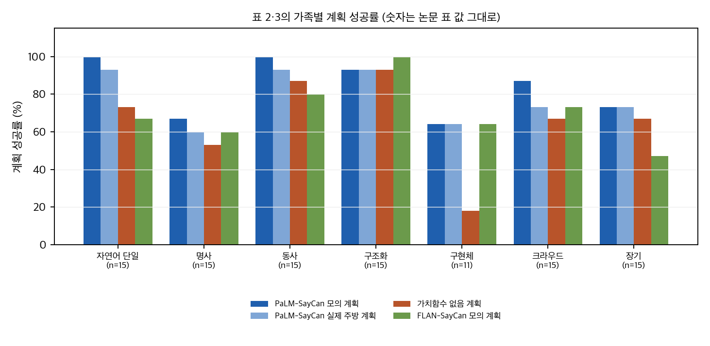
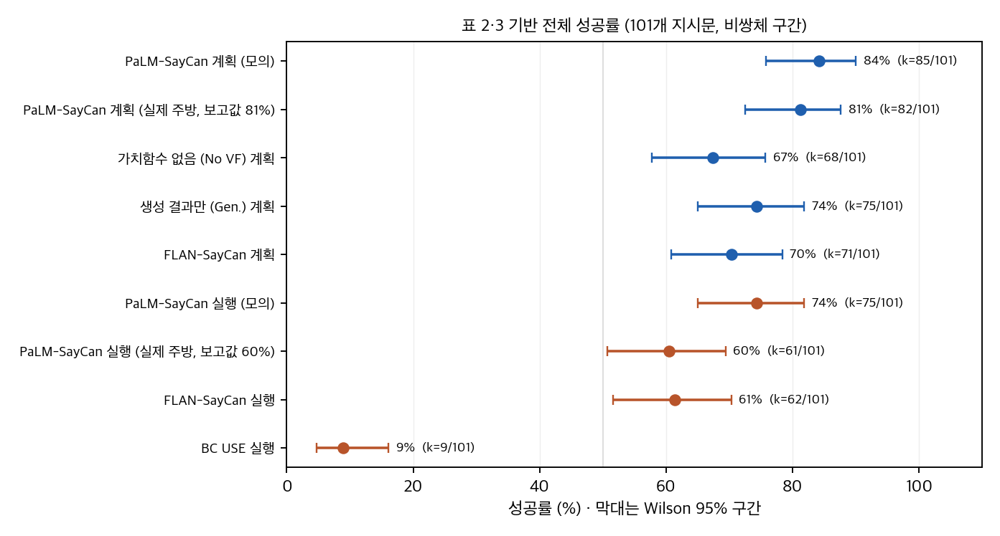

> **논문:** Michael Ahn 외 (Google Research, Everyday Robots). *Do As I Can, Not As I Say: Grounding Language in Robotic Affordances.* CoRL 2022 (PMLR 205), arXiv:2204.01691 (v2, 2022-08-16).
> 공식 노트북(google-research/saycan)은 정적으로만 읽었고 실행하지 않았습니다. 논문 그림은 싣지 않습니다(arXiv non-exclusive 라이선스). 아래 그래프 두 장은 표 값으로 우리가 그렸습니다.

## 질문

언어 모델은 "커피를 쏟았으면 진공청소기를 쓰라"처럼 그럴듯한 답을 냅니다. 로봇이 그 답을 따를 수 없다면 쓸모가 없습니다. SayCan은 이 간격을 두 확률의 곱으로 메웁니다. 하나는 언어 모델이 "이 기술이 지시에 쓸모 있다"고 보는 확률이고, 다른 하나는 가치함수가 "이 기술을 지금 실행하면 성공한다"고 보는 확률입니다. 두 값을 곱해 가장 높은 기술을 고르고, 다음 스텝에서 다시 계획합니다.

## 무엇을 확인했나

**헤드라인은 판본에 따라 바뀌었습니다.** 2022년 4월 v1은 FLAN 137B를 썼고, 모의 주방에서 계획 70%, 실행 61%를 보고했습니다. 8월 v2는 PaLM 540B로 바꾸고 계획 84%, 실행 74%를 보고합니다. v2의 FLAN 행은 v1 숫자와 열 단위로 같습니다. 인용할 때는 어느 LLM인지 같이 적어야 합니다.

**실제 주방의 총계가 행과 맞지 않습니다.** 실제 주방 열의 가족별 값을 더하면 계획 80/101(79%), 실행 59/101(58%)입니다. 보고 총계는 81%와 60%입니다. 본문의 하락 폭(−3%p, −14%p)은 보고 총계에서 나왔습니다. 행 기준으로 보면 하락 폭이 조금 더 큽니다.

**"거의 두 배"는 계획에서 맞지 않습니다.** 가치함수를 뺀 기준선은 계획 67%, 언어 모델 출력만 쓴 기준선은 74%입니다. 상대 배율은 1.25와 1.13입니다. 두 배에 가까운 차이는 실행 성공률을 BC USE(9%)와 비교할 때만 나옵니다. 가치함수 효과는 가치함수 없음 대비에서만 p = 0.008로 유의하고, 생성 결과 대비에서는 p = 0.12입니다.

*그림 1. 표 2·3의 가족별 계획 성공률입니다. 숫자는 논문 표 그대로이고, 그림은 우리가 그렸습니다. 출처: 논문 Table 2, Table 3 (arXiv:2204.01691 v2).*

*그림 2. 전체 성공률의 Wilson 95% 구간입니다. 지시문별 결과가 없어 쌍체 검정은 하지 못했고, 모든 비교는 비쌍체 Fisher 검정입니다. 출처: 논문 Table 2, Table 3, Table 6.*

**공식 코드는 논문의 시스템이 아닙니다.** 공개된 노트북은 탁상 UR5e 시뮬레이션에서 GPT-3(text-davinci-002)를 씁니다. 가치함수 대신 객체 탐지 결과의 0/1 게이트를 씁니다. 가용성은 초기 장면에서 한 번만 계산해서, 완료한 동작을 가리지 않습니다. 탐지된 객체가 하나도 없으면 계획이 `done()`으로 바로 끝납니다. 이것은 코드를 읽고 추론한 것이고 실행해서 확인하지는 않았습니다.

## 재현할 수 있나

- 논문 표 2의 재현: **불가능합니다.** PaLM 540B 가중치와 API가 없고, 실로봇과 지시문별 결과도 공개되지 않았습니다.
- 공식 노트북: **이 맥에서는 불가능합니다.** CUDA를 전제로 하고, OpenAI 유료 API 키와 Google Drive·GCS 자산이 필요합니다.
- 선택 규칙을 numpy로 옮긴 작은 실험: 가능합니다. 노력은 1–2일로 추정합니다(측정하지 않았습니다).

## 남는 질문

- 실제 주방 열 총계(81%, 60%)는 어디서 나왔는지.
- 가치함수 보정 상수(v_min, v_max)가 실험마다 같은지.
- 완료한 기술을 어떻게 가리는지. 노트북은 가리지 않습니다.
- 지시문별 결과와 PaLM 실험 코드가 공개될지.

자세한 대조와 판정은 `analysis/03_analysis.md`와 `analysis/04_code_verification.md`에 있습니다.

## 자료

- [통합 리포트 PDF](report/report_public.pdf)
- [01. 논문 분석: Do As I Can, Not As I Say (SayCan)](analysis/01_paper_analysis.md)
- [02. 선행연구와 관련 자료](analysis/02_prior_work.md)
- [03. 수치 재계산과 일관성 검사](analysis/03_analysis.md)
- [04. 공식 코드 대조 (정적 읽기)](analysis/04_code_verification.md)
