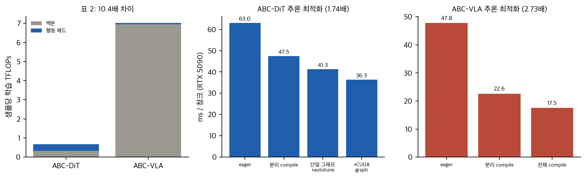
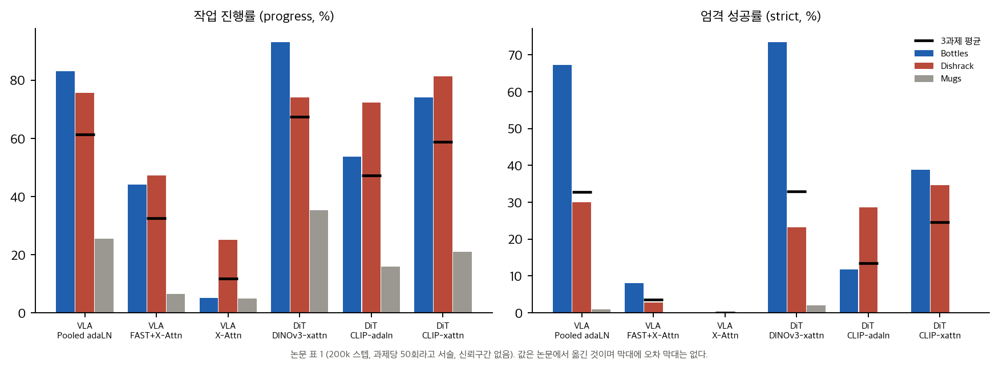
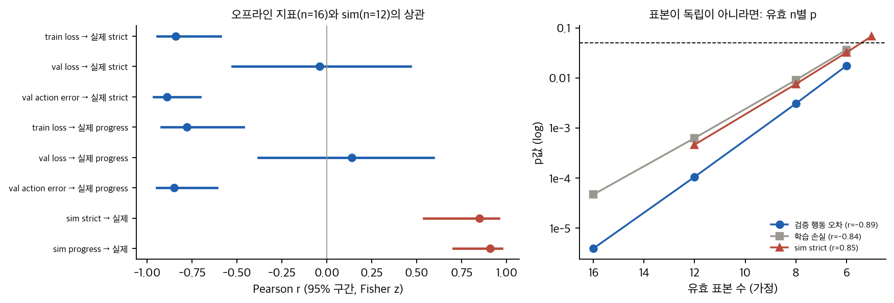
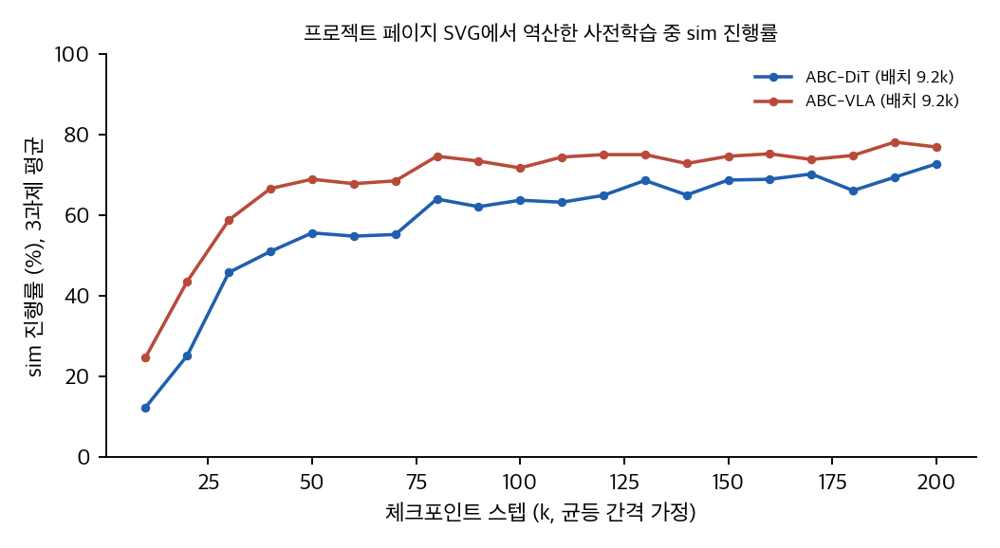

> **논문:** Arthur Allshire, Himanshu Gaurav Singh, Ritvik Singh 외. *Scalable Behavior Cloning with Open Data, Training, and Evaluation.* CoRL 2026 포스터, arXiv:2606.27375 (v1, 2026-06-25).
> 공식 코드는 GitHub amazon-far/abc(Apache-2.0), 프로젝트 페이지는 abc.bot입니다. 이 글의 그림은 모두 우리가 그린 그래프입니다.

## 논문이 한 일

행동 복제(BC) 스택 전체를 열었습니다. 저비용 양팔 로봇(I2RT YAM 두 대) 위에서 모은 **134,806 에피소드, 195 과제, 3,553시간**의 원격조종 데이터(ABC-130K), 2B DiT 정책(ABC-DiT)과 4.3B VLA 정책(ABC-VLA), MuJoCo로 다시 만든 시뮬레이터(400시간 시뮬 데이터), 100시간 이상의 실제 평가 롤아웃, 그리고 하드웨어와 학습·배포 코드입니다. 새 알고리즘보다 "산업 연구실 수준의 BC 실험을 누구나 반복할 수 있게 한다"는 인프라 기여가 중심입니다.

계산량을 먼저 보면 규모가 감이 옵니다. 표 2에서 샘플당 학습 FLOPs는 DiT 0.678 TFLOPs, VLA 7.020 TFLOPs로 VLA가 10.4배입니다. 200k 스텝, 배치 9,216이면 ABC-130K의 프레임을 약 4.8번 보는 셈입니다. 파라미터와 FLOPs는 공식 코드 구조에서 다시 센 값과 맞았습니다(DiT 헤드 1.924B 대 보고 1.93B).

*그래프 (우리가 그림). 표 2와 부록 D의 값을 다시 그렸습니다. 추론은 컴파일과 CUDA graph로 DiT 63.0 → 36.3 ms, VLA 47.8 → 17.5 ms입니다.*

## 이 글에서 확인한 것

**1. 표 1의 비율은 "과제당 50회"로는 만들어지지 않습니다.** 논문은 모든 과제를 50회 평가했다고 쓰지만, strict 성공률 18칸 중 9칸이 50회로는 불가능한 값입니다(67.3%는 33/49, 73.5%는 36/49, 38.9%는 14/36 등). progress도 Bottles와 Dishrack 12칸 중 6칸이 점수 합 정수 조건을 못 맞춥니다. 칸마다 시도 수가 다르거나 여러 실행을 평균한 값으로 보이며, 어느 쪽인지 표만으로는 알 수 없습니다. 컵 뒤집기(Mugs)의 채점 기준도 부록 표 3에 없습니다.

**2. 표 1은 큰 차이만 가릅니다.** 과제당 50회에서 80% 검정력으로 구분되는 최소 차이는 약 28%p입니다. DINOv3가 CLIP보다 낫다는 결론은 평균(progress 67.5 대 58.8)으로는 맞지만 Bottles 한 과제가 끌고 갑니다. **Dishrack에서는 CLIP이 strict(34.7 대 23.2)와 progress(81.3 대 74.1) 모두 높습니다.** VLA에서 풀링 adaLN이 교차 어텐션(strict 0.0%)과 FAST 병행(3.6%)보다 낫다는 결론은 차이가 커서 지지됩니다.

*그래프 (우리가 그림). 논문 표 1의 값입니다. 논문에는 오차 막대와 검정이 없습니다.*

**3. 상관 수치는 재현되지만 점이 독립이 아닙니다.** 그림 8(오프라인 지표 대 실제 성능, 체크포인트 16개)의 p값과 그림 9(시뮬 대 실제, 12개)의 r = 0.85, 0.91은 모두 재계산으로 맞습니다. 다만 점들은 같은 학습 실행의 여러 스텝과 3개 묶음(DiT, VLA, 사내 데이터 혼합)입니다. 유효 표본을 8, 6, 5로 줄여 보면 시뮬 strict 상관의 p가 0.0075, 0.032, 0.068이 됩니다. r = 0.85의 95% 구간은 [0.54, 0.96]입니다. 상관의 방향(학습 손실과 확산 스텝을 고정한 검증 행동 오차는 유효, 검증 손실은 무상관)은 이 가정에서도 유지됩니다.

*그래프 (우리가 그림). 왼쪽은 그림 8과 9의 r과 Fisher z 95% 구간, 오른쪽은 유효 표본을 줄였을 때의 p입니다.*

**4. 시뮬 프록시는 엔진과 버전에 민감합니다.** 공식 README는 같은 정책과 장면에서 MJWarp 배치 평가가 0.71–0.77, CPU MuJoCo가 0.54라고 적습니다. MuJoCo 3.6에서 3.8로 가면 dishrack이 15/20에서 12/20이 됩니다(Fisher p = 0.50, 20 월드로는 시드 변동과 구분되지 않음). 20 월드에서 구분되는 최소 차이는 43%p이고, 엔진 차이를 가르려면 조건당 약 126 월드가 필요합니다. 시뮬 과제 수도 논문 본문은 10개, 그림 2와 프로젝트 페이지는 20개, 코드는 33개 명세로 서술이 갈립니다. 프로젝트 페이지 곡선(원자료로 보이나 확인하지 못함)에서는 사전학습 중 sim 진행률이 200k 스텝에서 DiT 72.7%, VLA 76.9%였습니다.

*그래프 (우리가 그림). 프로젝트 페이지 SVG의 점에서 y 좌표를 환산했습니다. 논문 그림 12와 같은 자료인지는 확인하지 못했습니다.*

**5. 부록 H(조건당 10회)에서 지지되는 것은 둘뿐입니다.** 조종자 ID 조건화 체크포인트의 Op-0 조건이 Op-0만 필터한 체크포인트보다 낫다(완료 8/10 대 2/10, Fisher p = 0.023)와 하위 과제 프롬프트가 재펴기 실패를 줄인다(0/10 대 5/10, p = 0.033)입니다. 조종자 ID 조건화가 "strictly beneficial"이라는 서술은 주변화 6/10 대 4/10(p = 0.66)이어서 이 표본으로는 확인되지 않습니다. DAgger의 80:10:10 혼합은 개입 구간을 첫 라운드 기준 약 1.7배, 둘째 라운드 3.3배 과대표집합니다.

## 공식 코드와 논문의 차이

공식 저장소(커밋 d0832d1, 2026-09-25)를 정적으로만 읽었습니다. DiT와 VLA의 구조, 손실(속도 예측 flow matching, 균등 시간), prefix 길이 0–7, 학습률 1e-4와 1k 스텝 워밍업은 논문과 맞습니다. 다음은 맞지 않거나 논문에 없습니다.

- **비전 인코더 학습률 배율:** 논문은 0.1, 코드 기본값은 1.0입니다.
- **표 1의 비교 변형:** 6종 중 CLIP-adaLN, 교차 어텐션 VLA, FAST 병행 VLA는 코드에 없습니다.
- **다중 draw 수:** 논문은 VLA에서 8, 코드 기본값은 1이고 README 예시는 4입니다.
- **이미지 증강:** 논문에 없는 회전, 크롭, 밝기·대비·채도 변환이 코드에 있습니다.
- **공개 사전학습 DiT:** 3.5K시간 실제 데이터에 98시간 시뮬을 섞어 학습했다고 README가 밝히지만 논문 5.1절은 ABC-130K만 말합니다. 195 과제 전체의 사전학습 혼합 프리셋도 없습니다.
- **시뮬 평가:** 논문은 과제당 50회, 코드 기본값은 5 월드입니다. 시뮬 strict는 "모든 물체를 한 시점에 올바르게", progress는 시간에 따른 최대 진행입니다.

## 토이로 본 다중 draw

ABC-VLA는 4B VLM 한 번의 순역전파에 독립 (잡음, 시간) 샘플 k개를 공유합니다. 작은 CPU 토이(큰 인코더와 작은 확산 헤드, 시드 5개)에서 백본 기울기 분산은 이렇게 움직였습니다.

| k | 총 분산 (k=1 대비) | 잡음 항만 (k=1 대비) |
|---|---|---|
| 1 | 1.000 | 1.000 |
| 2 | 0.696 ± 0.014 | 0.486 ± 0.051 |
| 4 | 0.554 ± 0.009 | 0.243 ± 0.017 |
| 8 | 0.482 ± 0.007 | 0.124 ± 0.011 |
| 16 | 0.435 ± 0.015 | 0.060 ± 0.005 |

잡음 항은 정확히 1/k로 줄지만 총 분산은 데이터 샘플 분산 바닥에서 포화합니다(k=1에서 잡음 항 약 60%). "분산을 줄인다"는 맞고, 이득은 k를 키울수록 줄어듭니다. 토이이므로 절대 비율이 아니라 추세만 봅니다.

## 구현 가능성

논문의 사전학습(DiT 200k 스텝, 배치 9,216, H200 약 2,000 GPU 시간 추정)과 실로봇 결과는 개인 장비로 재현할 수 없습니다. 2B DiT의 미세조정도 FP32 파라미터, 기울기, Adam으로 약 32 GB라 24 GiB 메모리에 들어가지 않습니다. 공개 DiT 체크포인트(8.1 GB)의 시뮬 평가는 새 환경과 다운로드가 필요한 조건부 작업이고, 구조 재구현과 분산 감소 토이는 CPU에서 가능합니다.

## 한계와 읽는 법

- 모든 계산은 논문 표와 그림 제목에 적힌 값으로 했습니다. 그림에만 값이 있는 곳(스케일링, 사전학습 효과, DAgger 전후)은 다시 계산하지 못했습니다.
- 코드는 정적으로만 읽었고 실행, 설치, 가중치 다운로드는 하지 않았습니다. 공개 가중치가 논문과 같은 설정의 결과인지는 보장되지 않습니다.
- 표 1의 모델 선택은 사내 7,000시간 데이터로 학습한 결과이며 신뢰구간이 없습니다. 소비자 입장에서는 ABC-130K와 공개 체크포인트를 "미세조정 출발점"으로 쓰고, 아키텍처 선택은 자기 데이터로 다시 확인하는 것이 안전합니다.

## 자료

- [통합 리포트 PDF](report/report_public.pdf)
- [01. 논문 분석: Scalable Behavior Cloning with Open Data, Training, and Evaluation (ABC, arXiv:2606.27375)](analysis/01_paper_analysis.md)
- [02. 선행연구와 관련 저장소 (ABC, arXiv:2606.27375)](analysis/02_prior_work.md)
- [03. 수치 재계산과 검정 (ABC, arXiv:2606.27375)](analysis/03_analysis.md)
- [04. 공식 코드 대조와 구현 가능성 (ABC, arXiv:2606.27375)](analysis/04_code_verification.md)
