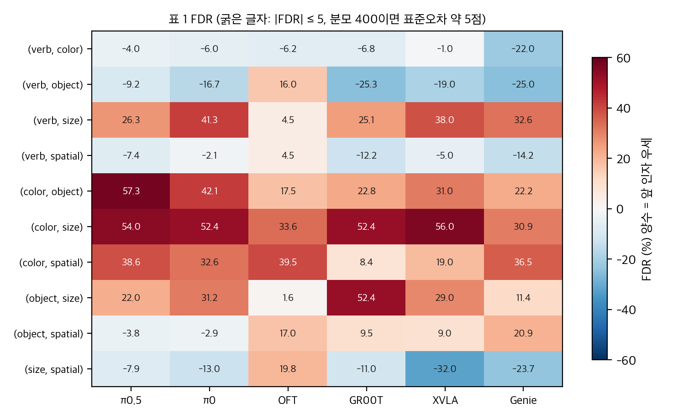
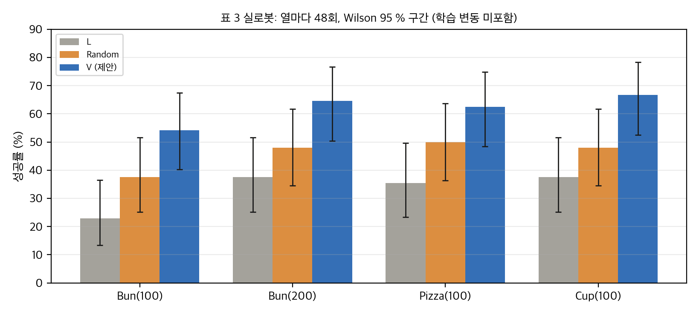
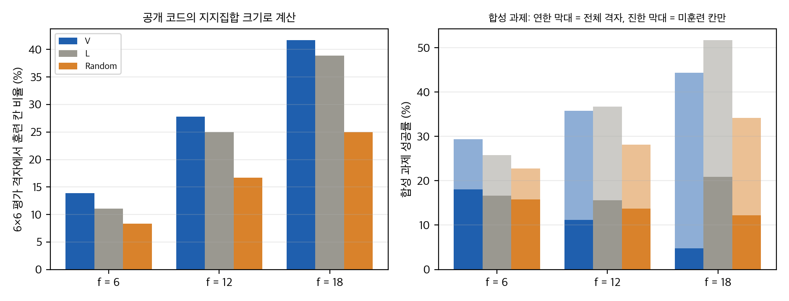
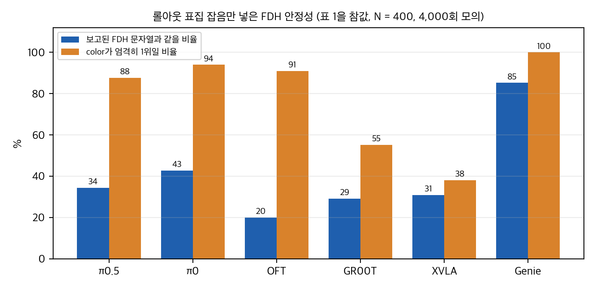

# 03. 수치 재계산, 설계 검사, 주장 판정

재현(정책 학습, 롤아웃)은 하지 않았습니다. 논문 표 1, 2, 3, 5, 6, 7과 본문 수치를 `analysis/recompute.py`(표준 라이브러리, 수 초)로 다시 계산하고, 시행 수가 보고되지 않은 곳은 가정을 문장 안에 적었습니다. 그림 4의 점·선 값은 판독이 어려워 부록 C.4와 본문에 글자로 적힌 수치만 썼습니다. 결과는 `analysis/recompute_results.json`입니다. 합성 과제 하나는 `analysis/toy_seen_fraction.py`입니다(V8).

## 요약

| 번호 | 확인 | 결과 |
|---|---|---|
| V1 | 표 1 → 표 6, 7, 표 2 Copeland | 표 6과 표 7의 12행 모두 일치. 표 2 XVLA 한 행만 표 6, 부록 목록과 다름 |
| V2 | 표 1 값의 분모 가능성 | 60칸 중 26칸만 분모 400에서 표현 가능. 같은 값이 5종 반복 |
| V3 | 모델별 쌍 비교 vs 주장한 순서 | 쌍 10개 중 일치 5–10개, 반대 방향(5점 초과) OpenVLA-oft만 2개, 순환 없음 |
| V4 | 표 3 비율, Wilson, Fisher | 비율 12칸 모두 일치. V 대 L은 p ≤ 0.014, V 대 Random은 열별 p = 0.10–0.30 |
| V5 | 본문 +28.7 / +16.7 | +28.7은 맞고 +16.7은 열 평균(16.2)과 다름 (Bun 두 열의 값과 같음) |
| V6 | 시뮬레이션 부록 수치 | 독립 롤아웃 가정 SE 약 2.8점, 부록의 +7 ~ +19점은 롤아웃 잡음 기준으로 구분됨 |
| V7 | 표 5 정수 가능성 | 세 클래스 값이 모두 정확하려면 주석 100개 이상 필요, 표는 80개 |
| V8 | 평가 격자의 훈련 칸 비율 | 코드 기준 V 15칸 / L 14칸 / Random 9칸(f = 18), 평가는 36칸 전체 |
| V9 | FDR 표집 잡음 | 분모 400 가정에서 보고된 FDH가 그대로 나오는 비율 20–85 % |

## V1. Copeland 재계산 (표 1 → 표 6, 7, 표 2)

식 3(τ = 5 %, 10 %)을 표 1의 60개 값에 적용했습니다. 표 6과 표 7은 6개 모델 × 2 임계값 모두 일치합니다.

| 모델 | color | object | spatial | verb | size | 재계산 FDH (τ = 5 %) | 표 2 |
|---|---|---|---|---|---|---|---|
| π0.5 | 3 | 2 | 2 | 1 | 0 | color > object ≈ spatial > verb > size | 같음 |
| π0 | 4 | 2 | 1 | 1 | 0 | color > object > spatial ≈ verb > size | 같음 |
| OpenVLA-oft | 4 | 1 | 0 | 1 | 1 | color > object ≈ verb ≈ size > spatial | 같음 |
| GR00T-N1.7 | 4 | 3 | 2 | 1 | 0 | color > object > spatial > verb > size | 같음 |
| XVLA | 3 | 3 | 1 | 1 | 0 | color ≈ object > spatial ≈ verb > size | **spatial > verb**로 적힘 |
| Genie-Envisioner | 4 | 3 | 2 | 1 | 0 | color > object > spatial > verb > size | 같음 |

- 표 2의 XVLA 행은 "color ≈ object > spatial > verb > size"인데, 표 6의 점수(spatial 1, verb 1)와 부록 B.3의 τ = 5 % 목록("{spatial ≈ verb}")은 동점입니다. 프로젝트 페이지의 FDH 목록은 표 2와 같습니다. 어느 쪽이 의도인지는 저자 확인이 필요합니다.
- 또한 XVLA의 "color ≈ object"는 Copeland 점수 동점(3 대 3)이고, 두 인자의 직접 비교 FDR(color, object) = +31.0은 color 쪽입니다. 표 2의 ≈는 쌍별 동점이 아니라 점수 동점을 뜻하므로, 이 행을 "color와 object가 비슷하다"로 읽으면 직접 비교와 어긋납니다. verb가 color를 이기는 쌍이 XVLA에는 없고((verb, color) −1.0은 동점), 그 때문에 color의 점수가 3에 머무릅니다.
- 이 한 행이 본문 Finding 3의 "spatial ≥ verb"(≥이므로 동점 허용)와는 충돌하지 않지만, 6개 중 "엄격 순서가 일치하는" 모델 수를 세는 방식에는 영향을 줍니다. 재계산 기준으로 τ = 5 %에서 color > object > spatial > verb > size가 **엄격히** 나오는 모델은 GR00T-N1.7과 Genie-Envisioner 둘이고, 표 2 기준으로는 XVLA를 합쳐 셋입니다.
- τ = 10 %(표 7)에서는 GR00T-N1.7이 color ≈ object ≈ spatial > verb > size, π0.5가 color > object ≈ verb > spatial ≈ size가 됩니다. 부록의 "임계값에 걸쳐 일관"이라는 서술은 color가 대체로 위이고 size가 대체로 아래라는 수준에서 성립하고, object–spatial–verb 사이의 순서는 임계값에 따라 바뀝니다.

*그림 A. 표 1의 FDR 60칸(우리가 그림). 열은 모델, 행은 인자 쌍이고 빨강은 앞 인자 우세*

## V2. FDR 값의 분모 (표 1)

FDR = (N_f1 − N_f2)/(N_f1 + N_f2)이고 "neither"는 분모에서 빠집니다(부록 B.2). 표 1의 60개 값(소수 첫째 자리)이 정수 N_f1, N_f2로 만들어질 수 있는 최소 분모를 구했습니다(N_f1 + N_f2 ≤ 400 가정, 홀짝 일치).

- 분모가 정확히 400(neither 0건)이면 FDR은 0.25 %p 단위입니다. 60개 중 **26개**만 그 격자에 놓입니다(예: 4.5 = 18/400). 나머지 34개는 N_f1 + N_f2가 400보다 작아야 하므로, neither(또는 오류)로 판정된 롤아웃이 있었다는 뜻이고 그 수는 보고되지 않습니다. 보고되지 않은 neither 비율이 FDR의 해석에 영향을 줍니다(`03` V9).
- 최소 분모가 100을 넘는 값은 7개, 가장 큰 최소 분모는 212입니다. 즉 이 값들은 정밀한 분모에서만 나옵니다.
- 같은 값이 여러 칸에 나옵니다: **52.4가 3칸**(π0 color–size, GR00T-N1.7 color–size, GR00T-N1.7 object–size), 22.0(2칸), 19.0(2칸), 4.5(2칸, 모두 OpenVLA-oft), 32.6(2칸). 52.4는 11/21이므로 N_f1 + N_f2가 21의 배수일 때 정확히 나옵니다. 서로 다른 모델·쌍에서 같은 값이 반복되는 이유(분모 구조, 평가 구성의 공유 등)는 표만으로 알 수 없어 저자 확인이 필요합니다.

## V3. 모델별 쌍 비교와 주장한 순서 (표 1)

주장 순서 color ≥ object ≥ spatial ≥ verb ≥ size의 앞선 인자가 5점 넘게 이기면 "일치", 반대면 "반대", ±5점 안이면 "동점"으로 쌍 10개를 셌습니다.

| 모델 | 일치 | 동점 | 반대 |
|---|---|---|---|
| π0.5 | 8 | 2 | 0 |
| π0 | 8 | 2 | 0 |
| OpenVLA-oft | 5 | 3 | 2 ((verb, object) +16.0, (size, spatial) +19.8) |
| GR00T-N1.7 | 10 | 0 | 0 |
| XVLA | 8 | 2 | 0 |
| Genie-Envisioner | 10 | 0 | 0 |

- 5점 초과로 순서와 반대인 쌍은 OpenVLA-oft 두 개뿐이고, τ = 5 %에서 승리 관계의 순환(a>b>c>a)은 어느 모델에서도 없습니다. 쌍별 FDR이 서로 다른 정책 10개에서 나왔는데도 전역 순위로 합치는 것이 모순을 만들지는 않았습니다.
- "동점"이 많은 쌍은 (verb, color)(모델 6개 중 5개가 −1.0 ~ −6.8)입니다. verb는 color에 지는 쪽이지만 그 크기는 작아서, "verb가 color에 압도된다"기보다 "verb가 color보다 조금 아래이거나 비슷하다"가 표에서 읽히는 내용입니다.

## V4. 표 3 실로봇 결과 (시행 수 48 가정, 표에 적힘)

- 열 12칸의 성공 수/48에서 퍼센트를 다시 계산하면 보고값과 모두 일치합니다(예: 11/48 = 22.9 %).
- Wilson 95 % 구간: V Bun(100) 54.2 % [40.3, 67.4], Random 37.5 % [25.2, 51.6], L 22.9 % [13.3, 36.5]. 열마다 폭이 약 ±13점입니다.
- Fisher 정확 검정(양측, 열별, 두 정책이 48개씩 독립이라고 가정):

| 열 | V − L | p | V − Random | p |
|---|---|---|---|---|
| Bun(100) | +31.2 | 0.003 | +16.7 | 0.151 |
| Bun(200) | +27.1 | 0.014 | +16.7 | 0.149 |
| Pizza(100) | +27.1 | 0.014 | +12.5 | 0.304 |
| Cup(100) | +29.2 | 0.008 | +18.8 | 0.098 |
| 네 열 합산(참고, 독립 아님) | +28.6 | < 0.001 | +16.1 | 0.002 |

- V 대 L은 열마다 구분됩니다. V 대 Random은 열마다는 구분되지 않고, 네 열을 합쳐야 p = 0.002입니다. 네 열은 같은 정책·같은 격자 구조에서 나온 것이라 독립이 아니므로 합산 p는 참고용입니다.
- "절반의 시연으로 더 높은 성공"(Bun, V n = 100 대 기준선 n = 200): V 26/48 대 L 18/48은 p = 0.151, 대 Random 23/48은 p = 0.683입니다. 방향은 V가 높지만 이 열 하나(시행 48개)로는 구분되지 않습니다. Pizza와 Cup은 n = 100만 보고되어 이 비교가 불가능합니다.
- 체크포인트가 방법마다 하나(학습 시드 하나로 가정)이므로 위 구간은 학습 변동을 포함하지 않습니다.

*그림 B. 표 3의 성공률과 Wilson 95 % 구간(우리가 그림, 시행 수 48은 표에 적힘)*

## V5. 본문 평균 +28.7 / +16.7 (§6.2)

- 열별 차이(퍼센트포인트): V − L = 31.2, 27.1, 27.1, 29.2 → 평균 **28.65**(보고 28.7과 일치). V − Random = 16.7, 16.7, 12.5, 18.8 → 평균 **16.15**(보고 +16.7과 다름).
- 본문의 "+16.7"은 Bun 두 열(n = 100, 200)의 V − Random 값과 같고, 프로젝트 페이지는 같은 값을 "Bun에서 최고 기준선 대비 16.7점"으로 적습니다. §6.2의 "by +16.7 points on average"는 네 열 평균 16.2로 읽는 편이 표와 맞습니다(방향과 결론은 같음).

## V6. 시뮬레이션 부록 수치의 롤아웃 잡음 (본문 §6.1, 부록 C.4)

체크포인트당 3 시드 × 200 = 600 롤아웃(그림 4 캡션), 롤아웃이 독립이라는 가정입니다. 글자로 적힌 수치만 썼습니다.

| 설정 (f = 18) | V | 비교 | 차이 | 표준오차(점) | z |
|---|---|---|---|---|---|
| Spatial×Size, GR00T | 48.1 | L 33.9 | +14.2 | 2.8 | 5.1 |
| Spatial×Size, GR00T | 48.1 | Random 28.7 | +19.4 | 2.8 | 7.1 |
| Color×Spatial, π0 | 54.9 | L 47.8 | +7.1 | 2.9 | 2.5 |
| Color×Spatial, π0 | 54.9 | Random 46.8 | +8.1 | 2.9 | 2.8 |
| Verb×Size, π0.5 (본문) | 51 | Random 68 | −17.0 | 2.8 | −6.1 |

- 600 대 600 비교에서 롤아웃 잡음만으로 구분되는 최소 차이는 성공률 50 % 근처에서 약 5.7점입니다. 시드 하나(200개)의 표준오차는 약 3.5점이어서, 그림 4의 시드별 점이 퍼지는 폭과 비슷한 규모입니다.
- 이 표준오차는 **미세조정을 다시 했을 때의 변동**(학습 시드, 시연 표집 시드)을 포함하지 않습니다. 평가 시드 3개는 같은 체크포인트를 평가합니다(그림 4 캡션 "each checkpoint is evaluated under three random seeds"). 지지집합이 L에서 무작위 칸(`04` D5)과 Random에서 표집에 따라 달라지므로, 훈련 쪽 변동도 격차의 구분에 영향을 줄 수 있습니다.
- Verb×Size(π0.5)의 −17점은 롤아웃 잡음 기준으로도 큽니다. 본문은 이를 size가 본질적으로 어렵다는 해석(Finding 2)으로 설명합니다.

## V7. 사람 판정 일치율 (표 5)

표 5는 성공 90.0, overfit-f1 83.0, overfit-f2 93.0, 전체 88.7이고 주석 롤아웃은 80개입니다.

- 전체 88.7은 세 값의 단순 평균(88.67)과 같습니다. 즉 롤아웃 수로 가중한 일치율이 아니라 클래스별 일치율의 평균으로 읽힙니다.
- 각 값이 소수 첫째 자리까지 정확하려면 클래스별 주석 수가 성공은 10의 배수, overfit-f1은 47 또는 53 이상, overfit-f2는 43, 57, 71 중 하나여야 합니다. 합이 최소 100입니다. 80개를 전체 수로 읽으면 세 값이 동시에 정확할 수 없고, 클래스당 80개로 읽어도 83.0, 93.0이 되는 정수가 없습니다(66/80 = 82.5, 67/80 = 83.75, 74/80 = 92.5, 75/80 = 93.75). 반올림 방식이나 "80"의 정의가 본문에 없어서 저자 확인이 필요합니다.
- 일치율은 π0.5 하나에 대해서만 보고되었고, 오분류 방향(예: f1을 f2로 보는 비대칭)과 "neither"의 일치율은 없습니다. 또 일치율 88.7 %는 FDR 값의 오차로 환산되지 않습니다. 방향이 편향된 오분류가 있으면 FDR 부호가 바뀔 수 있습니다.

## V8. 평가 격자의 훈련 칸 비율 (공개 코드 기준, `04` D3과 함께 읽을 것)

공개 코드의 쌍별 평가(`gr00t_grid_eval.py`, `pi0_grid_eval.py`)는 격자의 **모든 칸**을 돌고(칸당 ceil(200/칸 수)회), 훈련 지지집합 크기는 f마다 전략별로 다릅니다.

| f | V(stair) 칸 | L(Lrandom) 칸 | Random 칸 | 6×6 평가에서 훈련 칸 비율 (V / L / Random) |
|---|---|---|---|---|
| 6 | 5 | 4 | 3 | 13.9 % / 11.1 % / 8.3 % |
| 12 | 10 | 9 | 6 | 27.8 % / 25.0 % / 16.7 % |
| 18 | 15 | 14 | 9 | 41.7 % / 38.9 % / 25.0 % |

- 논문 본문은 "같은 f"를 공정 비교의 단위로 씁니다. 코드에서 f는 Hamming 거리 합이 아니라 격자 크기를 고르는 설정 이름이고(`04` D2), 같은 f에서 V가 가장 많은 서로 다른 칸을 훈련합니다.
- 실로봇은 4×4 격자 16칸을 3회씩 평가하므로 훈련 칸도 평가에 섞입니다. 코드의 f = 12 지지집합 크기(V 10, L 9, Random 6칸)를 가져오면 훈련 칸 비율은 62.5 % / 56.3 % / 37.5 %입니다. 그림 8(그림 판독)에서는 Random 훈련 칸이 7–8개, V가 9–10개로 읽힙니다(경계 판독이 어려워 범위로 적음). 칸별 성공 수의 합은 그림 8에서 Random 23, V 31로 표 3 Bun(200)의 23/48, 31/48과 정확히 일치합니다(그림 판독 값).
- 훈련 칸과 미훈련 칸의 성공률이 같다면 비율 차이는 격차에 영향이 없습니다. 훈련 칸 성공률이 높고 미훈련 칸이 낮다면 격차에 (V 비율 − Random 비율) × (훈련 칸 성공률 − 미훈련 칸 성공률)이 섞입니다. 훈련 칸 90 %, 미훈련 칸 20–30 %로 가정하면 코드의 f = 12 지지집합 크기(비율 차이 25점)에서는 12.5–17.5점, 그림 8 판독 기준 비율 차이(6–19점, 훈련 칸 수 V 9–10 대 Random 7–8)에서는 약 4–13점입니다. 표 3의 V − Random(12.5–18.8점)에 비해 일부 또는 상당 부분을 설명할 수 있는 크기이지만, 이 가정은 데이터로 확인된 것이 아닙니다. **훈련 칸과 미훈련 칸의 성공률을 따로 보고하면 분리됩니다.** 그림 8의 칸별 값으로 보면 Random의 미훈련 칸과 V의 미훈련 칸의 성공 수도 따로 셀 수 있으나, 훈련 칸의 경계 판독이 불확실해 이 분석에서는 세지 않았습니다.
- 합성 과제 한 개(`analysis/toy_seen_fraction.py`, 작은 MLP가 (값1, 값2) → (값1 + 2·값2) mod 6을 학습, 같은 지지집합 크기와 구조, 시드 10개, CPU 약 15초): 전체 격자 성공률은 f = 18에서 V 44.4 %, L 51.7 %, Random 34.2 %이고, 훈련하지 않은 칸만 보면 V 4.8 %, L 20.9 %, Random 12.2 %입니다. 합성 라벨은 조합 구조가 없는 임의 함수라 VLA의 행동을 대표하지 않습니다. 이 결과가 보이는 것은 오직 "전체 격자 평균에는 훈련 칸 비율이 크게 섞이고, 훈련 칸 비율의 순서와 미훈련 칸의 순서가 다를 수 있다"는 점입니다.

*그림 C. 훈련 칸 비율(공개 코드의 지지집합 크기 기준)과 합성 과제의 전체 격자 대 미훈련 칸 성공률(우리가 그림)*

## V9. FDR 표집 잡음과 FDH 안정성 (표 1, 가정: N_f1 + N_f2 = 400)

- 분모가 400이면 FDR의 표준오차는 FDR = 0 근처에서 5점입니다(√(1/400)). 동점 임계값 τ = 5 %는 표준오차 1배입니다. 표 1의 60개 값 중 |FDR| ≤ 10(약 2 표준오차)인 값이 **18개**, ≤ 5인 값이 9개입니다.
- 표 1 값을 참값으로 보고 이항 표집을 4,000번 반복해 Copeland 순위(τ = 5 %)를 다시 만들었을 때 보고된 FDH 문자열과 정확히 같은 비율:

| 모델 | 보고된 FDH와 같을 비율 | color가 엄격히 1위일 비율 |
|---|---|---|
| π0.5 | 0.34 | 0.88 |
| π0 | 0.43 | 0.94 |
| OpenVLA-oft | 0.20 | 0.91 |
| GR00T-N1.7 | 0.29 | 0.55 |
| XVLA | 0.31 | 0.38 |
| Genie-Envisioner | 0.85 | 1.00 |

- 이 값은 **롤아웃 표집 잡음만**을 반영한 하한 성격의 계산입니다(neither 제외 시 분모가 줄어 잡음은 더 큼, 학습 변동은 제외). 쌍별 정책이 하나씩이므로(체크포인트당 학습 1회) 학습 시드에 따른 FDR 변동은 이 표에 들어 있지 않습니다. 전체 순서를 한 줄로 요약하는 FDH는 개별 순서 관계 중 하나만 뒤집혀도 문자열이 달라지므로 "같을 비율"이 낮게 나오는 점은 감안해서 읽어야 합니다. 그래도 color가 1위라는 결론은 π0.5, π0, OpenVLA-oft, Genie-Envisioner에서는 안정적이고, GR00T-N1.7과 XVLA에서는 훨씬 덜 안정적입니다.

*그림 D. 표집 잡음만 넣은 FDH 재현 비율(우리가 그림, N = 400 가정)*

## K1. 구조 수치 점검

| 항목 | 확인 |
|---|---|
| 지시 공간 6×6×6×6×5 | 6,480 (§3, 부록 A와 일치) |
| 모델당 영상 수 | 10쌍 × 400 = 4,000 (부록 B.2와 일치) |
| 훈련 지시 수(부록 B 목록) | 쌍마다 6×2 = 12 또는 5×2 = 10, 열 개 쌍 모두 일치 |
| OOD 칸 수 | 6×6 격자는 36 − 6 = 30칸, 400 / 30 = 13.3이라 "균일 추출"은 정수가 아님 (코드는 200쌍 × 장면 2개, `04` D8) |
| 실로봇 롤아웃 | 16지시 × 3 = 48 (일치) |
| Complete의 칸당 시연 | n = 100이면 6.25, n = 200이면 12.5 (16칸 기준) |
| All-Factor 시연 밀도 | n = 400이면 지시 6,480개 중 칸당 평균 0.06개 (지지집합 크기는 `04` D6) |

## K2. 설계 검사

1. **쌍별 FDR은 서로 다른 훈련 세트에서 나옵니다.** 쌍마다 정책 하나를 따로 미세조정하고, 훈련 지시는 10–12개, "운반(carrier)" 인자의 값은 쌍마다 다릅니다(예: 객체 쌍은 동사 grasp/lift만, verb 쌍은 객체 cube/sphere만, 부록 B). FDH는 이 열 개의 서로 다른 훈련 조건의 결과를 순서로 합친 것입니다.
2. **훈련 칸의 짝 배정이 고정입니다.** 예: color–object의 red+cube, yellow+sphere, … 한 가지 배정만 사용하고(부록 B), 배정 순열에 따른 FDR 변동은 보고되지 않았습니다. 특정 색과 특정 객체의 짝이 결과에 영향을 줄 수 있습니다.
3. **판정 구성이 쌍 유형마다 다릅니다.** verb 쌍은 "어떤 동작을 했는가", 객체 쌍은 "어떤 물체로 갔는가"를 봅니다(그림 3). 같은 척도(FDR)로 두 유형을 한 순서에 넣는 것은 가정입니다. verb 쌍은 FDR이 작은 편(−1 ~ −7)이고 size 쌍은 큰 편(+25 ~ +56)이라, 쌍 유형에 따른 척도 차이와 인자 사이의 차이가 섞입니다.
4. **수집 전략의 "덜 접지된 인자"는 전역 순서가 정합니다(§6).** 설정마다 FDR을 다시 재지 않고 하나의 순서를 쓰므로, 예를 들어 Verb×Size에서 V가 size 쪽을 보강하는 것은 표 1의 (verb, size) FDR이 모든 모델에서 양수(+4.5 ~ +41.3)라는 사실과 맞지만, 순서가 모델마다 달랐던 쌍(예: (object, spatial) −3.8 ~ +20.9, (verb, spatial) −14.2 ~ +4.5)에서는 고른 인자가 모델의 실제 FDR과 어긋날 수 있습니다. 그림 4 panel 8(Spatial×Object, GR00T)에서 세 전략의 차이가 작게 읽히는 것(그림 판독)과 함께 볼 만한 쌍입니다.
5. **실로봇의 FDR 진단은 없습니다.** 실로봇 정책(GR00T-N1.7)의 인자 편향을 직접 측정한 것이 아니라 시뮬레이션의 FDH를 가져온 것입니다. Bun(color×spatial)은 시뮬레이션 (color, spatial) 쌍과 같지만 Pizza(spatial×object), Cup(verb×color)에서는 새로운 과제·물체이므로 "color가 지배적이다"가 실로봇 Cup 과제에서도 성립한다는 근거는 이 논문에 없습니다.

## C. 주장 판정

| 번호 | 주장 (위치) | 판정 | 근거 |
|---|---|---|---|
| C1 | 지시 인자 편향은 "체계적이고 이전에 측정된 적 없는" 실패 양식 (§1) | 부분 | 상관 훈련 후 충돌 평가 설계 자체는 새롭다. 인자 분해 성능 보고는 기존 벤치마크에도 있어 "측정된 적 없음"의 범위는 설계에 한정된다(`02` §1). |
| C2 | 여섯 정책에서 color가 가장 우세 (Finding 1) | 지지, 단서 있음 | 표 1에서 color는 6개 모델 모두 object, size, spatial과의 직접 비교에서 5점 넘게 이기고(최소 +8.4, GR00T color–spatial), verb와의 비교는 6개 모두 color 쪽이거나 동점. 표집 잡음 기준 color가 엄격히 1위인 비율은 0.38–1.00 (V9) |
| C3 | verb와 size가 가장 덜 접지됨 (Finding 2) | 지지 (OpenVLA-oft 제외) | 표 1·6. 재계산 일치 (V1) |
| C4 | 순서 color ≥ object ≥ spatial ≥ verb ≥ size가 모델 전반에서 일관 (Finding 3, 부록 B.3) | 부분 | 일치 쌍 수 5–10 (V3). OpenVLA-oft는 벗어남을 저자가 인정. τ = 10 %에서 object–spatial–verb 순서 변동 (V1). 순서 문자열이 같은 비율 20–85 % (V9) |
| C5 | 표 2 FDH가 표 6의 Copeland 점수에서 나옴 | 부분 | 5개 모델은 일치, XVLA 한 행은 spatial과 verb가 점수상 동점인데 > 로 적힘 (V1) |
| C6 | VLM 판정이 사람 판정과 매우 일치 (88.7 %) | 부분 | π0.5 하나, 80개, 표의 수와 정수 가능성이 맞지 않음 (V7). 방향 편향은 미보고 |
| C7 | V가 대다수 시뮬레이션 설정에서 L, Random 이상 (§6.1) | 지지, 단서 있음 | 부록 수치는 롤아웃 잡음 기준 구분 (V6). 단 같은 f에서 훈련 칸 수가 V 최다이고 평가가 전체 격자 (V8, `04` D3). size 쌍에서는 이점 소실(부록 C.4)을 저자가 보고 |
| C8 | All-Factor에서 V가 n = 400으로 기준선 n = 800을 넘음 (§6.1) | 부분 | 그림 4 panel 11, 12 판독으로 방향은 그렇게 읽히나 예산이 같지 않은 비교. 코드에서 All-Factor 지지집합 크기가 V 42, L 29, Random 12 (`04` D6) |
| C9 | 실로봇에서 V가 L보다 평균 +28.7점, Random보다 +16.7점 (§6.2) | 부분 | +28.7 일치, Random 대비 열 평균은 16.2 (V5). V 대 Random은 열별로는 구분되지 않음 (V4) |
| C10 | V가 절반의 시연으로 더 높은 성공 (초록, §6.2) | 부분 | Bun 한 열의 비교(n = 100 대 200)이고 p = 0.15 / 0.68 (V4). 시뮬레이션 쪽은 All-Factor의 n = 400 대 800 |
| C11 | 부분 커버리지가 작은 예산에서 전체 커버리지보다 낫다 (그림 9) | 부분 | n = 100에서는 그렇게 읽힘. n = 200에서 Complete가 약 88 %(그림 판독 값)로 V 64.6 %를 앞서므로, 예산에 따라 방향이 바뀜 |
| C12 | 전략이 모델에 무관하다(model-agnostic) (결론) | 부분 | 수집 실험은 π0, π0.5, GR00T-N1.7 세 모델이고 실로봇은 GR00T 하나. FDH가 달랐던 OpenVLA-oft는 수집 실험에서 제외 |
| C13 | 편향 패턴이 더 복잡한 장면과 다단계 과제로 일반화되는지 (한계) | 확인 불가 | 저자가 열린 문제로 둠 |
