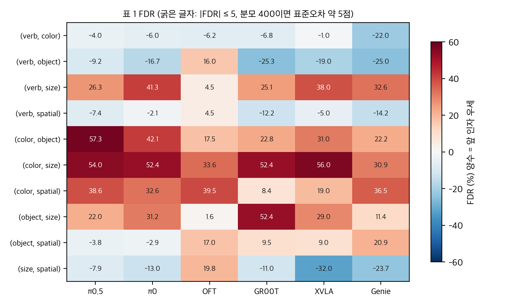
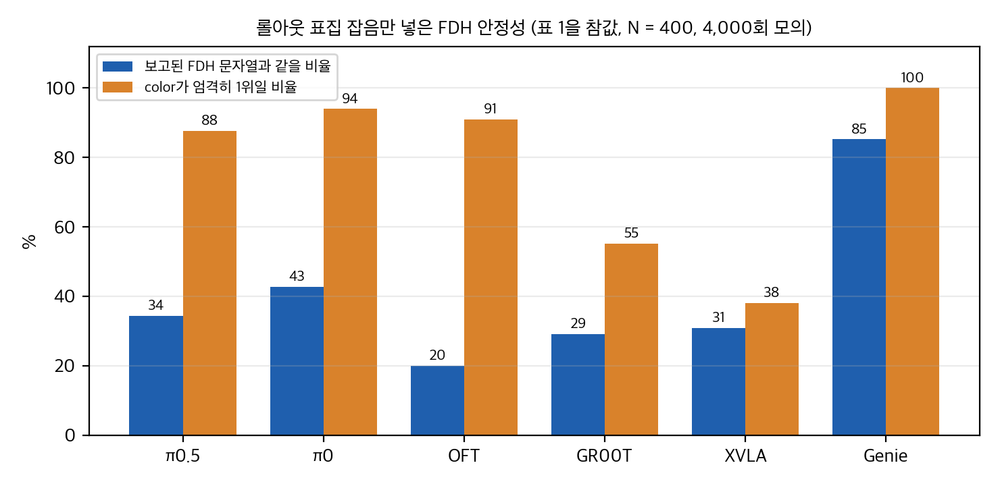
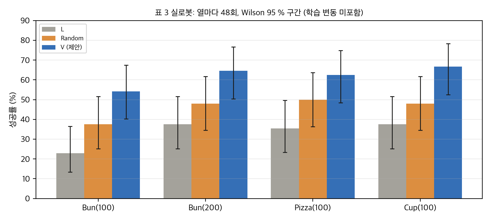
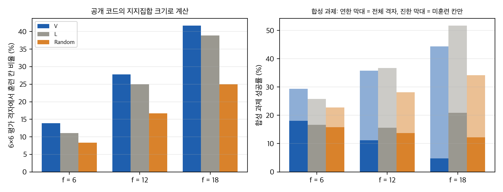

> **논문:** Yu Qi, Zhang Ye, Xinyi Xu, Yuxuan Lu, Amitoj Sandhu, Boce Hu, Haojie Huang, Jonathan Tremblay, Lawson L.S. Wong. *Scale Up Strategically: Learning Compositional Generalization via Bias-Aware Evaluation and Data Collection for Robotic Manipulation.* CoRL 2026 포스터, arXiv:2607.21582 (v1, 2026-07-23).
> 이 글의 그림은 모두 표 수치와 공개 코드에서 우리가 다시 그린 것입니다. 논문의 arXiv 라이선스(non-exclusive-distrib)에서는 논문 그림을 옮기지 않았습니다. 공식 코드는 정적으로만 읽었고 실행하지 않았습니다(커밋 `b5b32418bd07`).

## 논문이 묻는 것

로봇 정책은 언어를 접지(grounding)하지 않고 눈에 띄는 단서를 지름길로 쓴다는 관찰을, 지시를 다섯 인자(verb, color, object, size, spatial)로 나누어 정량화합니다. 인자 두 개를 훈련에서 대각선으로 짝지은 뒤(시연 300개), 그 짝을 깨는 평가 지시에서 정책이 어느 인자를 따르는지 VLM(Gemini-2.5-Flash)이 영상을 보고 판정합니다. 인자 쌍별 Factor Dominance Rate(FDR)를 Copeland 점수로 합친 것이 Factor Dominance Hierarchy(FDH)이고, 여섯 정책에서 대체로 color ≥ object ≥ spatial ≥ verb ≥ size가 나온다고 보고합니다(표 1, 2). 이 순서를 이용해 덜 접지된 인자 쪽으로 시연을 재배분하는 수집 전략 V를 제안하고, 시뮬레이션(π0, π0.5, GR00T-N1.7)과 UR5 실로봇(GR00T-N1.7)에서 L, Random 기준선과 비교합니다(그림 4, 표 3).

## 표 1에서 Copeland를 다시 계산하면

식 3(τ = 5 %, 10 %)을 표 1의 60개 값에 적용하면 표 6과 표 7의 점수는 열두 행 모두 다시 나옵니다. 표 2에서는 XVLA 한 행만 다릅니다. 표 6의 점수(spatial 1, verb 1)는 동점인데 표 2는 "spatial > verb"로 적혀 있고, 부록의 τ = 5 % 목록은 동점입니다. 같은 XVLA 행의 "color ≈ object"는 점수 동점(3 대 3)이며, 두 인자의 직접 비교 FDR은 color 쪽 +31.0입니다. 표 2의 ≈가 쌍별 동점이 아니라 점수 동점을 뜻한다는 점을 함께 읽으면 됩니다. 어느 쪽이 의도인지는 저자 확인이 필요합니다.

color가 object, size, spatial과의 직접 비교에서 여섯 모델 모두 5점 넘게 앞서는 것(최소 +8.4)은 표에서 그대로 확인됩니다. 순서 color ≥ object ≥ spatial ≥ verb ≥ size와 반대 방향으로 5점을 넘는 쌍은 OpenVLA-oft의 두 개((verb, object) +16.0, (size, spatial) +19.8)뿐이고, τ = 5 %에서 승리 관계의 순환은 없었습니다.

*그림 1. 표 1의 FDR 60칸(우리가 그림). 열은 모델, 행은 인자 쌍이고 빨강은 앞 인자 우세. 분모를 400으로 보면 표준오차는 FDR 0 근처에서 약 5점입니다.*

## 분모와 표집 잡음

FDR은 "neither"를 뺀 N_f1 + N_f2로 나눕니다(부록 B.2). 표 1의 값이 정수 N_f1, N_f2에서 나오려면 분모가 얼마여야 하는지 보면, 60개 중 **26개**만 분모 400(neither 0건)에서 표현됩니다. 나머지는 분모가 더 작아야 하므로 neither 또는 오류로 분류된 롤아웃이 있었다는 뜻인데, 건수는 보고되지 않았습니다. 같은 값이 여러 칸에 나타나는 점도 있습니다. 52.4가 세 칸(π0 color–size, GR00T-N1.7 color–size, GR00T-N1.7 object–size)에 있고 52.4 = 11/21이므로 N_f1 + N_f2가 21의 배수여야 정확합니다. 이유는 표만으로 알 수 없어 저자 확인이 필요합니다.

분모 400을 가정하면(최선의 경우) FDR의 표준오차는 0 근처에서 5점으로, 동점 임계값 τ = 5 %와 같은 크기입니다. 표 1의 |FDR| ≤ 10인 칸이 18개입니다. 표 1 값을 참값으로 두고 이항 표집을 4,000번 반복해 Copeland 순위를 다시 만들면(롤아웃 표집 잡음만, 학습 변동 제외) 보고된 FDH 문자열이 그대로 나오는 비율은 모델에 따라 20–85 %이고, color가 엄격히 1위인 비율은 0.38–1.00입니다. FDH는 문자열 하나가 달라지는 데 민감한 요약이므로 "같을 비율"은 낮게 나오는 점을 감안해야 합니다. 그래도 color가 1위라는 서술은 π0.5, π0, OpenVLA-oft, Genie-Envisioner에서는 안정적이고, GR00T-N1.7(0.55)과 XVLA(0.38)에서는 덜 안정적입니다.

*그림 2. 표집 잡음만 넣은 FDH 재현 비율(우리가 그림, N = 400 가정, 모의 4,000회).*

사람 판정과의 일치율(표 5)은 성공 90.0, overfit-f1 83.0, overfit-f2 93.0, 전체 88.7 %이고 주석 롤아웃은 80개입니다. 전체 88.7은 세 값의 단순 평균(88.67)과 같습니다. 각 값이 소수 첫째 자리까지 정확하려면 클래스별 주석 수의 합이 최소 100이어야 하므로, 80을 전체 수로 읽으면 세 값을 동시에 맞출 수 없습니다. 반올림 방식이나 80의 정의는 저자 확인이 필요합니다. 일치율은 π0.5 한 모델에 대한 것이고 오분류의 방향은 보고되지 않았습니다.

## 실로봇 표 3

열마다 48회(3회 × 지시 16개)이므로 시행 수 48이 표에 적혀 있고, 12칸의 퍼센트는 성공 수/48과 모두 일치합니다. Fisher 정확 검정(열별, 두 정책이 독립이라고 가정):

| 열 | V − L (p) | V − Random (p) |
|---|---|---|
| Bun(100) | +31.2 (0.003) | +16.7 (0.151) |
| Bun(200) | +27.1 (0.014) | +16.7 (0.149) |
| Pizza(100) | +27.1 (0.014) | +12.5 (0.304) |
| Cup(100) | +29.2 (0.008) | +18.8 (0.098) |

V 대 L은 열마다 구분되고, V 대 Random은 열마다는 구분되지 않으며 네 열을 합치면 p = 0.002입니다(네 열은 독립이 아니므로 참고용). 체크포인트가 방법마다 하나(학습 시드 하나 가정)이므로 구간에는 학습 변동이 들어 있지 않습니다. 본문의 "Random 대비 평균 +16.7점"은 열별 평균 16.2와 다르고, Bun 두 열의 차이(16.7)와 같은 값입니다. "절반의 시연으로 더 높은 성공"은 Bun 한 열의 비교(V n = 100 대 기준선 n = 200)로, V 26/48 대 L 18/48은 p = 0.15, 대 Random 23/48은 p = 0.68입니다. Pizza와 Cup은 n = 100만 보고되어 이 비교가 불가능합니다. 그림 9에서 Complete는 n = 200에서 약 88 %(그림 판독 값)로 V(64.6 %)보다 높고, 본문의 "부분 커버리지가 낫다"는 n = 100 비교에 해당합니다.

*그림 3. 표 3의 성공률과 Wilson 95 % 구간(우리가 그림, 열마다 n = 48).*

## 같은 f, 다른 훈련 칸

논문은 전략 사이를 "같은 factor change f와 같은 시연 수 n"에서 비교합니다. f는 연속한 구성 사이의 Hamming 거리 합으로 정의되고(§6, 부록 C.2), 다르면 Random 시연을 더해 맞춘다고 쓰여 있습니다. 공개 코드에서는 f가 Hamming 거리가 아니라 격자 크기를 고르는 설정 이름이고, 저장소 전체에서 Hamming 거리 계산이나 f를 맞추는 추가 시연 로직을 찾지 못했습니다. 코드에서 센 쌍별 훈련 칸 수는 f = 6/12/18에서 V 5/10/15, L 4/9/14, Random 3/6/9칸이고, 평가는 f와 무관하게 6×6 전체 격자를 돕니다. 그러면 훈련 칸이 평가의 41.7 %(V), 38.9 %(L), 25.0 %(Random)(f = 18)를 차지합니다. 실로봇 4×4 격자도 16칸 전부를 3회씩 평가하고, 그림 8을 읽으면 훈련 칸 수가 V 9–10개, Random 7–8개로 보입니다(그림 판독 값. 칸별 성공 수의 합은 표 3의 31/48, 23/48과 일치).

훈련 칸 성공률이 높고 미훈련 칸이 낮다면 이 비율 차이가 격차에 섞입니다. 훈련 칸 90 %, 미훈련 칸 20–30 %라는 가정(데이터로 확인된 값이 아님)에서는 비율 차이 6–19점에 대해 약 4–13점이 됩니다. 훈련 칸과 미훈련 칸의 성공률을 따로 보고하면 구분됩니다. 합성 과제로 이 점만 보여 주는 작은 실험을 했습니다(작은 MLP가 (값1, 값2) → (값1 + 2·값2) mod 6을 학습, 같은 지지집합 크기, 시드 10개). f = 18에서 전체 격자 성공률은 V 44.4 %, L 51.7 %, Random 34.2 %이고 미훈련 칸만 보면 V 4.8 %, L 20.9 %, Random 12.2 %입니다. 합성 라벨은 조합 구조가 없는 임의 함수라 VLA의 행동을 대표하지 않으며, 보이는 것은 "전체 격자 평균에 훈련 칸 비율이 크게 섞인다"는 점입니다.

*그림 4. 왼쪽: 공개 코드의 지지집합 크기로 계산한 6×6 평가의 훈련 칸 비율. 오른쪽: 합성 과제의 전체 격자(연한 막대)와 미훈련 칸(진한 막대) 성공률(우리가 그림).*

## 코드와 논문 사이에서 확인할 점

- 평가 러너가 있는 정책은 GR00T-N1.7과 π0/π0.5입니다. OpenVLA-oft, X-VLA, Genie-Envisioner의 열은 이 저장소로 다시 만들 수 없습니다(Genie는 비공개 추론 패키지에 의존해 뺐다고 README에 적혀 있음).
- 충돌 평가는 OOD 쌍을 복원 추출로 200번(쌍마다 장면 두 개, 시드 42 하나) 뽑고, size가 들어간 쌍은 (small, large) 등 세 쌍의 교환만 써서 OOD 칸이 6개뿐입니다.
- 판정 프롬프트의 크기·공간 값 사전(예: "second smallest", "in the center")이 논문의 어휘와 다르고, 응답 형식에 CONFIDENCE 필드가 있습니다.
- 정책마다 평가 최대 스텝과 재계획이 다르고(GR00T 300/5, π0 150/10), "수렴까지" 학습은 코드에서 고정 스텝(GR00T 10,000스텝, 배치 32)입니다.
- All-Factor의 지지집합은 V 42칸, L 29칸, Random 12칸(코드 README 기준)이고 비교 예산은 V n = 400 대 Random n = 800입니다.
- Complete 전략과 실로봇 코드는 저장소에 없습니다.

## 한계와 맺음

이 분석은 표 수치와 공개 코드를 읽은 것이며 학습과 롤아웃을 다시 돌리지 않았습니다. 분모 400, 학습 시드 하나, 독립 롤아웃 같은 가정은 문장에 적었고, 그림에서 읽은 값은 그림 판독 값으로 표시했습니다. 논문의 방향(color가 지배적이고 size는 어렵다, V가 L보다 낫다)은 표에서 지지됩니다. 읽을 때 함께 볼 점은 (1) FDH 문자열의 표집 안정성, (2) 같은 f에서 전략별 훈련 칸 수와 평가 격자의 훈련 칸 비율, (3) 실로봇 V 대 Random의 열별 구분 정도입니다. 훈련 칸과 미훈련 칸 성공률을 따로 보고하면 (2)는 분리됩니다.

## 자료

- [통합 리포트 PDF](report/report_public.pdf)
- [01. 논문 분석: Scale Up Strategically](analysis/01_paper_analysis.md)
- [02. 선행연구, 코드와 저장소, 관련 분석](analysis/02_prior_work.md)
- [03. 수치 재계산, 설계 검사, 주장 판정](analysis/03_analysis.md)
- [04. 공식 코드와 논문 대조](analysis/04_code_verification.md)
