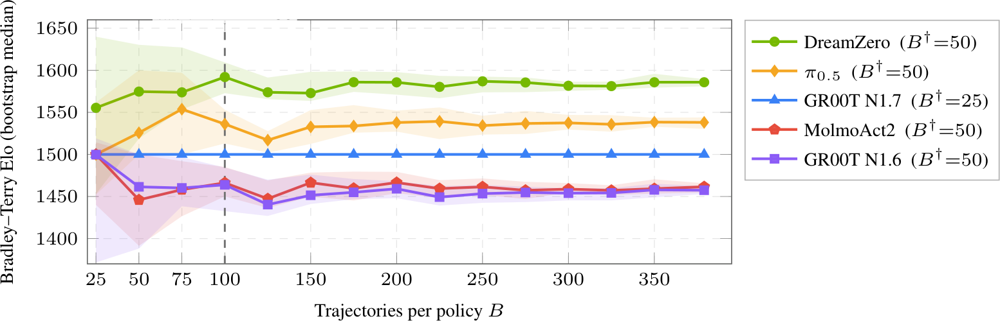
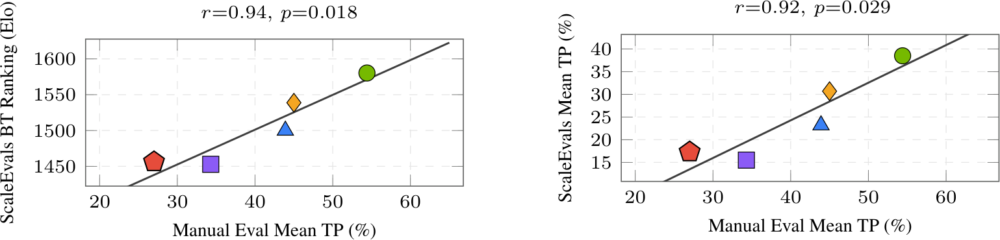
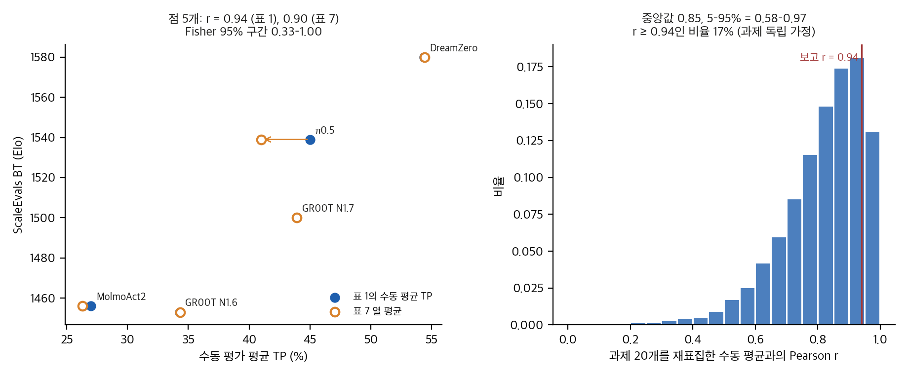
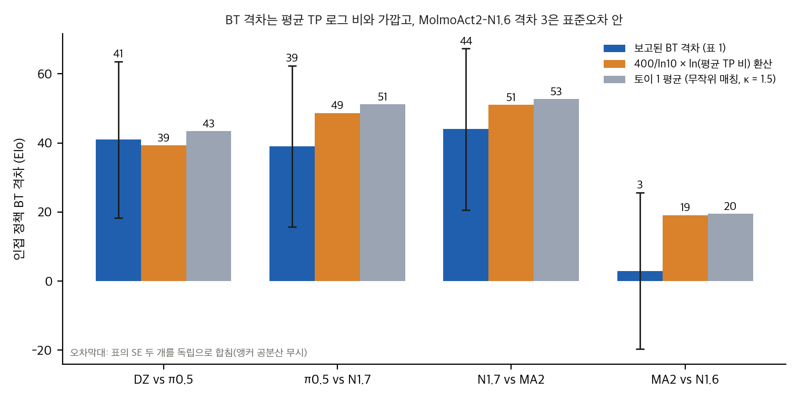
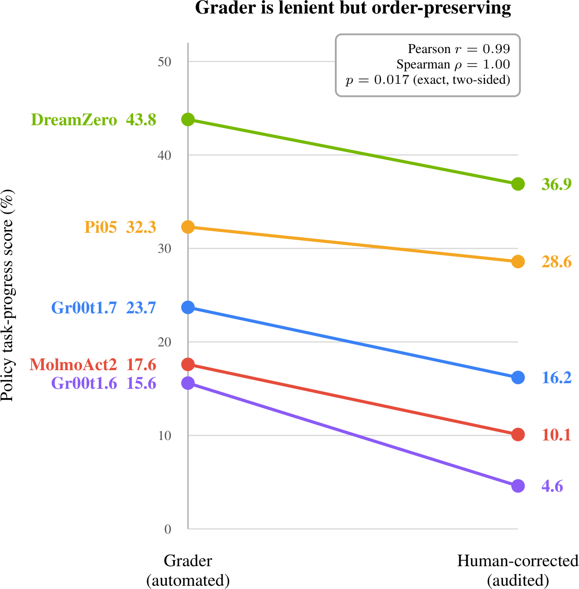
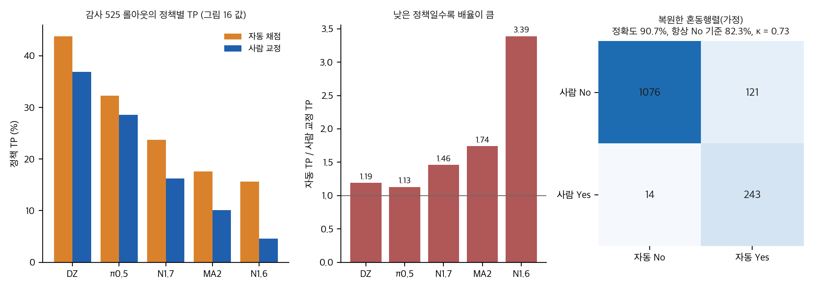
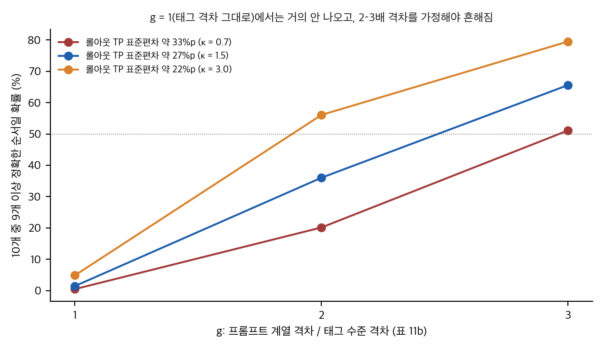

> **논문:** Amitoj Sandhu, Ethan Sick, Omkaar Buddhikot, Nadia Laswi, Wesley Durbano, Nadun Ranawaka, You Liang Tan (NVIDIA). *ScaleEvals: Scaling Generalist Policy Evaluation through Reset-Free Autonomous Play.* arXiv:2611.28411 (v1, 2026-11-20). CoRL 2026 포스터입니다. 라이선스는 CC BY 4.0입니다.
> 공식 코드는 2026-11-26 기준 확인하지 못했습니다(프로젝트 페이지에는 "Code (soon)"). 이 글의 논문 그림 세 장은 © 저자, CC BY 4.0, 출처 arXiv:2611.28411이고, 나머지 그래프는 제가 그렸습니다.

## 무엇을 하는 논문인가

실물 로봇 정책 평가는 장면 되돌리기(reset), 사람 채점, 작은 고정 과제 모음이 병목입니다. ScaleEvals는 로봇이 이전 롤아웃이 남긴 장면에서 다음 과제를 이어 받아 계속 "놀게" 하고, 그 롤아웃으로 정책을 비교합니다. 세 부품이 있습니다.

- **AutoPrompter:** 현재 장면을 보고 VLM이 과제 문장, 난이도, 스킬 태그, 마일스톤 채점표(yes/no 질문 2–4개)를 만듭니다.
- **AutoGrader:** Gemini 3 Flash가 롤아웃 영상을 마일스톤마다 채점해 작업 진행도(TP, 0–100%)를 냅니다.
- **PlayArena:** 정책 쌍마다 비슷한 롤아웃을 헝가리안 알고리즘으로 짝짓고, 두 진행도로 만든 소프트 목표 y = (P_i + ε)/(P_i + P_j + 2ε)를 Bradley–Terry(BT)로 합쳐 순위를 만듭니다. 태그별 ANOVA로 정책이 어느 스킬에서 앞서는지도 봅니다.

DROID Franka에서 정책 다섯 개(DreamZero, π0.5, GR00T N1.7, MolmoAct2, GR00T N1.6)의 롤아웃 2,486개를 모았고, 별도로 사람이 채점한 수동 평가 20과제(198회)와 비교합니다. 주장은 이렇습니다. 순위가 수동 평가와 r = 0.94, 처리량 23.0 대 14.8 롤아웃/시간, 사람 시간 98% 절감, AutoGrader가 사람과 90.7% 일치, 그리고 태그 근거를 재조합해 처음 보는 프롬프트의 순서를 96% 쌍별 일치로 맞힙니다.

표 값 자체는 대체로 잘 맞습니다. 정수 가능성, 표 4와 표 1의 차이 크기, ANOVA의 η²와 p, 처리량 산술은 다시 계산해서 재현됩니다. 아래는 표 값만으로는 해석이 정해지지 않는 곳입니다.

## 정책 5개의 r = 0.94

*그림: 논문 그림 4. 정책당 롤아웃 수에 따른 BT Elo. 정책당 약 100개부터 순서가 고정됩니다. © 저자, CC BY 4.0, 출처 arXiv:2611.28411.*

*그림: 논문 그림 5. 수동 평가 평균 TP 대 ScaleEvals BT(왼쪽)와 평균 TP(오른쪽). © 저자, CC BY 4.0, 출처 arXiv:2611.28411.*

표 1의 값으로 계산하면 Pearson r = 0.939, p = 0.018로 논문과 같습니다. 다만 점이 정책 5개뿐이라 Fisher 95% 구간이 0.34–1.00입니다. 초록의 "p = 0.018"은 Pearson의 값이고, ρ = 0.90에 대한 정확 순열 p는 0.083입니다.

수동 평가 값도 두 곳에 있습니다. 표 1의 π0.5 수동 TP는 45.0인데, 부록 표 7의 열 평균을 다시 내면 41.0입니다(표 7의 마지막 행도 0.41). 다른 네 정책은 0.7%p 안에서 맞습니다. 표 7의 값으로 수동 순위를 세면 GR00T N1.7이 π0.5보다 위가 되어 ScaleEvals와 순서가 두 쌍에서 달라지고, BT와의 r은 0.90입니다. 표 1과 표 7의 차이가 어디서 오는지는 논문만으로 알 수 없어서 저자 확인이 필요합니다.

*그림: 왼쪽은 BT 대 수동 평균 TP(표 1 값과 표 7 열 평균), 오른쪽은 표 7의 과제 20개를 재표집한 r의 분포(과제가 독립이라는 가정). 제가 그린 그래프입니다.*

수동 평균은 과제 20개의 평균이라 그 자체가 표본입니다. 과제를 재표집해 BT와의 r을 다시 만들면 중앙값이 0.85(5–95% 0.58–0.97)이고 r ≥ 0.94인 비율은 17%입니다(과제 독립 가정). 또 수동 20과제 가운데 붓기, 수건 접기, 숟가락으로 섞기는 AutoPrompter 프롬프트가 만들지 않게 한 행동(액체 붓기, 접기)과 복잡한 도구 사용 회피 규칙에 해당하는 것으로 읽힙니다(이 분류는 프롬프트 문구를 읽은 제 판단입니다). 이 셋을 빼고 17과제로 세면 r = 0.85(p = 0.07)입니다. 정리하면 순위가 수동 평가와 같은 방향이라는 점은 점추정으로 확인되지만, "수동 순위를 보존한다"고 말하기에는 수동 쪽의 과제 표본 변동까지 넣어 읽어야 합니다.

## BT 점수는 평균 진행도의 로그 비에 가깝습니다

소프트 목표가 진행도의 비율이라서, 비교가 고르게 짝지어져 있으면 BT 점수의 차이는 평균 TP 비의 로그와 가까워집니다. Elo 척도(400/ln 10)로 환산하면 인접 정책 격차가 39, 49, 51, 19 Elo이고, 표 1의 값은 41, 39, 44, 3입니다. BT와 평균 TP의 상관은 0.997입니다. 정책 효과를 BT로 합치는 방법의 이점은 매칭으로 과제 난이도를 어느 정도 맞춘다는 데 있고, 순위 자체는 평균 TP와 거의 같다는 점은 알고 읽는 편이 좋습니다.

*그림: 인접 정책 BT 격차의 보고 값, 평균 TP 로그 비 환산, 모의 실험 평균(무작위 매칭과 Beta 분포 가정). 제가 그린 그래프입니다.*

논문이 말하는 "수동 평가와의 유일한 순위 불일치"는 MolmoAct2와 GR00T N1.6인데, ScaleEvals 쪽에서 둘의 격차는 3 Elo이고 표준오차가 16입니다. 이 정도 표본에서는 순서가 구분되지 않는 쌍입니다. 수동 쪽에서도 두 정책의 차이(8.1%p)는 과제 단위 p = 0.36입니다. 표본 크기에서 오는 한계이고, 같은 모의 실험에서 Hessian 표준오차(약 15)는 실제 변동을 과소 추정하지 않았습니다(무작위 매칭 가정).

## AutoGrader의 90.7%

*그림: 논문 그림 16. 감사한 525개 롤아웃에서 정책별 자동 점수와 사람 교정 점수. © 저자, CC BY 4.0, 출처 arXiv:2611.28411.*

감사 결과(그림 16)에서 사람 교정 후 모든 정책 점수가 내려가고 순서는 유지됩니다(Pearson 0.987, 정확 순열 p = 0.017, 정책 5개). 순서 보존은 표 값으로 확인됩니다. 읽을 때 두 가지를 더 봤습니다.

*그림: 왼쪽과 가운데는 그림 16의 값, 오른쪽은 논문 한계 절의 정확도·정밀도·재현율로 복원한 혼동행렬(통과를 양성으로 둔 가정). 제가 그린 그래프입니다.*

- **정책별 과대 채점 배율.** 자동 TP를 사람 교정 TP로 나눈 값이 DreamZero 1.19, π0.5 1.13, GR00T N1.7 1.46, MolmoAct2 1.74, GR00T N1.6 3.39입니다. 순서는 같지만 낮은 정책에서 교정폭이 큽니다. BT가 TP의 비율에 가까워서 이 차이는 낮은 정책들 사이의 격차에 영향을 줄 수 있습니다.
- **90.7%의 기준선.** 정확도 90.7%, 정밀도 66.7%, 재현율 94.5%, macro F1 86.2%에서 혼동행렬을 복원하면(TP 243, FN 14, FP 121, TN 1,076) 네 수치가 서로 맞습니다. 이 행렬에서 사람이 "Yes"라고 한 판단은 18%이고, 항상 "No"라고 답하는 채점기도 82% 정확합니다. Cohen의 κ는 0.73입니다.

또 그림 14의 35개 칸에 적힌 기준 수를 합하면 1,504개(틀린 것 148개, 정확도 90.2%)이고, 본문은 1,454개 판단에 90.7%입니다. 차이 50개가 어디서 오는지는 논문에 없습니다.

## 예측 검증의 96%와 9/10

논문은 동사·스킬·물체별 BT 순위를 합쳐 처음 보는 프롬프트의 정책 순서를 미리 예측하고, 10개 프롬프트와 240 롤아웃에서 검증합니다(표 6).

- ρ̄ = 0.887은 재현됩니다. 프롬프트 하나의 ρ = 0.87은 세 정책 중 두 정책이 동점일 때의 값인데, 표는 그 프롬프트에 "정확한 순서 ✓"를 적었습니다. 동점을 맞힘으로 세면 9/10, 엄격하게 세면 8/10입니다.
- 쌍별 일치 96%는 30쌍 중 동점 두 쌍을 뺀 27/28(96.4%)과 같습니다. 동점을 절반으로 세면 93.3%, 실패로 세면 90%입니다. 저자 확인이 필요합니다.
- 다섯 개 Place 프롬프트의 예측은 전체 BT 순서(π0.5 > N1.7 > N1.6)와 같습니다. 집계 순위를 그대로 내는 기준선이 Place에서 이미 5/5이고, 실질적인 시험은 순서가 뒤집히는 Rotate 쪽 4/5입니다.

*그림: 프롬프트 계열의 정책 격차를 표 11b의 태그 수준 격차의 g배로 했을 때, 10개 중 9개 이상이 정확한 순서일 확률(롤아웃 TP를 Beta 분포로 가정한 모의 실험). 제가 그린 그래프입니다.*

프롬프트당 8회로는 순서를 맞히기가 쉽지 않습니다. 모의 실험에서 계열 평균이 표 11b의 태그 행(Place ≈ transfer, Rotate ≈ reposing)과 같으면(g = 1) 10개 중 9개 이상 정확한 순서일 확률이 0.5–4.9%이고, 격차가 2배면 20–56%, 3배면 51–80%입니다. 표 6의 9/10은 프롬프트 수준의 조건부 격차가 태그 평균보다 클 때 자연스럽게 나오는 결과입니다. 어느 쪽인지는 프롬프트별 롤아웃 값이 있어야 가려집니다.

## 처리량과 인력, 코드

순 처리량 23.0 대 14.8은 1.55배이고, 사람 4시간 → 5분(100롤아웃당)은 97.9% 감소로 "98%"가 재현됩니다. 5분이 운영 중 개입만 가리키는지, AutoGrader 감사(525 롤아웃, 코퍼스의 21%)와 장면 구성이 들어 있는지는 논문에 없습니다.

## 정리

표로 확인되는 것: 표 1의 내부 일관성, 표 4의 이동 크기, 표 6의 ρ̄, 표 11b의 η²와 p, 처리량 산술. 표 값만으로는 정해지지 않는 것: 점 5개 r의 구간과 π0.5 수동 TP의 두 값, MolmoAct2 대 GR00T N1.6의 순서, 90.7%가 낮은 양성 비율에서 나온 값이라는 점과 정책별 과대 채점, 예측 검증의 96%와 9/10가 동점을 어떻게 세는가, 인력 5분의 범위. 이 목록은 저자가 답하면 쉽게 정리될 것들입니다.

구현 쪽에서는 PlayArena 통계 파이프라인과 시뮬레이션 축소판은 노트북에서 구현할 수 있지만, 논문의 실험(로봇 여러 대, 정책 5개 서빙, 상용 VLM 채점)은 로봇과 GPU, 그리고 공개되지 않은 데이터가 필요합니다.

이 글의 재계산과 모의 실험 스크립트는 함께 올린 저장소 폴더에 있습니다.

## 자료

- [통합 리포트 PDF](report/report_public.pdf)
- [01. 논문 분석: ScaleEvals (arXiv:2611.28411)](analysis/01_paper_analysis.md)
- [02. 선행연구와 관련 자료: ScaleEvals](analysis/02_prior_work.md)
- [03. 수치 재계산과 해석: ScaleEvals](analysis/03_analysis.md)
- [04. 주장 검증과 구현 가능성: ScaleEvals](analysis/04_claim_verification.md)
