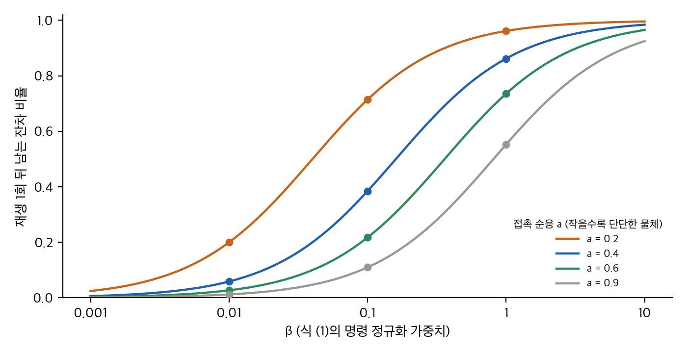

# 03. 수치 재계산과 해석: SEED-UMI (arXiv:2609.11753 v1)

스크립트: `analysis/recompute.py`(결과 `recompute_results.json`, numpy·scipy, 약 30초), `analysis/toy_paired_replay.py`(결과 `toy_paired_replay_results.json`, numpy, 1초 미만), `analysis/plot_figures.py`. 재현(로봇, 학습)은 하지 않았고 논문에 적힌 수치만 다시 계산했습니다.

## 0. 가정

- 표 1 캡션이 "20 autonomous robot rollouts per entry"라고 하므로 각 칸의 분모를 20으로 둡니다(성공 수 = 비율 x 20). 45개 칸 모두 5의 배수라서 20회 격자와 맞습니다(V4).
- 세 정책(ACT, DP, π0.5)은 같은 과제의 같은 시연으로 학습되어 서로 독립이 아닙니다. 정책을 합친 검정(과제당 60회, 전체 300회)은 독립을 가정한 것이라 구간이 좁게 나옵니다. 정책을 층으로 둔 CMH 검정을 함께 냅니다.
- 논문은 P−와 P+가 같은 정책 체크포인트에 다른 매핑을 얹은 것인지 따로 학습한 것인지 적지 않았습니다. 롤아웃별 결과가 없어 짝지은 검정(McNemar)은 못 하고 독립 표본 검정과 층화 검정만 냈습니다.
- 효율(F3)은 한 작업자, 한 과제, 30분 한 번의 측정이라 반복 분산을 알 수 없습니다.

## 1. 재계산 (V 항목)

### V1. 전체 평균 (표 1 → 본문 F1)

| 조건 | 재계산 | 본문 |
|---|---|---|
| T | 71.67 | 71.7 |
| P− | 57.33 | 57.3 |
| P+ | 70.00 | 70.0 |

세 값 모두 소수 첫째 자리까지 일치합니다. 정책별 평균(프로젝트 페이지의 Mean 열 방식, 다섯 과제 평균): ACT 74.0 / 60.0 / 73.0, DP 60.0 / 46.0 / 57.0, π0.5 81.0 / 66.0 / 80.0 (T / P− / P+).

### V2. 과제별 평균과 P+ 대 T

| 과제 | T | P− | P+ | P+ − T | P+ − P− |
|---|---|---|---|---|---|
| Screw Driving | 78.33 | 51.67 | 68.33 | −10.00 | +16.67 |
| AirPods Case | 65.00 | 65.00 | 73.33 | +8.33 | +8.33 |
| Ball Throwing | 60.00 | 60.00 | 68.33 | +8.33 | +8.33 |
| Table Cleaning | 73.33 | 50.00 | 65.00 | −8.33 | +15.00 |
| Air Freshener | 81.67 | 60.00 | 75.00 | −6.67 | +15.00 |

본문의 AirPods 73.3 대 65.0, Ball 68.3 대 60.0은 일치합니다(V2). 같은 표에서 P+가 T보다 낮은 과제는 세 개(Screw −10.0, Table −8.3, Air Freshener −6.7)이고, 본문 F1은 이를 "텔레오퍼레이션의 71.7%에 근접"으로 요약합니다.

### V3. 향상폭 (F2)

P+ − P−: 전체 +12.67(본문 +12.7), Screw +16.67(+16.7), Table +15.00(+15.0), Air Freshener +15.00(+15.0). 모두 일치합니다. AirPods와 Ball도 +8.33이고 본문은 "contact-load-dominated tasks에 집중"이라고만 씁니다(V9, K5).

### V4. 정수 가능성

모든 셀이 5의 배수이므로 n = 20에서 정수 성공 수(예: 70% = 14/20)와 맞습니다. 과제별 합산(60회)은 P+ 73.3% = 44/60, 68.3% = 41/60, 65.0% = 39/60처럼 소수 둘째 자리 표기와 맞습니다. 이 점에서 표 안의 수치 모순은 찾지 못했습니다.

### V5. 합산 검정 (과제당 60회 가정): P+ 대 T

| 과제 | 성공 (P+ / T) | 차이 (%p) | Newcombe 95% | Fisher p |
|---|---|---|---|---|
| Screw | 41 / 47 | −10.0 | −25.2 – +5.8 | 0.30 |
| AirPods | 44 / 39 | +8.3 | −8.1 – +24.2 | 0.43 |
| Ball | 41 / 36 | +8.3 | −8.7 – +24.7 | 0.45 |
| Table | 39 / 44 | −8.3 | −24.2 – +8.1 | 0.43 |
| Air Freshener | 45 / 49 | −6.7 | −21.2 – +8.1 | 0.51 |

과제별로 P+와 T의 차이는 어느 쪽에서도 구간이 0을 포함합니다. AirPods와 Ball에서 "P+가 T보다 높다"(F1)는 방향은 확인되지만 p = 0.43–0.45입니다. 같은 차이(+8.3%p, 기저 0.6–0.65)를 검정력 80%로 가르려면 한 쪽당 약 510–540회가 필요합니다(시뮬레이션, `recompute_results.json`의 `n_per_arm_for_80pct_power`).

### V6. P+ 대 T 전체

- 전체 합산 210/300 대 215/300: 차이 −1.7%p, Newcombe 95% 구간 −8.9 – +5.6, Fisher p = 0.72.
- 15개 (과제, 정책) 층의 CMH: 공통 오즈비 0.92, p = 0.65.
- 15개 쌍 중 P+가 높은 쌍 6, 낮은 쌍 9, 같은 쌍 0: 부호 검정 p = 0.61.

"70.0%가 71.7%에 근접"하다는 문장과 일관된 값입니다. 다만 구간이 −8.9%p까지 내려가므로(독립 가정에서) 5%p 이내 동등이라고 결론내기에는 시도 수가 부족합니다.

### V7. P+ 대 P− (미세조정 효과)

- 전체 합산 210/300 대 172/300: +12.7%p, 95% 구간 +5.0 – +20.2, Fisher p = 0.0017. 15개 층 CMH: 공통 오즈비 1.78, p = 0.0011.
- 과제별(60회 합산): Screw 0.093, AirPods 0.43, Ball 0.45, Table 0.14, Air Freshener 0.12. 5개 과제 Holm 보정 후 0.47–0.86이라 과제 하나씩으로는 유의하지 않습니다.
- 15개 (과제, 정책) 쌍 모두에서 P+가 P−보다 높습니다(향상 +5에서 +20%p).

미세조정이 도움이 된다는 방향은 합쳐서 보면 분명하고, 어느 과제에서 얼마나 큰지는 과제별로는 가려지지 않습니다.

### V8. P− 대 T

전체 172/300 대 215/300: −14.3%p, 구간 −21.8 – −6.7, p = 0.0003. Screw(p = 0.004), Table(0.014), Air Freshener(0.015)에서 P−가 T보다 낮고 AirPods와 Ball에서는 같습니다(p = 1.0). 곧 매핑 미세조정 없이 사람 쪽 시연을 쓰면 세 과제에서 텔레오퍼레이션 기준선보다 낮아집니다.

### V9. F2의 "접촉 하중 우세 과제에 집중" 이질성

접촉 하중 우세로 불린 3개(Screw, Table, Air Freshener)의 평균 향상 +15.6%p, 나머지 2개(AirPods, Ball) +8.3%p. 차이 +7.2%p, Wald z = 0.91, p = 0.36(독립 가정). 방향은 서술과 같지만 두 군의 향상폭이 다르다고 말할 근거는 이 표에서는 부족합니다.

### V10. 정책 비교

P+ 조건의 정책별 합(100회): ACT 73, DP 57, π0.5 80. π0.5 대 DP p = 7.4e-4, ACT 대 DP p = 0.026, π0.5 대 ACT p = 0.32. 순위 π0.5 > ACT > DP는 세 조건 모두 같습니다. 논문은 백본 비교를 주장하지 않지만 세 백본의 하이퍼파라미터 설정도 적혀 있지 않습니다(`04` C13).

### V11. 효율 (F3, 그림 7)

- 52/18 = 2.889. 반올림하면 2.9이고 초록·결론의 "3.0×"와 0.1 차이입니다. 본문 F3와 §1은 "almost 3.0×"로 씁니다.
- 같은 30분 창의 두 건수를 포아송으로 보면 비율의 정확 95% 구간은 1.66 – 5.25, 비율 1 대비 p = 5.9e-5입니다. 방향(SEED-UMI가 빠르다)은 이 한 번의 측정에서 분명하지만 반복 분산(작업자, 세션)은 없습니다.
- 시연 하나당 시간으로 환산하면 텔레오퍼레이션 100초, SEED-UMI 34.6초입니다(성공 시연 기준, 실패·리셋 시간은 밝히지 않음). 100개를 모으면 166.7분 대 57.7분입니다.
- "성공 정규화 약 2.9×"는 P+ 70.0%와 T 71.7%를 쓰면 2.889 x 0.700/0.717 = 2.82입니다. 계산 방식에 따라 값이 바뀝니다(AirPods만의 P+ 73.3과 T 65.0을 쓰면 3.26, P− 65.0과 T 65.0을 쓰면 2.89). 본문이 쓴 2.9가 어느 정규화인지 적혀 있지 않습니다. 저자 확인이 필요합니다.
- 보정 비용을 넣으면 상쇄 시점이 달라집니다(가정 계산): 보정 에피소드 250개를 에피소드당 30초, 60초, 120초(사람과 로봇 재생 합산)로 가정하면 보정에 125분, 250분, 500분이 듭니다. 과제 하나의 100개 시연에서 아끼는 시간은 109분이므로 손익분기는 각각 1.15개, 2.29개, 4.59개 과제입니다. 보정이 과제와 무관하게 한 번이면 여러 과제에 걸쳐 상쇄되고, 과제마다 다시 해야 하면 상쇄되지 않습니다. 논문은 이 비용을 효율 비교에서 제외한다고 적었고(§5.1) 보정이 과제 의존인지 손 의존인지는 밝히지 않았습니다.

### V12. 검정력

셀당 20회에서 기저 0.6일 때 +10%p 차이를 검출할 확률은 6%, +20%p는 19%, +30%p는 50%입니다(Fisher, 모의 4000회). 과제당 60회 합산에서 +8.3%p는 11%, +15%p는 35%입니다. 표 1의 셀 단위 차이(5–10%p)는 단일 셀로는 검출 불가능한 크기입니다.

## 2. 일관성 검사 (K 항목)

| 번호 | 내용 | 결과 |
|---|---|---|
| K1 | 효율 배수 표기 | 초록·그림 7·결론 3.0×, §1과 F3 "almost 3.0×"/"거의 3.0배", 계산 2.889(V11). 같은 값의 서로 다른 반올림 |
| K2 | 평균 70.0% 대 71.7% | 일치(V1). "approaching"은 −1.7%p이고 구간은 −8.9 – +5.6(V6) |
| K3 | P−와 T의 셀 값 | AirPods와 Ball 두 과제에서 세 정책 모두 같은 값(65/55/75, 60/50/70). 6개 셀. 그 결과 이 두 과제의 "P+ − T"와 "P+ − P−"가 정확히 같습니다. 같은 값이 나온 이유(평가 조건이 같은 경우, 롤아웃을 공유한 경우 등)는 표만으로 알 수 없습니다. 저자 확인이 필요합니다 |
| K4 | "P+가 T를 넘는다" | 과제 5개 중 2개, (과제, 정책) 15쌍 중 6쌍. 나머지 9쌍은 T가 높음(V6). 쌍별 차이가 ±5 또는 ±10%p로 규칙적이지만(ACT −10, +10, +10, −10, −5 등), 셀 20회에서 5%p는 1회 차이입니다 |
| K5 | F2 "접촉 하중 우세에 집중" | AirPods와 Ball에서도 +8.3%p입니다. 세 과제 15.6 대 두 과제 8.3, p = 0.36(V9) |
| K6 | 평가 분모 | 본문 "20 rollouts per task-backbone-condition", 캡션 "per entry"로 같음. 45칸 x 20 = 900회 |
| K7 | 데이터 양 | 시연 100개/과제는 세 조건 같음. 조건별 수집 시간은 다름(T는 로봇 쪽 실시간, P는 사람 쪽). 같은 시간 예산 비교는 아님 |
| K8 | 그림 7 | 수치 축이 없는 개념도입니다. 표 값과 위치를 대조할 수 없습니다 |
| K9 | 식 (1)의 기호 | β, λ, K, L(청크 길이)이 값 없이 쓰임. g_φ의 입력은 사람 이력 h^h이나 학습은 로봇 이력으로 한다고 읽힘(M.2) |
| K10 | 시연 수집 "decouples from teleoperation" | 보정 에피소드 250개는 로봇 재생이 필요합니다(M.2, §5.1). 시연 수집은 로봇 없이 가능하고 보정은 로봇이 필요합니다 |
| K11 | 참고 인용 | §1의 "DexUMI [19, 20, 21]"에서 [20, 21]은 영상 변환 방법(`01` §5) |
| K12 | 수집 효율 정의 | "successful AirPods demonstrations"의 성공 판정 기준, 실패 시연의 시간, 에피소드 사이 리셋 시간 포함 여부가 없음 |

## 3. 해석 요약

1. 수치 재계산 상 표 1의 평균과 향상폭, 본문 인용은 모두 일치합니다.
2. 미세조정 효과는 정책을 합친 검정(p ≈ 0.001)에서 분명하고 과제별로는 가려집니다.
3. 텔레오퍼레이션과의 비교는 같다/조금 낮다를 가르지 못하는 구간(−8.9 – +5.6%p)입니다. "throwing에서 능가"는 +8.3%p, p = 0.45입니다.
4. 효율은 방향은 분명하지만 한 번의 측정이라 크기의 불확실성이 큽니다(1.66 – 5.25배). 보정 비용이 과제에 의존하는지에 따라 순이득이 달라집니다.

## 4. 토이 T1: 식 (1)의 정규화가 접촉 보정에 미치는 영향

`analysis/toy_paired_replay.py`. 신경망이 아니라 닫힌 형태를 직접 푼 1축 모형입니다(처음에 신경망 변형을 시도했으나 학습 예산 안에서 닫힌 식의 β = 0 극한(잔차 0)에도 도달하지 못해 결과를 쓰지 않았고, 최소제곱 직접 풀이로 대체했습니다).

**모형(가정).** 로봇 명령 q, 로봇 엔코더 e_r = q (접촉점 c 이하), e_r = c + a(q − c) (접촉, a = kp/(kp + k_obj), 물체가 단단할수록 작음). 사람은 c + 0.05까지 눌러 유지. f_θ0는 항등. 접촉 구간의 매핑을 q = e + k(e − c)로 매개화하고 식 (1)을 k에 대해 최소화합니다. λ 항은 뺐습니다.

**닫힌 식.** 최소해는 k = (a(1 − a) + β k_prev)/(a² + β)이고, 재생 한 번 뒤 남는 엔코더 잔차는 초기 잔차(1 − a)·0.05의 β/(a² + β)배입니다. 재생을 한 번 더 하면(논문 "한 번 반복") 이 비율이 한 번 더 곱해집니다. 직접 풀이 결과가 이 식과 소수 5자리까지 일치합니다.

| a (순응) | 초기 잔차 | β = 0.01: 1회 / 2회 | β = 0.1: 1회 / 2회 | β = 1: 1회 / 2회 |
|---|---|---|---|---|
| 0.2 (단단한 물체) | 0.0400 | 0.0080 / 0.0016 | 0.0286 / 0.0204 | 0.0385 / 0.0370 |
| 0.4 | 0.0300 | 0.0018 / 0.0001 | 0.0115 / 0.0044 | 0.0259 / 0.0223 |
| 0.6 | 0.0200 | 0.0005 / 0.00001 | 0.0044 / 0.0010 | 0.0147 / 0.0108 |

**읽는 법.** 접촉이 단단할수록(a 작을수록) 첫 항의 기울기가 a²에 비례해 작아져서, 같은 β에서 정규화가 보정을 더 많이 누릅니다. β = 0.1이면 a = 0.2에서는 재생 한 번 뒤에도 초기 잔차의 71%가 남습니다. 논문 β는 값이 공개되어 있지 않으므로 이 식은 "β가 크면 단단한 접촉에서 보정이 약해질 수 있다"는 방향만 말합니다. 순방향 모델 g_φ의 접촉 기울기를 재생 데이터의 접촉 구간(닫기 구간의 c → c + 0.05)에서 잡음 σ까지 적합한 몬테카를로(300회)에서는 σ = 0.01에서 a_hat의 표준편차가 약 0.03이고 1회 뒤 잔차 평균이 초기의 약 14% 이하여서(a = 0.2, 0.0056 대 0.04), 이 깨끗한 선형 모형에서는 기울기 식별이 병목이 아니었습니다. 실제 손의 히스테리시스, 다축 결합, 물체별 강성을 반영한 결과가 아닙니다.

## 5. 이 문서가 말하지 않는 것

- 롤아웃 단위 데이터가 없어서 짝지은 검정과 시도 재사용 여부는 판정하지 못했습니다.
- 정책 간 상관을 모르므로 합산 구간은 낙관적입니다. 층화 검정(CMH)과 방향이 같습니다.
- 토이는 논문의 설정을 재현한 것이 아니라 식 (1)의 정규화 항이 가진 성질을 확인한 것입니다.
