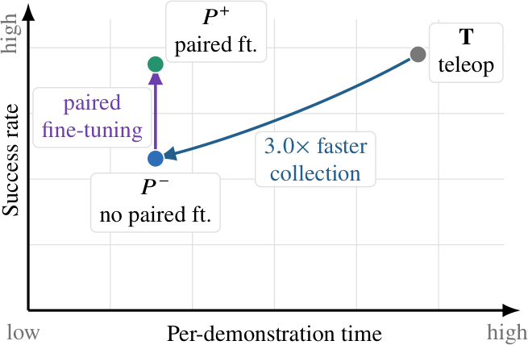
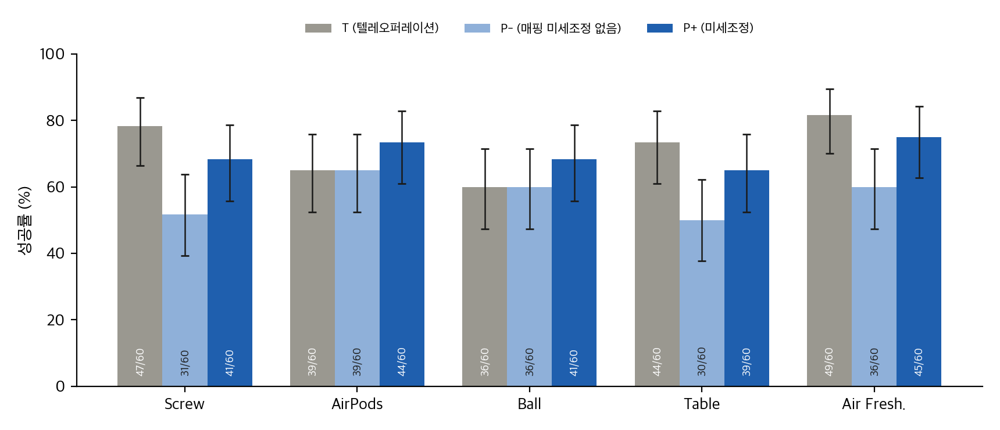
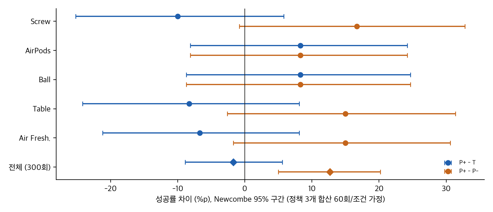
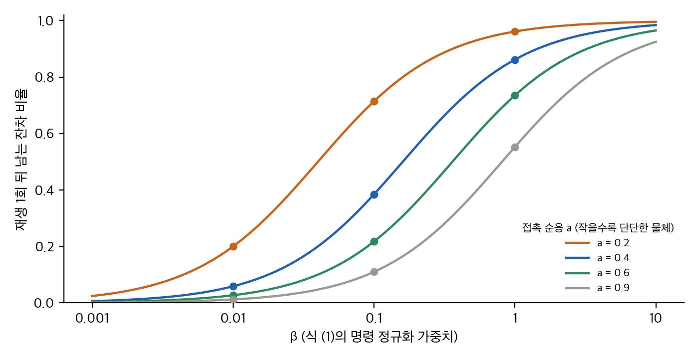

> **논문:** Tengbo Yu, Jiahao Wu, Daohan Li, Bingxu Chen, Hao Liu, Xiaojian Ma, Hangxin Liu. *SEED-UMI: Sharing the Exoskeleton between human and robot for onE-to-one Dexterous demonstration.* CoRL 2026 포스터, arXiv:2609.11753 (v1, 2026-09-10).
> 프로젝트 페이지(`tengbo-yu.github.io/SEED-UMI/`)와 GitHub 저장소 `Tengbo-Yu/SEED-UMI`가 있지만, 저장소는 프로젝트 페이지의 소스이고 방법 구현은 들어 있지 않습니다. 이 글의 그림은 논문 그림 한 장(출처 표기)과 우리가 그린 그래프입니다.

## 논문이 묻는 것

손 모션 캡처로 모은 시연을 로봇 손으로 옮길 때는 사람 손과 로봇 손 사이의 매핑이 필요합니다. 외골격 계열은 이 매핑을 자유 공간에서 한 번 맞추는데, 접촉에서는 마찰과 외부 하중 때문에 어긋날 수 있습니다. SEED-UMI는 같은 외골격을 사람과 로봇이 모두 끼게 해서 이 문제를 다룹니다. 관절 엔코더(20개)와 손목 카메라가 두 쪽에서 같은 물리 측정이 되므로, 사람 엔코더와 로봇 엔코더를 짝지은 데이터로 매핑을 학습하고 정책은 원본 손목 영상으로 학습합니다.

매핑은 두 단계입니다. 로봇이 외골격을 끼고 자유 공간을 탐색해(motor babbling) 초기 매핑을 만들고, 사람 시연을 로봇에 재생해 얻은 짝지은 엔코더 데이터로 순방향 모델 g를 포함한 손실(논문 식 (1))로 미세조정합니다. 평가는 RealMan 팔과 Wuji 손(20자유도)에서 5개 과제, 3개 정책(ACT, Diffusion Policy, π0.5), 3개 조건(텔레오퍼레이션 T, 미세조정 없음 P−, 미세조정 P+)으로 했고 칸마다 롤아웃 20회입니다.

*그림 7 (논문 원문, 개념도로 수치 축이 없습니다). © 저자, CC BY 4.0, 출처 arXiv:2609.11753.*

## 이 글에서 확인한 것

**1. 표 1의 평균과 향상폭은 모두 재현됩니다.** 전체 평균은 T 71.67%, P− 57.33%, P+ 70.00%이고 본문의 71.7, 57.3, 70.0과 맞습니다. P+ − P− 향상도 전체 +12.7, Screw +16.7, Table +15.0, Air Freshener +15.0이 표에서 나옵니다. 45개 칸이 모두 20회 격자(5%p 단위)와 맞습니다.

*그래프 (우리가 그림). 정책 3개를 합산해 과제당 60회로 본 값입니다(시행 수 20 x 3 가정). 정책들이 같은 시연으로 학습되어 독립이 아니므로 구간은 좁게 나옵니다.*

**2. 미세조정 효과는 합쳐서 분명하고, 과제별로는 가려집니다.** P+ 대 P−는 210/300 대 172/300(+12.7%p, 95% 구간 +5.0 – +20.2, Fisher p = 0.0017이고 정책을 층으로 둔 CMH도 p = 0.0011)입니다. 15개 (과제, 정책) 쌍 모두에서 P+가 높습니다. 과제 하나씩 보면 Fisher p는 0.09–0.45이고 5개 과제 Holm 보정 후에는 0.47–0.86입니다. 논문은 향상이 접촉 하중이 큰 세 과제에 "집중"된다고 쓰는데, 그 세 과제의 평균 향상 15.6%p와 나머지 두 과제 8.3%p의 차이는 p = 0.36(독립 가정)이라 이 표만으로는 두 군의 차이를 가르기 어렵습니다.

**3. 텔레오퍼레이션과의 우열은 가려지지 않습니다.** P+ 대 T는 210/300 대 215/300으로 −1.7%p(구간 −8.9 – +5.6, p = 0.72)입니다. "텔레오퍼레이션 71.7%에 근접"이라는 서술과 일관되지만, 구간이 −9%p까지 내려가므로 5%p 이내 동등이라고 말하기에는 시도 수가 부족합니다. "던지기에서 T를 능가"는 +8.3%p이고 p = 0.45입니다(AirPods도 +8.3%p, p = 0.43). 같은 크기의 차이를 80% 검정력으로 가르려면 한 쪽당 약 510–540회가 필요하다고 모의로 추정했습니다.

*그래프 (우리가 그림). 정책 3개 합산 과제당 60회 가정. 아래쪽 마름모는 전체 300회입니다.*

**4. 표 1에서 P−와 T가 두 과제에서 세 정책 모두 같은 값입니다.** AirPods는 65/55/75, Ball Throwing은 60/50/70으로 두 조건이 일치합니다(6개 셀). 그 결과 이 두 과제의 "P+ − T"와 "P+ − P−"가 정확히 같고, 나머지 세 과제에서는 P−가 T보다 21.7–26.7%p 낮습니다. 같은 값이 나온 이유는 표만으로는 알 수 없어서 저자 확인이 필요합니다.

**5. 수집 효율 3.0배는 한 번의 측정입니다.** 같은 작업자가 AirPods 과제를 30분씩 했을 때 성공 시연이 18개(텔레오퍼레이션)와 52개(SEED-UMI)였고 비율은 2.889입니다. 초록과 결론은 3.0×, 본문은 "almost 3.0×"로 씁니다. 두 건수를 포아송으로 보면 비율의 95% 구간은 1.66–5.25입니다. 성공 정규화 값 "약 2.9×"는 기재된 성공률(P+ 70.0%, T 71.7%)로 계산하면 2.82이고, 계산에 쓴 성공률에 따라 값이 달라집니다(AirPods만의 73.3과 65.0이면 3.26). 논문은 보정 에피소드 250개와 babbling 시간을 효율 비교에서 뺍니다. 보정이 과제나 손마다 반복되는지에 따라 손익이 달라집니다. 에피소드당 30, 60, 120초(가정)로 보면 손익분기는 약 1.2, 2.3, 4.6개 과제입니다.

## 토이로 본 것: 식 (1)의 정규화 항

식 (1)의 둘째 항은 명령을 "재생에 쓴 명령"(직전 매핑의 출력) 쪽으로 당깁니다. 접촉에서 로봇 엔코더가 명령에 둔감하면(단단한 물체) 첫 항의 기울기가 작아져서 이 당김이 보정을 누를 수 있습니다. 1축 선형 접촉 모형(e_r = c + a(q − c), a가 작을수록 단단함)에서 식 (1)을 최소화하면 재생 한 번 뒤에 남는 잔차 비율이 β/(a² + β)로 나옵니다. β = 0.1, a = 0.2이면 71%가 남고, 한 번 더 재생하면 51%입니다.

*그래프 (우리가 그림). 1축 접촉 토이의 닫힌 식과 직접 풀이 결과(점)입니다. 실로봇 결과가 아니고, 논문은 β, λ, 순방향 모델 g의 구조를 밝히지 않아서 실제 값에서의 크기는 알 수 없습니다.*

## 구현 가능성 (Apple M4 Pro, CUDA 없음)

- **외골격 제작과 실로봇 평가: 불가.** CAD와 부품 목록, 데이터, 체크포인트가 공개되어 있지 않고 Wuji 손과 RealMan 팔이 필요합니다.
- **매핑 학습 구조: 합성 환경에서 가능.** 작은 MLP와 최소제곱으로 구현할 수 있고 위 토이가 가장 단순한 형태입니다. 다축 손가락, 히스테리시스, 관측 경로 절제까지 확장하는 일은 며칠에서 2주 정도로 추정합니다(측정 전).
- **정책 학습(ACT, DP, π0.5): 데이터가 없고 π0.5는 GPU가 필요합니다.**

이 글은 재현 실험을 하지 않았고, 논문에 적힌 수치를 다시 계산했습니다.

## 한계

- 칸당 20회, 시드 분산 없음. 정책 간 상관을 모르므로 합산 구간은 낙관적입니다(층화 검정은 같은 방향).
- 롤아웃별 기록이 없어 P−와 P+가 같은 정책에 매핑만 바꾼 것인지, 짝지은 검정이 가능한지 확인하지 못했습니다.
- 사람-로봇 엔코더 잔차(미세조정 전후)의 정량값이 논문에 없어 매핑 품질의 직접 지표를 볼 수 없습니다. 정책이 엔코더를 입력으로 받으므로 매핑의 효과가 행동 경로와 관측 경로 두 곳에서 나타날 수 있고 표 1로는 나누지 못합니다.
- 시각 정렬("분할·인페인팅 불필요")과 "자연스러운 시연"에는 비교 실험이나 착용 측정이 없습니다.

## 출처와 라이선스

- 논문: arXiv:2609.11753, CC BY 4.0(arXiv abs 페이지의 라이선스 링크 확인). 원문 PDF 저작권 표시는 찾지 못했습니다.
- 그림 7만 논문 원문에서 잘라 실었습니다(© 저자, CC BY 4.0). 사진이나 영상 프레임이 있는 그림과 3D 렌더 그림은 싣지 않았습니다.
- 표 값은 인용과 재계산을 위해 옮겼습니다. 그래프, 토이, 분석 문서와 스크립트는 이 저장소 작성자가 만들었습니다.
- GitHub 저장소 `Tengbo-Yu/SEED-UMI`는 프로젝트 페이지 소스라서 코드로 보지 않았고 클론하지 않았습니다.

## 자료

- [통합 리포트 PDF](report/report_public.pdf)
- [01. 논문 분석: SEED-UMI (arXiv:2609.11753)](analysis/01_paper_analysis.md)
- [02. 선행연구와 관련 저장소: SEED-UMI (arXiv:2609.11753)](analysis/02_prior_work.md)
- [03. 수치 재계산과 해석: SEED-UMI (arXiv:2609.11753 v1)](analysis/03_analysis.md)
- [04. 주장 검증: SEED-UMI (arXiv:2609.11753 v1)](analysis/04_claim_verification.md)
