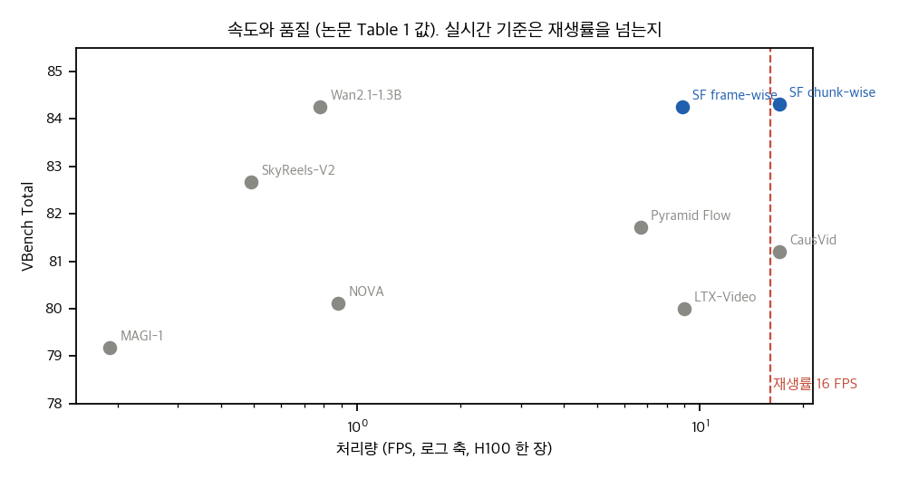
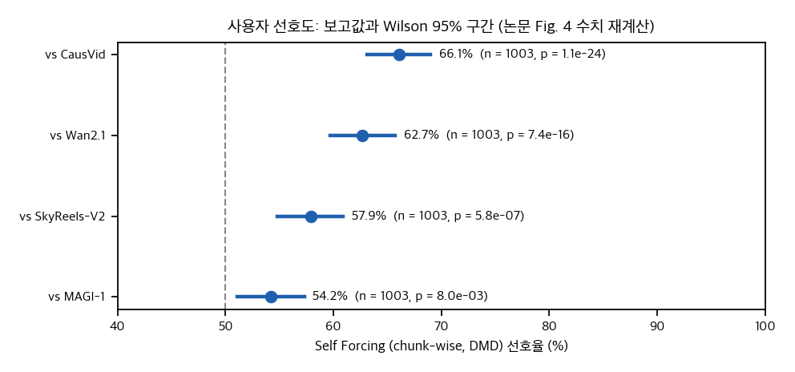
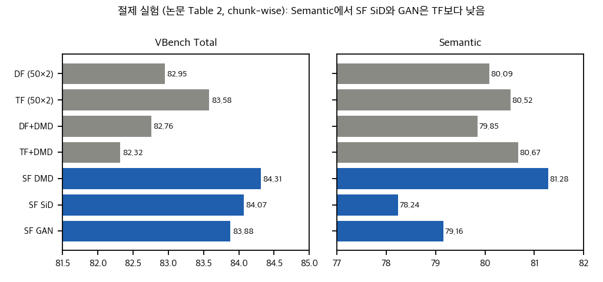

> **논문:** Xun Huang, Zhengqi Li, Guande He, Mingyuan Zhou, Eli Shechtman. *Self Forcing: Bridging the Train-Test Gap in Autoregressive Video Diffusion.* NeurIPS 2025, arXiv:2506.08009 (v2, 2025-11-10).
> 공식 코드는 GitHub guandeh17/Self-Forcing(Apache-2.0)에 있습니다. 논문은 CC BY-NC-SA 4.0입니다. 이 글의 그래프는 모두 논문 수치로 우리가 그렸고, 논문 그림은 싣지 않았습니다.

## 논문이 묻는 것

자기회귀 영상 확산 모델은 한 프레임씩 만들어 실시간 스트리밍에 맞습니다. 그런데 학습은 정답 프레임을 문맥으로 주고, 추론은 자기 출력을 문맥으로 씁니다. 이 차이를 노출 편향(exposure bias)이라고 하며, 프레임이 쌓일수록 오류가 커집니다.

Self Forcing은 학습 중에도 모델이 자기 출력으로 프레임을 이어 만들게 합니다. 그리고 프레임 하나의 오차가 아니라 영상 전체에 대한 분포 정합 손실(DMD, SiD, GAN 중 하나)로 감독합니다. 학습 비용을 줄이려고 디노이징 단계를 4개로 줄이고, 무작위로 고른 한 단계에서만 기울기를 흘립니다.

## 방법: 학습 루프 한 장으로

1. 영상마다 디노이징 단계 s를 무작위로 하나 뽑습니다.
2. 프레임을 처음 단계부터 디노이징하되, s 단계의 출력만 기울기를 켠 채 계산합니다.
3. 그 출력을 KV 캐시에 넣되, 캐시로 흐르는 기울기는 끊습니다.
4. 생성된 영상 전체에 분포 정합 손실을 걸고 한 번 갱신합니다.

추론에서는 가장 오래된 캐시를 버리는 롤링 KV 캐시를 씁니다. 긴 영상에서 생기는 깜빡임은 학습 중에 마지막 청크가 첫 청크를 보지 못하게 어텐션 창을 제한해서 줄였다고 합니다.

## 우리가 확인한 것

**학습 루프는 공식 코드와 맞습니다.** 저장소의 `pipeline/self_forcing_training.py`에서 무작위 단계, 마지막 단계만 기울기, 캐시 기울기 차단이 논문 알고리즘 1과 같은 순서로 구현돼 있습니다. 학습률, 배치, 옵티마이저 값도 논문 표 3과 같습니다.

**VBench 우위는 잡음 수준입니다.** 표 1에서 Self Forcing chunk-wise의 Total은 84.31이고 Wan2.1은 84.26입니다. 차이는 0.05입니다. 점수 분산을 보고하지 않아서 우위라고 말할 수 없습니다. 같은 표의 Total은 Quality와 Semantic을 0.8 대 0.2로 섞은 값으로 재계산이 맞습니다.

그래프: 논문 표 1의 처리량(FPS, 로그 축)과 VBench Total을 우리가 다시 그렸습니다.

**사용자 선호도 우위는 확인됩니다.** 1003개 MovieGenBench 프롬프트에서 Self Forcing은 CausVid에 66.1%, Wan2.1에 62.7%, SkyReels-V2에 57.9%, MAGI-1에 54.2%로 이겼습니다. 네 비교 모두 보정 후에도 p < 0.05입니다. 다만 프롬프트당 평가자가 한 명이라 평가자 간 일치는 볼 수 없습니다.

그래프: 논문 Fig. 4의 수치에서 역산한 승수와 Wilson 95% 구간. 우리가 그렸습니다.

**절제 주장은 Total에서만 맞습니다.** 표 2에서 Self Forcing은 Total과 Quality에서 모든 기준선보다 높습니다. Semantic에서는 DMD만 최고이고, SiD(78.24)와 GAN(79.16)은 TF(80.52)보다 낮습니다.

그래프: 논문 표 2 (chunk-wise)의 Total과 Semantic을 우리가 다시 그렸습니다.

**실시간성은 여유가 6%입니다.** H100 한 장에서 chunk-wise는 17.0 FPS로 재생률 16 FPS를 넘습니다. 논문이 정한 기준(처리량이 재생률을 넘을 것)에 맞춰 보면 frame-wise(8.9 FPS)는 실시간이 아닙니다. 저장소 README는 RTX 4090 실시간을 말하지만, 그 수치는 논문이나 저장소에 없습니다.

**공개 저장소에는 빠진 것이 있습니다.** 롤링 캐시의 첫 청크 차단을 켜는 설정(`local_attn_size`)이 공개 학습 설정에 없고, GAN 설정 파일도 없습니다. frame-wise 설정과 체크포인트 이름도 공개돼 있지 않습니다.

## 재현할 수 있는가

**학습은 이 맥에서 불가능합니다.** DMD는 14B 교사 모델과 H100 64장, 약 1.5–2 시간을 씁니다. SiD와 GAN도 같은 규모입니다.

**공개 1.3B 추론은 조건부입니다.** 체크포인트 다운로드, 저장소의 CUDA 호출 12곳을 MPS로 바꾸는 작업, 속도 측정이 필요합니다. 포팅은 1–2주쯤으로 보지만 측정하지 않았습니다.

**CPU로 할 수 있는 것은 설계입니다.** 작은 자기회귀 확산 모델에서 정답 문맥과 자기 출력 문맥의 오차 누적을 비교하는 실험은 CPU에서 2분 안에 돌릴 수 있을 것으로 보입니다. 아직 만들지 않았습니다.

## 남는 질문

- 학습 루프의 이득이 목적함수 선택과 얼마나 독립적인가? 논문은 DMD에서 가장 좋다고 하지만 Semantic 역전이 있습니다.
- 첫 청크 차단은 어떤 설정으로 실험했는가? 공개 설정으로는 확인할 수 없습니다.
- 자기 출력 롤아웃이 행동 토큰이나 정책 평가 환경에도 같은 효과를 내는가? 이 질문은 논문 범위 밖입니다.

## 한계

- 수치는 모두 논문 보고값입니다. 재실행하지 않았습니다.
- 그림 4와 6은 그림 텍스트와 축으로만 읽었습니다.
- 학회는 NeurIPS 2025 본 학회로 확인했고, spotlight는 공식 목록에서 확인하지 못했습니다.

## 자료

- [통합 리포트 PDF](report/report_public.pdf)
- [01. 논문 분석: Self Forcing (arXiv:2506.08009)](analysis/01_paper_analysis.md)
- [02. 선행연구, 공식 코드, 관련 분석](analysis/02_prior_work.md)
- [03. 수치 재계산과 일관성 검사](analysis/03_analysis.md)
- [04. 공식 코드 대조와 구현 가능성](analysis/04_code_verification.md)
