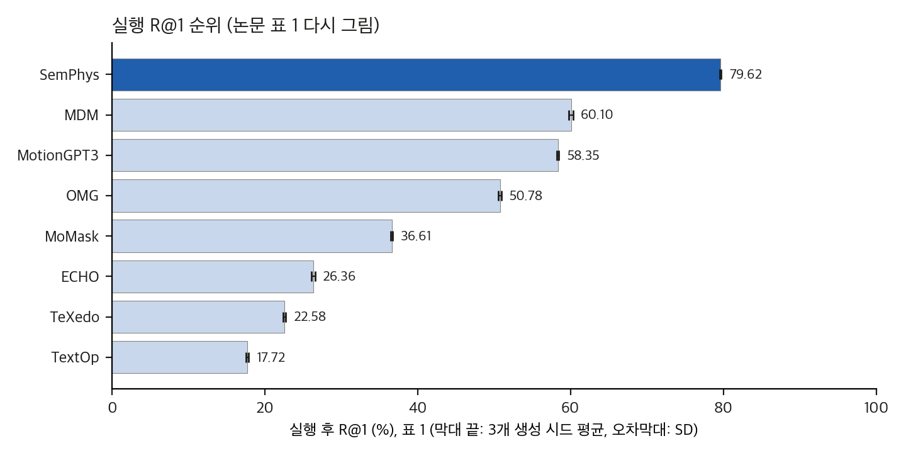
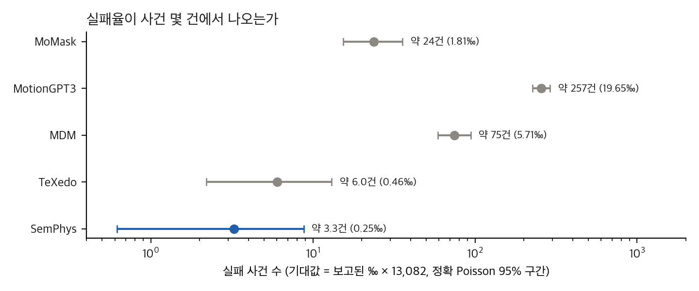
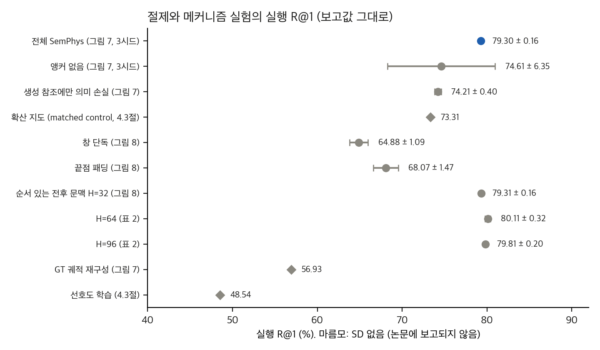

> **논문:** Zejian Kang 외. *SemPhys: Semantic-Physical Co-Learning for Humanoid Motion Generation via Differentiable World Models.* arXiv:2611.24074 (v1, 2026-11-18). 학회 표기는 없습니다.
> 논문 라이선스는 CC BY-NC-ND 4.0입니다. 논문 그림은 싣지 않고, 우리가 만든 그래프만 씁니다. 공식 코드와 프로젝트 페이지는 찾지 못했습니다.

## 논문이 묻는 것

"180도 돌고 앞으로 걸어라"라는 말을 휴머노이드에게 시키면, 텍스트 모델은 그럴듯한 참조 동작을 만듭니다. 그런데 실제로 로봇을 움직이면 추종 제어기가 균형을 맞추려고 회전을 줄이거나 팔을 떨굽니다. 그러면 걷는 방향이 달라져서 지시와 어긋납니다.

논문의 주장은 단순합니다. 의미가 맞는지는 참조 동작이 아니라 로봇이 실제로 실행한 동작에서 봐야 한다는 것입니다. BONES-SEED에서 MotionGPT3는 참조의 74.08%에서 지시를 맞혔지만, 실행에서는 58.18%만 맞혔다고 보고합니다.

방법인 **SemPhys**는 이 실행 점수를 생성기 학습에 씁니다. 학습된 세계모델과 고정된 추종 제어기가 전체 궤적 가운데 짧은 창(0.64초) 하나를 다시 예측하고, 그 예측을 원래 시간 위치에 넣어 전체 궤적의 의미 점수를 매깁니다. 그래디언트는 그 창을 지나 생성기 투영 헤드로 들어갑니다. 같은 지시와 노이즈에 대해 초기 생성기 출력을 기준으로 삼는 쌍 앵커가 학습을 붙잡습니다.

## 이 글에서 확인한 것

**실행 R@1 우위는 방향이 확실합니다.** 논문 표 1에서 SemPhys의 실행 R@1은 79.62%이고 MDM은 60.10%입니다. 차이는 19.52 pp입니다. 세 생성 시드의 표준편차로 만든 구간은 [18.84, 20.20]인데, 논문이 보고한 "근사 동시 95% 구간" [11.99, 27.05]는 이보다 훨씬 넓습니다. 구간 방식과 쿼리 수가 적혀 있지 않아서, 폭은 저자에게 물어야 합니다.

그래프: 논문 표 1의 실행 후 R@1입니다. 막대 끝은 3개 생성 시드 평균이고, 오차막대는 표준편차입니다. SemPhys가 가장 높고 MDM이 두 번째입니다. 우리가 그린 그래프입니다.

**실패율 0.25‰는 사건 약 3건입니다.** 실패는 upright 작업 13,082개 가운데 천 번에 0.25번꼴이라는 뜻입니다. 실제로 세면 3건 안팎입니다. MDM(5.71‰, 약 75건), MoMask, MotionGPT3보다 낮다는 것은 확실합니다. 그러나 TeXedo(0.46‰, 약 6건)와의 차이는 통계적으로 구분되지 않습니다.

그래프: 보고된 실패율을 사건 수로 바꾸고, 정확 Poisson 95% 구간을 붙인 것입니다. SemPhys 구간은 약 0.6–9건입니다. 우리가 그린 그래프입니다.

**앵커는 분산을 줄이지만 평균 향상은 확인되지 않았습니다.** 논문은 앵커를 빼면 실행 R@1이 74.61%로 떨어지고 시드 간 표준편차가 6.35에서 0.16으로 준다고 보고합니다. 분산 감소는 뚜렷합니다(F 검정 p ≈ 0.001). 그러나 평균 차이 4.69 pp는 시드 3개로는 검정되지 않습니다(Welch p ≈ 0.33). 또 같은 논문이 "공유 시작점"을 76.71%로 적어서 두 값의 기준이 다릅니다.

**창 밖의 효과는 점수에 들어가지 않습니다.** 이 방법은 창 밖 접미부를 기록된 롤아웃 그대로 둡니다. 논문의 동기인 "회전 뒤에 걸음이 따른다"는 현상과 긴장이 있습니다. 논문은 이를 한계로 적지 않았습니다. 재생 검사(112쌍 가운데 102쌍에서 방향이 맞음, 91.1%)는 아주 짧은 한 걸음의 방향만 보여 줍니다.

그래프: 논문 4.3절과 그림 7–8, 표 2의 보고값입니다. 마름모는 SD가 보고되지 않은 값입니다. 우리가 그린 그래프입니다.

## 평가가 학습 보상과 같습니다

이 글에서 가장 중요하게 본 점입니다. 학습 보상과 모든 실행 점수는 같은 GloVe 매처에서 나옵니다. 즉, 모델은 측정하는 것과 같은 기준을 최적화했습니다. 논문의 R@1과 MM 향상은 이 기준 안에서 맞는 결과입니다. 독립 신호는 사람 평가뿐입니다. 자연성 2.44/3과 의미 2.68/3이 차점보다 높지만, 50개 지시와 10명, 무작위 순서 여부는 본문에 없습니다.

## 빠져 있는 것

- **부록이 없습니다.** 본문이 부록을 세 번 가리키지만, PDF는 10쪽에 참고문헌으로 끝납니다. 16개 동역학 교란 결과, 하이퍼파라미터, 손실 가중치가 없습니다. 그래서 "교란에서도 강건하다"는 주장은 확인할 수 없습니다.
- **같은 수치가 다른 값으로 나옵니다.** SemPhys의 실행 R@1은 79.62, 79.59, 79.30, 79.31로 보고됩니다. 프로토콜이 다르다는 설명은 있지만 대응표는 없습니다.
- **기준선 구성이 섞여 있습니다.** 네 기준선은 공식 체크포인트를, 세 기준선은 같은 데이터로 재학습했습니다. 어느 쪽이 약한지는 확인할 수 없습니다.

## 이 맥에서 구현할 수 있는가

**논문 표 1의 재현은 이 맥(Apple M4 Pro, 24 GiB, CUDA 없음)에서 불가능합니다.** 공식 코드가 없어서 DiT 생성기의 사전학습, LLM 이벤트 계획, GloVe 매처, 추종 제어기를 모두 새로 만들어야 합니다. 학습 규모도 GPU를 전제합니다.

**핵심 아이디어는 작은 모델로 볼 수 있습니다.** 2-링크 같은 작은 접촉 시스템과 작은 생성기에서 "창 밖을 고정할 때와 다시 시뮬레이션할 때" 점수가 어떻게 다른지 확인하고, 앵커의 평균 효과를 시드 10개로 검정하는 실험은 CPU나 MPS로 1–2주 정도로 봅니다(추정). 소형 G1 CPU 환경은 로봇 자산을 받은 뒤 수 주로 봅니다.

## 읽을 때 조심할 것

- 실행 R@1의 구간은 쿼리 수와 방식을 알 수 없으므로, 폭을 인용하지 않는 것이 안전합니다.
- 실패율은 사건 수로 읽어야 합니다. "최소"라는 표현은 TeXedo와의 비교에서 근거가 약합니다.
- 실로봇 결과는 정성 영상 한 편입니다. 시도 횟수와 성공 기준이 없습니다.

## 정리

SemPhys는 "실행된 동작의 의미"를 생성기 학습 신호로 바꾸는 방법입니다. 실행 공간 학습이 참조 공간 학습보다 낫다는 절제(5.09 pp, p ≈ 0.0006)와 전후 문맥이 필요하다는 절제(11.24 pp)는 시드 3개에서도 뚜렷합니다. 반면 쌍 앵커의 평균 효과, 실패율의 최소성, 교란 강건성은 지금 자료로는 확인되지 않습니다. 아이디어는 흥미롭지만, 부록과 평가 독립성이 확보되기 전까지는 수치보다 구조를 가져가는 것이 맞습니다.

## 자료

- [통합 리포트 PDF](report/report_public.pdf)
- [01. 논문 분석: SemPhys](analysis/01_paper_analysis.md)
- [02. 선행연구, 가까운 대안, 관련 자료](analysis/02_prior_work.md)
- [03. 수치 재계산과 일관성 검사](analysis/03_analysis.md)
- [04. 주장 검증 (공식 코드 없음): C1–C11](analysis/04_claim_verification.md)
