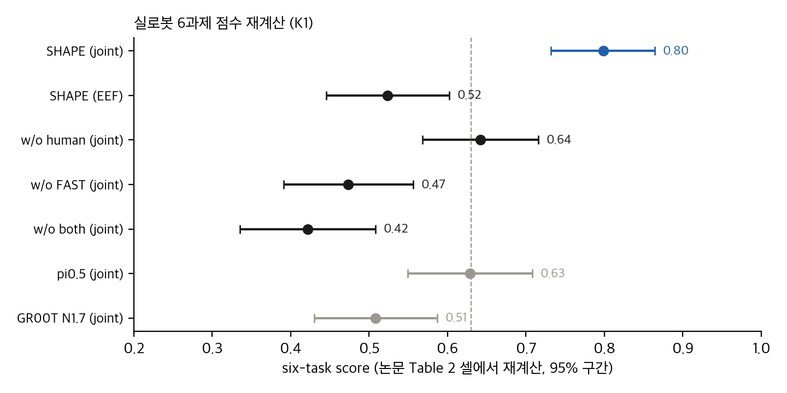
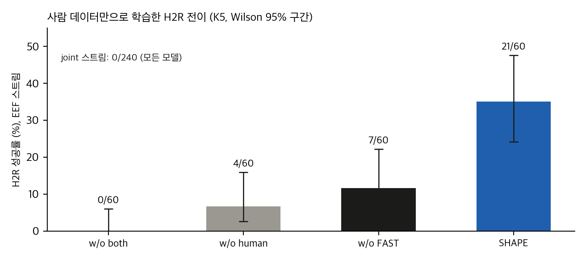

> **논문:** Yaping Li 외 12명. *SHAPE: Discrete Supervision and Parallel Continuous Streams for Learning Dexterous Manipulation from Egocentric Human Data.* arXiv:2611.24585 (v1, 2026-11-18). 학회 표기 없음.
> 공식 코드는 찾지 못했습니다. 이 글의 그림은 우리가 논문 표 값으로 그린 그래프 두 장입니다. 논문 그림은 쓰지 않았습니다(arXiv non-exclusive 라이선스).

## 논문이 묻는 것

사람 손 영상은 싸고 많지만 로봇 관절 명령이 없습니다. 손 추적 결과는 손목과 손끝 위치(EEF)로만 바꿀 수 있고, 관절은 역기구학으로 얻으면 몸체에 묶이고 로봇 분포 밖의 팔 자세가 나옵니다. SHAPE는 두 질문에 답합니다. 사람 데이터를 어떻게 지도할지, 그리고 다지 손 로봇에서 관절과 EEF 중 무엇을 실행할지입니다.

답의 골격은 두 가지입니다. 백본이 EEF 청크의 이산 토큰(FAST)을 보조 목표로 예측하고, 흐름 매칭 전문가가 EEF와 관절 두 스트림을 주의 마스크로 나눠 냅니다. 같은 체크포인트에서 두 스트림 중 하나를 골라 실행할 수 있습니다.

## 이 글에서 확인한 것

**1. 6과제 점수 차이는 6과제 기준으로 유의합니다.** 관절 스트림 SHAPE는 0.80, π0.5는 0.63입니다. 논문 Table 2 셀에서 다시 계산한 값이 모두 맞았고, 두 점수 차의 z 검정 p = 0.001입니다. 과제가 6개뿐이고 학습을 한 번만 했다는 점은 남습니다.

*그래프 (우리가 그림). 논문 Table 2 셀로 다시 계산한 six-task score와 분산 상한 기반 구간입니다.*

**2. 사람 데이터만으로 한 전이는 방향이 맞고 유의합니다.** 사람 시연만으로 학습한 세 과제에서 SHAPE는 60회 중 21회(35%) 성공했습니다. 이산 토큰 없이 사람 데이터만 쓴 모델은 7회입니다. 풀링 Fisher p = 0.004입니다. 다만 이 실험에는 π0.5나 GR00T 같은 외부 기준선이 없습니다. 그리고 관절 스트림은 240회 모두 실패했습니다. 저자는 리타게팅된 팔 자세가 로봇 분포 밖이라서라고 설명하지만, 이 설명은 검증되지 않았습니다.

*그래프 (우리가 그림). Table 3의 EEF 스트림 성공률에 Wilson 95% 구간을 붙였습니다.*

**3. 연속 헤드 대조는 경계선입니다.** 그래디언트 크기를 맞춘 연속 회귀 헤드는 같은 실험에서 18.3%였습니다. 논문은 p = 0.055를 보고합니다. 우리가 순열 검정으로 다시 해 보니 0.056이 나와 논문과 같습니다. 점근 검정은 0.034가 나와 더 낙관적입니다. 과제 구조 보존이 원인이라는 해석을 말하려면 분리 실험이 더 필요합니다.

**4. 시뮬레이션은 과제 단위로 봐도 SHAPE가 앞섭니다.** RoboCasa GR-1 24과제에서 SHAPE 72.2%, π0.5 64.8%입니다. 과제 24개를 단위로 쌍체 검정하면 차이 +7.5 포인트, p = 0.001입니다. 사람 데이터에 이산 토큰을 더한 효과는 +2.6 포인트, p = 0.04로 작습니다.

## 구현할 수 있을까

논문 전체는 개인 장비에서 재현할 수 없습니다. 백본 4B를 학습하려면 GPU 메모리가 훨씬 필요하고, 사람 데이터 2,811시간과 실로봇 데이터는 공개되지 않았습니다. 대신 "토큰 보조 목표가 연속 헤드보다 나은가"를 작은 합성 실험으로 묻는 것은 가능하다고 봅니다. 이 글은 재계산과 검정까지만 했습니다.

## 남은 질문

- 실행 간 변동은 얼마나 될까요? 원문에는 사전학습 반복이 없습니다.
- 관절 스트림의 사람 데이터 실패는 리타게팅 때문일까요, 정책 학습 때문일까요?

## 자료

- [통합 리포트 PDF](report/report_public.pdf)
- [01. 논문 분석: SHAPE](analysis/01_paper_analysis.md)
- [02. 선행연구와 관련 자료](analysis/02_prior_work.md)
- [03. 수치 재계산과 일관성 검사](analysis/03_analysis.md)
- [04. 주장 검증 (공식 코드 없음)](analysis/04_claim_verification.md)
