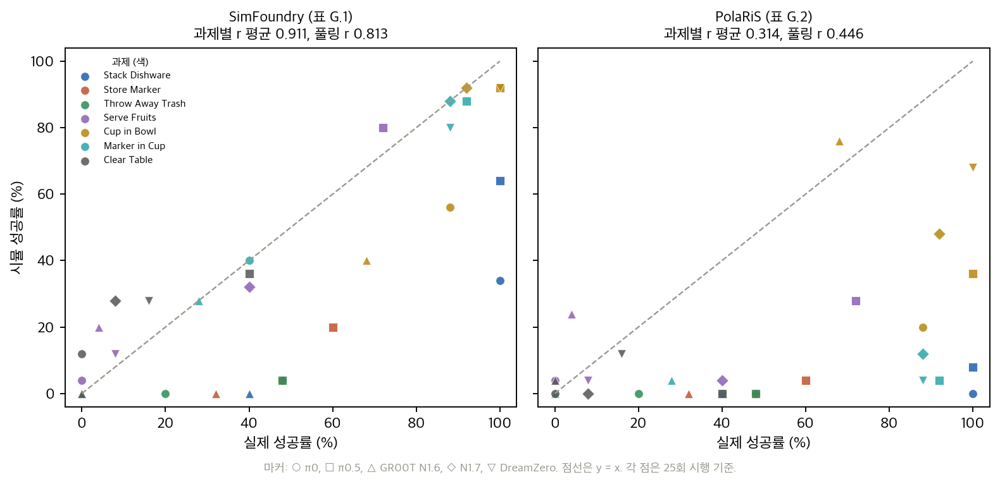
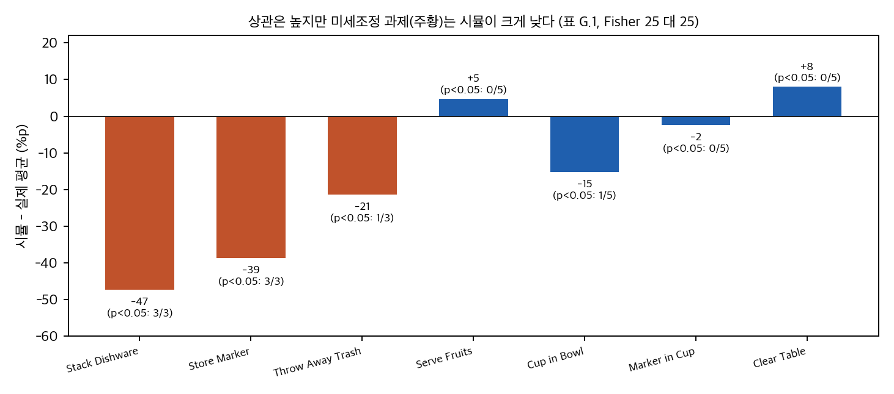
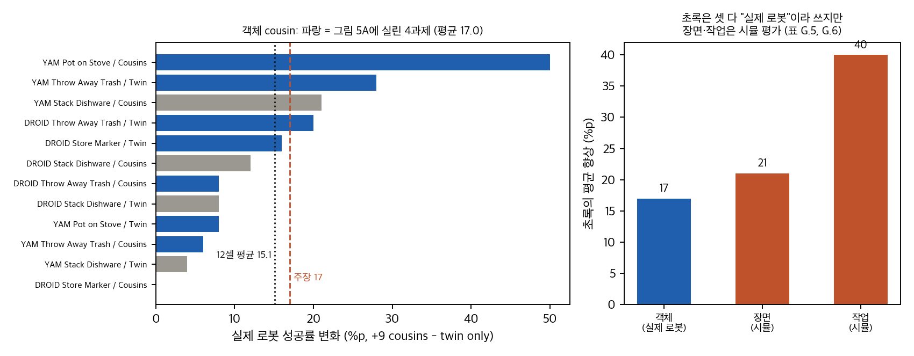
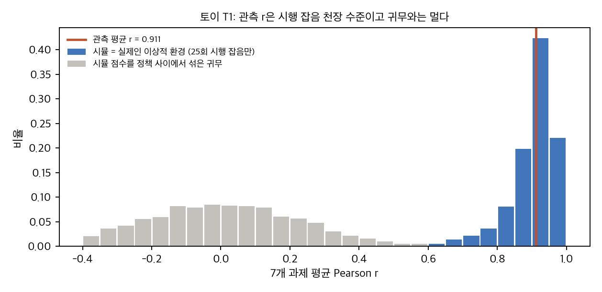

# 03. 수치 재계산, 일관성 검사, 주장 판정

모든 값은 논문 v4의 표(G.1–G.8, 표 2, L.2, L.4, L.6)를 `analysis/recompute.py`에 옮겨 계산했습니다(numpy, scipy, 수 초). 결과는 `analysis/recompute_results.json`입니다. 코드는 실행하지 않았고, 재현 실험도 하지 않았습니다.

**표기.** V = 수치 재계산, K = 문서 안 일관성 검사, C = 주장 판정, T = 토이. 시도 수는 부록 J.1의 "과제당 25회 롤아웃"을 기본으로 하고, 다르게 가정한 곳은 그 자리에 적었습니다. 정책이 과제마다 3–5개뿐이라 과제별 r의 불확실성이 큽니다.

## 1. 재계산 (V1–V17)

### 1.1 실제-시뮬 상관 (V1–V4)

| 번호 | 대상 | 결과 |
|---|---|---|
| V1 | 표 G.1 (SimFoundry) 과제별 r과 MMRV 14개 값 | **14개 모두 일치.** 평균 r = 0.9114(초록 0.911), 평균 MMRV = 0.0175(초록 0.018, 표에 찍힌 값의 평균은 0.0176) |
| V2 | 표 G.2 (PolaRiS) 과제별 r과 MMRV 13개 값 (Throw Away Trash의 r은 시뮬이 전부 0이라 정의되지 않음) | **모두 일치.** 평균 r = 0.3136(6과제), SimFoundry와의 차이 **0.598**(본문 "over 0.59" 맞음). 정의되지 않은 칸을 0으로 넣으면 0.643. 평균 MMRV 0.229 대 0.0175. 시뮬에서 동률이면 순위 불일치로 센다는 해석이 Throw Away Trash MMRV 0.253을 정확히 재현함 |
| V3 | 정책-과제 쌍 수 | 표 G.1은 **29쌍**(미세조정 3과제 × 3정책 + 영샷 4과제 × 5정책). 초록의 "7 tasks and 5 policy" 곱 35가 아님. 25회라면 실제 725회, 시뮬 725회, PolaRiS 725회 |
| V4 | 하위 과제 평가 (표 G.3) | r과 MMRV 모두 일치. 같은 3과제의 평균 r이 G.1 0.9027에서 G.3 0.9504로 오름(본문 "0.90 → 0.95", 부록 "0.902 → 0.951"). 과제별로는 Stack Dishware 0.883→0.961, Store Marker 0.915→0.981, Throw Away Trash 0.910→**0.910(변화 없음**, 시뮬 0,4,0이 0,8,0으로 바뀌었을 뿐 모양이 같음) |

### 1.2 상관의 의미와 불확실성 (V5–V9)

| 번호 | 대상 | 결과 |
|---|---|---|
| V5 | 셀 단위 실제 대 시뮬 (Fisher 정확 검정, 25 대 25) | 29쌍 중 **8쌍이 p < 0.05**. 미세조정 과제 9쌍 중 7쌍, 영샷 20쌍 중 1쌍. 평균 시뮬 − 실제: 미세조정 **−35.8%p**, 영샷 −1.2%p. 평균 절대 차 17.2%p. 예: π0 Stack Dishware 실제 100 대 시뮬 34, π0.5 Store Marker 60 대 20 |
| V6 | 과제별 r의 통계적 의미 | 정책 3개면 양측 p < 0.05에 필요한 \|r\| > 0.997, 4개 0.950, 5개 0.878. 표 값 기준 개별 r의 p: Stack Dishware 0.31, Store Marker 0.26, Throw Away Trash 0.27(셋 다 정책 3개, 순열 p의 최솟값이 1/6 = 0.167이라 유의 불가), Serve Fruits 0.0097, Cup in Bowl 0.034, Marker in Cup 0.0004, Clear Table 0.097. **개별 과제 r은 7개 중 3개만 유의**하고 평균 0.911은 과제를 합쳐야 의미가 생김 |
| V7 | 풀링 상관 | 29쌍 풀링 r = 0.813, Spearman 0.775(PolaRiS 풀링 0.446). 과제 평균을 뺀 과제 내 상관은 0.880 |
| V8 | 셀 시행 부트스트랩 (셀마다 이항 25회 재표본, 3000회) | 평균 r: SimFoundry 0.842 [95% 0.683, 0.933], PolaRiS 0.236 [−0.013, 0.461]. **두 구간이 겹치지 않아 PolaRiS 대비 우위는 시행 잡음으로 설명되지 않음** |
| V9 | PolaRiS 대비 과제별 짝 비교 | r은 6/6 과제에서 SimFoundry가 높음(부호 검정 양측 p = 0.031), MMRV는 7/7에서 낮음(p = 0.016) |

### 1.3 cousin 효과와 영샷 전이 (V10–V13)

| 번호 | 대상 | 결과 |
|---|---|---|
| V10 | 객체 cousin 평균 "17%" (표 G.4, 그림 5A, G.2A) | **그림 5A에 실린 4개 과제(Pot on Stove, YAM Throw Away Trash, DROID Store Marker, DROID Throw Away Trash)의 실제 twin+cousin 8셀 평균이 정확히 17.0**. 그림 G.2A에 있는 Stack Dishware 두 설정(YAM, DROID)까지 6과제 12셀이면 **15.1**. 시뮬 12셀은 25.0, 실제+시뮬 24셀은 20.0 |
| V11 | 장면 cousin "21%" (표 G.5) | twin 장면 +13.3, cousin 장면 +29.3, 6셀 평균 21.3으로 재현. **평가는 DROID 시뮬뿐** |
| V12 | 작업 cousin "40%" (표 G.6) | 13개 작업 대 twin 전용의 향상이 +20, +40, +60, 평균 40.0으로 재현. 세 과제 모두 작업 수에 단조 증가. **평가는 DROID 시뮬뿐** |
| V13 | 영샷 전이의 실제 twin 성공률 (표 G.4, +9 cousins) | YAM Stack Dishware 43, Pot on Stove 99, Throw Away Trash 28, DROID Stack Dishware 96, Store Marker 20, Throw Away Trash 20. **6개 평균 51%**. 시뮬 twin과의 격차는 YAM Throw Away Trash 69%p(시뮬 97, 실제 28), YAM Stack Dishware 49%p, DROID Store Marker 40%p, Pot on Stove 1%p |

Fisher 검정(25 대 25 가정, DROID 셀만; YAM은 K2 때문에 시행 수 불명)으로 본 개별 향상:

- 실제 로봇 객체 cousin(DROID, twin 전용 대 +9): Stack Dishware 88→96 (p = 0.61), cousin 물체 88→100 (p = 0.23), Store Marker twin 4→20 (p = 0.19), cousin 4→4, Throw Away Trash twin 0→20 (p = 0.050), cousin 0→8 (p = 0.49). **개별 셀은 대부분 유의하지 않습니다.** 12셀 평균의 방향이 일관되다는 점이 근거입니다.
- 시뮬 장면 cousin: Throw Away Trash cousin 장면 0→36 (p = 0.0016), Stack Dishware cousin 28→64 (p = 0.022), 그러나 "Store Marker cousin 장면 0→16"은 p = 0.11이고 twin 장면 Stack Dishware 80→88은 p = 0.70, Store Marker 20→24는 p = 1.0.
- 시뮬 작업 cousin: Throw Away Trash 8→68 (p = 2e-5), Store Marker 20→60 (p = 0.0086), Stack Dishware 80→100 (p = 0.050).

### 1.4 공동 학습, 다중 작업 (V14–V15)

| 번호 | 대상 | 결과 |
|---|---|---|
| V14 | 표 2 (다중 작업). 시도 수가 보고되지 않아 값과 과제 수(13, 7)가 모두 맞는 가장 작은 총 시도 수를 **가정**하고 계산 | 정수 가능성: 실제 seen 65(과제당 5), 실제 held-out 35(과제당 5), 시뮬 seen 104, 시뮬 held-out 49 등. 이 가정에서 실제 held-out은 base 9/35, FT 10/35, DROID-FT 9/35로 **차이가 1회, Fisher p = 1.0**. seen 실제: base 18/65 대 DROID-FT 30/65 p = 0.045. 시뮬 seen 31/104 대 63/104 p < 0.001. 시뮬 held-out 18/49, 22/49, 16/49로 모두 p > 0.2 |
| V15 | 공동 학습 Δ (표 G.7, 그림 G.2D, 25 대 25 가정) | π0.5 실제 Store Marker 60→92 p = 0.018, π0 시뮬 Throw Away Trash 0→36 p = 0.0016. π0.5 Stack Dishware 실제는 sim-only 96, real-only 100으로 차이 없음(p = 1.0). 표 G.7의 π0.5-S 열은 표 G.4 DROID +9 cousins와 일치하고, -R 열은 표 G.1 실제와 일치. 그림 G.2D 11개 막대 중 **하나가 표와 다름**(K6) |

### 1.5 재구성과 시스템 (V16–V17)

| 번호 | 대상 | 결과 |
|---|---|---|
| V16 | 표 L.2 (12 장면, 난이도별 4개; SD의 단위는 논문이 밝히지 않음) | 9개 지표 중 **Hard 챔퍼 거리는 SimFoundry 영샷이 SAM3D보다 나쁨**(0.0091 ± 0.0076 대 0.0088 ± 0.0022, +3.4%). F1 범위(0.81–0.92, 0.93–0.99, 0.66–0.71)는 맞음. SD가 장면 간이고 장면이 4개라고 가정하면 Welch p는 쉬움 챔퍼 0.039, 쉬움 위치 0.035, 중간 위치 0.045뿐이고 F1은 쉬움 0.061, 중간 0.099, 어려움 0.17로 유의하지 않음 |
| V17 | 표 L.4 (시간), 표 L.6 (배경) | L.4: 9개 장면 76개 물체, 총 415.4분, 물체당 **5.47분**(본문 "roughly 5"). 선형 적합은 절편 13.8분 + 3.84분/물체(R² = 0.78)라 작은 장면은 물체당 9–10분. 장면 하나는 67분. L.6: 자동이 일곱 지표 모두 우수, RMSE ≥ MAE이고 PSNR 평균은 평균 RMSE에서 구한 값보다 크게 나와 옌센 부등식과 일치(12.91 ≥ 12.79, 15.29 ≥ 15.10)라 내부 모순 없음 |

## 2. 일관성 검사 (K1–K13)

| 번호 | 위치 | 내용 | 영향 |
|---|---|---|---|
| K1 | 표 G.1, G.7 | π0 Stack Dishware 시뮬 **34%**는 25회로 만들 수 없음(8/25 = 32, 9/25 = 36). 나머지 G.1, G.2, G.3 값은 모두 4의 배수. 34는 17/50 | 한 칸의 시행 수가 다름. r과 MMRV 재현에는 영향 없음 |
| K2 | 표 G.4, G.8 (YAM) | YAM의 25개 값(2, 9, 14, 17, 21, 27, 35, 37–39, 41–43, 45, 65, 66, 83, 85, 89, 91, 93, 94, 97–99)이 25회로 불가능, 50회로도 불가능. 모든 값이 맞는 n은 1–100에서 95, 98, 99, 100뿐. 부록 G.3은 "25 eval trials"라 씀 | YAM 셀의 시행 수와 집계 방식이 불명(예: 물체 4개 × 25회 = 100이면 가능) |
| K3 | §5.2 본문 대 표 G.4 | "100% success on Stack Dishware with DROID (Table G.4)". 표에서 실제 **twin은 96%**이고 100%는 held-out 실제 물체 cousin 칸 | 헤드라인이 최댓값을 인용 |
| K4 | 부록 B FAQ 6 대 표 G.7 | "π0.5-DROID 48% → 100% with sim-only finetuning". 표 G.7의 π0.5 sim-only 실제 Stack Dishware는 **96%** (real-only 100%) | 같은 부록 안 불일치 |
| K5 | 그림 5A 대 G.2A | 본문 그림 5A는 4과제만 싣고 부록 그림 G.2A는 6과제를 싣는데 두 캡션 모두 "average 17%". 6과제로는 15.1 (V10) | 평균 17%는 선택된 4과제 값 |
| K6 | 그림 G.2D (시뮬) | π0.5 Throw Away Trash의 Δ가 그림에는 **+16**, 표 G.7로는 60 − 48 = **+12** | 표나 그림 둘 중 하나가 틀림 |
| K7 | 초록, 부록 G.2 | "When evaluating sim-trained policies zero-shot **in the real world**, ... object, scene, and task cousins ... 17%, 21%, and 40%". 21%와 40%는 표 G.5, G.6의 **시뮬** 평가(그림 5B, 5C 제목에 "DROID, sim") | 초록 문장과 근거가 어긋남 |
| K8 | §5.1 본문 대 표 G.1 | "GR00T N1.7 can outperform others on precise grasping (e.g., Marker in Cup)". 실제는 **π0.5 92 > N1.7 88** (Fisher p = 1.0, 시뮬 88 대 88 동률) | 해당 문장의 근거 없음 |
| K9 | §5.3 본문 대 표 L.2 | "lower chamfer distance and position error" 가 SAM3D 대비 모든 난이도에서 성립한다는 서술. Hard 챔퍼는 더 나쁨 (V16) | 부분 모순 |
| K10 | 초록, 부록 J.1 | "5 policy architectures": GR00T N1.6과 N1.7은 같은 계열, π0와 π0.5도 같은 계열. 29쌍(V3) | 표현 문제 |
| K11 | v1 부록 J.3.3 | PolaRiS 평가 과제 6개 나열 대 표 G.2의 7개. v2에서 목록 삭제 | v1만 해당 |
| K12 | 프로젝트 페이지 HTML | 주석 처리된 초록이 Pearson 0.928, task cousins 50%. 논문은 0.911, 40% | 옛 초안 흔적 |
| K13 | 부록 G.1.1 | 평균 0.902 → 0.951. 표 값 평균은 0.9027 → 0.9504(반올림 차이 수준) | 무시할 만함 |

추가로 읽을 점: 부록 H.2는 "시뮬에서 1k 스텝마다 평가해 가장 좋은 체크포인트를 실제에서 평가"한다고 씁니다. 실제-시뮬 상관 실험에서도 시뮬 성공률로 체크포인트를 골랐다면 시뮬 점수는 최댓값 선택이라 상향 편향이 있고, 같은 시뮬이 평가와 선택에 동시에 쓰여 독립적 검증이 아닙니다(부록은 어느 쪽인지 분리해 쓰지 않음).

## 3. 주장 판정 (C1–C11)

판정: **지지**(수치 재현, 해석 가능), **부분 지지**(수치는 맞으나 범위나 해석이 좁음), **약함**(근거가 부족), **불일치**(문서 안 근거와 어긋남).

| 번호 | 주장 (위치) | 판정 | 근거 |
|---|---|---|---|
| C1 | SimFoundry 시뮬 평가가 실제 성능을 강하게 예측: 평균 r 0.911, MMRV 0.018 (초록, §5.1, 표 G.1) | **부분 지지** | 수치는 정확히 재현(V1). 순위·추세 보존은 PolaRiS 대비 일관적(V8, V9). 그러나 정책이 3–5개라 개별 과제 r은 7개 중 3개만 유의(V6)하고, 평균 r은 25회 시행 잡음만으로 기대되는 천장 0.90과 같은 수준(T1). 미세조정 과제에서 절대 성공률을 평균 36%p 낮게 예측(V5). "순위 예측"은 맞고 "성공률 예측"은 아님 |
| C2 | PolaRiS보다 Pearson이 0.59 이상 높음 (§5.1) | **지지 (조건부)** | 0.598로 재현, 부트스트랩 구간이 겹치지 않음(V8). 다만 PolaRiS는 저자들이 자기 장면에 SimFoundry 자산과 2DGS로 다시 만든 환경에서 영샷으로 평가했고, v1의 수작업·코드 수정 서술이 v2에서 삭제됨(§0.1) |
| C3 | 하위 과제 평가로 r이 0.90에서 0.95로 (§5.1, G.1.1) | **약함** | 3과제 r 세 개, 한 과제는 변화 없음(V4). 시뮬은 일부 하위 과제를 마친 상태에서 시작하고 실제는 전 과정이라 기준이 다름. 어떤 상태에서 시작할지는 사후 선택 |
| C4 | SimFoundry 데이터로 학습한 정책이 실제에 영샷 전이 (초록, §5.2) | **부분 지지** | Pot on Stove 99%, DROID Stack Dishware 96%는 강함. 그러나 6개 설정 평균 51%, YAM Throw Away Trash 28%, DROID Store Marker·Throw Away Trash 20%(V13). 시뮬-실제 격차가 큼 |
| C5 | 객체 cousin이 평균 17%p 향상, held-out 물체 최대 +50%p (§5.2) | **부분 지지** | 17은 선택 4과제 평균, 6과제는 15.1(V10, K5). +50은 YAM Pot on Stove cousin 하나. DROID 실제 개별 셀은 대부분 비유의. 방향은 일관됨 |
| C6 | 장면 cousin 21%, 작업 cousin 40% 향상을 "실제 영샷"으로 서술 (초록) | **불일치** | 두 평균 모두 시뮬 평가(V11, V12, K7). 실제 로봇 근거 없음 |
| C7 | 다중 작업 미세조정이 held-out에서 29% (§5.2, 표 2) | **약함** | 실제 held-out 26/29/26은 최소 시도 수 가정에서 1회 차이(V14). 기본 DROID 체크포인트가 이미 26%. held-out 일반화로 읽기 어려움 |
| C8 | 공동 학습이 sim, real 성능을 올림 (§5.2) | **대체로 지지** | π0.5 실제 Store Marker 60→92, π0 Throw Away Trash 모두 유의(V15). Stack Dishware 실제는 변화 없고 π0 Stack Dishware 시뮬은 −16 |
| C9 | "완전 자동" 파이프라인 (초록, 결론, §1) | **부분 지지** | 초기 생성은 자동이나 실제-시뮬 평가 장면은 사람이 포즈를 다듬음(부록 K.2, FAQ 3), 공개 코드의 평가 스크립트 머리말에는 렌더·마찰·포즈·스케일 수동 맞춤 목록이 있음(`04` D12) |
| C10 | 영샷 재구성 F1 0.81–0.92, SAM3D보다 우수 (§5.3, 표 L.2) | **부분 지지** | F1 방향은 일관. Hard 챔퍼는 더 나쁘고(K9), 장면 12개에 SD 단위 불명이라 대부분 지표의 유의성을 판단할 수 없음(V16) |
| C11 | 물체당 약 5분 (§5.3, 표 L.4) | **지지 (범위 한정)** | 5.47분/물체(V17). 3090 GPU, 자동 배경(약 90분)은 별도(부록 C). 코드 README는 "under an hour"라 적음 |

## 4. 토이 T1: 시행 잡음 천장과 귀무

**질문.** 평균 r = 0.911은 "시뮬이 실제와 같은 환경이라도 25회씩 뽑으면 나오는 정도"인가, 아니면 그보다 한참 높은가?

**설정 (numpy, 약 3초, `analysis/recompute.py`).** 각 정책-과제 셀의 진짜 성공률을 표의 실제 성공률(0.5회 가산 평활)로 두고, **실제와 시뮬 양쪽에 독립적으로 25회씩** 이항 표본을 뽑아 7개 과제 평균 r과 평균 MMRV를 4000번 계산합니다. 귀무는 시뮬 점수를 정책 사이에서 무작위로 섞는 순열입니다.

| 지표 | 시뮬 = 실제인 이상적 환경 | 귀무(섞기) | 관측 |
|---|---|---|---|
| 평균 r | 평균 0.903 (5–95%: 0.769–0.971) | 평균 −0.001, 99% 지점 0.526 | **0.911** |
| 평균 MMRV | 평균 0.028 (5–95%: 0.008–0.055) | (미계산) | **0.0175** |

- 관측 평균 r 0.911은 이상적 환경이 만드는 분포의 한가운데에 있고(추첨의 56.6%가 관측값 이상), 귀무 분포 4000개 중 하나도 넘지 못합니다. 즉 **0.911은 "무작위 순위"와는 분명히 다르지만, 25회 시행으로 달성 가능한 천장과도 구별되지 않습니다.**
- MMRV 0.0175는 이상적 환경의 평균 0.028보다 낮아 운이 좋은 쪽입니다(5–95% 범위 안).
- 한계: 진짜 성공률을 실제 관측으로 고정했고, 시뮬과 실제의 진짜 차이는 0으로 가정했습니다. 그래서 이 토이는 "r은 25회 시행에서 이 정도가 기대 최대치"라는 상한이지, 시뮬의 정확도 지표가 아닙니다. 또 V5의 편향은 이 가정과 모순되며, 이 점이 r이 편향을 가린다는 근거입니다.

## 5. 이 문서가 하지 않는 것

- 실로봇, 시뮬 학습, 공식 코드는 실행하지 않았습니다. 시도 수를 알 수 없는 표(표 2, YAM 셀)는 가정을 밝히고 계산했습니다.
- 그림과 표의 값은 PDF 텍스트와 렌더링 이미지(그림 G.2)로 확인했고, 그림 5와 4의 막대 값은 부록 표와 대조했습니다.
