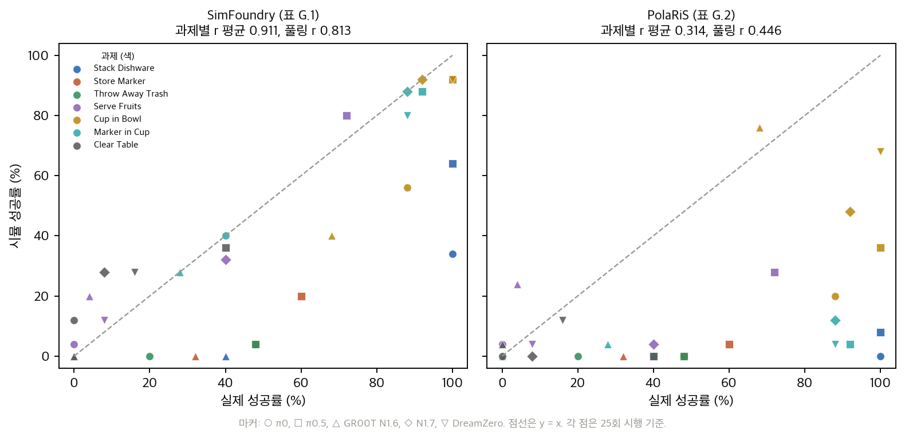
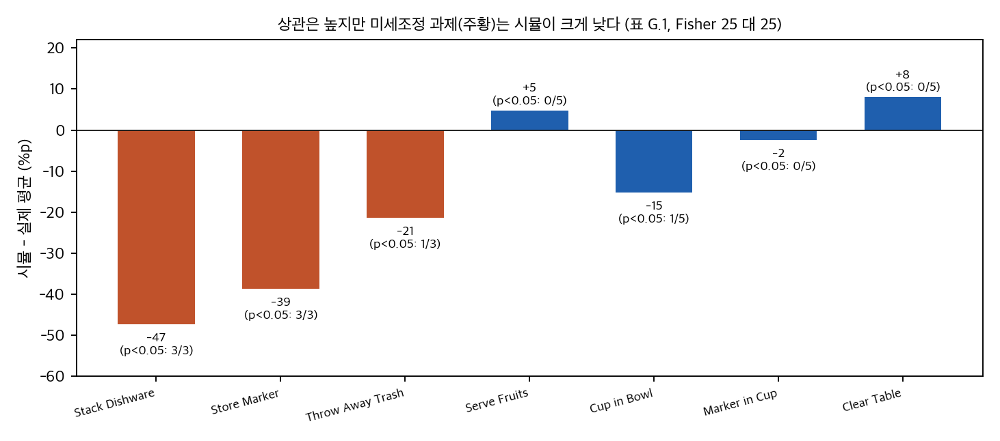
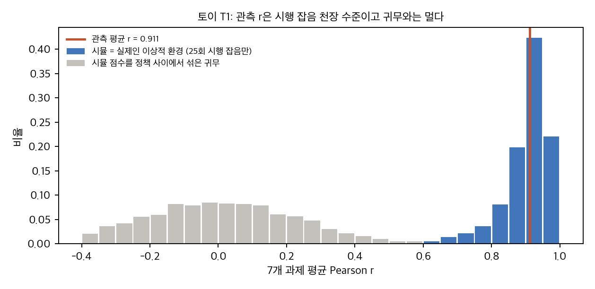
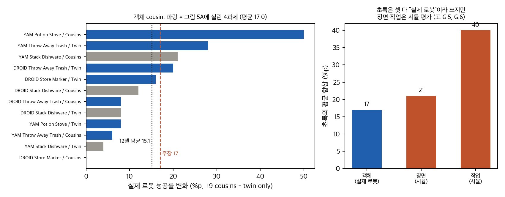

> **논문:** Nadun Ranawaka, Josiah Wong 외. *SimFoundry: Modular and Automated Scene Generation for Policy Learning and Evaluation.* CoRL 2026 포스터, arXiv:2606.28276 (v4, 2026-08-05).
> 공식 코드는 GitHub NVlabs/SimFoundry(Apache-2.0)에 있고, 프로젝트 페이지는 research.nvidia.com/labs/gear/simfoundry/입니다. 논문은 arXiv에 CC BY-SA 4.0으로 올라와 있지만 PDF 첫 쪽에 "All rights reserved" 고지가 따로 있어, 이 글에는 논문 그림을 싣지 않고 우리가 그린 그래프만 썼습니다.

## 논문이 묻는 것

실제 로봇으로 정책을 평가하고 학습시키는 비용이 큽니다. SimFoundry는 스마트폰 영상 한 편에서 시뮬레이션에 바로 쓸 수 있는 장면을 자동으로 만들고, 그 장면에서 (1) 실제 정책을 시뮬에서 평가해 실제 성능을 예측하고, (2) 시뮬 데이터로 정책을 학습해 실제 로봇에 영샷으로 옮깁니다. 장면에서 파생되는 변형은 **digital cousin**이라 부르고 객체, 장면 배치, 작업 세 축으로 나눕니다. 파이프라인은 파운데이션 모델(Gemini, SAM3, DepthAnything3, Hunyuan3D, FoundationPose)을 엮은 것이고, 새 알고리즘보다 시스템과 실험 보고에 가깝습니다.

## 이 글에서 확인한 것

**1. 평균 r 0.911과 MMRV 0.018은 표에서 정확히 재현됩니다.** 표 G.1의 과제별 r과 MMRV 14개 값이 모두 맞고, PolaRiS(표 G.2) 13개 값도 맞습니다. PolaRiS와의 평균 r 차이는 0.598입니다(본문 "over 0.59"). 셀마다 25회 시행의 이항 잡음을 넣어 부트스트랩하면 평균 r이 SimFoundry 0.84 [0.68, 0.93], PolaRiS 0.24 [−0.01, 0.46]로 구간이 겹치지 않습니다. 우위는 시행 잡음으로 설명되지 않습니다. 다만 비교는 논문이 자기 장면에 PolaRiS를 영샷으로 적용한 것입니다.

*그래프 (우리가 그림). 표 G.1과 G.2의 29개 정책-과제 쌍. 초록과 달리 쌍은 7×5 = 35가 아니라 29개입니다.*

**2. 그러나 상관은 보정(calibration)이 아닙니다.** 미세조정 과제 9쌍에서 시뮬 성공률이 실제보다 평균 35.8%p 낮고, 그중 7쌍이 Fisher 검정(25 대 25)에서 유의합니다. 예를 들어 π0의 Stack Dishware는 실제 100%, 시뮬 34%이고 π0.5의 Store Marker는 실제 60%, 시뮬 20%입니다. 영샷 과제 20쌍은 평균 차이가 −1.2%p이고 1쌍만 유의합니다. r과 MMRV는 순위와 선형 추세만 보므로 이 편향을 가립니다.

*그래프 (우리가 그림). 막대는 시뮬 − 실제 평균(%p), 괄호는 25 대 25 Fisher p < 0.05인 셀 수입니다.*

**3. 개별 과제의 r은 정책이 3–5개뿐이라 대부분 유의하지 않습니다.** 정책 3개인 과제는 순열 p의 최솟값이 1/6이라 r이 유의할 수 없고(양측 p 0.26–0.31), 7개 과제 중 Serve Fruits, Cup in Bowl, Marker in Cup만 p < 0.05입니다. 평균 0.911은 과제를 합쳐야 의미가 생깁니다.

**4. 0.911은 25회 시행의 잡음 천장 수준입니다.** 토이로 확인했습니다. 시뮬이 실제와 완전히 같은 환경이라고 가정하고 양쪽에서 25회씩 독립 추출해 4000번 반복하면 7개 과제 평균 r은 0.903(5–95%: 0.77–0.97)입니다. 관측값 0.911은 이 분포의 한가운데이고, 시뮬 점수를 정책 사이에서 섞은 귀무 분포(평균 −0.001)는 한 번도 넘지 못했습니다. 즉 순위 신호는 분명하지만 r이 더 높아져도 시행 수로는 구별되지 않는 영역입니다. 이 토이는 시뮬 정확도 지표가 아니라 25회 시행에서 기대되는 상한을 보여 줍니다.

*그래프 (우리가 그림). 토이 T1: 7과제 평균 r의 분포. 파랑은 시뮬 = 실제인 이상적 환경, 회색은 시뮬 점수를 섞은 귀무, 주황 선은 관측값입니다.*

**5. 초록의 "실제 로봇 영샷 17%, 21%, 40%"는 한 가지만 실제입니다.** 초록은 "When evaluating sim-trained policies zero-shot in the real world, ... object, scene, and task cousins ... 17%, 21%, and 40%"라고 씁니다. 표 G.5와 G.6을 다시 계산하면 장면 cousin 21.3%와 작업 cousin 40.0%는 재현되지만 둘 다 **DROID 시뮬레이션 평가**입니다(그림 5B, 5C의 제목도 "DROID, sim"). 실제 로봇 평가는 객체 cousin 17%뿐이고, 17.0은 그림 5A에 실린 4개 과제 8셀의 평균입니다. 같은 표의 6개 과제 12셀 평균은 15.1%p입니다. 개별 DROID 실제 셀은 대부분 유의하지 않고(Throw Away Trash twin 0→20은 p = 0.050), 12셀 평균의 방향이 일관된 것이 근거입니다.

*그래프 (우리가 그림). 왼쪽: 표 G.4의 실제 로봇 셀별 향상(파랑 = 그림 5A에 실린 4과제). 오른쪽: 초록의 세 평균과 평가 방식(주황 = 시뮬).*

**6. 영샷 전이는 과제에 따라 크게 다릅니다.** 표 G.4(+9 cousins)의 실제 twin 성공률은 YAM Pot on Stove 99%, DROID Stack Dishware 96%로 강하지만 YAM Throw Away Trash 28%, DROID Store Marker와 Throw Away Trash 20%입니다(6개 평균 51%). 본문의 "100% Stack Dishware (DROID)"는 표에서 held-out 실제 물체 칸이고 실제 twin은 96%입니다.

**7. 다중 작업 held-out 일반화는 아직 근거가 약합니다.** 표 2에는 시도 수가 없어, 값과 과제 수(13, 7)가 모두 맞는 가장 작은 시도 수를 가정했습니다(가정입니다). 이 가정에서 실제 held-out 26/29/26은 9/35, 10/35, 9/35로 1회 차이(Fisher p = 1.0)이고, 기본 DROID 체크포인트가 이미 26%입니다. 시뮬 seen 31/104 대 63/104는 p < 0.001로 분명합니다.

**8. 문서 안 불일치가 몇 군데 있습니다.**

- π0 Stack Dishware 시뮬 34%(표 G.1, G.7)는 25회로 만들 수 없습니다(8/25 = 32, 9/25 = 36).
- YAM 셀 25개(표 G.4, G.8)는 25회로 불가능하고 시행 수 95–100에서만 가능합니다. 부록은 "25 eval trials"라고 씁니다.
- 부록 FAQ의 "48% → 100% (sim-only finetuning)"은 표 G.7에서 96%입니다. 그림 G.2D의 π0.5 Throw Away Trash 시뮬 Δ는 +16인데 표로는 +12입니다.
- 본문의 "GR00T N1.7이 Marker in Cup에서 가장 낫다"는 표 G.1에서 실제 π0.5 92 > N1.7 88이고 시뮬은 88 대 88 동률입니다.
- 재구성 표 L.2의 Hard 챔퍼 거리는 SimFoundry 0.0091이 SAM3D 0.0088보다 나쁜데 본문은 챔퍼와 위치 오차가 낮다고 씁니다.

## 버전 차이

v1(2026-06-26)부터 v4(2026-08-05)까지 표와 그림 수치는 같습니다. v1 → v2에서 PolaRiS 비교 부록(J.3)의 서술이 크게 줄었습니다. v1에는 장면당 약 15분의 수작업, 평가 코드 수정, 마커 질량 수동 조정, 관절 물체 지원을 위한 코드 수정이 적혀 있었고 v2에서 삭제됐습니다. 대신 "정책을 시뮬에 맞게 미세조정하지 않고 영샷으로 평가했다"는 문구가 추가됐고, 상관 비교에서 PolaRiS 공동 학습 체크포인트를 제외한다는 문장이 들어갔습니다. v1 J.3.3의 PolaRiS 과제 6개 목록은 표 G.2의 7개와 맞지 않았고 v2에서 목록이 사라졌습니다. v2 → v4는 저자 순서와 날짜 줄만 다릅니다.

## 공식 코드와 논문의 차이

공식 저장소(커밋 `9e34ebe`, 2026-08-27)의 구조는 논문과 잘 맞습니다. 객체 cousin 프롬프트, PyBullet 속도 0 리셋 안정화, CoACD, FoundationPose는 일치합니다. 다만 범위와 기본값이 다릅니다.

- **없는 것:** 정책 학습 코드, Pearson/MMRV 계산, PolaRiS 비교, SAM3D 비교와 재구성 벤치마크. README는 "robotics data generation, training, evaluation"을 "Coming soon"으로 적지만 시연 생성과 평가 스크립트는 이미 들어 있습니다.
- **다른 것:** 대표 프레임은 논문이 frame 0인데 코드 기본값은 휴리스틱과 VLM의 자동 선택입니다. 작업 cousin은 논문 예시 13개인데 기본 5개이고 모델은 gemini-2.5-pro입니다(논문은 "Gemini-Pro-3"). 시연 증식은 MimicGen 패키지를 쓰지 않고 객체 중심 웨이포인트 재생을 자체 구현한 것으로 보이며 탁자 높이 무작위화는 찾지 못했습니다. 장면 cousin의 술어는 VLM이 뽑기보다 작업 YAML에서 사용자가 지정합니다.
- **내보내기:** 논문은 IsaacLab 등을 말하지만 코드는 OmniGibson 장면만 내보냅니다.
- **수작업 맞춤:** 평가 스크립트 머리말에 렌더 색 보정, 3DGS 배경을 메시로 교체, assisted를 physical 파지로 변경, 마찰·포즈·스케일 조정 목록이 있습니다. 기본 설정은 `assisted` 파지입니다. 보고된 수치가 어느 쪽인지 논문에는 없습니다.
- **라이선스 주의:** 기본 메시 모델 Hunyuan3D-2.1의 라이선스는 유럽연합, 영국, 한국을 제외한 지역에 한정하고, Any6D와 FoundationPose는 비상업입니다.

## 구현 가능성 (Apple M4 Pro, CUDA 없음)

- **영상 → 장면 재구성: 불가.** Linux + NVIDIA GPU, 디스크 약 250 GB, SAM3 등 게이트 모델, Gemini 원격 호출이 필요합니다.
- **시뮬 평가, 시연 생성, 정책 학습, 실로봇: 불가.** OmniGibson은 Isaac Sim 기반이고 학습 코드는 저장소에 없습니다.
- **표 재계산, 검정, 시행 잡음 토이: 완료.** numpy와 scipy로 수 초입니다.
- **개념 재구현(물리 안정화, 술어 배치 샘플러, 재구성 지표): 가능.** 각 1–3일로 추정합니다(측정 전).

이 글은 재현 실험을 하지 않았습니다.

## 한계

- 표 2와 YAM 셀의 시행 수가 보고되지 않아 일부 검정은 가정에 기댑니다(밝혀 둠).
- 셀 단위 검정은 25 대 25를 가정했고, 부록 J.1의 시도 수가 모든 셀에 적용되는지는 확인할 수 없습니다.
- 시행 잡음 토이는 시뮬과 실제의 진짜 차이를 0으로 둔 상한이라 시뮬의 정확도 지표가 아닙니다.
- 공식 코드는 정적으로만 읽었고 8만 줄을 줄 단위로 모두 읽지는 않았습니다. 논문 표와 직접 대응하는 설정과 스크립트를 중심으로 봤습니다.

## 출처와 라이선스

- 논문: arXiv:2606.28276. arXiv 라이선스 페이지는 CC BY-SA 4.0을 가리키지만 PDF 첫 쪽에 "© 2026 NVIDIA. All rights reserved." 고지가 있어 논문 그림은 싣지 않았습니다.
- 표 값은 인용과 재계산을 위해 옮겼습니다. 그래프, 토이, 분석 문서와 스크립트는 이 저장소 작성자가 만들었습니다.
- 공식 코드, 예시 자산, 모델 가중치는 받아서 실행하지 않았고 외부 API도 호출하지 않았습니다.

## 자료

- [통합 리포트 PDF](report/report_public.pdf)
- [01. 논문 분석: SimFoundry](analysis/01_paper_analysis.md)
- [02. 선행연구, 구성요소 출처, 공개 자료](analysis/02_prior_work.md)
- [03. 수치 재계산, 일관성 검사, 주장 판정](analysis/03_analysis.md)
- [04. 공식 코드 대조와 구현 가능성](analysis/04_code_verification.md)
