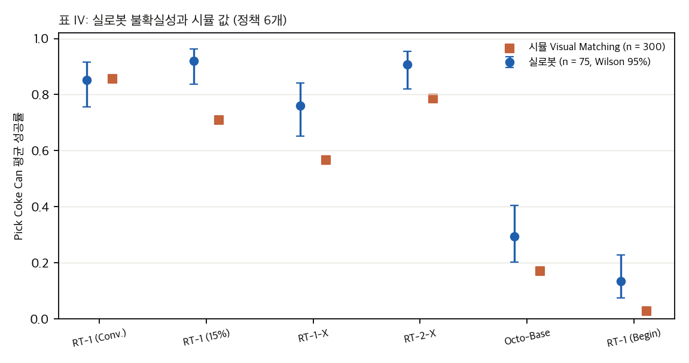
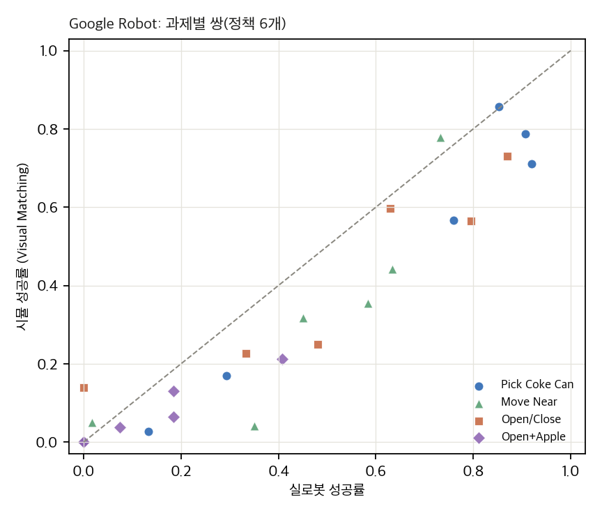
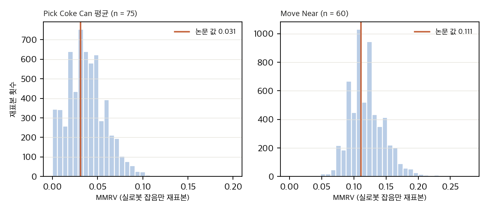

> **논문:** Xuanlin Li, Kyle Hsu, Jiayuan Gu 외 16명. *Evaluating Real-World Robot Manipulation Policies in Simulation.* CoRL 2024 (PMLR 270:3705–3728), arXiv:2405.05941.
> 공식 코드는 GitHub simpler-env/SimplerEnv (MIT)에 있습니다. 이 글의 그림은 우리가 그린 그래프입니다. 논문 그림은 쓰지 않았습니다.

## 논문이 묻는 것

실로봇 평가는 비싸고 재현이 어렵습니다. 논문은 정밀한 디지털 트윈 대신 **순위만 맞는 시뮬**을 만들자고 제안합니다. 제어 차이는 PD 파라미터의 오프라인 시스템 식별로, 시각 차이는 실사 배경 합성과 텍스처 매칭으로 줄입니다. 평가 지표는 평균 최대 순위 위반(MMRV)과 피어슨 상관(r)입니다. Google Robot과 WidowX 두 설정에서 정책 여럿의 실로봇 성공률과 시뮬 성공률을 비교합니다.

## 우리가 다시 계산한 것

논문 표의 값으로 MMRV와 r을 다시 계산하고, 실로봇 시도 수로 구간과 검정을 했습니다. 재현 실험은 하지 않았습니다.

*그래프 1. 표 IV의 Pick Coke Can 평균. 실로봇은 Wilson 95% 구간(n = 75), 시뮬은 Visual Matching 값입니다. 우리가 그린 그래프입니다.*

**1. 점추정은 맞지만 표본이 작습니다.** Pick Coke Can 평균의 r = 0.976은 Fisher 95% 구간이 0.79–0.997입니다. Move Near는 r = 0.856이고 구간이 0.15–0.98입니다.

*그래프 2. Google Robot 네 과제, 정책 6개의 실로봇 대 시뮬 성공률(표 IV Visual Matching). 우리가 그린 그래프입니다.*

**2. MMRV 0.031은 잡음 범위 안입니다.** Pick 평균의 MMRV를 만드는 순위 위반은 RT-1 (Converged)과 RT-1 (15%) 쌍, RT-1 (Converged)과 RT-2-X 쌍입니다. 두 쌍의 실로봇 차이는 표준오차의 약 1배입니다. 상위 세 정책의 실로봇 순서는 75회로 정해지지 않습니다(Fisher p = 0.30–0.45).

*그래프 3. 실로봇 이항 잡음만 재표본한 MMRV 분포(시뮬 값 고정). 세로선은 논문 값입니다. 시뮬 쪽 분산은 원자료가 없어 넣지 못했습니다. 우리가 그린 그래프입니다.*

**3. 검증 MSE 대비 우위는 잡음보다 큽니다.** 표 I에서 행동 MSE의 MMRV는 0.375, 시각 매칭은 0.056입니다. 차이가 잡음 구간보다 훨씬 큽니다.

**4. 논문 안의 표기가 맞지 않는 곳이 있습니다.** 부록은 WidowX 에그플랜트를 24회라고 적지만, 표 V의 실로봇 값은 1/30 격자에 맞습니다. 표 V의 에그플랜트 상관 계수 0.990은 표의 실로봇 값으로 계산하면 나오지 않고, 공식 저장소의 값(0.250, 0.400)으로 계산하면 나옵니다. 분포 이동 표에서는 증강 모델의 평균 MMRV가 표에 0.041로 적혀 있지만 재계산과 본문 캡션은 0.016입니다.

## 구현 가능성

이 맥(Apple M4 Pro, CUDA 없음)에서는 공식 평가를 재현할 수 없습니다. 정책 추론에 NVIDIA GPU와 체크포인트가 필요하기 때문입니다. 표 재계산과 통계 검사는 끝냈습니다. 공식 코드는 정적으로만 읽었고 설치하거나 실행하지 않았습니다.

## 한계

- 정책 6개(Google), 3개(WidowX)입니다. 상관의 구간이 넓습니다.
- 실로봇 시도 수가 24–75회입니다. 정책 간 차이 대부분이 잡음 수준입니다.
- 실로봇 원자료와 Isaac Sim 구현이 공개되어 있지 않습니다.
- 객체 질량과 마찰은 근사이고, 텍스처 매칭과 자세 조정에 사람의 손이 들어갑니다.

## 자료

- [통합 리포트 PDF](report/report_public.pdf)
- [01. 논문 분석: Evaluating Real-World Robot Manipulation Policies in Simulation](analysis/01_paper_analysis.md)
- [02. 선행연구, 대안, 이 저장소의 관련 분석](analysis/02_prior_work.md)
- [03. 재계산, 검정, 일관성 검사](analysis/03_analysis.md)
- [04. 공식 코드 대조와 구현 가능성](analysis/04_code_verification.md)
