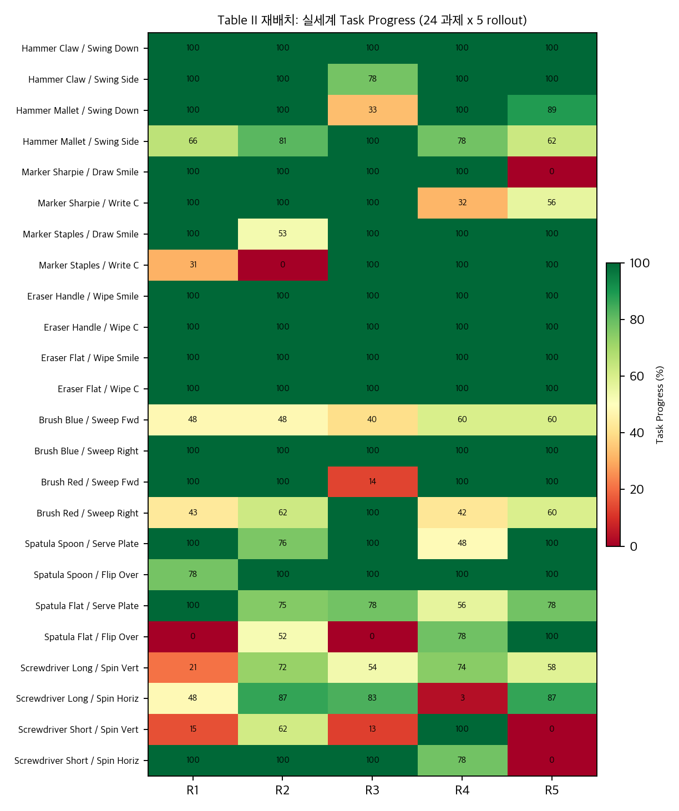
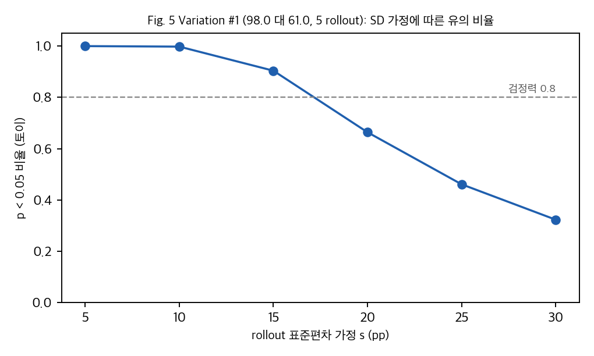

> **논문:** Kushal Kedia, Tyler Ga Wei Lum, Jeannette Bohg, C. Karen Liu. *SimToolReal: An Object-Centric Policy for Zero-Shot Dexterous Tool Manipulation.* RSS 2026, arXiv:2602.16863 (v3, 2026-10-06).
> 공식 코드(MIT, tylerlum/simtoolreal)는 정적으로만 읽었고 실행하지 않았습니다. 논문 그림은 싣지 않고, 우리가 만든 그래프만 씁니다.

---

## 한 줄 요약

도구 사용을 "도구를 목표 포즈 열로 옮기는 일"로 바꾸면, 절차적으로 만든 막대-머리 물체 수만 개에서 학습한 **목표 도달 정책 하나**로 사람 영상에서 뽑은 궤적을 실로봇에서 따라갈 수 있다는 주장입니다.

## 무엇을 주장하나

- 정책은 6D 포즈와 거친 파지 박스만 보고, 물체 기하는 직접 보지 않습니다(LSTM).
- 학습은 물체 프리미티브와 무작위 목표 포즈만으로 합니다. 과제별 보상 설계가 없습니다.
- 실세계 DexToolBench 24 과제 x 5회 (120 rollout)에서 zero-shot으로 평균 Task Progress를 냅니다.

## 우리가 확인한 것

**1. 평균 79.3%는 표와 맞습니다.** 표 II의 24 과제 평균을 다섯 rollout에서 다시 계산하면 보고값과 일치합니다(최대 차이 0.04 pp). 120 rollout 평균은 79.26%이고, 95% 구간은 73.7–84.8입니다. 본문 어디에도 전체 평균이 적혀 있지 않아서 표에서 직접 계산해야 합니다.

*그림 1. 표 II를 다시 그린 히트맵. 가로는 rollout 다섯 번, 세로는 과제 24개입니다. 우리가 그렸습니다.*

**2. 초록의 "37%"는 한 조건의 차이입니다.** 그림 5 Variation #1에서 SimToolReal은 98.0%, 고정 파지는 61.0%입니다. 차이는 37.0 %p입니다. 상대 개선으로 읽으면 61%이므로 37과 맞지 않습니다. 같은 비교의 Variation #2 차이는 71.9 %p입니다. 초록은 어느 조건인지, 어느 지표인지 밝히지 않습니다.

**3. 5회 반복에서 37 %p가 유의한지는 알 수 없습니다.** 논문은 rollout 값과 표준편차를 주지 않습니다. 간단한 토이(정규 가정, 조건당 5회, Welch t)를 돌리면, 표준편차가 15 pp를 넘을 때 유의하게 보일 확률이 0.9 아래로 떨어집니다. 표 II 전체의 표준편차는 30.5입니다. 방향은 그럴듯하지만 크기는 확인되지 않았습니다.

*그림 2. 토이 결과입니다. 가정에 따라 바뀌며 실제 p값이 아닙니다. 우리가 그렸습니다.*

**4. 실패 원인 비율의 분모가 없습니다.** 본문의 43.7, 34.5, 18.2, 3.6%를 작은 정수 실패 수로 만들 수 없습니다. 원인별 집계표가 본문에 없어서 검증할 수 없습니다.

**5. 공식 코드와 논문 설정이 다른 곳이 있습니다.** 성공 허용오차는 논문 표 I에 1 cm, 평가는 2 cm인데, 코드 평가 설정은 0.01입니다. 외력과 외토크는 논문에 고정 단위(5 N, 0.5 Nm)로 나오지만 코드는 물체 질량에 비례시킵니다. 리프트 기준도 절대 0.73 m와 상대 0.15 m로 서로 다릅니다. 재현할 때는 코드 값을 기준으로 해야 합니다.

## 재현 가능성

- **이 맥에서는 논문 재현이 불가능합니다.** 학습은 NVIDIA GPU에서 IsaacGym이나 IsaacSim으로 24,576 환경을 돌려야 합니다. 실로봇은 Sharpa 손과 KUKA iiwa가 필요합니다.
- **맥에서 구현할 수 있는 부분:** 닫힌 루프 Task Progress 계산기, 프리미티브 생성기, 키포인트 보상입니다. NumPy로 충분합니다.
- **지적할 점:** 계산 자원(GPU 수, 학습 시간)이 논문에 없습니다. 재현 계획에서 가장 먼저 물어야 할 항목입니다.

## 함께 볼 것

- 공식 코드와 프로젝트 페이지는 위 링크에 있습니다. 사전학습 정책은 외부 서버에서 받아야 합니다.
- 같은 목표 포즈 조건을 이미지 목표로 바꾼 연구(GoalDex, arXiv:2611.02171)와 비교하면 목표 표현의 차이를 볼 수 있습니다.

## 맺음말

SimToolReal은 "도구 사용 = 목표 포즈 열 추종"이라는 틀을 명확하게 보여 줍니다. 다만 수치 주장은 아직 얇습니다. 평균 79.3%는 믿을 만하고, 37%는 조건을 밝혀 읽어야 하며, 특화 정책과의 비교와 실패 비율은 원자료 없이는 확인할 수 없습니다.

## 자료

- [통합 리포트 PDF](report/report_public.pdf)
- [SimToolReal: An Object-Centric Policy for Zero-Shot Dexterous Tool Manipulation (arXiv:2602.16863) 논문 분석](analysis/01_paper_analysis.md)
- [SimToolReal 선행연구와 관련 자료](analysis/02_prior_work.md)
- [SimToolReal 수치 재계산과 일관성 검사](analysis/03_analysis.md)
- [SimToolReal 논문 ↔ 공식 코드 대조 (정적 읽기)](analysis/04_code_verification.md)
