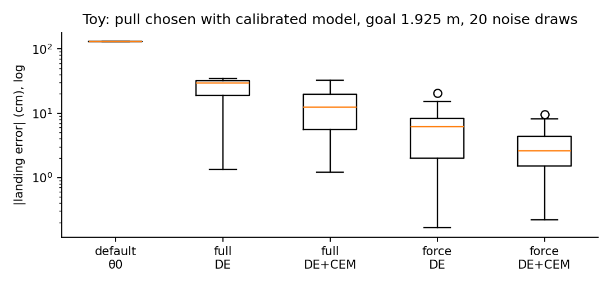

# 한 번 당겨서 탄성을 맞출 수 있는가

새총 정책을 시뮬에서 배우려면 고무줄의 영률과 감쇠를 알아야 합니다. 그런데 이 값은 영상만으로는 구별되지 않고, 발사를 반복하면 고무줄이 상합니다. Sling2Sim2Real(arXiv:2607.23268)은 고무줄을 40 cm 당겼다 놓는 기록 한 번(속도, 손목 힘, 점군)으로 시뮬 파라미터 5개를 맞추고, 보정된 시뮬에서 정책을 배워 실물에 옮깁니다.

## 논문이 한 일

- 손실은 점군 거리, 힘 차이, 일(work)의 차이를 더한 것입니다.
- 전역 탐색은 차분 진화(DE)로 하고, 탐색 히스토리에서 공분산을 얻어 여러 시작점에서 CMA-ES로 다듬습니다.
- 정책은 1단계 MDP로 풀어 발사 위치를 목표마다 고릅니다.

## 수치로 본 결과

- Band 2 평균 착탄 오차는 14.2 cm 대 Package SI 35.2 cm입니다. 재계산에서 이 값은 맞습니다. 가정(표의 ±가 표준편차)을 두면 p ≈ 0.002입니다.
- 그러나 Band 2, 목표 212.5 cm에서는 기준선(11.0 cm)이 제안(23.5 cm)보다 낫습니다. 본문은 "slightly higher"라고 적었습니다.
- Band 1의 평균 차이(7.17 대 8.00 cm)는 통계적으로 구별되지 않습니다.
- 절제표의 "All targets" 7.83 cm 한 칸은 셀 평균 7.17 cm와 맞지 않습니다.

## toy로 본 것

직접 계산(toy): 목표 1.925 m에서 보정 모델로 당김을 고른 뒤의 착탄 오차(20회, 로그 축). 힘만 쓴 보정이 전체 손실 보정보다 정확했습니다. 이 결과는 논문의 일 항 주장과 반대라서, 가중치와 최적화에 따라 달라지는지 더 확인해야 합니다.

- 1회 기록의 피셔 정보에서 강성과 비선형은 1–2%로 정해지지만, 감쇠와 마찰은 4–7%이고 서로 얽힙니다.
- 보정 오차는 재계산으로 사라지지 않습니다. 정책이 같은 모델로 당김을 고르기 때문에, 강성이 10% 틀리면 착탄도 약 20 cm 틀립니다.

## 구현 가능성

공식 재현(Isaac Sim, 실물 로봇과 고무줄 3종)은 NVIDIA GPU와 실험 장비가 필요해서 이 맥에서는 할 수 없습니다. 알고리즘(손실, DE, 공분산 CEM)은 CPU toy로 구현했습니다. 3차원 재구현은 설정값을 가정해야 합니다.

## 남은 질문

- Table IV의 0.50이 2.50의 오식인지
- "±"가 표준편차인지 표준오차인지
- Alg. 1 줄 16이 CMA-ES 결과를 쓰는지
- 필터 차단 주파수 0.224 rad/s의 단위

원문: https://arxiv.org/abs/2607.23268 (CC BY 4.0)

## 자료

- [통합 리포트 PDF](report/report_public.pdf)
- [Sling2Sim2Real: One-Shot Elastic System Identification for Non-Destructive Slingshot Policy Learning (arXiv:2607.23268) 분석](analysis/01_paper_analysis.md)
- [Sling2Sim2Real (arXiv:2607.23268) 선행연구와 관계](analysis/02_prior_work.md)
- [Sling2Sim2Real (arXiv:2607.23268) 수치 재계산, 유도, toy](analysis/03_analysis.md)
- [Sling2Sim2Real (arXiv:2607.23268) 주장 검증과 구현 가능성](analysis/04_claim_verification.md)
