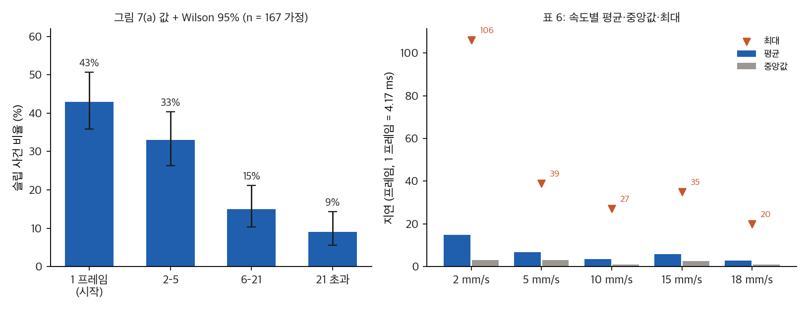
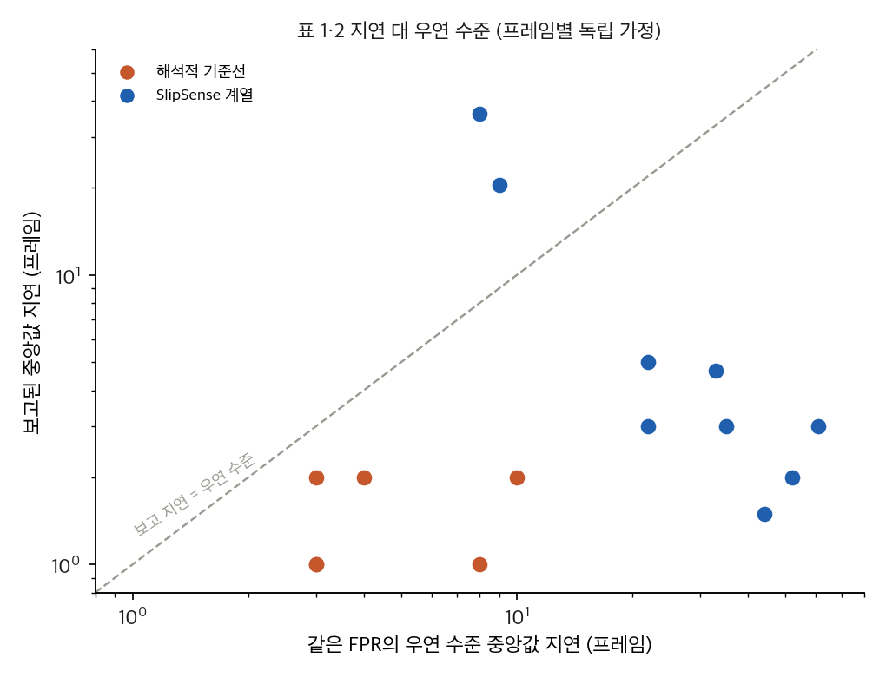
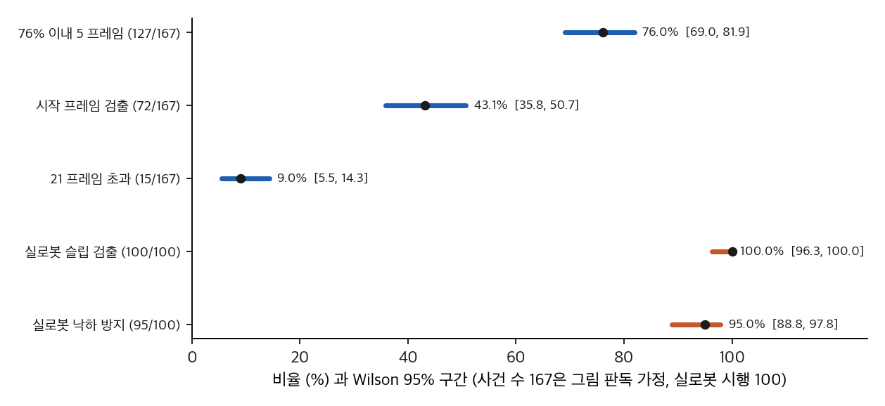

> **논문:** Tong Jian 외 9명(Dexterous AI Group, Analog Devices, Inc.). *SlipSense: Multimodal Tactile Learning for Low-Latency and Generalized Slip Detection.* CoRL 2026 포스터, arXiv:2609.15910 (v1, 2026-09-14).
> 공식 코드와 프로젝트 페이지는 찾지 못했습니다(그림 1 캡션에 "Project page coming soon"). 이 글의 그래프는 모두 우리가 그린 것이고, 논문 그림은 쓰지 않았습니다(arXiv 라이선스가 CC가 아닌 non-exclusive 배포입니다).

## 논문이 묻는 것

물건을 쥔 손에서 슬립은 파지가 무너지기 전 가장 빨리 나타나는 신호 가운데 하나입니다. 저자들은 두 가지가 아직 풀리지 않았다고 말합니다. 하나는 슬립이 시작된 뒤 첫 정답 검출까지의 **지연**이 거의 보고되지 않고 오탐과의 상충도 평가되지 않는다는 점입니다. 다른 하나는 보지 못한 물체, 센서 개체, 로봇 플랫폼으로의 **일반화**입니다.

해법은 센서와 학습을 함께 설계하는 것입니다. TacV5 모듈은 32×32 압전저항 배열(Piezo, 240 Hz, 155 taxels/cm²)과 3축 가속도계(XL, 8 kHz)를 한 손끝에 넣습니다. Piezo는 압력의 공간 분포와 그 변화를, XL은 마찰이 만드는 진동을 봅니다. 두 신호의 실패 양상이 다르다는 것이 핵심 가정입니다. Piezo는 파지력 변화를 슬립으로 오인하고, XL은 슬립이 아닌 외부 진동에도 반응합니다.

## 방법을 한눈에

슬립 라벨은 센서 신호가 아니라 시험대(Mark-10)의 크로스헤드 변위로 만듭니다. 누적 변위가 0.07 mm를 넘는 순간이 슬립 시작이고, 평균 taxel 값이 1 ADC count 미만이면 접촉 없음입니다. 모델은 60프레임(250 ms) 창의 마지막 프레임을 세 클래스(접촉 없음, 슬립 없음, 슬립)로 분류합니다.

- Piezo: 3블록 CNN으로 128차원 임베딩.
- XL: 10 Hz 고역 통과, 16 ms 인과 창의 로그 멜, 세 축을 **로그합지수**로 합쳐 슬립 방향에 무관한 스펙트로그램, 사전학습 SSAST-Tiny로 128차원 임베딩.
- 센서 개수가 다른 플랫폼을 위해 센서 개체 간에는 max pooling, 두 모달 사이는 교차 어텐션, 시간은 인과 자기어텐션 한 층.

## 이 글에서 확인한 것

**1. 융합 이득은 크고 일관됩니다.** 표 1에서 학습한 모델의 Macro F1은 Piezo 단독 83.54%, XL 단독 81.61%인데 융합은 96.77%(UMI ID)입니다. 보류 물체(UMI OOD)에서는 81.91%와 81.33% 대 95.75%입니다. 최고 단일 모달 대비 +13.2 %p와 +13.8 %p입니다. 다만 표의 값은 3 시드 평균이고 분산이 적혀 있지 않습니다.

**2. "76%가 23.1 ms 이내"는 지연 분포의 76번째 백분위수입니다.** 그림 7(a)의 비율(43%, 33%, 15%, 9%)과 부록 G 표 6의 속도별 사건 수 합 167을 맞추면 76%는 127/167이고 Wilson 95% 구간은 69.0–81.9%입니다(사건 167개는 그림 판독 가정). 표 6에서 계산한 풀링 평균 지연은 28.7 ms(추론 2.3 ms 포함 31.0 ms)이고, 9%는 87.5 ms를 넘습니다. 가장 느린 2 mm/s에서는 평균 62 ms, 최대 442 ms(추가 이동 0.88 mm, 센서 한 칸 피치와 같은 크기)입니다. 23.1 ms는 "5 프레임 환산 + GPU 추론 평균 2.3 ms"로, 센서 전송, XL 16 ms 창, 제어기 지연은 들어 있지 않습니다.

*그래프 (우리가 그림). 왼쪽은 그림 7(a)에 적힌 비율과 Wilson 95% 구간(사건 167개는 그림 판독 가정), 오른쪽은 표 6의 속도별 평균·중앙값·최대 지연입니다.*

**3. FPR의 분모가 논문에 없고, 슬립이 아닌 프레임으로 읽어야 표와 맞습니다.** §5.1은 FPR을 "슬립으로 잘못 예측된 프레임의 비율"이라고만 씁니다. 전체 프레임 대비로 읽으면 오류의 일부여야 하므로 FPR ≤ 100 − 정확도인데, 표 1의 XL 기준선은 ID에서 22.98 > 20.59, OOD에서 19.31 > 17.01입니다. 슬립이 아닌 프레임을 분모로 읽으면 15개 행 모두 정확도, F1과 동시에 가능한 혼동행렬이 있습니다(클래스 비율은 전체 데이터 비율 가정). 분모를 적어 주면 읽기가 쉬워집니다.

**4. 지연은 FPR과 함께 읽어야 합니다.** 프레임마다 독립으로 확률 p로 슬립을 내는 정보 없는 검출기의 첫 검출 지연 중앙값은 ceil(ln 0.5 / ln(1−p)) 프레임입니다. 표 1의 해석적 기준선은 FPR이 20%대라서 이 값이 3–4 프레임이고, 보고된 지연은 1–2 프레임입니다. 같은 지연이라도 FPR 1.3–1.6%의 학습 모델(우연 수준 44–52 프레임, 보고 1.5–2)과는 의미가 다릅니다. 그래서 표 1 캡션의 "융합이 가장 낮은 지연과 FPR"과 §5.2의 "sub-frame latency"는 UMI ID에서 융합 2.00 프레임 대 기준선 1.00 프레임과 일부 다릅니다. 한 학습 모델 안에서 융합은 Piezo(20.50)와 XL(4.67)보다 분명히 빠릅니다.

*그래프 (우리가 그림). 가로축은 같은 FPR을 갖는 정보 없는 검출기의 중앙값 지연(프레임별 독립 가정), 세로축은 표에 보고된 중앙값 지연입니다. 점선 아래가 우연 수준보다 빠른 쪽이고, 중앙값과 시드 평균을 비교한 근사입니다.*

**5. 헤드라인 96.7%는 학습 물체의 시험 분할입니다.** 초록의 96.7%는 표 1의 UMI ID 96.77%(반올림이면 96.8)이고, 보류 물체는 95.75%입니다. Tesollo 손으로의 영점 전이는 2-finger 94.39%, 3-finger 87.24%입니다. 같은 Tesollo 2-finger 분할이 XL 증강(표 4)과 융합 방식(표 5)의 평가에도 쓰여서, 설계 선택과 평가 분할이 분리되었는지는 논문에서 알 수 없습니다. 학습과 ID 시험의 프레임 분할(70.1 대 29.9)이 프레임 단위인지 에피소드 단위인지도 적혀 있지 않습니다.

**6. 실로봇 결과는 구간으로 읽으면 이렇습니다.** 100회 중 100회 검출은 95% 구간이 96.3–100%이고, 낙하 방지 95/100은 88.8–97.8%입니다(시행 100, 독립 가정). "오탐 없음"을 센 분모와 제어기 트리거 조건이 적혀 있지 않습니다. 프레임 FPR 1–3%가 모든 비슬립 프레임에 독립으로 적용된다면 2초 구간에 오탐이 한 번도 없을 확률은 0.4% 이하여서, 오류가 시간적으로 몰려 있거나 제어기 쪽에 별도 조건이 있을 가능성이 있습니다. 슬립 검출 없이 동작하는 대조 제어도 없습니다.

*그래프 (우리가 그림). 지연 구간별 사건 비율(n = 167은 그림 판독 가정)과 실로봇 100/100, 95/100의 Wilson 95% 구간입니다.*

**7. 방향 불변 증명은 맞고, 더 일반적으로도 성립합니다.** 부록 I는 단일 진동원 등 네 가정 아래서 로그합지수가 슬립 방향과 무관함을 보입니다. 합성 진동으로 확인하니 방향 200개에서 최대 편차가 2.2e-15였습니다. 축별 파워의 합은 3성분 벡터의 노름 제곱이라 센서 좌표계의 직교 회전에는 단일 진동원 가정 없이도 불변입니다. 반대로 한 진동원의 방향만 바꾸면 편차(1.52, ln 단위)가 생깁니다. 이 인코딩이 보지 못한 슬립 방향 일반화에 기여했는지는 로그합지수와 축별 쌓기를 비교한 절제가 없어 확인할 수 없습니다. 사전학습 SSAST의 기여도 무작위 초기화 대조가 없어 구조와 분리되지 않습니다.

## 구현 가능성

- **논문 수치의 재현은 어렵습니다.** TacV5 센서, 140만 프레임 데이터, 시험대·그리퍼·로봇 손, 코드, 체크포인트가 공개되어 있지 않습니다.
- **구조 재구현과 합성 데이터 실험은 노트북에서 가능합니다.** 논문이 적지 않은 크기를 가정해 같은 구조의 임의 초기화 모델(약 5.9M 매개변수)로 한 번 순전파 시간을 쟀더니, Apple M4 Pro에서 GPU(MPS)는 3.0–3.2 ms로 프레임 예산 4.17 ms 안이고 CPU는 16–26 ms로 넘었습니다. 구조 크기 가정과 창 전체 재계산을 전제한 값이며 논문 모델의 시간이 아닙니다.

## 저자에게 확인하고 싶은 것

FPR의 분모, 지연의 시작 프레임 규약과 미검출 사건의 처리, ID 분할의 단위, "오탐 없음"의 정의, 설계 선택에 쓰인 평가 분할, 시드 분산입니다.

## 재계산과 토이

표 수치 재계산(`recompute.py`), 방향 불변성 토이(`toy_lse_invariance.py`), 지연 예산 토이(`toy_latency_budget.py`)와 분석 문서는 함께 올린 자료에 있습니다. 논문 원문은 arXiv:2609.15910에서 받을 수 있습니다.

## 자료

- [통합 리포트 PDF](report/report_public.pdf)
- [01. 논문 분석: SlipSense (arXiv:2609.15910)](analysis/01_paper_analysis.md)
- [02. 선행연구와 관련 저장소](analysis/02_prior_work.md)
- [03. 수치 재계산, 일관성 검사, 토이](analysis/03_analysis.md)
- [04. 주장 검증 (공식 코드 없음)](analysis/04_claim_verification.md)
