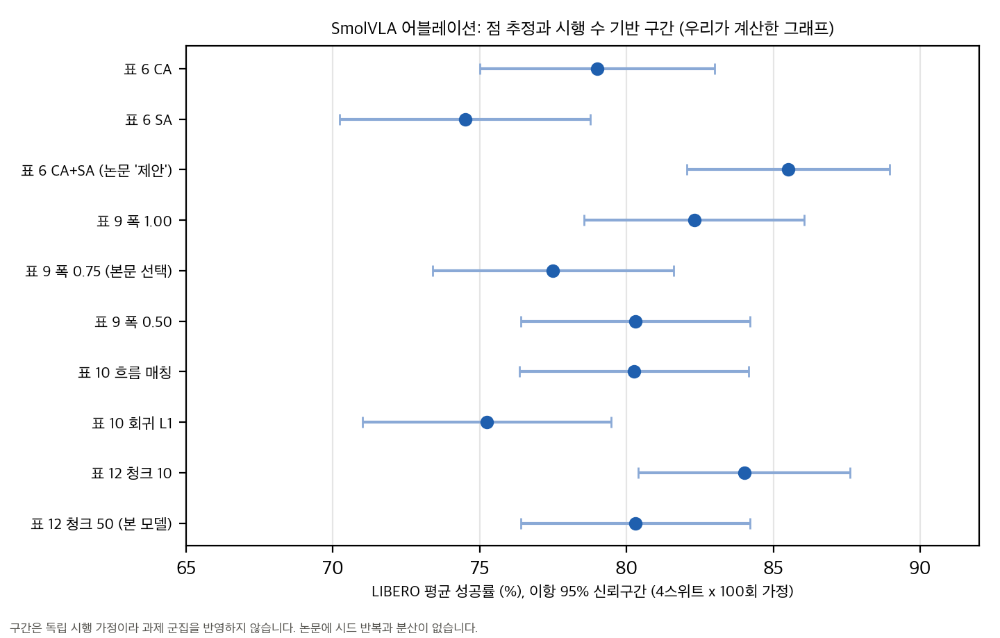

> **논문:** Mustafa Shukor 외. *SmolVLA: A Vision-Language-Action Model for Affordable and Efficient Robotics.* arXiv:2506.01844 (v1, 2025-06-02). 학회 표기는 없습니다.
> 공식 코드는 LeRobot(Apache-2.0)이며 정적으로만 읽었습니다. 실행하거나 설치하지 않았습니다. 논문 그림은 싣지 않고, 우리가 계산한 그래프만 씁니다. 논문 라이선스는 arXiv non-exclusive입니다.

## 논문이 하려는 것

VLA(로봇 행동을 내는 시각-언어 모델)는 대개 수십억 파라미터입니다. 학습 비용이 크고, 연구실이나 개인이 실물 로봇에 올리기 어렵습니다. SmolVLA는 세 가지로 이 문제를 풀겠다고 합니다.

1. 450M 파라미터의 작은 모델입니다. VLM의 첫 16층만 쓰고, 행동은 흐름 매칭 트랜스포머(액션 전문가)가 50스텝씩 냅니다.
2. Hugging Face에서 모은 커뮤니티 데이터 481개(약 22.9K 에피소드)로 사전학습합니다.
3. 행동 실행과 관측 처리를 분리한 비동기 추론으로 제어 주기를 높입니다.

초록은 "10배 큰 VLA와 비슷한 성능"을 주장합니다.

## 무엇을 확인했는가

**표를 다시 계산했습니다.** 논문의 모든 평균 열(표 2, 3, 5, 6, 8–13)은 반올림 안에서 맞습니다. 어긋난 값은 없습니다.

**어블레이션의 기준선이 표마다 다릅니다.** 표 6의 제안 구조(교차 어텐션과 자기 어텐션 교차)는 LIBERO 평균 85.5입니다. 같은 과제 구성이라고 볼 수 있는 표 10–13의 기준선은 80.3입니다. 같은 설정인지 논문만으로는 확인할 수 없습니다.

**전문가 폭의 선택이 표와 맞지 않습니다.** 논문은 은닉 폭을 VLM의 0.75배로 정했다고 말합니다. 그런데 표 9에서 0.50은 80.3, 0.75는 77.5입니다.

**검정을 해 보니.** 시드 반복이 없어서 독립 가정으로 계산했습니다. 흐름 매칭이 회귀보다 낫다는 5점 차이는 p ≈ 0.09입니다. 제안 구조가 교차 어텐션만 쓴 것보다 낫다는 6.5점 차이는 p ≈ 0.02입니다. SmolVLA와 π0(3.3B)의 LIBERO 차이 1.3점은 구별되지 않습니다.

*그림: 표 6·9·10·12의 LIBERO 평균과 이항 95% 신뢰구간(400 에피소드 가정). 우리가 계산해 그렸습니다. 과제 군집과 시드 차이는 반영하지 않습니다.*

**실로봇은 시행 수가 없습니다.** SO100 평균 78.3 대 π0 61.7의 차이는 과제당 시행을 10회로 가정하면 유의하지 않습니다. 논문이 시행 수를 밝히지 않았기 때문에 판정할 수 없습니다.

**비동기 추론은 빠릅니다.** 같은 과제를 완료하는 시간은 13.75초에서 9.70초로 줄었습니다(Welch p = 0.004). 고정된 시간 안에 성공하는 횟수는 9에서 19로 늘었습니다. 성공률은 대체로 비슷하지만 Sorting은 70에서 50으로 떨어졌습니다. 논문은 이 차이를 언급하지 않습니다.

**코드와 논문이 다른 곳이 있습니다.**
- 사전학습 데이터 목록: 본문은 481개인데, 부록 목록의 고유 ID는 532개입니다.
- 학습률 워밍업: 본문 100 스텝, 공개 코드 기본값 1,000 스텝입니다.
- 학습 대상: 서론은 "end-to-end"라고 쓰지만, §4.3과 코드는 VLM을 동결하고 액션 전문가만 학습합니다.
- 비동기 추론: 논문의 근접 프레임 필터는 2025년 버전 코드에는 있지만 현재 LeRobot에는 없습니다.

## 효율 주장은 측정되지 않았습니다

논문은 "소비자 GPU와 CPU에서 배포할 수 있다", "π0보다 약 40% 빠르게 학습하고 메모리는 6배 적게 쓴다"고 말합니다. 그러나 지연 시간이나 메모리를 재는 표나 그림이 없습니다. 또 사전학습은 4 GPU로 200k 스텝을 돌렸고, 프로젝트 전체에 약 30k GPU 시간이 들었다고 적었습니다.

## 이 맥에서 할 수 있는 것

- **재현 불가:** 사전학습(4 GPU, 200k 스텝), 미세조정, 실로봇 평가. CUDA와 로봇 하드웨어가 필요합니다.
- **조건부 가능:** 공개 가중치(Apache-2.0, 약 0.9 GB bf16)의 추론 지연과 메모리 측정. 가중치를 받는 것은 승인 후에 합니다.
- **가능:** 흐름 매칭 규약, 어텐션 구조, 비동기 큐를 다루는 CPU 토이 검증.

## 정리

SmolVLA는 작은 모델로 VLA를 만들 수 있다는 것을 보여 주는 중요한 자료입니다. 다만 "10배 큰 모델과 비슷하다"는 주장은 시드와 신뢰구간 없이 나온 평균 비교에 기대고 있습니다. 어블레이션 기준선과 효율 측정도 논문만으로는 확인되지 않습니다. 비동기 추론의 속도 이득은 가장 믿을 만한 결과입니다.

## 출처

- arXiv:2506.01844 (v1). 라이선스: arXiv non-exclusive distribution.
- LeRobot 코드: https://github.com/huggingface/lerobot (Apache-2.0).
- 프로젝트 블로그: https://huggingface.co/blog/smolvla.
- 분석 문서와 재계산 스크립트는 `analysis/` 폴더에 있습니다.

## 자료

- [통합 리포트 PDF](report/report_public.pdf)
- [SmolVLA 논문 분석 (arXiv:2506.01844)](analysis/01_paper_analysis.md)
- [SmolVLA 선행연구와 구성 요소 (02)](analysis/02_prior_work.md)
- [SmolVLA 표 재계산과 일관성 검사 (03)](analysis/03_analysis.md)
- [SmolVLA 논문 ↔ 공식 코드 대조 (04)](analysis/04_code_verification.md)
