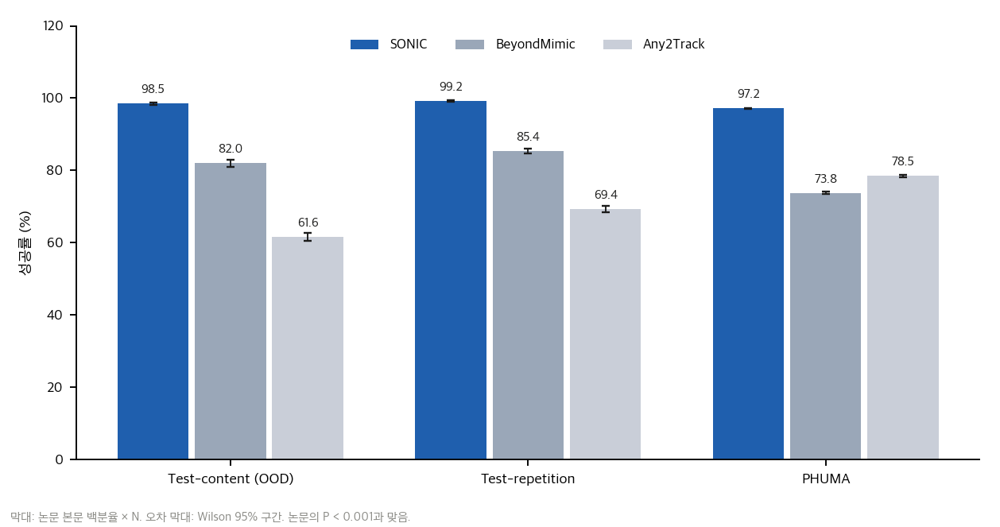
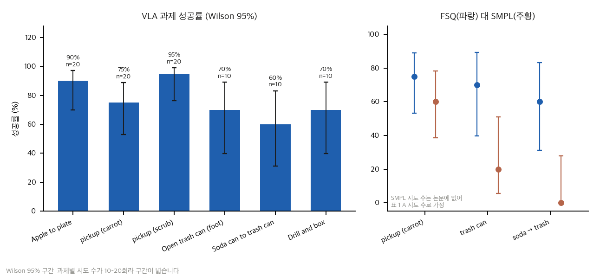

# 03. 수치 재계산, 일관성 검사, 주장 판정

**재현은 하지 않았습니다.** 논문 본문, 표 1–3, 그림 2에 적힌 수치를 다시 계산하고, 표와 본문이 서로 맞는지 확인했습니다. 계산은 `analysis/recompute.py`(수 초, CPU), 결과는 `analysis/recompute_results.json`에 있습니다. 그래프는 `analysis/plot_figures.py`가 만듭니다. 입력 수치는 논문에서 옮겨 적었고 스크립트 상단에 출처를 적었습니다.

**표기.** V1–V8은 재계산 항목이고, K1–K15는 일관성 검사 항목입니다. 모두 이 문서 안에서만 쓰는 점검 번호입니다. 논문 번호(표·그림·식)는 그대로 씁니다.

**방법.** 비율의 신뢰구간은 Wilson 95%입니다. 두 비율 차이는 Newcombe 구간, 검정은 두 비율 z 검정(합동 분산)과 Fisher 정확 검정을 씁니다. 개수는 논문의 백분율에 분모를 곱해 얻었으므로 반올림 오차(±0.5%p × N)가 있습니다.

---

## 1. 재계산 결과

### 1.1 실제 로봇 (V1)

- 성공률 123/124 = 99.2%, Wilson 95% 구간 95.6–99.9%.
- 시뮬 124/124, 구간 97.0–100%.
- 실제와 시뮬은 같은 124개 동작의 쌍입니다. 시뮬이 전부 성공했으므로 쌍체 불일치는 실제 실패 한 개 뿐입니다. 쌍체 검정(McNemar 정확)의 p는 1.0이고 정보가 없습니다.
- **판정.** "시뮬과 같은 성공률"은 124개 중 실패 1건으로는 검정할 수 없습니다. 구간의 하한 95.6%는 시뮬 100%와 구별되지 않습니다. 논문은 이 부분을 "closely matched"라고만 씁니다.

### 1.2 기준선 비교 (V6, 그림 2 D)

| 평가 셋 | N | SONIC | BeyondMimic | 차이 (Newcombe 95%) | z 검정 p | Any2Track | 차이 (Newcombe 95%) | z 검정 p |
|---|---|---|---|---|---|---|---|---|
| Test-content | 7,016 | 98.5% | 82.0% | 16.5 (15.6–17.5)%p | < 10⁻²⁰⁰ | 61.6% | 36.9 (35.7–38.1)%p | < 10⁻³⁰⁰ |
| Test-repetition | 9,395 | 99.2% | 85.4% | 13.8 (13.1–14.6)%p | < 10⁻²⁰⁰ | 69.4% | 29.8 (28.9–30.8)%p | < 10⁻³⁰⁰ |
| PHUMA | 68,326 | 97.2% | 73.8% | 23.4 (23.0–23.8)%p | < 10⁻³⁰⁰ | 78.5% | 18.7 (18.4–19.0)%p | < 10⁻³⁰⁰ |

- 논문의 "P < 0.001"과 맞습니다. 차이가 커서 검정력은 충분합니다.
- 다만 같은 동작 셋에서 기준선이 학습한 데이터가 달랐습니다(LaFAN, AMASS). 그래서 차이는 "데이터와 재타겟팅까지 포함한 차이"입니다. 방법만의 차이로 읽으면 안 됩니다(논문 §2.1도 인정).
- MPJPE-L 42% 감소(23.7 대 40.9 mm)는 계산과 맞습니다. (40.9 − 23.7)/40.9 = 42.1%.

### 1.3 속도 추종 생존율 (V7, 그림 2 I)

- SONIC 197/200 = 98.5%, OpenHomie 86/200 = 43.0%.
- Fisher 정확 검정 p = 7.9 × 10⁻⁴⁰. 0/1 결과에 적용한 Welch t 검정 p = 8.6 × 10⁻³⁷. 두 비율 z 검정 p = 3.1 × 10⁻³⁴.
- 차이 55.5%p, Newcombe 95% 구간 48.0–62.2%p입니다.
- **판정.** 생존율 차이는 세 검정 모두에서 매우 큽니다. "P < 0.001"과 맞습니다. 분모 200이 어떤 격자(속도와 방향 수)인지 본문에 없습니다(K8).

### 1.4 VLA 과제 (V2, 표 1 A)

| 과제 | 성공 | 시도 | 성공률 | Wilson 95% |
|---|---|---|---|---|
| 사과 옮기기 (3점) | 18 | 20 | 90% | 70–97% |
| 물체 집기: 당근 | 15 | 20 | 75% | 53–89% |
| 물체 집기: 스크럽 | 19 | 20 | 95% | 76–99% |
| 쓰레기통 발 조작 | 7 | 10 | 70% | 40–89% |
| 소다 캔 → 쓰레기통 | 6 | 10 | 60% | 31–83% |
| 드릴 상자 옮기기 | 7 | 10 | 70% | 40–89% |

- **논문의 "5개 과제 평균 75%"**는 과제 비율의 단순 평균입니다. 물체 집기 두 행을 한 과제로 묶어 평균 (75 + 95)/2 = 85%를 쓰면 (90 + 85 + 70 + 60 + 70)/5 = 75.0%가 됩니다.
- 여섯 행을 모두 합산하면 72/90 = 80%이고 Wilson 95% 구간은 70.6–87.0%입니다. 단순 평균과 합산 평균이 5%p 차이납니다. 과제 수가 적어 어느 쪽도 정밀하지 않습니다.
- 시도 수 10–20은 구간 폭이 최대 ±30%p 가까이 됩니다. 평균 75%의 신뢰구간은 넓습니다.

### 1.5 FSQ 대 SMPL (V3, 표 1 B)

- 표 1 B에는 시도 수가 없습니다. **가정:** 표 1 A의 시도 수(당근 20, 쓰레기통 10, 소다 10)와 같다고 둡니다.
- 당근 75% 대 60%: Fisher p = 0.50. 쓰레기통 70% 대 20%: p = 0.070. 소다 60% 대 0%: p = 0.011.
- 논문의 평균 차이 +42%p는 세 과제 차이(15, 50, 60)의 단순 평균 41.7%p입니다. 합산 기준 차이는 70% 대 35%, 즉 35.0%p입니다.
- **판정.** 방향(토큰이 더 낫다)은 세 과제 모두에서 같습니다. 크기 +42%p는 가정된 시도 수와 단순 평균에 기댑니다. 한 과제(쓰레기통)는 가정 아래에서도 유의하지 않습니다.

### 1.6 양자화기 절제 (V4, 표 3 A)

- FSQ 대 VQ-VAE, test-content: 99.3 대 98.7%. 개수 기준 z 검정 p = 0.00036.
- test-repetition: 99.6 대 99.3%, p = 0.0059.
- **판정.** 이 p 값은 "개수가 독립이라는 가정"으로 계산했습니다. 표 3은 학습 시드 한 개의 단일 평가이므로 시드 변동이 들어 있지 않습니다. 따라서 이 p 값은 실제 비교의 확실성을 과장합니다. MPJPE 차이 8.7 mm(26.6 대 35.3)는 시드 변동 없이는 판단할 수 없습니다.

### 1.7 양자화기 용량 (V5, 표 3 B, 32 GPU)

| 비교 | 효과 (mm, MPJPE-L, test-content) |
|---|---|
| 차원 16 → 32 (레벨 16 고정) | −6.0 (35.7 → 29.7) |
| 레벨 16 → 32 (차원 16 고정) | −5.4 (35.7 → 30.3) |
| 차원 16 → 32 (레벨 32 고정) | −2.8 (30.3 → 27.5) |
| 레벨 16 → 32 (차원 32 고정) | −2.2 (29.7 → 27.5) |

- 논문은 "토큰 차원이 레벨보다 효과가 크다"고 씁니다. 표를 같은 기준에서 다시 보면 차원 효과가 조금 크지만, 차이는 1–3 mm 수준이고 시드 변동을 모르므로 확정할 수 없습니다(K7).

### 1.8 규모 효과 (그림 2 A–C)

- 그림에서 읽은 값(±0.1%p, 라벨 기준): test-content 성공률은 데이터 4M → 100M에서 98.8 → 99.6%, 모델 1.2M → 42M에서 98.0 → 99.6%, 계산 2k → 21k GPU 시간에서 98.9 → 99.6%입니다.
- 본문의 "99.6%와 23.8 mm 대 98.0%와 27.7 mm"는 그림과 맞습니다.
- 음영(±1 s.d., n = 6 체크포인트)에서 P ≤ 0.011이라고 쓴 값은 Data S1 없이 재현할 수 없습니다(K9).

---

## 2. 일관성 검사

| 번호 | 확인 내용 | 결과 | 판정 |
|---|---|---|---|
| K1 | 표 2 행 합계 (대분류 합 대 클립 수) | 학습 317,189 = 합계(일치). test-content 6,998 대 7,016(18 누락). **test-repetition 6,306 대 9,395(3,089 누락, 33%)** | 불일치 (test-repetition 분류가 빠짐) |
| K2 | 데이터 규모: 프레임 대 클립 | 4M 프레임 ↔ 20k 클립, 10M ↔ 50k, 22M ↔ 110k 모두 **평균 클립 길이가 정확히 4.0 s(200프레임)**. 전체 데이터는 평균 6.9 s | 이상. 하위 범주 균등 추출이 이 비율을 만들 수 있으나 본문에 설명이 없음 |
| K3 | 초록의 "700 hours" 대 학습 시간 | 초록은 "100M+ frames from 700 hours"라고 씀. 본문은 원천 700 h, 학습 611 h(필터 후) | 초록이 원천 시간을 학습량처럼 씀 |
| K4 | 기본 설정 FSQ-32-32의 성능 세 값 | 표 3 A "FSQ (ours)" 128 GPU: 99.3 / 26.6. 표 3 B 32 GPU: 98.8 / 27.5. 표 3 C "Robot" 128 GPU: 99.6 / 23.8. 그림 2와 본문 2.1: 99.6 / 23.8 | **불일치.** 같은 기본 설정이 128 GPU에서 두 값을 가짐 |
| K5 | VLA "5개 과제 평균 75%"와 "5개 whole-body 과제" | 75%는 과제 비율의 단순 평균(물체 집기 두 행을 평균). 사과는 3점 인터페이스라 캡션의 "whole-body 5개 과제"와 맞지 않음 | 표현 불일치 |
| K6 | 표 1 B 평균 +42%p | 단순 평균 차이 41.7%p. 합산 차이 35%p. 시도 수 없음 | 단순 평균 방식을 본문에 밝혀야 함 |
| K7 | 표 3 B에서 "토큰 차원이 레벨보다 크다" | 같은 기준에서 차원 효과는 −6.0, −2.8, 레벨 효과는 −5.4, −2.2 (1.7절). 단일 평가 | 약하게 지지 (차이 작음, 시드 없음) |
| K8 | 속도 실험의 분모 | 그림 2 I의 생존율은 200 실행, 부록 S2.5(OpenHomie 규모 실험)는 80 실행(20 속도 × 4 방향). 200의 격자(0–5 m/s 속도 수)는 본문에 없음. 그림 2 H–J는 "n = 4 방향" | 격자 미기재 |
| K9 | 규모 효과 통계 (P ≤ 0.011) | n = 6은 같은 실행의 체크포인트. 독립 반복이 아님. 시드 변동 없음. P 값은 Data S1에만 있음 | 확인 불가 (Data S1 필요) |
| K10 | "Welch t 검정은 두 비율 z 검정과 근사로 같다" | K2 자료에서 Welch p 8.6 × 10⁻³⁷, z p 3.1 × 10⁻³⁴, Fisher p 7.9 × 10⁻⁴⁰. 결론은 같음 | 근사 타당 (결론 영향 없음) |
| K11 | "SONIC은 약 4 m/s까지 안정" 대 달성 속도 | 그림 2 H에서 SONIC 달성 속도는 약 2 m/s에서 평탄해짐. 그림 2 I의 생존율은 약 5 m/s까지 100%. 명령(0–6 m/s)과 달성 속도가 섞여 있음 | 명령 속도와 달성 속도를 분리해서 써야 함 |
| K12 | 그림 2 J, 저속 구간 우열 | 두 곡선은 약 3 m/s 전후에서 교차. 저속(≤2 m/s)의 방향은 본문에 없음. 본문은 "고속에서 우위"로 읽힘. 쌍체 t 검정 P < 0.001 (두 구간) | 방향 미기재 |
| K13 | 실로봇 "시뮬과 같다" 대 쌍체 t 검정 | 0/1 결과에 쌍체 t 검정을 씀. 불일치 1쌍 | 검정 방법 부적절 (정보 부족) |
| K14 | 확장성 비교 (SONIC 대 OpenHomie) | SONIC 격자 16–128 GPU, OpenHomie 격자 1–32 GPU로 겹치지 않음 | 직접 비교 불가 |
| K15 | 표 S1 은닉층 폭과 "42M 파라미터" | 표 S1의 디코더(행동)와 크리틱은 [4096, 4096, 2048, 2048, 1024, 1024, 512, 512]. 입력 층을 빼고 세면 두 MLP가 각각 약 33M입니다. 여기에 인코더 3개(약 8.8M)와 나머지를 더하면 전체가 약 78M 이상(입력 층 제외)입니다. 공식 코드 폭 [2048, 2048, 1024, 1024, 512, 512]는 같은 방식으로 약 8M씩이고 전체가 약 28M(입력 층 제외)입니다 | 표 S1 폭은 42M과 맞지 않음. 코드 폭은 근사로 맞을 수 있음 (입력 차원 필요, `04` D1, D16) |

**맞는 항목 (확인함).**

- 128 GPU × 7일 = 21,504 GPU 시간, 본문 21k와 맞음.
- 611 h × 3600 s × 50 Hz = 1.10 × 10⁸ 프레임, "100+ million frames"와 맞음.
- 표 1 A의 정수 개수 (18/20, 15/20, 19/20, 7/10, 6/10, 7/10)는 모두 가능한 값.
- 표 3 A의 MPJPE 차이 8.7 mm (35.3 − 26.6)와 본문 일치.
- 표 3 C의 인코더 차이 +0.6 mm(사람), +2.7 mm(혼합)와 본문 일치.
- 그림 2 L의 123/124 = 99.2%와 본문 일치.

---

## 3. 주장 판정

| 주장 (논문 위치) | 판정 | 근거 |
|---|---|---|
| 규모를 키우면 추종 성공률과 정확도가 좋아진다 (§2.1, 그림 2 A–C) | **방향 지지, 확실성 미확인.** 그림 값이 단조 증가. 통계는 K9 때문에 검증 불가 | 1.8, K9 |
| 기준선 세 개보다 성공률과 MPJPE가 낫다 (§2.1, 그림 2 D–G) | **지지됨** (차이가 크고 검정력 충분). 데이터 차이는 교란 | 1.2 (V6) |
| 속도 추종에서 OpenHomie보다 생존율이 낫다 (§2.1, 그림 2 I) | **지지됨** (생존율 차이 매우 큼). 격자 불명 | 1.3 (V7), K8 |
| 고속 추종 오차가 OpenHomie보다 낫다 (§2.6, 그림 2 J) | **부분 지지.** 교차가 있고 저속 방향 미기재 | K12 |
| 실로봇 성공률이 시뮬과 같다 (§2.1, 그림 2 L) | **방향만.** 실패 1건, 검정력 없음 | 1.1, K13 |
| 실로봇 MPJPE가 시뮬과 가깝다 (그림 2 K) | 사지는 가깝고 발은 차이가 큼(29.0 → 53.7 mm). 시드와 쌍체 자료 없이는 검정 불가 | 본문 수치 |
| VLA 토큰 행동 공간이 SMPL보다 낫다 (§2.5, 표 1 B) | **방향 지지, 크기는 가정에 기댐.** 한 과제는 유의하지 않음 | 1.5, K6 |
| 5개 과제 평균 75% (§2.5) | **산술 맞음, 방식은 단순 평균.** 합산은 80% | 1.4, K5 |
| 토큰 차원이 레벨보다 효과가 크다 (§3.6) | **미확정.** 차이가 같은 크기 | 1.7, K7 |
| FSQ가 VQ-VAE보다 낫다 (§3.6, 표 3 A) | **방향 지지.** 단일 평가, 시드 없음 | 1.6 |
| 초록의 700시간 학습 데이터 (초록) | **부정확.** 학습 611시간 | K3 |
