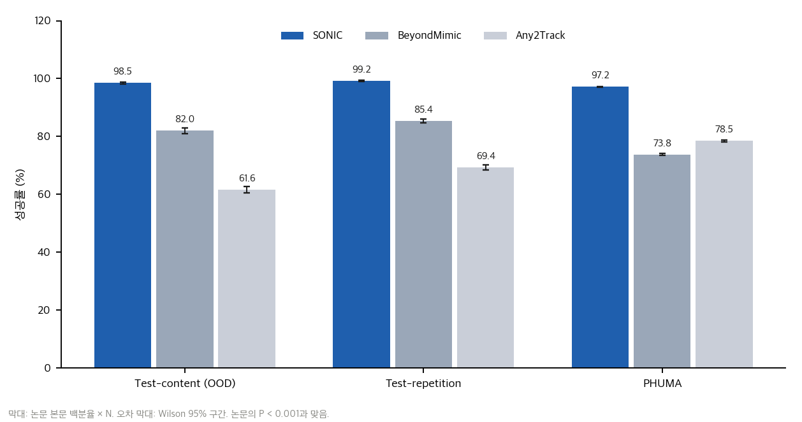
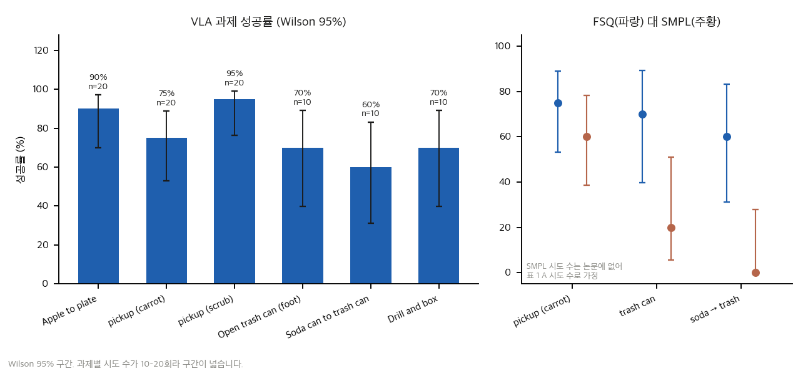

> **논문:** Zhengyi Luo, Ye Yuan, Tingwu Wang 외 (NVIDIA). *SONIC: Supersizing Motion Tracking for Natural Humanoid Whole-Body Control.* arXiv:2511.07820 (v4, 2026-08-13). *Science Robotics* 11(117), eaed4592 (2026).
> 공식 코드는 GitHub NVlabs/GR00T-WholeBodyControl에 있습니다. 이 글의 그림은 우리가 논문 수치로 그린 그래프 두 장입니다. 논문 그림은 쓰지 않았습니다(라이선스 CC BY-SA 4.0, PDF에 저작권 고지).

## 논문이 묻는 것

휴머노이드 제어기는 보통 작은 신경망(3층 MLP 수준)을 한 과제에 맞춰 몇 장의 GPU로 학습합니다. 과제가 바뀌면 보상을 다시 짜야 합니다. 반면 파운데이션 모델은 수천 장의 GPU로 키우면 능력이 늘어납니다. 이 논문은 둘 사이를 잇는 과제로 **동작 추종(motion tracking)**을 고릅니다. 사람 모션캡처는 프레임마다 목표 자세를 주므로 보상 설계 없이 밀도 높은 감독을 줍니다.

논문의 세 가지 주장은 다음과 같습니다.

1. 네트워크(1.2M → 42M), 데이터(4M → 100M 프레임), 계산(2k → 21k GPU 시간)을 키우면 추종 성공률과 정확도가 함께 좋아집니다.
2. 로봇 모션, 사람 SMPL 모션, 혼합 입력을 세 인코더로 받아 하나의 FSQ 토큰 공간에 넣으면, 같은 제어기로 원격조작, 영상·텍스트·음악 입력, VLA 제어를 모두 할 수 있습니다.
3. 운동학 계획기를 붙이면 속도와 방향 명령을 실시간으로 처리합니다.

## 무엇을 확인했나

이 글과 분석의 근거는 논문 본문, 표 1–3, 그림 2, 부록 표 S1–S4입니다. 세 가지를 했습니다.

- 논문에 적힌 표와 그림 수치를 다시 계산하고 검정했습니다(Wilson 구간, 두 비율 z 검정, Fisher 정확 검정).
- 본문, 표, 그림 사이에 맞지 않는 곳을 찾았습니다.
- 공식 저장소의 학습 설정을 정적으로 읽어 논문 설정과 대조했습니다. 코드는 실행하지 않았습니다.

재현은 하지 않았습니다.

## 기준선 비교: 차이는 크다

그림: 우리가 그린 그래프. 논문 그림 2 D의 성공률을 옮겨 적고 Wilson 95% 구간을 더했습니다. 막대는 논문 백분율 × 평가 동작 수입니다.

test-content에서 SONIC은 98.5%, BeyondMimic은 82.0%, Any2Track은 61.6%입니다. 차이는 15–37%p이며 검정 p 값은 10⁻²⁰⁰ 아래입니다. 논문의 "P < 0.001"과 맞습니다.

다만 기준선은 다른 데이터(LaFAN, AMASS)와 다른 재targeting으로 학습되었습니다. 논문도 이 비교가 "데이터를 맞춘 벤치마크가 아니다"라고 인정합니다. 그래서 이 차이는 방법만의 차이가 아니라 데이터와 파이프라인을 포함한 차이로 읽어야 합니다.

속도 추종에서는 OpenHomie와 비교했습니다. 생존율은 197/200 대 86/200입니다(Fisher p = 8 × 10⁻⁴⁰). 다만 그림 2 H를 보면 SONIC의 달성 속도는 약 2 m/s에서 머뭅니다. 명령 범위 0–6 m/s는 달성 속도가 아닙니다. 명령과 달성을 나눠 읽어야 합니다.

## 실로봇과 VLA: 방향은 맞고 크기는 가정에 기댄다

실로봇에서는 Unitree G1으로 124개 동작을 한 번씩 실행해 123개가 성공했습니다(99.2%). 시뮬은 124/124입니다. 실패가 한 건뿐이라 "시뮬과 같다"는 결론을 검정할 수 없습니다. 논문은 이를 "closely matched"라고 씁니다.

VLA 실험(GR00T N1.5를 미세조정해 토큰을 예측)에서는 토큰 행동 공간이 SMPL 자세보다 낫다고 보고합니다. 토큰 평균 68%, SMPL 평균 27%, 차이 +42%p입니다. 세 과제의 단순 평균이고 SMPL의 시도 수가 표에 없습니다. 시도 수를 표 1 A와 같다고 가정하면 쓰레기통 과제(70% 대 20%)는 유의하지 않습니다. 방향은 세 과제에서 같지만 크기는 확정하기 어렵습니다.

그림: 우리가 그린 그래프. 왼쪽은 표 1 A의 과제별 성공률과 Wilson 95% 구간(시도 10–20회라 구간이 넓습니다). 오른쪽은 표 1 B의 FSQ 대 SMPL 비교이며 SMPL 시도 수는 가정입니다.

"5개 과제 평균 75%"는 물체 집기 두 행을 한 과제로 묶은 단순 평균입니다. 여섯 행을 합산하면 72/90 = 80%입니다. 어느 쪽이든 과제 수가 적어 정밀하지 않습니다.

## 표와 본문이 맞지 않는 곳

- **데이터 분류 합계.** 표 2에서 test-repetition 대분류 합은 6,306으로, 전체 클립 9,395의 67%입니다. 나머지 3,089클립이 어느 범주인지 표에 없습니다.
- **데이터 규모 표기.** 초록은 "100M+ frames from 700 hours"라고 쓰지만 학습은 611시간입니다. 700시간은 필터 전 원천 시간입니다. 또 4M, 10M, 22M 프레임 부분집합의 클립 수는 모두 평균 4.0 s로 맞아떨어집니다. 전체 데이터 평균은 6.9 s입니다.
- **기본 설정의 값.** 논문은 FSQ-32-32를 기본으로 씁니다. 그런데 같은 설정이 표 3 A에서는 99.3%와 26.6 mm, 표 3 C와 그림 2에서는 99.6%와 23.8 mm입니다. 표 3 B는 32 GPU에서 98.8%와 27.5 mm입니다.
- **통계.** 그림 2 A–C의 규모 효과 검정은 같은 학습 실행에서 나온 체크포인트 6개로 했습니다. 독립된 반복이 아닙니다. 시드 변동이 빠져 있어 규모 효과의 확실성을 판단하기 어렵습니다.
- **차원 대 레벨.** 논문은 토큰 차원이 레벨보다 중요하다고 씁니다. 같은 기준으로 다시 보면 두 효과는 1–6 mm로 비슷합니다. 한 시드의 단일 평가라 차이를 확정할 수 없습니다.

## 공식 코드와 논문 설정

공식 저장소(커밋 1e1ec4f, 2026-11-02)에는 학습 설정과 손실 코드가 있습니다. 정적으로 대조하니 여러 값이 달랐습니다.

- 디코더와 크리틱의 은닉층 폭: 논문 표 S1은 [4096, 4096, 2048, …]이고 코드는 [2048, 2048, 1024, …]입니다. 표 S1 폭으로 세면 두 MLP만 각각 약 33M이어서 42M 전체와 맞지 않습니다.
- 복원 손실 계수: 논문 식 (1)은 1이고 코드는 0.01입니다.
- 엔트로피 계수: 논문 0.013, 코드 기본값 0.01입니다. 릴리스 설정은 이 값을 바꾸지 않습니다.
- 평가 종료 기준: 논문은 높이 0.25 m만 씁니다. 코드 평가 설정에는 방향 기준(1.0 rad²)이 하나 더 있습니다.
- 교란 범위: 코드의 COM 교란은 논문의 1/3–1/2이고, 밀기 간격 4–6 s는 논문 표의 "지속 시간 1–3 s"와 다른 항목입니다.
- 계획기 감쇠: 위치 감쇠 계수는 식 (8)과 맞지만 방향은 약 18% 다릅니다.
- PD 이득: 논문에는 값이 없고 코드에는 있습니다. 감쇠비가 2.0이라 과감쇠입니다.

이 차이들은 논문 결과를 재현하려면 값을 명시해서 고정해야 한다는 뜻입니다.

## 이 맥에서 할 수 있는 것

- **학습 (42M, 128 GPU, 7일, 약 21.5k GPU 시간): 불가능.** 저장소는 Isaac Lab과 NVIDIA GPU를 전제합니다.
- **실로봇: 불가능.** G1 실물이 필요합니다.
- **공개 체크포인트 추론과 MuJoCo 소규모 평가: 조건부.** 설치, 체크포인트 다운로드, 공식 코드 실행이 필요합니다.
- **토큰 구조 토이와 계획기 식 검사: 가능.** 노력은 토이 1–2주 정도로 추정합니다(추정치).

## 라이선스와 주의

- 논문 라이선스는 arXiv 기준 CC BY-SA 4.0이고 PDF에는 저작권 고지가 있습니다. 그래서 논문 그림을 이 글에 넣지 않았습니다.
- 공식 코드의 소스는 Apache-2.0입니다. 모델 가중치는 NVIDIA Open Model License를 따릅니다. 학습 데이터 BONES-SEED는 허깅페이스의 별도 조건입니다.

## 정리

SONIC은 동작 추종을 규모로 키우면 기준선보다 낫다는 방향을 본문 수치로 잘 보여 줍니다. 다만 실로봇 동등성, 토큰 차원 우위, VLA의 +42%p는 검정이나 가정이 약합니다. 공식 코드를 쓰려면 논문과 다른 설정 여러 개를 먼저 확인해야 합니다.

## 자료

- [통합 리포트 PDF](report/report_public.pdf)
- [01. 논문 분석: SONIC (arXiv:2511.07820)](analysis/01_paper_analysis.md)
- [02. 선행연구, 공식 저장소, 관련 분석](analysis/02_prior_work.md)
- [03. 수치 재계산, 일관성 검사, 주장 판정](analysis/03_analysis.md)
- [04. 공식 코드 대조 (정적 읽기): 논문 대 저장소](analysis/04_code_verification.md)
