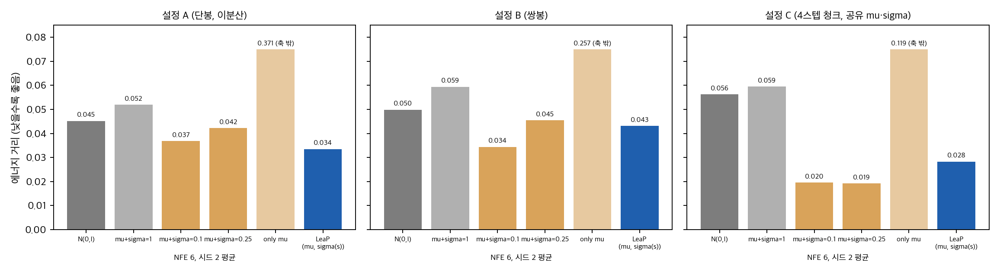

# 03. 수치 재계산, 일관성 검사, 토이 실험

이 문서는 논문 표의 수치를 다시 계산하고(§1), 일관성과 해석 문제를 정리하며(§2), 작은 CPU 토이로 중심 주장 하나를 확인하고(§3), 본문 주장을 수치로 판정합니다(§4). 재계산은 `analysis/recompute.py`, 토이는 `analysis/toy_source_prior.py`, 코드 파라미터 수는 `analysis/param_count.py`입니다. 결과는 같은 이름의 `*_results.json`에 있습니다. 재현 실험(학습, 시뮬 평가)은 하지 않았습니다.

## 0. 가정

- 표 1의 "±"는 **표본 SD(n − 1)**로 읽습니다. 3시드 × 정수 성공 수로 복원하면 모집단 SD로는 75셀 중 37셀이 불가능하고 표본 SD로는 75셀 모두 가능합니다(V2). 논문은 SD의 종류를 적지 않았습니다.
- 표 1은 과제×방법 셀마다 3시드 평균이고 시드마다 100회입니다(표 1 캡션). 과제 평균 행은 15과제 단순 평균으로 읽습니다.
- 실로봇(그림 4)은 표가 없고 막대 위 숫자만 있습니다. 그림을 확대해 읽은 값이며 20회 중 성공 수 = 값/5입니다.
- 절제 표 6–9는 시드 0 한 번, 과제당 100회입니다(논문 §5). 변형당 3과제 합산 300회로 Fisher 검정을 하되 **과제 이질성과 시드 변동을 무시한 낙관적 p**이므로 참고용입니다. 다중 비교 보정은 하지 않았습니다.
- 검정은 양측이고 α = 0.05입니다. 과제 단위 검정은 15과제를 독립 표본으로 봅니다(과제는 서로 다른 장면이라 이 가정이 가장 약합니다).

## 1. 재계산 결과 (V 항목)

### V1. 표 1 평균 행

15과제 단순 평균은 LeaP 81.57, A2A 73.84, VITA 75.11, NoPrior 56.13, BridgePolicy 61.39로 보고된 81.6, 73.8, 75.1, 56.1, 61.4와 모두 일치합니다(최대 차이 0.04, 반올림 범위). 보고된 격차 "6.5에서 25.5 pp"는 재계산 격차 VITA 6.47, A2A 7.73, BridgePolicy 20.19, NoPrior 25.44에서 나옵니다. 본문의 격차는 반올림 평균의 차이(7.8, 6.5, 25.5, 20.2)입니다.

### V2. 정수 복원 (3시드 × 100회)

각 셀의 평균은 정수 3개의 평균(k/3)이고 SD는 같은 정수 3개에서 나와야 합니다. 0–100 정수 삼중항을 모두 탐색했습니다.

- 평균 일치: 75셀 모두 가능.
- 모집단 SD(분모 3): **37셀 불가능**. 예: beat block hammer LeaP 94.0 ± 2.6, dump bin bigbin LeaP 92.3 ± 6.7.
- 표본 SD(분모 2): **75셀 모두 가능**.

따라서 표 1은 표본 SD이고 정수 성공 수와 모순이 없습니다. place phone stand LeaP 75.0 ± 0.0은 세 시드가 모두 정확히 75/100이라는 뜻입니다.

### V3. 과제별 승패 (표 1, LeaP 대 각 기준선)

| 기준선 | 평균 격차 | 승/패 (15과제) | 부호 검정 p | Wilcoxon p | 과제 부트스트랩 95% 구간 | Welch로 유의한 과제 수 (표본 SD) |
|---|---|---|---|---|---|---|
| A2A | +7.73 | 12 / 3 | 0.035 | 0.0009 | [3.8, 12.7] | 4 |
| VITA | +6.47 | 12 / 3 | 0.035 | 0.0015 | [3.2, 10.1] | 3 |
| NoPrior | +25.44 | 15 / 0 | 1e-4 | 6e-5 | [18.0, 33.1] | 11 |
| BridgePolicy | +20.19 | 15 / 0 | 1e-4 | 6e-5 | [13.9, 26.7] | 11 |

- LeaP가 최고인 과제는 10개이고, 아닌 5개는 handover block, move playingcard away, place empty cup, stack blocks two, place object basket입니다. 모두 격차가 0.7–1.7 pp입니다. 본문 "다수 과제에서 1위"는 맞습니다.
- 과제 격차의 중앙값은 A2A 5.3, VITA 4.3, NoPrior 21.6, Bridge 19.7 pp입니다. 격차가 큰 3과제를 빼면 평균 격차는 A2A 4.3, VITA 3.8, NoPrior 20.1, Bridge 15.5 pp로 줄어, 일부 과제가 평균을 올립니다(예: pick diverse bottles의 A2A 대비 +33.7).
- 과제별 Welch(시드 3개)는 검정력이 낮아 A2A와 VITA에서는 15과제 중 3–4개만 유의합니다. 표 1 하나만으로 "A2A, VITA보다 확실히 낫다"고 말하려면 과제 단위 집계(부호 검정 0.035)에 기대야 합니다.

### V4. 평균의 SD (표 1 마지막 행)

보고된 SD(LeaP 0.4, A2A 2.2, VITA 0.9, NoPrior 2.5, Bridge 1.3)가 과제별 SD로 설명되는지 시드 간 독립 가정의 몬테카를로로 봤습니다. 독립이면 평균의 기대 SD는 LeaP 1.14, A2A 1.09, VITA 1.40, NoPrior 2.55, Bridge 1.32입니다. 보고값이 이 시뮬레이션 분포의 하위 몇 %에 있는지는 LeaP 12%, A2A 98%, VITA 33%, NoPrior 61%, Bridge 61%입니다. 이상치는 없습니다. LeaP의 0.4가 다소 낮고 A2A의 2.2가 다소 높지만 3시드 표본 SD의 변동 범위 안입니다.

### V5. 파라미터와 효율 주장 (그림 3a, 표 5)

- 프라이어 head 0.21M ÷ 13.22M = 1.59%("약 1.6%" 일치). LeaP − NoPrior = 0.21M(일치).
- A2A는 LeaP의 1.28배(+28.0%), VITA 1.28배(+27.7%): "28% 더 많다" 일치.
- ACT 6.35배, DP3 19.85배, BridgePolicy 20.5배: "6–20배" 일치.
- 공식 코드의 레이어 모양으로 직접 센 LeaP 전체는 13.217M으로 논문 13.22M과 일치합니다(`04` D10, `analysis/param_count.py`).

### V6. 그림 3(b) 수렴 곡선 읽기

그림에서 읽은 값은 LeaP 약 78, 91, 89, 90, A2A 57, 67, 72, 74, VITA 49, 61, 35, 61, NoPrior 34, 40, 50, 50, Bridge 38, 35, 50, 54(500, 1000, 2000, 3000 에폭, 읽기 오차 ±2). 본문 서술은 맞습니다. LeaP는 1000 에폭에 91%로 다른 방법의 3000 에폭 값(74, 61, 50, 54)을 넘고, VITA는 61에서 35로 떨어집니다. 3000 에폭 값은 표 1의 open laptop 3시드 평균(LeaP 86.0, A2A 70.3, VITA 62.7, NoPrior 46.3, Bridge 50.3)과 시드 SD 범위 안에서 맞습니다. 다만 점이 4개이고 한 과제, 한 시드이며 모든 방법이 같은 3000 에폭 학습입니다.

### V7. 실로봇 평균 (그림 4)

| 방법 | 과제별 막대 (Pick Cube / Close Box / Sandbags) | 막대 평균 | 본문 보고 평균 | 차이 |
|---|---|---|---|---|
| LeaP | 70 / 80 / 90 | 80.0 | 80.0 | 0 |
| VITA | 45 / 80 / 45 | 56.7 | 56.7 | 0 |
| A2A | 50 / 85 / 70 | 68.3 | 68.3 | 0 |
| NoPrior | 60 / 35 / 55 | **50.0** | **46.7** | **3.3 (60회 중 2회)** |

**불일치:** NoPrior 막대 평균은 150/3 = 50.0%인데 본문과 캡션은 46.7%이고, 이에 따라 "33.3 pp 차이"도 막대로는 30.0 pp입니다. 46.7%는 60회 중 28회이고 막대의 합은 30회입니다. 막대 하나(예: Pick Cube 60 → 50)가 잘못 표기됐거나 평균이 다른 값으로 계산됐을 수 있습니다. 어느 쪽인지 논문만으로는 알 수 없습니다. 이 둘은 본문 "NoPrior가 두 설정에서 꼴찌" 서술의 근거이기도 합니다(V8, C13).

### V8. 실로봇 검정 (20회 × 3과제, 한 시드)

과제별 Fisher: LeaP 대 VITA는 Pick Cube 0.20, Close Box 1.0, Sandbags 0.006. 대 A2A는 0.33, 1.0, 0.24. 대 NoPrior는 0.74, 0.010, 0.031입니다. 3과제 합산(60회, 막대 값 기준):

| 대 | 격차 | Fisher p | 과제 층화 CMH p |
|---|---|---|---|
| A2A | +11.7 pp | 0.21 | 0.14 |
| VITA | +23.3 pp | 0.010 | 0.006 |
| NoPrior | +30.0 pp (본문 값 28/60이면 +33.3 pp, p = 0.0003) | 0.001 | 0.0006 |

LeaP의 3과제 합산 Wilson 95% 구간은 [68.2, 88.2]%, A2A [55.8, 78.7]%로 크게 겹칩니다. 80% 검정력으로 A2A(68.3%)와 가르려면 팔당 약 219회, VITA와는 약 61회, NoPrior와는 약 32회가 필요합니다(정규 근사). "실로봇에서도 LeaP가 최고"는 A2A에 대해서는 증거가 약하고(Close Box에서는 A2A가 85 대 80로 앞섭니다), VITA와 NoPrior에 대해서는 합산으로 유의합니다.

### V9. 절제 표 6–9 평균

표 6–9의 과제 평균 25개 값이 모두 그림 5와 본문 값에 맞습니다(예: 85.33, 79.67, 78.67, 78.00, 74.67, 62.67, 47.67). 표 6–9의 "LeaP" 행(74, 90, 92)은 표 6, 7, 8, 9에서 모두 같은 값이고, "no prior"(41, 50, 52)는 표 7과 표 9의 FM 행이 같습니다. "15–26 pp 낮다"(§5.1)는 85.3 − 70.3 = 15.0, 85.3 − 59.3 = 26.0, "15.3 pp"(§5.2)는 78.0 − 62.7 = 15.3으로 맞습니다.

### V10. 절제의 과제 이질성과 검정 (표 6–9)

- **핸드오버 한 과제의 몫.** 상태 전용 프라이어가 다른 입력보다 앞서는 격차(표 6) 중 handover block이 차지하는 몫은 vision 64%, FiLM 89%, MLP 75%, CrossAttn 76%입니다. NLL·Align 제거(표 8)에서는 w/o Align 69%, 둘 다 뺀 경우 92%입니다. pick diverse bottles에서는 FiLM(77)과 CrossAttn(76)이 상태 전용(74)보다 높고, 둘 다 뺀 변형(79)도 Full(74)보다 높습니다.
- **형태 비교(표 7), 300회 합산 Fisher p (LeaP 대 변형, 미보정):** μ+full Σ 0.085, GMM 0.043, only μ 0.026, MSE 0.0015, μ+고정 σ 3e-10, 프라이어 없음 4e-23. 6개 비교에 Bonferroni(0.0083)를 적용하면 MSE, μ+고정 σ, 프라이어 없음만 남고 "only μ보다 낫다"(78.0 대 85.3, +7.3 pp)는 남지 않습니다. 과제별로는 handover block에서 only μ(93)가 LeaP(92)와 같고, open laptop(90 대 78, p = 0.033)에서만 차이가 납니다.
- **입력 비교(표 6):** 상태 전용 대 각 시각 변형은 300회 합산으로 유의하지만(p ≤ 1.3e-5) 위 이질성 때문에 "시각이 해롭다"는 일반 결론이 아니라 "이 과제 세트와 시드에서 상태 전용이 낫다"로 읽어야 합니다.
- **지도 손실(표 8):** w/o Align 0.0015, w/o NLL 0.0011(미보정). 과제별로는 handover block(70, 81 대 92)에서 주로 차이가 나고 pick diverse bottles에서는 유의하지 않습니다(p 0.44, 0.13). 두 손실을 모두 뺀 변형은 handover block 21로 무너지지만 pick diverse bottles에서는 79로 Full보다 높습니다.
- **브리지(표 9):** Bridge(μ) 68.7 대 Bridge+LeaP 76.7. 합산 Fisher p = 0.035, 과제별 p는 0.17, 0.56, 0.063입니다. 개선은 세 과제 모두에서 같은 방향이지만(+10, +5, +9) 과제 단위로 유의하지 않습니다.

### V11. 시드 0 절제와 표 1(3시드) 일관성

세 과제에서 LeaP의 표 1 평균은 84.9, 시드 0 절제는 85.3이고 과제별 z는 −0.49, 0.58, 0.20으로 맞습니다. NoPrior는 표 1 평균 40.8, 시드 0 절제 47.7이고 z가 0.46, 1.06, 1.15(모두 +)입니다. 시드 0은 NoPrior에 대해서 약간 유리한 시드입니다. 절제의 LeaP − NoPrior 격차는 37.6 pp이고 표 1 3시드로 쓰면 44.1 pp입니다. 절제는 오히려 격차를 작게 보이게 합니다. 표 1의 BridgePolicy(3과제 평균 48.2)와 표 9의 Bridge(μ_φ 소스, 68.7)는 소스가 달라 같은 모델이 아닙니다(z 10.0, 1.9, 6.5).

### V12. 프로젝트 페이지의 수치

프로젝트 페이지는 81.6%, +25.5 pp, 80.0%, 0.21M(1.6%), 85.3/78.0/62.7, 68.7→76.7을 그대로 옮겼습니다. 영상의 BridgePolicy 60.8%만 논문(61.4%)과 다르고 페이지가 이를 밝힙니다(`01` §0).

## 2. 일관성과 해석 문제

### 2.1 일관성 점검 목록

| 점검 | 결과 |
|---|---|
| 표 1 평균 행, 격차 6.5–25.5 pp | 일치 (V1) |
| 표 1 SD의 정수 복원 | 표본 SD로 75/75 가능 (V2) |
| 표 5 파라미터 비율, 1.6%, 28%, 6–20배 | 일치 (V5) |
| 표 6–9 평균, 그림 5 막대 | 일치 (V9) |
| 그림 3b 본문 서술 | 일치 (V6, 점 4개) |
| 그림 4 막대 평균과 본문 평균 | **NoPrior 불일치** (V7) |
| "NoPrior가 두 설정에서 꼴찌" (§4.4) | 평균 순위로는 맞음(시뮬 56.1이 최하, 실로봇 막대 평균 50.0이 VITA 56.7보다 낮음). 과제 단위로는 Pick Cube에서 VITA 45, A2A 50보다 높아 맞지 않음 |
| "BridgePolicy는 공개 코드가 없다"(A.2) | GitHub에 2026-05-25 생성된 공식 구현 표기 저장소가 있음 (`02` §2, `04` D15) |
| 표 6, 7, 8, 9의 LeaP 행 | 동일 (74, 90, 92) |
| 표 1 LeaP의 3과제 값과 시드 0 절제 | 일치 (V11) |

### 2.2 NLL의 최적해와 "상태 적응형 분산"의 의미

식 5와 코드(`04` D1)가 같은 (μ, σ²)를 H 스텝에 공유하므로, 한 상태에서 L_NLL의 최적해는 차원별로 μ* = 청크 평균, σ²* = (청크 내부 분산) + (표본 간 분산)입니다. 이를 직접 유도하면 d/dμ와 d/dσ²를 0으로 놓을 때 μ* = E[a_h]이고 σ²* = E[(a_h − μ*)²]이며 총 분산 법칙으로 두 항으로 나뉩니다. 관절 공간 청크(H = 8 스텝의 다음 관절 위치)에서는 청크 내부 분산이 **동작 속도에 비례**하는 항입니다. 따라서 σ(s)는 "관측 불확실성"만이 아니라 "청크가 얼마나 넓게 움직이는가"를 함께 학습합니다. 빠른 구간에서 σ가 크고 정지 근처에서 작은 것은 소스가 청크를 덮는 폭을 맞춘다는 뜻이고, 논문이 말하는 "보정된 불확실성"과는 다른 해석입니다. 또 "μ를 그대로 실행하면 0%"(표 8)는 μ가 H 스텝에 공유되어 **상수 청크**이기 때문에 정지 동작이 되어 당연한 결과입니다. "프라이어는 소스를 줄 뿐 생성기를 대체하지 않는다"는 결론은 맞지만, 이 시험이 그 주장을 시험하는 힘은 약합니다.

### 2.3 NoPrior 비교의 단위

코드(`04` D8)에서 소스와 행동은 정규화 공간(limits 모드, 대략 [−1, 1])에서 다룹니다. NoPrior의 N(0, I)는 이 공간에서 "범위 중앙 근방, 표준편차 1"이라 행동 범위의 가장자리까지 닿는 넓은 소스입니다. LeaP의 NoPrior 대비 이득은 **정규화 방식과 청크 길이에 의존**하는 크기입니다. 이는 소스 선택이 정규화 단위와 결합된다는 뜻이고, 논문이 정규화를 기술하지 않아 다른 환경으로 옮길 때 같은 크기의 이득을 기대하기 어렵습니다(`03` §3 토이는 이 영향을 직접 시험하지 않습니다).

## 3. 토이: 상태 조건부 소스와 분산 학습의 효과 (`toy_source_prior.py`, 약 1.8분, 시드 2)

**질문.** 논문의 핵심 주장은 "상태 적응형 분산을 함께 학습하는 것이 핵심이다"(§5.2)입니다. 근거로 든 비교는 μ+고정 σ=1(62.7%)과 only μ(78.0%)뿐입니다. 잘 고른 작은 고정 σ는 시험하지 않았습니다. 가장 작은 설정에서 이 공백을 봅니다.

**설정.** 상태 s ∈ [−1, 1]², 행동 a ∈ R⁸. 생성기는 같은 MLP(은닉 128 × 3), 흐름 매칭, 오일러 NFE 6(논문 표 3과 동일). 세 설정: A 단봉 이분산(σ*(s) = 0.03 + 0.35 sigmoid(4 s₁)), B 쌍봉, C 4스텝 × 2차원 궤적 청크(|v(s)|가 0.05–0.95로 변하고 μ, σ를 스텝에 공유하며 잡음은 독립, 식 2–3 구조). 소스 변형: N(0, I), μ+σ = 1, μ+σ = 0.1, μ+σ = 0.25, only μ(결정적), LeaP(μ(s), σ²(s)를 NLL + 흐름 손실로 학습). 지표는 상태별 에너지 거리(생성 64개 대 참 64개, 작을수록 좋음)입니다.



| 에너지 거리, NFE 6, 시드 2 평균 | A | B | C |
|---|---|---|---|
| N(0, I) | 0.0452 | 0.0499 | 0.0563 |
| μ + 고정 σ = 1 | 0.0520 | 0.0594 | 0.0595 |
| μ + 고정 σ = 0.1 | 0.0369 | **0.0344** | 0.0196 |
| μ + 고정 σ = 0.25 | 0.0423 | 0.0455 | **0.0192** |
| only μ (결정적) | 0.3708 | 0.2565 | 0.1191 |
| LeaP (μ(s), σ(s) 학습) | **0.0335** | 0.0432 | 0.0283 |

시드별 값은 서로 가깝습니다(예: A의 LeaP 0.0334, 0.0337). 결과:

1. **μ + 고정 σ = 1은 N(0, I)보다 나쁩니다**(세 설정 모두). 논문의 μ+고정 σ 62.7%가 프라이어 없음 47.7%보다 높게 나온 것과는 방향이 다르지만, 둘 다 "σ = 1은 좋은 고정값이 아니다"로 읽힙니다. 논문의 이 비교만으로는 "분산 학습이 핵심"이 아니라 "σ = 1이 너무 넓다"가 설명이 됩니다.
2. **잘 고른 고정 σ가 LeaP와 비슷하거나 낫습니다.** A에서는 LeaP(0.0335)가 σ = 0.1(0.0369)보다 약간 낫고, B에서는 σ = 0.1(0.0344)이 LeaP(0.0432)보다 낫고, C에서는 σ = 0.1, 0.25(0.0196, 0.0192)가 LeaP(0.0283)보다 낫습니다. 이 토이에서 NLL로 학습한 σ(s)가 고정 σ를 일관되게 이기지는 않습니다.
3. **only μ는 분포를 못 맞춥니다**(스프레드 0). 성공률 지표가 표본 하나의 정확도라면 이 결함이 안 드러날 수 있습니다(`only μ`의 표본 평균 RMSE는 A 0.032, B 0.012로 가장 낮은 편). 논문 표 7에서 only μ가 78.0%로 높은 것과 같은 모양입니다.
4. **NFE 1에서는 학습된 σ가 불리합니다.** NFE 1 에너지 거리는 A에서 LeaP 0.276, σ = 0.1 0.060, N(0, I) 0.184입니다(JSON `nfe1`). 소스 폭이 한 스텝 적분 오차를 키운다는 점에 주의해야 합니다(한 스텝 정책에서는 소스를 좁히는 것과 σ를 학습하는 것이 충돌할 수 있음).
5. **소스 이득의 크기는 청크 구조에서 가장 큽니다.** C에서 N(0, I) 0.056 대 σ = 0.25 0.019(약 3배). A, B에서는 0.045 대 0.034–0.037(약 25%)입니다.

**한계.** 8차원, 상태 2차원, 같은 생성기 폭, 시드 2개, 평균 상태별 분포 지표이며 로봇 정책의 성공률이 아닙니다. 고정 σ는 "미리 알고 고른" 값이라 현실의 하이퍼파라미터 튜닝 비용이 있습니다. LeaP식 σ(s)의 이점이 특정 구조(이분산이 크고 소스 폭 튜닝이 안 된 경우)에서 나타날 수는 있습니다. 이 토이는 논문 주장을 반박하지 않고 **논문의 절제가 그 주장을 분리하지 못했다**는 점만 보입니다.

## 4. 주장 판정 (C 항목)

| 번호 | 주장 (위치) | 수치 근거 | 판정 |
|---|---|---|---|
| C1 | 15과제 평균 81.6%, 네 기준선보다 6.5–25.5 pp 높다 (초록, §4.2, 표 1) | 평균 일치 (V1). A2A, VITA 대비는 과제 단위 12승 3패 (부호 p = 0.035) | 지지. A2A, VITA 대비는 크지 않음 |
| C2 | 다수 과제에서 1위 (§4.2) | 10/15 (V3) | 지지 |
| C3 | 25.5 pp 격차는 학습 가능한 프라이어 "전체"를 반영하며 구조 변경 때문이 아니다 (§4.2) | NoPrior와 구조 동일은 맞음. A2A, VITA는 생성기·손실이 다름. 소스의 상태 근접성과 분산 학습이 분리되지 않음 (§2.2, §3 토이) | 부분: 소스 교체 효과는 지지, "학습 가능한 분포형" 귀속은 미분리 |
| C4 | A2A와 VITA는 28% 더 큰데 점수가 낮다 (§4.3) | 1.28배 (V5) | 지지 (수치) |
| C5 | 학습 수렴이 더 빠르고 안정적이다 (§4.3, 초록) | 한 과제, 시드 0, 점 4개 (V6). 모두 3000 에폭, 시간 측정 없음 | 약함 |
| C6 | 프라이어 입력은 고유수용감각만으로 충분하고 시각을 넣으면 나빠진다 (§5.1, 초록 iii) | 3과제 시드 0. handover block이 격차의 64–92% (V10). pick diverse bottles에서는 일부 시각 변형이 더 높음 | 부분: "이 설정에서 상태 전용이 평균이 높다"까지 |
| C7 | 상태 적응형 분산 학습이 핵심 요인이다 (§5.2, 초록 iv) | only μ 대비 +7.3 pp는 미보정 p = 0.026이고 handover에서 같은 값. 고정 σ는 1만 시험. 토이는 잘 고른 고정 σ가 비슷하거나 나음 (§3) | 약함: 분리되지 않음 |
| C8 | μ+고정 σ가 only μ보다 15.3 pp 낮으므로 이득은 확률성만이 아니다 (§5.2) | 산술 일치 (V9). σ = 1이 너무 넓은 설정 | 산술만 지지, 추론은 약함 |
| C9 | Align과 NLL은 상보적이다 (§5.3) | 74.7, 74.3 대 85.3은 맞음 (V9). 과제별로는 handover 위주이고 둘 다 뺀 변형이 pick diverse bottles에서 최고 (V10) | 부분 |
| C10 | μ를 직접 실행하면 0% (§5.3) | 표 8. μ는 H 스텝 공유 상수 청크라 당연한 결과 (§2.2) | 지지하나 정보량 작음 |
| C11 | 브리지에서도 +8.0 pp (§5.4) | 산술 일치. 합산 p = 0.035, 과제별 비유의 (V10) | 방향만 지지 |
| C12 | 실로봇에서 LeaP가 최고, 평균 80.0% (§4.4, 그림 4) | A2A에 대해 합산 p = 0.21, Close Box에서는 A2A 85 대 80. VITA, NoPrior에 대해서는 유의 (V8) | A2A에 대해 지지 안 됨 |
| C13 | NoPrior가 시뮬과 실로봇 모두 꼴찌 (§4.4) | 실로봇 막대 평균 50.0(본문 46.7과 불일치, V7). Pick Cube에서는 NoPrior가 VITA, A2A보다 높음 | 평균 순위만 지지, 과제 단위로는 아님 |
| C14 | 프라이어 head는 0.21M(1.6%), LeaP는 모든 외부 기준선보다 파라미터가 적다 (§4.3, A.5) | V5, 코드 13.217M 직접 계산 (`04` D10) | 지지 |
| C15 | BridgePolicy는 공개 코드가 없어 재구현했다 (§4.1, A.2) | 2026-05-25 생성된 "official implementation" 저장소가 있음 (`02` §2) | 미확인: LeaP 실험 시점의 공개 여부 불명 |
| C16 | 소스 분포는 독립적이고 재사용 가능한 설계 축이다 (초록, 결론) | 생성기는 MLP SimpleFlowNet과 브리지(μ 소스) 두 개, 단일 벤치마크, VLA는 시험 안 함 (§7). 소스 이득은 정규화 단위와 결합 (§2.3) | 방향은 지지, 일반화는 미시험 |

## 5. 재실행

```bash
python3 analysis/recompute.py        # 표 재계산과 검정, 수 초 (numpy, scipy, statsmodels)
python3 analysis/param_count.py      # 코드 레이어 모양에서 파라미터 수 계산, 순수 파이썬
python3 analysis/toy_source_prior.py # 토이, 약 1.8분 (torch, CPU 2스레드)
python3 analysis/plot_figures.py     # 그래프 네 장
```
