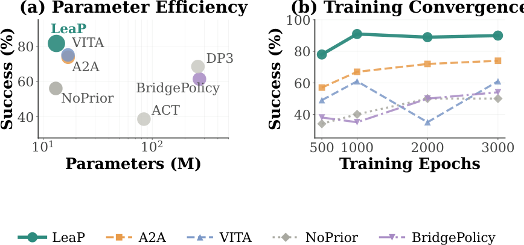
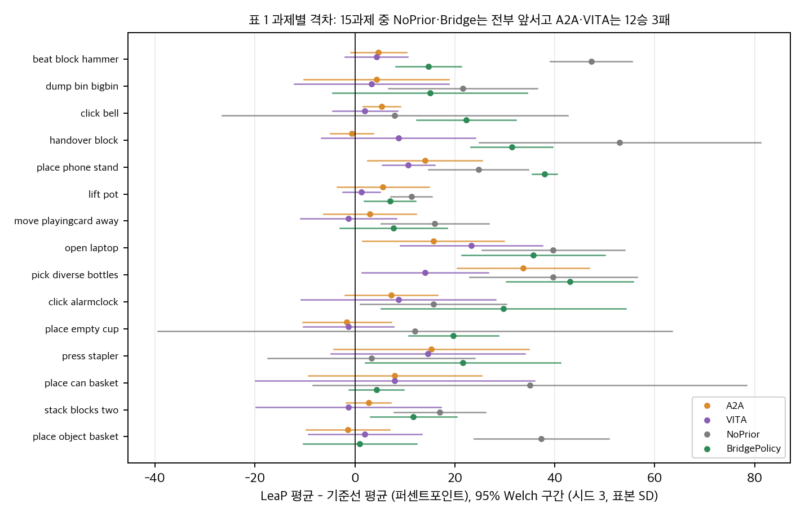
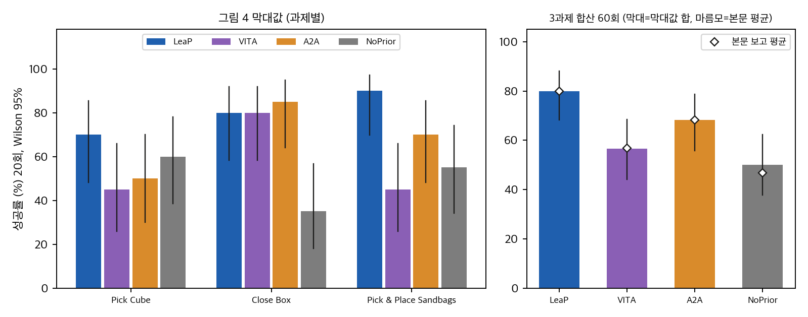
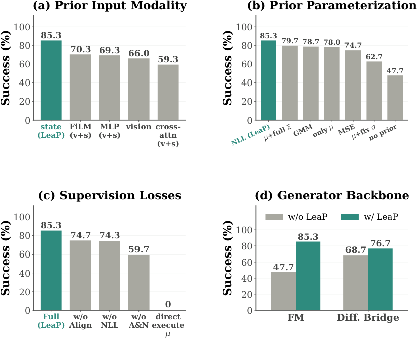
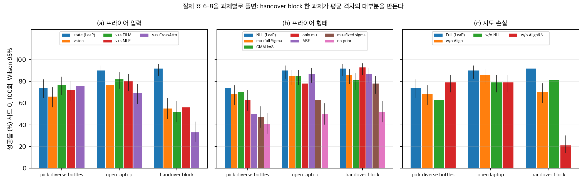
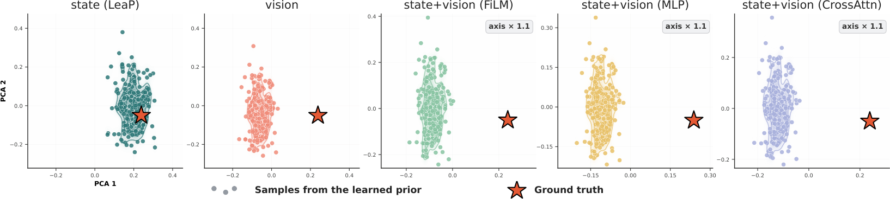
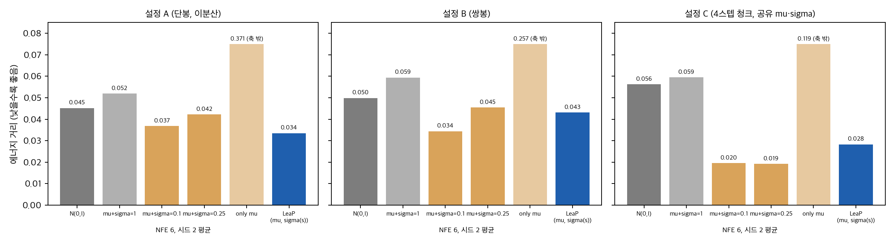

> **논문:** Meipo Dai 외. *Where Should Action Generation Begin? A Learnable Source Prior for Generative Robot Policies.* CoRL 2026 포스터, arXiv:2606.17408 (v1, 2026-06-16, 유일한 버전). 공식 코드는 GitHub daimeipo/LeaP(MIT)입니다. 논문 그림은 CC BY 4.0에 따라 그림 3, 5, 6만 출처와 함께 실었고, 나머지 그래프는 직접 그렸습니다.

## 논문이 묻는 것

확산·흐름 매칭 정책은 행동을 관측과 무관한 N(0, I)에서 시작합니다. LeaP는 시작점을 **고유수용감각에 조건부인 대각 가우시안**으로 바꿉니다. 두 층 MLP가 평균과 로그 분산을 내고, 이를 행동 청크의 모든 스텝이 공유하며 스텝마다 독립 잡음을 뽑습니다. 생성기와 풀이기는 그대로 두고 흐름 손실, 가우시안 NLL, 대조 정렬 손실을 함께 학습합니다.

*그림 3 (논문 원문). © 저자, CC BY 4.0, 출처 arXiv:2606.17408.*

## 이 글에서 확인한 것

**1. 소스 교체의 효과는 크고 일관됩니다.** RoboTwin 15과제 평균 81.6%는 15과제 단순 평균(81.57)과 맞고, 같은 구조에서 소스만 N(0, I)로 바꾼 NoPrior(56.1%)보다 25.5 pp 높습니다. 15과제 모두에서 앞섭니다(부호 검정 p = 1e-4). 표의 ±는 정수 성공 수로 복원하면 표본 SD입니다(75셀 모두 가능, 모집단 SD는 37셀 불가능).

*그래프 (우리가 그림). 표 1 과제별 LeaP − 기준선 격차와 95% Welch 구간.*

**2. A2A, VITA와의 차이는 방향만 확실합니다.** +7.8, +6.5 pp는 과제 단위로 12승 3패(p = 0.035)이고, 과제별로 유의한 과제는 3–4개입니다.

**3. 실로봇 표가 어긋납니다.** 그림 4의 NoPrior 막대(60, 35, 55)의 평균은 50.0%인데 본문은 46.7%이고, "+33.3 pp"는 막대로는 30.0 pp입니다. A2A와의 차이(+11.7 pp)는 3과제 합산 p = 0.21이고 Close Box에서는 A2A가 앞섭니다. 과제당 20회, 한 시드입니다.

*그래프 (우리가 그림). 그림 4 막대 값(Wilson 95%)과 3과제 합산, 본문 보고 평균(마름모).*

**4. 절제는 한 과제가 크게 좌우합니다.** 절제는 세 과제, 시드 0 한 번입니다. 상태 전용 프라이어가 시각 포함 변형보다 앞서는 격차의 64–89%, NLL·정렬 제거 격차의 최대 92%가 handover block 한 과제에서 나옵니다. pick diverse bottles에서는 일부 시각 변형(77, 76)이 상태 전용(74)보다 높습니다.

*그림 5 (논문 원문). © 저자, CC BY 4.0, 출처 arXiv:2606.17408.*

*그래프 (우리가 그림). 절제 표 6–8의 과제별 값(시드 0, 100회, Wilson 95%).*

*그림 6 (논문 원문). © 저자, CC BY 4.0, 출처 arXiv:2606.17408.*

**5. "상태 적응형 분산이 핵심"은 분리되지 않았습니다.** 비교는 μ + 고정 σ = 1(62.7%)과 평균만(78.0%)뿐입니다. 평균만과의 차이는 +7.3 pp이고 미보정 p = 0.026이며 handover block에서는 같은 값입니다. NLL의 최적해는 μ = 청크 평균, σ² = 청크 내부 분산 + 표본 간 분산이라서, σ는 불확실성만이 아니라 동작 속도도 담습니다.

## 토이로 본 것

8차원 행동, 2차원 상태에서 같은 흐름 생성기에 여섯 가지 소스를 붙여 비교했습니다(NFE 6, 시드 2). 설정 C는 4스텝 청크이고 (μ, σ)를 스텝에 공유합니다.

*그래프 (우리가 그림). 낮을수록 좋습니다. σ = 1은 N(0, I)보다 나쁘고, 잘 고른 고정 σ(0.1–0.25)가 학습 σ와 비슷하거나 더 낫습니다.*

이 토이는 논문 주장을 반박하지 않습니다. 논문의 절제가 "분산 학습"과 "소스를 좁히는 것"을 분리하지 못했다는 점만 보입니다.

## 공식 코드와 논문의 차이

공식 저장소에는 LeaP 본 모델이 있고 레이어 모양으로 센 파라미터 수는 13.217M으로 논문 13.22M과 맞습니다. 다만 다음이 논문에 없거나 다릅니다.

- NLL이 식 5(차원 합)와 달리 원소 평균입니다.
- 로그 분산이 [−10, 5]로 잘립니다. 정렬 온도 0.1, AdamW β(0.95, 0.999), weight decay 1e-6도 논문에 없습니다.
- 기본 설정이 데모 50개 중 1개를 검증용으로 떼어 49개로 학습합니다.
- 행동은 다음 관절 위치이고 모든 값이 [−1, 1]로 정규화됩니다. NoPrior의 N(0, I)도 이 공간입니다.
- 기준선, 절제 변형, 실로봇 코드는 없습니다. 논문은 BridgePolicy의 공개 코드가 없다고 쓰지만, 공식 구현을 표방하는 저장소가 2026-05-25에 만들어져 있습니다(실험 시점의 공개 여부는 확인하지 못했습니다).

## 한계

논문 표의 재현(시뮬레이터, 실로봇)은 하지 않았습니다. 실로봇 값은 그림에서 읽은 막대 값이고, 절제의 Fisher p는 과제 이질성과 시드 변동을 무시한 참고값입니다. 토이는 로봇 성공률과 직접 대응하지 않습니다.

## 자료

- [통합 리포트 PDF](report/report_public.pdf)
- [01. 논문 분석: LeaP (arXiv:2606.17408)](analysis/01_paper_analysis.md)
- [02. 선행연구와 관련 저장소](analysis/02_prior_work.md)
- [03. 수치 재계산, 일관성 검사, 토이 실험](analysis/03_analysis.md)
- [04. 공식 코드 대조와 구현 가능성](analysis/04_code_verification.md)
