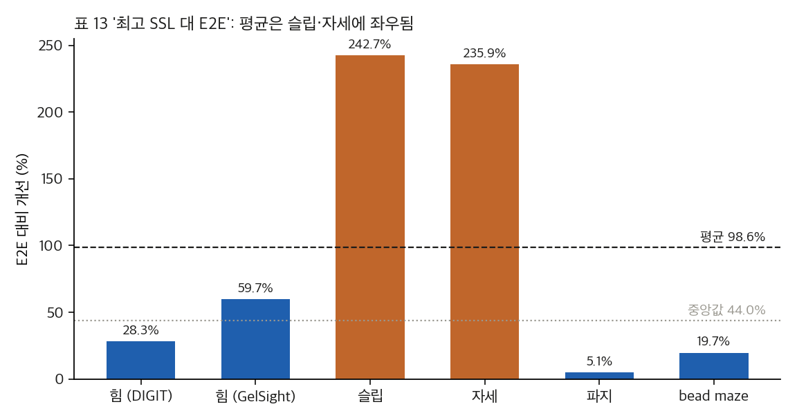
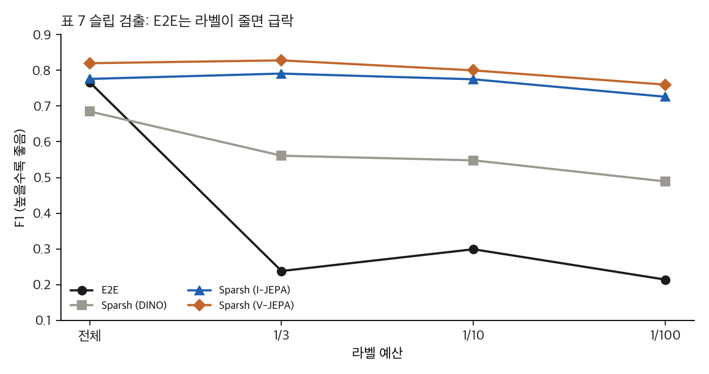
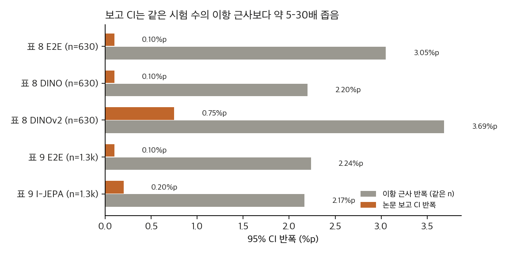

> **논문:** Carolina Higuera, Akash Sharma, Chaithanya Krishna Bodduluri, Taosha Fan, Patrick Lancaster, Mrinal Kalakrishnan, Michael Kaess, Byron Boots, Mike Lambeta, Tingfan Wu, Mustafa Mukadam. *Sparsh: Self-supervised touch representations for vision-based tactile sensing.* CoRL 2024 (PMLR 270:885–915), arXiv:2410.24090 (v1, 2024-10-31).
> 공식 코드는 GitHub facebookresearch/sparsh에 있습니다(CC BY-NC 4.0, 저장소는 아카이브 상태). 이 글의 그래프는 모두 논문 수치로 우리가 다시 그린 것입니다. 논문 그림은 arXiv 라이선스가 CC BY가 아니어서 싣지 않았습니다.

## 논문이 묻는 것

시각 기반 촉각 센서(DIGIT, GelSight 2017, GelSight Mini)는 센서마다, 과제마다 따로 모델을 학습해 왔습니다. 마커가 있는 센서에서 배운 특징은 마커가 없는 센서로 잘 옮겨 가지 않고, 힘이나 슬립 라벨은 모으기 어렵습니다. Sparsh는 라벨 없는 촉각 이미지 약 46만 장으로 자기지도 학습을 해서, 여러 센서와 과제에서 쓸 수 있는 **일반 촉각 표현**을 만들자는 제안입니다.

방법은 새 구조가 아닙니다. MAE, DINO, DINOv2, I-JEPA, V-JEPA를 촉각 이미지에 맞게 바꾼 레시피입니다. 입력은 두 장을 채널로 쌓은 6채널 이미지이고(약 80 ms), 무접촉 배경을 뺍니다. 저자들은 여섯 과제로 된 벤치마크 TacBench를 함께 냅니다. 평가는 인코더를 얼리고 얇은 디코더만 학습하며, 같은 크기의 E2E 모델과 비교합니다.

## 이 글에서 확인한 것

**1. 라벨이 적을 때 사전학습의 이득은 분명합니다. 그런데 평균 수치는 두 과제에 크게 기댑니다.** 논문 표 13의 "최고 SSL 대 E2E" 여섯 값은 힘(DIGIT) 28.3%, 힘(GelSight) 59.7%, 슬립 242.7%, 자세 235.9%, 파지 5.1%, bead maze 19.7%입니다. 슬립과 자세가 합의 81%를 차지하고, 중앙값은 44%입니다. 슬립과 자세는 E2E가 라벨 1/3에서 각각 F1 0.238, 정확도 0.245로 크게 떨어지는 과제입니다. 초록의 "95.1%"는 표 13 어디에도 없고, 기준 예산도 적혀 있지 않습니다.

*그래프 (우리가 그림). 논문 표 13의 여섯 값을 옮겼습니다. 점선은 평균, 점은 중앙값입니다.*

**2. 슬립에서 E2E는 라벨이 줄면 무너지고, V-JEPA는 버팁니다.** 슬립 F1은 전체 데이터에서 V-JEPA 0.820, E2E 0.767입니다. 라벨 1/100에서는 E2E 0.214, V-JEPA 0.760입니다. 그런데 DINO 계열은 전체 데이터에서도 E2E(0.767)보다 낮은 0.685입니다. 본문은 이 점을 말하지 않습니다.

*그래프 (우리가 그림). 표 7의 F1 값을 옮겼습니다.*

**3. 신뢰구간이 너무 좁습니다.** 표 8(자세, 630 샘플)의 95% 구간은 반폭이 ±0.001입니다. 같은 샘플 수에서 이항 분포로 계산하면 약 ±0.022–0.037입니다. 보고된 구간은 5–30배 좁습니다. 시드나 프레임 단위로 계산한 것 같지만 논문에 설명이 없습니다. 이 구간으로는 차이가 유의한지 말할 수 없습니다.

*그래프 (우리가 그림). 보고된 CI와 이항 근사를 같은 축에 놓았습니다.*

**4. 본문과 표가 맞지 않는 곳이 몇 군데 있습니다.**

- 본문 "DINO가 I-JEPA보다 평균 5.6% 낫다"는 표 13의 열 평균 8.91%와 다릅니다.
- 본문은 I-JEPA가 직물 인식과 파지에서 낫다고 하지만, 직물에서는 MAE(0.599)가 가장 높고 I-JEPA(0.506)는 DINO(0.527)보다 낮습니다.
- 실로봇 bead maze의 "E2E 대비 20–53% 더 멀리 감"은 표 11에서 사전학습 40–61%, 미세조정 26–68%로 계산됩니다. 시행은 10회입니다.
- bead maze 시연 수는 본문 50회, 부록 30회입니다.

**5. 공식 코드의 학습 설정은 논문 표와 다릅니다.** 공식 설정은 에폭 200(논문 150), 입력 320×240(논문 224×224), 패치 16(논문 ViT-B/14), I-JEPA 학습률 1e-3(논문 6.25e-4)입니다. 슬립 라벨의 마찰계수는 논문에 값이 없고, 공개 스크립트의 기본값은 1.6입니다. 정적 읽기로 본 결과이고, 실행해서 확인한 것은 아닙니다.

## 이 맥에서 구현할 수 있을까

**전체 재현은 이 맥(Apple M4 Pro, 약 24 GiB, MPS, CUDA 없음)에서 불가능합니다.** 사전학습은 A100 8장 기준이고, 실로봇 bead maze는 장비가 없습니다.

- 공식 DINO ViT-B 가중치(safetensors 약 345 MB)로 추론하고 동결 특징 위에 작은 디코더를 학습하는 것은 **조건부로 가능**합니다. 가중치 다운로드와 공식 코드 설치가 먼저 필요합니다.
- 목적 함수를 작은 데이터와 작은 모델로 옮겨 보는 소형 재구현은 2–3주 정도로 추정합니다. 측정하지 않은 추정입니다.

## 권리와 공개 범위

- 논문의 arXiv 라이선스는 nonexclusive 1.0이고 CC BY가 아닙니다. PDF에서 저작권 문구는 찾지 못했지만, 그림은 싣지 않았습니다.
- 공식 코드와 가중치는 CC BY-NC 4.0(비상업)입니다. 이 글에는 코드를 넣지 않았습니다.
- 표 값은 인용과 재계산을 위해 옮겼습니다. 재계산 스크립트와 결과는 분석 노트에 함께 있습니다.

## 정리

Sparsh는 라벨이 적은 촉각 과제에서 쓸 만한 출발점입니다. 다만 평균 개선율 하나로 판단하기보다 과제별, 예산별 곡선을 같이 봐야 합니다. 신뢰구간은 정의를 확인한 뒤 다시 계산해야 합니다. 재현이 필요하다면 체크포인트 추론과 동결 특징 평가부터 시작하는 것이 현실적입니다.

## 자료

- [통합 리포트 PDF](report/report_public.pdf)
- [01. 논문 분석: Sparsh (arXiv:2410.24090)](analysis/01_paper_analysis.md)
- [02. 선행연구와 공개 자원](analysis/02_prior_work.md)
- [03. 재계산, 일관성 검사, 주장 판정](analysis/03_analysis.md)
- [04. 공식 코드 대조와 구현 가능성](analysis/04_code_verification.md)
