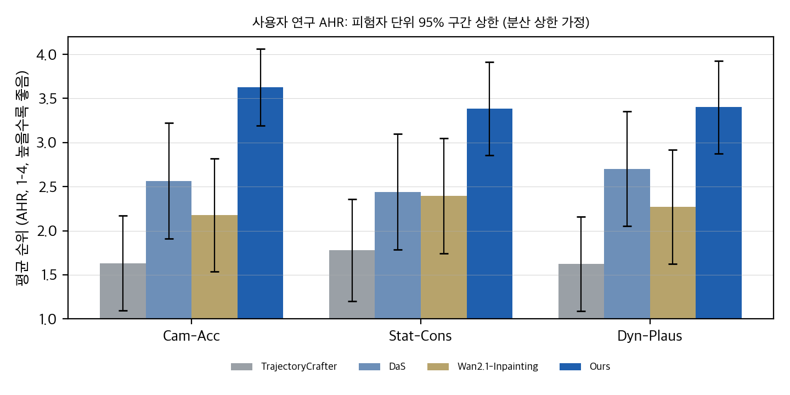
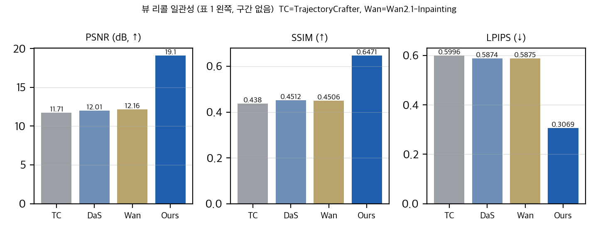
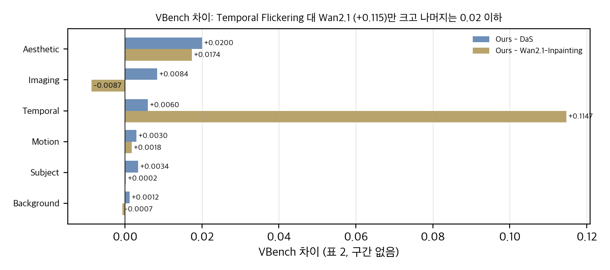

> **논문:** Tong Wu, Shuai Yang, Ryan Po, Yinghao Xu, Ziwei Liu, Dahua Lin, Gordon Wetzstein. *Video World Models with Long-term Spatial Memory.* NeurIPS 2025, arXiv:2506.05284 (v1, 2025-06-05, 버전 하나).
> 공식 코드는 GitHub spmem/spmem에 있습니다 (Apache-2.0). 이 글의 그래프는 모두 논문 표 값으로 우리가 다시 그린 것입니다. 논문 그림은 쓰지 않았습니다 (논문은 CC BY가 아닌 arXiv 비독점 배포 라이선스입니다).

## 논문이 묻는 것

자기회귀 영상 세계 모델은 카메라 움직임이나 행동 문장을 받아 프레임을 한 장씩 만듭니다. 문맥 창이 짧아서 이미 본 장면으로 돌아오면 앞서 만든 내용을 잊고 다른 장면을 그립니다. 이 논문은 문맥 창을 늘리는 대신 **3D 장면을 명시적으로 기억하는 공간 기억**을 옆에 둡니다.

기억은 세 가지입니다. 최근 프레임(작업 기억), 생성된 정적 장면을 점군으로 누적한 공간 기억, 그리고 대표 과거 프레임 몇 장(에피소드 기억)입니다. 점군은 TSDF 융합으로 누적하면서 움직이는 물체를 걸러냅니다. 기반 모델은 CogVideoX-5B-I2V이고, 정적 점군 렌더링을 0으로 초기화한 선형층을 거쳐 조건으로 넣습니다.

## 이 글에서 확인한 것

**1. 사용자 연구의 차이는 대부분 확실합니다. 예외가 하나 있습니다.** 피험자 20명, 사례 14개의 평균 순위 (1–4)에서 제안 방법은 세 기준 모두 기준선보다 높습니다. 평가 하나하나를 독립으로 보면 모든 비교가 매우 유의합니다. 같은 피험자의 판단이 묶여 있다고 보고 피험자 단위로 보수적으로 계산하면, 가장 가까운 기준선 DaS와의 동적 타당성 차이는 p ≈ 0.10으로 유의하지 않습니다. 평균과 분산 상계만으로 계산한 결과입니다.

*그래프: 논문 표 1 (사용자 연구)의 평균 순위와 피험자 단위 95% 구간 상한. 분산 정보가 없어서 범위 [1,4]의 최대 분산을 썼습니다. 우리가 그렸습니다.*

**2. 뷰 리콜 차이는 크지만 구간이 없습니다.** 같은 카메라 자세를 두 번 지나는 쌍에서 PSNR은 가장 좋은 기준선보다 6.9 dB 높고, LPIPS는 약 48% 낮습니다. 다만 샘플별 분산이 본문에 없어서 신뢰구간은 계산하지 못했습니다.

*그래프: 논문 표 1 (뷰 리콜). 구간 없음. 우리가 그렸습니다.*

**3. 영상 품질은 비슷한 수준입니다.** VBench에서 제안 방법은 미적 품질과 시간적 깜빡임에서 앞섭니다. Wan2.1은 Imaging과 Background에서 앞섭니다. 주체 일관성 차이는 0.0002로 해석할 수 없는 크기입니다. 깜빡임 차이는 Wan2.1 대비 0.11로 가장 큽니다.

*그래프: 논문 표 2 (VBench). 제안 방법에서 기준선을 뺀 값. 구간 없음. 우리가 그렸습니다.*

## 빈칸 두 개

**공간 기억 자체의 효과를 재는 절제가 없습니다.** 절제 표는 작업 기억과 에피소드 기억을 빼는 두 조건뿐입니다. 공간 기억을 뺀 생성 결과가 없어서, 공간 기억이 재방문 일관성을 높인다는 주장은 점군 조건을 쓰는 다른 기준선과의 비교로만 뒷받침됩니다.

**문맥 길이를 재지 않았습니다.** 초록과 결론은 문맥 길이 개선을 말하지만, 얼마나 오래 일관성이 유지되는지 보여 주는 실험이 없습니다.

## 공식 코드는 논문과 다릅니다

공식 저장소는 Apache-2.0이고 학습과 추론 코드가 있습니다. 다만 다음 차이가 있습니다.

- **추론 중 복원기.** 논문 부록은 CUT3R를 쓴다고 하지만, 저장소는 Depth-Anything-3를 쓰고 CUT3R 호출이 없습니다.
- **에피소드 프레임 선택.** 논문은 새로 드러난 미지 영역의 넓이로 고르지만, 코드는 카메라 시야 뿔의 겹침으로 고릅니다.
- **학습 설정.** 예제 스크립트의 학습률은 1e-5, 스텝은 8,000으로 논문 (2e-5, 6,000)과 다릅니다.
- **평가 코드가 없습니다.** 뷰 리콜, VBench, 사용자 연구 계산 코드와 기준선 코드가 저장소에 없습니다.

## 이 맥에서 할 수 있는 것

학습은 A100 8장을 전제하므로 할 수 없습니다. 추론은 코드가 CUDA에 묶여 있어서 장치 변경과 메모리 측정 뒤에야 판단할 수 있습니다. 논문 표를 다시 얻는 일은 평가 코드를 직접 짜야 해서 저장소만으로는 할 수 없습니다.

## 열린 질문

- 공간 기억을 뺐을 때 재방문 일관성은 얼마나 떨어질까요? 이 절제가 이 논문의 핵심 근거가 됩니다.
- 로봇 조작 장면처럼 물체가 접촉하며 움직이는 곳에서도 "움직이는 것은 걸러낸다"는 TSDF 전제가 유지될까요?
- 사용자 연구를 같은 규모로 다시 한다면, 가장 가까운 기준선과의 차이를 확실히 보려면 피험자가 몇 명 필요할까요? (분산 상계 가정 아래 집단당 약 59명)

## 참고

- 분석 문서와 재계산 스크립트는 공개 저장소의 `analysis/`에 있습니다 (게시 시). 재계산은 표준 라이브러리로 수 초면 끝납니다.
- 분석일 2026-11-21. 이 글은 논문 표의 수치를 다시 계산한 것이며, 실험을 재현하지 않았습니다.

## 자료

- [통합 리포트 PDF](report/report_public.pdf)
- [01. 논문 분석: Video World Models with Long-term Spatial Memory](analysis/01_paper_analysis.md)
- [02. 선행연구와 관련 자료](analysis/02_prior_work.md)
- [03. 재계산, 일관성 검사, 주장 판정](analysis/03_analysis.md)
- [04. 공식 코드 대조 (논문 ↔ 저장소), 권리, 구현 가능성](analysis/04_code_verification.md)
