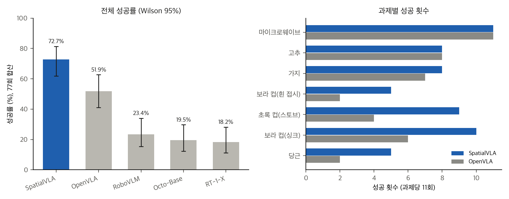
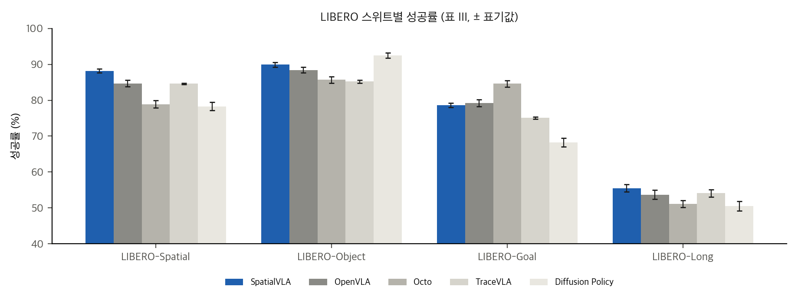
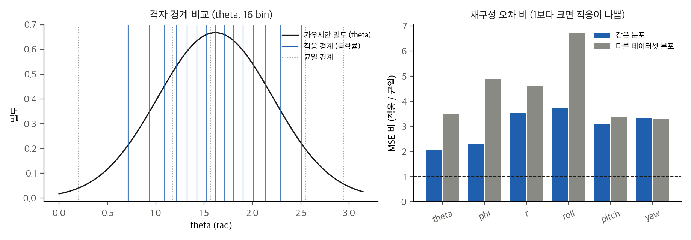

> **논문:** Delin Qu, Haoming Song, Qizhi Chen, Dong Wang, Yuanqi Yao, Xinyi Ye, Yan Ding, Zhigang Wang, Jiayuan Gu, Bin Zhao, Xuelong Li. *SpatialVLA: Exploring Spatial Representations for Visual-Language-Action Model.* RSS 2025, arXiv:2501.15830 (v5, 2025-05-19).
> 공식 코드는 GitHub SpatialVLA/SpatialVLA에 있습니다(라이선스 파일 없음). 체크포인트는 Hugging Face에 있고 MIT로 표시되어 있습니다. 이 글의 그림은 우리가 그린 그래프 세 장입니다. 논문 그림은 arXiv 비독점 라이선스라 싣지 않았습니다.

## 무엇을 주장하나

VLA 모델은 2D 영상만 보고 행동을 토큰으로 냅니다. 로봇마다 카메라 위치가 달라 관측이 3D로 맞지 않고, 행동 공간도 로봇마다 다릅니다. SpatialVLA는 두 가지로 이 문제를 풉니다.

- **Ego3D 위치 인코딩.** ZoeDepth로 추정한 깊이와 카메라 내부 파라미터로 패치별 3D 위치를 만들고, 이를 SigLIP 시각 특징에 더합니다. 외부 보정이 필요 없다고 주장합니다.
- **적응형 행동 격자.** 사전학습 데이터의 행동 분포에 가우시안을 맞추고, 그 분포에서 등확률로 경계를 잘라 이산 격자를 만듭니다. 한 동작은 토큰 3개(이동, 회전, 그리퍼)로 나옵니다. 어휘는 8194개입니다.

1.1M 에피소드로 사전학습한 뒤, 제로샷 시뮬과 실로봇에서 성능을 보이고, 새 로봇에는 격자를 다시 나누고 임베딩을 보간해 적응시킵니다.

## 무엇을 확인했나

**1. 표 재계산.** 시뮬 평균(Google Robot VM 71.9, WidowX 34.4 / 42.7)은 재계산과 맞습니다. LIBERO 평균 78.1도 맞습니다. 하지만 표 I의 π0 행을 포함하면 Google Robot 시각 매칭 우위는 1.8 pp로 줄어듭니다. π0 행은 세 셀만 있어 검산이 되지 않습니다.

**2. 실로봇 표본.** WidowX 제로샷은 7과제 × 11회(77회)입니다. 합산 성공률은 SpatialVLA 72.7%(Wilson 95% 61.9–81.4), OpenVLA 51.9%(41.0–62.7)이고 Fisher p = 0.012입니다. 쌍 구조가 없고 과제당 11회라 과제별 우위는 확인되지 않습니다. 논문 그림 5 캡션의 "전 과제 최고"는 close microwave에서 두 정책 모두 11/11로 동률이라 표 값과 맞지 않습니다.

그래프: 실로봇 제로샷 전체 성공률 (77회 합산, Wilson 95% 구간)과 과제별 성공 횟수 (과제당 11회). 논문 표 XI 값으로 우리가 그렸습니다.

**3. Franka 실험.** 단일 과제, 다중 과제, 지시 따르기 세 설정 모두 OpenVLA 대비 차이가 유의하지 않습니다(p = 0.45, 0.83, 0.084). 본문의 "지시 따르기에서 OpenVLA보다 12%" 는 재계산으로 18.2 pp이고, "Diffusion Policy 26%"는 7.3%입니다. 공간 이해 과제의 "73%"는 파지율이고 성공률은 63.6%입니다.

**4. LIBERO와 어블레이션.** LIBERO 네 스위트 평균 78.05는 맞습니다. 스위트별 우위 대부분은 비유의입니다. 깊이 어블레이션(표 IX)에서 ZoeDepth 72.7%는 OpenVLA 54.5%보다 높지만 44회 대 44회 검정에서 p = 0.12입니다. 본문의 "유의한 우위"는 근거가 부족합니다.

그래프: LIBERO 네 스위트의 성공률과 논문 표 III의 ± 값. ±가 표준오차인지 시드 표준편차인지는 논문에 없습니다.

**5. 행동 격자의 재구성 오차.** 공식 저장소의 가우시안 파라미터로 격자를 만들고, 같은 빈 수의 균일 격자와 비교했습니다. 등확률 구현은 맞습니다. 그러나 재구성 MSE는 적응 격자가 균일 격자의 2.9배(같은 분포)이고, 다른 데이터셋 분포에서는 4.4배입니다. 원인은 외곽 빈입니다. 가우시안 꼬리의 질량 1/16이 매우 넓은 빈 하나에 들어갑니다. 그러니 격자의 이득(끝단 성공률 +36.5 VA, 표 IV)은 재구성 정확도가 아닌 다른 경로에서 와야 합니다. 이 토이는 그 경로를 가리지 못합니다.

그래프: 토이. 왼쪽은 theta 격자 경계(적응 대 균일)이고, 오른쪽은 변수별 재구성 MSE 비(적응 / 균일)입니다. 1보다 크면 적응 격자가 더 나쁩니다.

**6. 공식 코드와 논문 설정.** 코드를 정적으로만 읽었습니다(실행, 설치, 가중치 다운로드 없음). 몇 가지 기본값이 논문과 다릅니다.

- 패치 점 수: 코드 기본 4, 공개 체크포인트 설정 2. 논문은 값을 쓰지 않습니다.
- 행동 청크: 코드 기본 1, 공개 설정 4.
- LIBERO 미세조정: 논문 200 epoch, 코드 스크립트 기본 50.
- 카메라 파라미터: 목록에 없는 카메라는 bridge의 값을 씁니다. "보정이 필요 없다"는 주장과 다릅니다.
- 사전학습 기본 GPU 수는 48이라 배치가 1536입니다. 논문의 2048은 GPU 64에서만 맞습니다.
- 행동 앙상블 코드와 실로봇 배치 코드는 저장소에 없습니다.
- 디코딩 기본 키 경로는 `next(dict.keys())`로 되어 있어 키를 주지 않으면 오류가 날 것으로 보입니다. 정적 확인이며 실행하지는 않았습니다.

## 구현할 수 있나 (M4 Pro, 24 GiB, MPS)

- **사전학습과 미세조정: 불가.** 64 A100에서 10일이 걸리고 CUDA를 전제합니다.
- **실로봇과 시뮬 평가: 불가.** 하드웨어가 없고 SimplerEnv 렌더링은 이 맥의 가정에 맞지 않을 수 있습니다.
- **추론: 조건부.** 체크포인트는 약 8.1 GB입니다. 메모리는 맞아 보이지만 MPS에서 bf16과 속도는 측정하지 않았습니다.
- **격자와 토크나이저 검사: 완료.** 위 5번입니다.

## 남는 질문

- 혼합 비율(그림 9)이 샘플링 비율인지 에피소드 비율인지. 코드 가중치와 논문 비율이 많이 다릅니다.
- 3D 인코딩에서 센서 깊이와 추정 깊이의 차이가 실제로 얼마나 되는지. 표 IX는 44회라 가릴 수 없습니다.
- 격자 이득의 원인. 토큰 분포의 균형인지, 극단 동작을 한 토큰에 묶는 효과인지.

## 출처와 라이선스

- 논문 원문은 arXiv 비독점 라이선스(nonexclusive-distrib 1.0)입니다. CC BY가 아니므로 그림을 싣지 않았습니다. 원문은 arXiv:2501.15830에서 받을 수 있습니다.
- 공식 코드는 라이선스 파일이 없어 복사하지 않았습니다. 읽기 전용으로 대조했습니다.
- 표 값은 인용과 재계산을 위해 옮겼습니다. 그래프, 토이, 분석 문서와 스크립트는 우리가 만들었습니다.
- 재계산 스크립트(`analysis/recompute.py`)와 토이(`analysis/toy_adaptive_grid.py`)는 게시 패키지에 있습니다. 가중치와 데이터셋은 받지 않았습니다.

## 자료

- [통합 리포트 PDF](report/report_public.pdf)
- [01. 논문 분석: SpatialVLA](analysis/01_paper_analysis.md)
- [02. 선행연구, 공식 저장소, 관련 분석](analysis/02_prior_work.md)
- [03. 재계산, 일관성 검사, 주장 판정](analysis/03_analysis.md)
- [04. 공식 코드 대조와 구현 가능성](analysis/04_code_verification.md)
