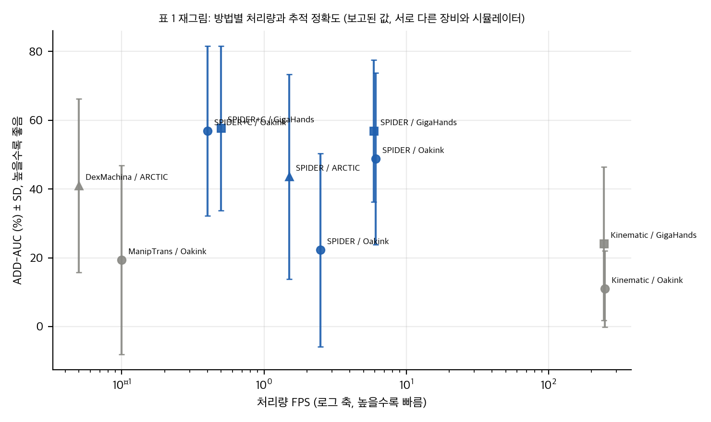
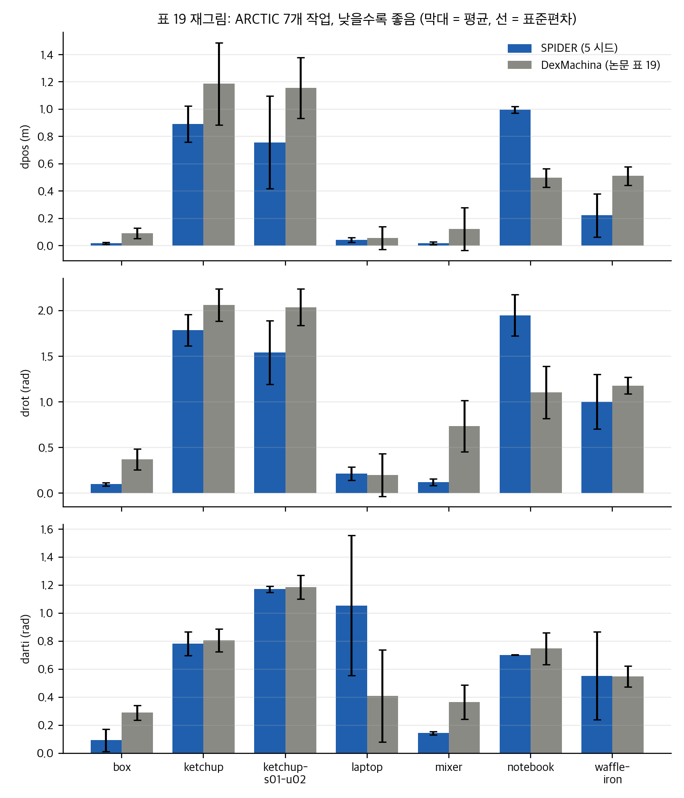
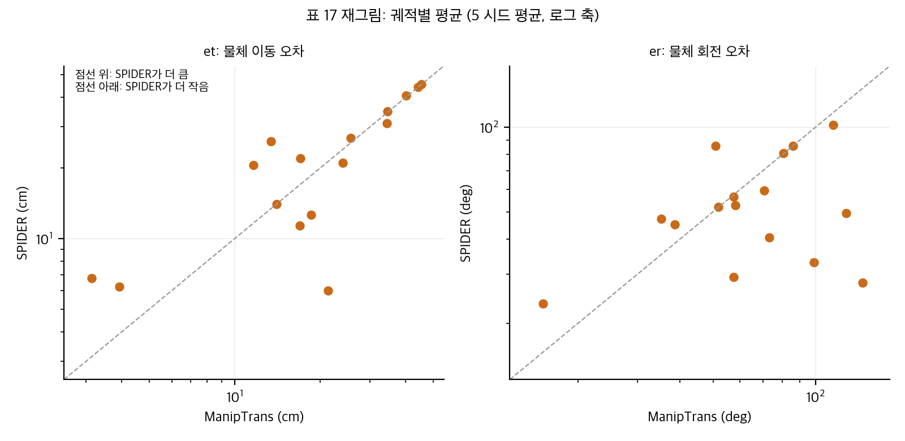

> **논문:** Chaoyi Pan, Changhao Wang, Haozhi Qi, Julen Urain, Zixi Liu, Homanga Bharadhwaj, Akash Sharma, Tingfan Wu, Guanya Shi, Jitendra Malik, Francois Hogan. *SPIDER: Scalable Physics-Informed Dexterous Retargeting.* arXiv:2511.09484 (v3, 2026-09-26). 학회 표기는 없습니다.
> 공식 코드는 GitHub facebookresearch/spider에 있습니다(라이선스 CC-BY-NC 4.0). 이 글의 그래프는 논문 표 값으로 우리가 다시 그린 것입니다. 논문 그림은 사람 영상 프레임과 실로봇 사진이 있어 싣지 않았습니다.

## 문제: 사람 동작은 많지만 로봇 동작은 적다

로봇 손 정책을 키우려면 시연이 많이 필요합니다. 사람 손 동작은 모션캡처와 영상으로 쌓이지만, 그대로 로봇에 옮기면 두 가지가 깨집니다. 손가락이 물체를 관통하거나 미끄러지고, 접촉 순서가 어긋납니다. 운동학만 맞추는 리타게팅은 빠르지만 물리를 무시하고, 강화학습으로 맞추는 방법은 궤적마다 정책을 학습해야 해서 비쌉니다.

SPIDER는 두 쪽을 잇습니다. 사람 시연에서 과제의 구조와 목표를 얻고, 그래디언트 없이 시뮬레이터 롤아웃으로 물리를 만족하는 제어열을 찾습니다. 샘플링 MPC의 가중 평균 업데이트(식 2)와 노이즈를 반복에 따라 줄이는 어닐링(식 3)이 핵심입니다. 접촉이 모호한 과제에는 목표 접촉쌍의 상대 위치를 가상 제약으로 묶는 **접촉 안내**를 더합니다.

## 이 글에서 확인한 것

**1. 물리 일관성은 확실히 좋아졌습니다.** 표 1에서 Oakink 기준 SPIDER의 ADD-AUC는 48.8%, 운동학 기준선은 11.0%입니다. GigaHands는 56.9%와 24.1%입니다. 재계산과 검정으로도 차이는 확실합니다(p < 0.001).

*그래프: 표 1의 값을 다시 그렸습니다. 처리량은 로그 축이고, 장비와 시뮬레이터가 방법마다 달라 방향만 읽어야 합니다.*

**2. RL 기준선보다 정확하다는 근거는 없습니다.** 본문은 RL과 "비슷하거나 더 좋은" ADD-AUC라고 씁니다. 실제로 ManipTrans는 19.4 ± 27.5, SPIDER는 22.3 ± 28.1입니다. 두 표준편차 안에 있어 p = 0.77입니다. 처리량은 25배에서 30배 빠르다는 보고가 있지만, 장비가 달라서 방향으로만 받아들이는 것이 맞습니다.

**3. 접촉 안내는 평균을 올리지만 손에 따라 엇갈립니다.** Oakink에서는 평균이 48.8%에서 56.9%로 올라갑니다. GigaHands에서는 평균 차이가 거의 없습니다(56.9 대 57.7). 손별로 보면 Allegro와 Inspire는 오르고, Ability와 Schunk는 절반 가까이 떨어집니다(55.5 → 30.8, 60.8 → 30.9). 본문은 이 하락을 말하지 않습니다.

*그래프: 표 19의 ARCTIC 결과를 다시 그렸습니다. 막대는 평균, 선은 표준편차입니다. SPIDER가 위치 오차에서 6/7, 회전과 관절에서 5/7 작업을 이깁니다. 작업별 검정은 대부분 약합니다.*

**4. 휴머노이드 결과에는 반례가 있습니다.** 본문은 모든 지표에서 GMR보다 낮은 오차라고 씁니다. 그러나 OMOMO 관절 오차는 SPIDER가 0.83, GMR이 0.57입니다. 표본도 작습니다. AMASS 8개, OMOMO 1개 궤적입니다.

**5. 데이터셋 규모 숫자가 시점마다 다릅니다.** 초록의 6,520 궤적, 서론의 6,532, 프로젝트 페이지의 6,523, 공개 저장소 README의 HF 데이터셋 7,876 궤적이 서로 맞지 않습니다. 표 7의 평균 78.30%는 필터를 거친 보존 세트 값이고, 필터 전 생성 평균은 61.48%입니다. 두 값을 같은 뜻으로 인용하면 안 됩니다.

*그래프: 표 17의 궤적별 값을 다시 그렸습니다. 평균 물체 이동 오차 et는 두 방법이 같고(23.1 대 23.0cm), 관절 오차 ej는 16개 모두 SPIDER가 낮습니다.*

**6. 공식 코드는 논문과 다른 점이 있습니다.** 공개된 ADD-AUC는 물체 중심 위치만 계산합니다. 논문 식 6은 표면 512점을 씁니다. 기본 설정(온도 0.1, 샘플 1,024)도 논문 표(온도 1.0)와 다릅니다. 2026-11-17에 추가된 CPU 기본 경로는 샘플 128, 반복 4로 훨씬 가볍습니다. 논문 재현에는 이 차이를 알고 설정을 맞춰야 합니다.

## 재현할 수 있을까

이 맥(Apple M4 Pro, CUDA 없음)에서 논문의 수치를 재현하는 것은 불가능합니다. 시뮬레이터(IsaacGym, Genesis, MuJoCo Warp)가 GPU를 전제로 하고, 정책 학습과 실로봇 실험도 마찬가지입니다.

공식 CPU 워크플로로 ARCTIC 장면 하나를 돌리는 것은 조건부로 가능합니다. MuJoCo 3.17 이상 설치와 장면 다운로드가 필요합니다. 공식 문서는 유휴 64코어 기계에서 16 스레드로 30초 클립을 약 5분이라고 적었습니다. 이 맥에서 실제로 얼마나 걸리는지는 측정하지 않았습니다.

알고리즘을 직접 구현하는 것은 가능합니다. 식 2와 3, Algorithm 1은 명확합니다. 다만 β1, β2 값, 강건화 파라미터 범위, 접촉 필터의 임계값은 논문과 코드 어디에도 없어서 직접 정해야 합니다.

## 정리

SPIDER의 아이디어는 가져다 쓸 만합니다. 샘플링 MPC에 어닐링과 접촉 안내를 더하는 구성은 단순합니다. 다만 주장의 세기는 조정해서 읽어야 합니다. 물리 일관성은 확실하고, RL 대비 정확도는 비슷하며, 접촉 안내 효과는 손에 따라 다릅니다. 실로봇 결과와 강건화 효과는 정량 수치가 없습니다.

---

*분석 노트와 재계산 스크립트는 같은 게시 묶음의 `analysis/` 폴더에 있습니다. 논문 원문은 arXiv:2511.09484에서 받을 수 있습니다.*

## 자료

- [통합 리포트 PDF](report/report_public.pdf)
- [SPIDER 논문 분석 (arXiv:2511.09484)](analysis/01_paper_analysis.md)
- [SPIDER 선행 연구와 관계](analysis/02_prior_work.md)
- [SPIDER 수치 재계산과 일관성 검사](analysis/03_analysis.md)
- [SPIDER 공식 코드 대조 (정적 읽기)](analysis/04_code_verification.md)
