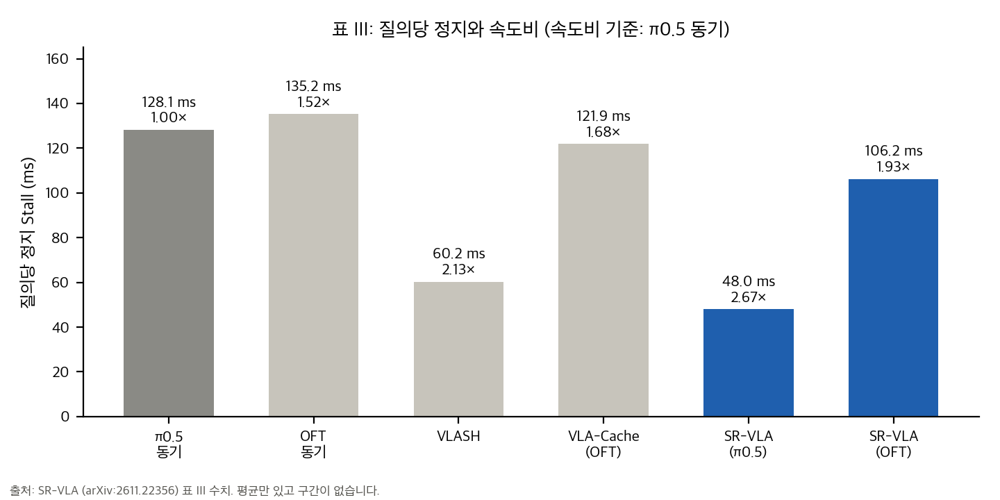
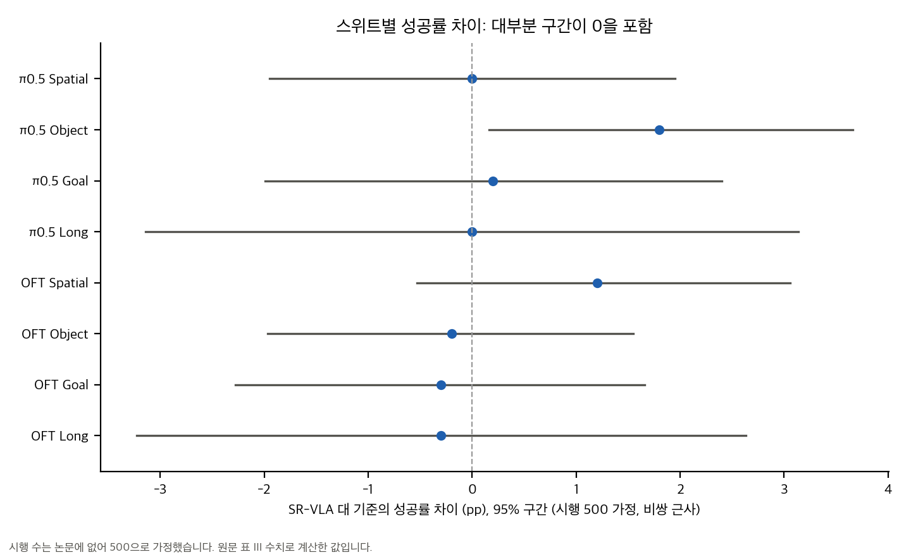

> **논문:** Tao Zhang, Yi Zhong, Jinhao Ruan, Yipeng Gao, Linfeng Zhong, Youming Yang, Yuan Wang. *SR-VLA: Stall-Reduced VLA Execution via Predicted-Input Lookahead and Selective KV Cache Repair.* arXiv:2611.22356 (v1, 2026-11-17). 원문은 IEEE 투고 고지가 있고 학회 채택은 확인되지 않았습니다. 논문 그림은 라이선스(nonexclusive)상 싣지 않았고, 이 글의 그림은 우리가 그린 그래프입니다.

## 문제: 다음 추론이 끝날 때까지 로봇이 멈춘다

VLA 정책은 행동 청크를 한 번에 만듭니다. 청크를 실행하는 동안 다음 청크를 계산하지 않으면, 청크가 끝난 뒤 다음 추론이 끝날 때까지 로봇이 멈춥니다. 논문은 π0.5와 OpenVLA-OFT를 30 Hz로 동기 실행했을 때 질의당 정지가 각각 128.1 ms와 135.2 ms라고 보고합니다.

비동기 추론은 다음 청크를 미리 계산해 정지를 줄입니다. 그러나 미리 계산한 결과는 실제 입력과 어긋날 수 있습니다. 어긋난 결과를 그대로 쓰면 틀린 행동을 하고, 전부 버리면 미리 한 계산이 아깝습니다.

## 방법: 예측하고, 검증하고, 일부만 고친다

SR-VLA는 두 단계를 나눕니다.

1. **실행 중 예측.** 현재 관측과 행동 청크로 다음 경계의 이미지와 로봇 상태를 예측하는 작은 모델(10.08M)을 돌립니다. 동결된 VLA는 예측 입력으로 KV 캐시와 행동을 미리 만들어 둡니다.
2. **도착 후 검증과 수리.** 실제 입력이 오면 두 게이트를 봅니다. 관측 게이트는 패치 단위 차이와 과제 관련도를 보고, 과제 보호 게이트는 그리퍼가 열리거나 닫히는지와 재사용 횟수를 봅니다. 둘 다 꺼지면 미리 만든 행동을 씁니다. 켜지면 차이가 큰 상위 토큰만 KV를 다시 계산합니다.

이 구조는 "미래 상태 표현을 예측하는" 선행 방법(VLASH)이나 "인접 관측의 캐시를 재사용하는" 방법(VLA-Cache)과 다릅니다. 예측한 **입력**을 쓰고, 도착 뒤 **검증해서 일부만** 고친다는 점이 핵심입니다.

## 결과: 속도는 분명하고, 성공률은 비슷하다는 수준

LIBERO 네 스위트 평균에서 질의당 정지는 다음과 같습니다(논문 표 III).

그래프: 논문 표 III의 질의당 정지와 속도비 (우리가 그린 그래프). 평균만 있고 구간이 없습니다.

| 방법 | 평균 성공 (%) | 질의당 정지 (ms) | 속도비 (π0.5 동기 기준) |
|---|---|---|---|
| π0.5 동기 | 96.4 | 128.11 | 1.00 |
| SR-VLA (π0.5) | 96.9 | 47.95 | 2.67 |
| VLASH (π0.5) | 96.6 | 60.25 | 2.13 |
| SR-VLA (OFT) | 97.2 | 106.19 | 1.93 (OFT 동기 대비 1.27) |

속도비의 산술은 맞습니다. 다만 원문은 질의 수, 반복 횟수, 분산을 보고하지 않아 2.67의 불확실성을 알 수 없습니다.

성공률은 평균 차이가 +0.5 pp(π0.5)와 +0.1 pp(OFT)입니다. 논문의 시행 수는 없어서, LIBERO 표준인 스위트당 500 시행을 가정하고 검정했습니다. 그 가정에서도 차이는 0을 포함합니다.

그래프: 스위트별 성공률 차이와 95% 구간 (우리가 그린 그래프). 시행 수 500은 가정이며 논문에 없습니다.

0.5 pp를 80% 검정력으로 검출하려면 팔당 약 18,000 시행이 필요합니다. "비슷하다"는 표현은 이 정도 근거에서만 말할 수 있습니다.

## 확인이 필요한 부분

- **본문 수치의 범위.** 표 II 본문은 정지를 139.72 → 60.44 → 54.78 ms로 줄였다고 씁니다. 표 III의 128.11과 47.95와 범위가 다르고, 원문이 범위를 밝히지 않습니다.
- **목표 이동 실험.** 초록의 "1.52–1.93×" 속도는 그림에서만 읽히는 값입니다. 표가 없어 검증하지 못했습니다.
- **공식 코드.** GitHub와 웹에서 찾지 못했습니다. 예측기 학습 데이터와 임계값 선택 방법도 원문에 없습니다.

## 이 맥에서 구현할 수 있는가

구조는 구현할 수 있습니다. 예측기와 게이트, 선택적 KV 수리는 PyTorch로 옮길 수 있고, 추정 노력은 1–2주입니다. 수치 재현은 어렵습니다. 지연은 A100 한 장에서 잰 값이고, 이 맥의 MPS 지연은 같은 기준이 되지 않습니다.

## 요약

SR-VLA는 "실행 중에 다음 입력을 미리 계산하고, 도착 뒤 어긋난 부분만 고친다"는 설계가 명확합니다. 질의 속도 향상은 산술상 분명하지만, 성공률과 목표 이동에서는 원문의 근거가 약합니다. 공식 코드가 나오면 가장 먼저 시행 수와 분산을 확인하는 것이 좋습니다.

## 자료

- [통합 리포트 PDF](report/report_public.pdf)
- [01. 논문 분석: SR-VLA (arXiv:2611.22356)](analysis/01_paper_analysis.md)
- [02. 선행연구와 관련 자료: SR-VLA](analysis/02_prior_work.md)
- [03. 재계산과 일관성 검사: SR-VLA](analysis/03_analysis.md)
- [04. 주장 검증: SR-VLA](analysis/04_claim_verification.md)
