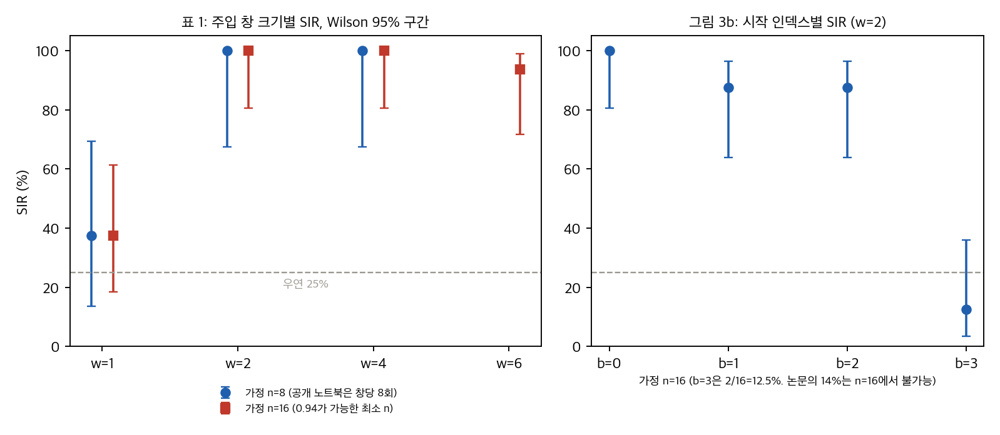
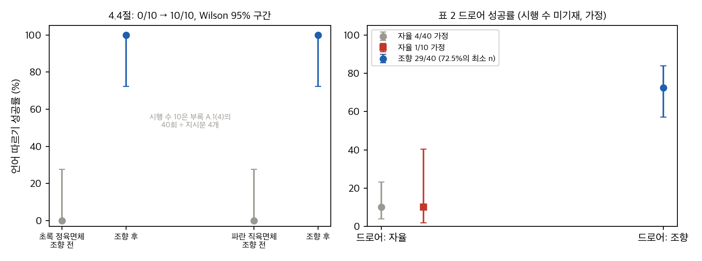
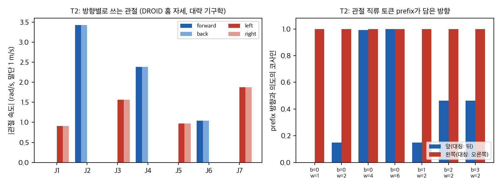

# 03. 수치 재계산, 일관성 검사, 토이 실험

이 문서는 논문과 프로젝트 페이지의 보고 수치를 다시 계산하고, 표·본문·그림·부록 사이의 불일치를 찾고, 중심 주장 하나를 작은 CPU 토이로 점검합니다. 재현 실험은 하지 않았습니다. 스크립트는 `analysis/recompute.py`(수 초), `analysis/toy_steering_prefix.py`(1초 미만)입니다.

## 0. 가정

- 논문은 시행 수를 거의 쓰지 않습니다. 확실한 시행 수는 부록 A.1의 "20 scenes, 80 trials"(엔트로피)와 "40 trials, 지시문 4개 순환"(언어 교정, 지시문당 10회)뿐입니다. 나머지는 보고된 백분율이 정수 비율이 되도록 **가능한 시행 수를 거꾸로 구했고**, 그렇게 가정한 곳은 "가정 n"으로 표시했습니다.
- 그림 판독(그림 3b, 5c)은 막대 위 숫자와 점 개수를 눈으로 읽은 값이라 근사입니다. 그림 2b 점 개수는 겹쳐 있어 ±1–2개입니다.
- 검정은 Fisher 정확 검정, Mann–Whitney(정규근사), Wilson 95% 구간입니다. 사용자 연구는 원자료가 없어 검정을 재현하지 못하고, "그 p값이 어떤 가정에서 나올 수 있는가"만 검사했습니다.

## 1. 재계산 결과 (V 항목)

### V1. 표 1 SIR: 시행 수와 구간

0.38, 1.00, 1.00, 0.94가 모두 정수 비율이 되는 공통 시행 수는 40 이하에서 **16, 32, 34**뿐입니다(`recompute.py` V1). 최소 n = 16(6/16, 16/16, 16/16, 15/16)이고, **n = 8이면 0.94는 불가능합니다**(8회 비율은 0.88 또는 1.00). 저자가 공개한 노트북 목록은 창 크기당 8개 궤적(총 32개)이라 n = 8과 맞지만(`04` D13), 그림 2b의 성공 시행 점은 w = 2와 w = 6에서 각각 약 14개로 보여 8회보다 많습니다(눈 판독, 근사). 노트북은 부분 집합이거나 다른 세션일 가능성이 큽니다. 어느 쪽이든 논문에는 n이 없습니다.

| w | SIR | n=8 가정 Wilson 95% | n=16 가정 Wilson 95% |
|---|---|---|---|
| 1 | 0.38 | 3/8: 14–69% | 6/16: 18–61% |
| 2 | 1.00 | 8/8: 68–100% | 16/16: 81–100% |
| 6 | 0.94 | 불가 | 15/16: 72–99% |

w = 1 대 w = 2: n = 8이면 Fisher p = 0.026, n = 16이면 p = 0.0002. 두 경우 모두 "w = 1은 부족하다"는 방향은 유지됩니다. w = 2 대 w = 6(16/16 대 15/16)은 p = 1.0이라 구별되지 않습니다. 그림 `own_sir_ci.png`.



*그래프 (우리가 그림). 보고된 SIR을 가정 시도 수(n = 8, 16)로 Wilson 95% 구간과 함께 그렸습니다. 오른쪽은 그림 3b이며 b = 3은 2/16(12.5%)로 그렸습니다.*

### V2. 그림 3b: 막대 위 88%와 14%

88%는 n = 8(7/8), 16(14/16), 17 등에서 가능하고, **14%는 n = 7, 14, 21, 22, … 에서만** 가능합니다. 88%와 14%가 모두 나오는 최소 n은 42입니다. n = 16이면 b = 3의 SIR은 12.5%(2/16)나 18.8%(3/16)이고 14%는 나올 수 없습니다. 프로젝트 페이지는 같은 막대를 **12%**로 적습니다(Findings 02). 12%는 n = 8(1/8)과 n = 16(2/16)에서 12.5%를 내림해 나오는 값입니다. 14%가 오기일 가능성이 가장 큽니다(K2).

### V3. 표 2: 시행 수와 사용자 7명

| 보고 값 | 정수 비율이 되는 시행 수 (가능한 값 중 작은 것) |
|---|---|
| 드로어 자율 10.0% | 10, 20, 30, 40, … |
| 드로어 조향 72.5% | **40**, 51, 69, 80 |
| 스펀지 자율 진행률 16.7% | 짝수 n (단계 합이 n/2) |
| 스펀지 조향 진행률 93.8% | **16**(단계 합 45/48), 27, 32, 43, 48 |

사용자 7명이 각자 같은 횟수 m회를 했다면 총 시행 수 7m이 되는데, 위 목록의 어느 값도 7의 배수가 아닙니다(70 이하). 따라서 **사용자별 횟수가 같지 않거나**, 보고 값이 시행 풀링이 아니라 사용자 평균입니다. 논문은 둘 다 밝히지 않습니다. 가장 자연스러운 읽기는 드로어 조향 29/40, 스펀지 조향 16회입니다(추정).

### V4. 드로어 성공률 p = 0.003: 시행 단위 검정으로는 나오지 않음

| 자율 | 조향 | Fisher p | Mann–Whitney p |
|---|---|---|---|
| 1/10 | 29/40 | 5e-4 | 4e-4 |
| 2/20 | 29/40 | 5e-6 | 6e-6 |
| 4/40 | 29/40 | 1.4e-8 | 1.7e-8 |
| 4/40 | 58/80 | 3e-11 | 1e-10 |

가장 약한 가정(자율 1/10)에서도 시행 단위 p는 0.0005로 보고된 0.003보다 훨씬 작습니다. 0.003이 나오려면 사용자 단위 순위합(7 대 7, 정확 최소 p = 0.00058)처럼 분석 단위가 시행보다 큰 쪽이어야 합니다. 논문은 "Wilcoxon rank-sum tests"라고만 쓰고 단위를 밝히지 않습니다. 이진 성공 여부에는 순위합보다 Fisher가 표준입니다. 결론: 성공률 증가 방향은 확실하지만, 보고된 p값이 무엇의 p값인지는 알 수 없습니다.

### V5. 완료 시간 p = 0.020

시간은 성공 시행만 포함합니다(부록 B.4). 자율의 성공 시행 수 a, 조향 29를 가정해 **완전 분리(자율이 전부 느림)** 에서 낼 수 있는 가장 작은 p:

| a | 정확 순위합 최소 p | 정규근사 최소 p |
|---|---|---|
| 1 | 0.067 | 0.094 |
| 2 | 0.0043 | **0.0197** |
| 3 | 0.0004 | 0.0049 |
| 4 | 5e-5 | 0.0014 |

자율 성공이 1회(10% = 1/10)라면 어떤 순위합 검정도 p = 0.020에 이를 수 없습니다. p = 0.020은 a = 2에서 완전 분리일 때 정규근사 값과 사실상 같습니다(0.0197). 따라서 자율 성공이 2–4회이고 거의 완전히 분리된 경우에만 나옵니다. 자율 중앙값 74.0 s는 소수(1–4개) 시행의 값이라 불안정합니다. 시간 이득 "74.0 → 42.0 s"는 신뢰구간이 없고, 자율 쪽 표본이 너무 작습니다.

### V6. 언어 따르기와 Wilson 구간 (§4.4)

지시문당 10회(40 ÷ 4). 자율 0/10: 0–28%. 조향 10/10: 72–100%. 두 지시문 모두 같습니다. 효과 방향은 확실합니다(Fisher 0/10 대 10/10 p = 1e-5). 대신 100%의 하한은 72%이므로 10회 관측으로는 "항상 성공"까지 말할 수 없습니다. 그림 `own_rates_ci.png`.

드로어(가정 n): 자율 4/40은 4–23%, 1/10은 2–40%. 조향 29/40은 57–84%. 시행 수에 따라 자율 구간이 크게 달라집니다.



*그래프 (우리가 그림). 언어 따르기 0/10 → 10/10과 드로어 성공률(가정 시행 수)의 Wilson 95% 구간입니다.*

### V7. "조향 토큰 25% 미만" (§4.4)

시퀀스 길이 8–36토큰(§4.1), 창 w = 2이면 한 청크에서 조향 토큰 비율은 **5.6%(36개)에서 25%(8개)** 입니다. 모든 청크에서 w = 2를 주입해도 25%를 넘지 못합니다. 즉 단위가 "토큰"이면 "25% 미만"은 실험 결과가 아니라 **설계상 상한**입니다. 반면 그림 5c의 축은 "Fraction of steps with active steering tokens"(스텝)이고 값은 초록 21%, 파랑 26%라 본문의 "25% 미만"과 맞지 않습니다(K1). 단위가 스텝이면 사람이 개입한 시간 비율이고 토큰 비율이 아닙니다.

### V8. 경로 효율 정의

부록 B.2는 d_straight를 "궤적 시작과 끝 사이 거리"로, §4.1은 "end-effector에서 블록까지 직선 길이"로 정의합니다(K8). 그릇 위에서 출발해 블록을 집고 그릇으로 돌아오는 궤적은 시작과 끝이 같은 곳이라 B.2 정의로는 0이 됩니다(손으로 만든 예: 경로 0.4 m, 시작–끝 0 m → 0, 시작–블록 0.2 m → 0.5). 보고된 MPE 0.56–0.72는 §4.1 정의에 가깝습니다. 또 MPE는 "성공 시행"에서만 평균이라 w = 1(성공 시행 약 5개)과 w = 6(약 14개)은 구성이 다른 집합입니다. "창이 크면 경로 효율이 떨어진다"는 단조 추세는 값 4개와 그림 점의 겹침만으로는 검정할 수 없고(원자료 없음), 효과가 관찰되더라도 성공 시행만의 평균입니다.

## 2. 일관성 검사 (K 항목)

| ID | 위치 | 내용 | 판정 |
|---|---|---|---|
| K1 | §4.4 대 그림 5c | 본문 "less than 25%"인데 그림 5c는 파랑 직육면체 **26%**, 개별 점은 초록에서 약 40%까지 | 모순. 단위(토큰 대 스텝)도 다름(V7) |
| K2 | 그림 3b 대 프로젝트 페이지, V2 | b = 3 SIR: 논문 14%, 프로젝트 12%. 14%는 88%와 같은 n에서 불가능 | 논문 14%가 오기일 가능성 |
| K3 | 표 1 대 공개 노트북 | 0.94는 n ≥ 16 필요, 노트북은 창당 8개 궤적 | 노트북은 일부로 보임. n 미기재 |
| K4 | 프로젝트 페이지 Finding 01 대 표 1 | 페이지: "w=2가 가장 좋은 경로 효율". 표 1 MPE는 w = 1이 0.724로 최고, w = 2는 0.663 | 페이지 문장이 표와 반대. 논문 본문에는 이 문장 없음 |
| K5 | 표 2, 초록, 본문 4.5, 부록 B.3 | 표 머리 "Success". 스펀지 16.7%와 93.8%는 전체 성공이 아니라 **진행률**(이동 3회 중 몇 회). 본문은 자율 전체 성공 0%라고 쓰면서 초록은 "success rates ... from 16.7% to 93.8%" | 같은 열에 다른 지표가 섞임. 조향의 스펀지 전체 성공률은 어디에도 없음 |
| K6 | §4.5 대 표 2 | 드로어 제한 "800 timesteps"인데 자율 중앙 완료 74.0 s. 15 Hz면 800 스텝 = 53.3 s. 74.0 s에 도달하려면 제어 루프가 10.8 Hz 이하여야 함 | 제어 주파수 미기재. 자기회귀 지연으로 루프가 느렸다면 가능하나 확인 불가 |
| K7 | §4.1, 부록 A.1 | "1-second 속도를 1 m/s"로 주입하는데 행동 horizon H = 10. DROID 제어 15 Hz면 한 청크는 0.67 s | 청크 길이와 "1초"가 맞지 않음. 제어 주파수 미기재라 단정 불가 |
| K8 | §4.1 대 부록 B.2 | 경로 효율 정의 두 가지(V8) | 모순 |
| K9 | §4.3 대 그림 4b | 본문: "3번째 토큰의 엔트로피가 작다". 그림 4b의 첫 점(생성 스텝 1 = 3번째 토큰)은 오른쪽 약 4.5, 왼쪽 약 3.3, 뒤 약 2.1, 앞 약 1.2 bit. 가장 낮은 값(약 0.5–1.3)은 스텝 5 | 앞 방향만 맞음. 저점은 3번째가 아니라 스텝 5(7번째 토큰) 부근 |
| K10 | §4.1 | "up, down, left, right"인데 실험 방향은 앞·뒤·왼·오른쪽 | 오기 |
| K11 | 부록 B.3 | "attributed to 31"(1/3의 오기) | 오기 |
| K12 | §4.5 | 사용자 7명인데 보고 값이 7의 배수 시행 수와 맞지 않음(V3) | 시행 수·분석 단위 미기재 |
| K13 | 부록 A.1(1)–(3) 대 (4), §4.5 | 속도 1.0, 0.5, 0.5 m/s, 창 w 2, 2, 4. §4.5는 과제에 맞게 "ideal control"로 골랐다고 씀 | 과제별로 설정을 바꿈. 평가 과제에서 조정했다면 사용자 연구는 훈련 겸 평가 |

일치하는 것: 80회 = 20장면 × 4방향(A.1(3)), 40회 = 지시문 4개 × 10회와 그림 5c의 점 10개 두 묶음, 그림 3b b = 0 SIR 100%와 표 1 w = 2 SIR 1.00(같은 조건), 그림 3b의 88% 두 값과 완료율 88%(같은 시행 한 번 실패).

## 3. 토이 실험

한 가지 질문만 봅니다. **§4.2의 "b가 커질수록 고주파 토큰을 편집한다"는 해석이 성립하는가.** 이 토이는 실제 FAST 토크나이저를 돌리지 않았고(다운로드·설치 없음), 논문의 입력 정의와 FAST 평탄화 순서만으로 위치가 무엇인지 계산한 것입니다.

### T1. 조향 청크의 DCT 배치 (`toy_steering_prefix.py` T1)

공식 코드는 조향 청크를 "같은 관절 속도 벡터를 H = 10 시간 단계에 복제"해 만듭니다(`04` D4). 시간에 상수인 신호는 정규직교 DCT에서 k = 0(직류) 계수만 0이 아닙니다. 평탄화가 "주파수 우선"이면 앞 D = 8개 위치가 관절 1–8의 직류 계수이고, 고주파(k ≥ 1)는 위치 8부터입니다. 스케일 γ = 10 양자화 예시에서 k ≥ 1의 비영 계수는 0개였습니다. 그러므로 **b ∈ [0, 3], w = 2는 모두 위치 0–4, 곧 관절 1–5의 직류 계수 안에 있습니다.** 위치가 다르다는 것은 주파수가 다르다는 뜻이 아니라 관절이 다르다는 뜻이 됩니다. 저자 코드 로그(`04` D11)에서 비영 관절 속도 7개 입력이 9개 토큰이 된 점은 "토큰 하나가 계수 하나"에 가깝다는 가정과 대략 맞습니다. 다만 BPE가 인접 토큰을 병합할 수 있어 이 대응은 근사입니다.

### T2. 관절 직류 토큰 prefix가 담은 방향 (Panda 대략 기구학, DROID 홈 자세)

말단 속도 1 m/s(앞·뒤·왼·오)의 관절 속도 q̇ = J⁺v를 구하면, 이 자세에서 앞·뒤 운동은 관절 2, 4, 6만(짝수 관절), 왼·오른쪽 운동은 관절 1, 3, 5, 7만(홀수 관절)을 씁니다. 위치 b..b+w−1의 관절 값만 알고 나머지를 모른다고 할 때 prefix 속도(J·q̇ 마스크)와 의도 방향의 코사인:

| 설정 | 앞/뒤 | 왼/오른 |
|---|---|---|
| b=0, w=1 (관절 1) | 0.00 | 1.00 |
| b=0, w=2 | 0.15 | 1.00 |
| b=0, w=4 | 0.99 | 1.00 |
| b=0, w=6 | 1.00 | 1.00 |
| b=1, w=2 | 0.15 | 1.00 |
| b=2, w=2 | 0.46 | 1.00 |
| b=3, w=2 | 0.46 | 1.00 |



*그래프 (우리가 그림). 왼쪽: 방향별로 쓰는 관절(대략 Panda 기구학, DROID 홈 자세). 오른쪽: 관절 직류 토큰 prefix만 알 때 의도 방향과의 코사인(토이, 정책 미포함).*

읽는 법과 한계:
- **w = 1의 실패는 운동학으로 설명됩니다.** 관절 1(베이스 회전)은 왼·오른쪽만 바꾸므로 앞·뒤 의도는 prefix에 정보가 없습니다. 논문은 "첫 토큰은 방향 정보가 부족하다"고 쓰지만(§4.1), 이 토이에서는 "첫 토큰이 한 관절의 직류값이라서"입니다. 표 1의 0.38(우연 0.25)은 왼·오른쪽만 맞히는 상한 0.5 아래라 대략 맞습니다.
- **b = 3에서의 SIR 급락(12–14%)은 이 토이로 설명되지 않습니다.** 토이의 prefix 방향 정보는 b = 3에서도 4방향을 구분합니다(코사인 0.46–1.0). 그러므로 "고주파라서 무시된다"도 "관절 인덱스라서 정보가 없다"도 확정할 수 없습니다. 정책이 나머지 토큰을 어떻게 채우는지에 달려 있고(BPE 병합 포함), 이 토이는 정책을 포함하지 않습니다.
- 그림 3의 요인(주파수)과 위치(관절)가 **구별되지 않는 설계**라는 점이 핵심입니다. 이를 가르려면 청크에 시간 변화를 넣어(예: 가속·감속 프로파일) 고주파 계수를 일부러 0이 아니게 한 뒤 같은 b 스윕을 해야 합니다. 현재 설계로는 §4.2의 제목 "Low-frequency FAST tokens more effectively steer the policy"를 지지하지도 반박하지도 않습니다.
- 가정: 토큰 하나 = 계수 하나, DROID 홈 자세, 공구 끝 0.21 m. 다른 자세에서는 어느 관절이 어느 방향을 쓰는지가 달라집니다.

## 4. 주장 판정 (C 항목)

| ID | 논문 주장 | 위치 | 판정 | 근거 |
|---|---|---|---|---|
| C1 | 추가 학습 없이 추론 시간에 조향한다 | 초록, §3.2 | **지지** | 코드가 디코딩 루프의 토큰만 바꿈(`04` D1). 가중치 변경 없음 |
| C2 | 짧은 prefix 주입이 정책을 유지하며 조향한다 | §4.1, 표 1 | **부분 지지** | w = 2에서 SIR 1.00이나 n이 없고(16/16이면 하한 81%), 비교 기준선 없음(정책 출력에 속도를 더하는 단순 혼합 등) |
| C3 | 저주파 토큰 편집이 더 효과적이다 | §4.2, 그림 3 | **미확정** | 위치 0–4는 모두 직류 계수(T1), 주파수와 관절이 교란. b = 3의 14%는 n과 맞지 않음(K2) |
| C4 | 주입 뒤 행동 엔트로피가 붕괴하지 않는다 | §4.3, 그림 4 | **약함** | 주입 없는 대조 곡선 없음. 기본 디코딩이 탐욕(`04` D8). 그림 4b에서 뒤 방향은 스텝 5 이후 약 0.3–0.6 bit로 낮음. 본문 "3번째 토큰 낮음"과 그림이 안 맞음(K9) |
| C5 | TS로 언어 따르기 실패를 교정한다 | §4.4, 그림 5 | **부분 지지** | 0/10 → 10/10이나 조향 입력이 정답 방향을 직접 알려 주는 "오라클"이다. 언어 이해가 아니라 위치 지시. "25% 미만"은 설계상 상한이거나 그림과 모순(K1, V7) |
| C6 | 드로어 성공 10.0% → 72.5%, 시간 74.0 → 42.0 s | §4.5, 표 2 | **방향 지지, 크기·p값 불명** | 시행 수 없음, p = 0.003은 시행 단위 검정이 아님(V4), 시간 p는 자율 성공 ≥ 2 필요(V5). 비교군은 "사람 입력 없는 정책"이라 사람의 추가 정보가 섞임 |
| C7 | 스펀지 16.7% → 93.8% | §4.5, 표 2 | **약함** | 지표는 진행률(K5). 기억이 필요한 과제의 계획은 사람이 함. 순수 원격 조작 대조 없음 |
| C8 | 정책이 부드럽고 안전하게 문을 닫게 한다 | §4.5 | **미검증** | 힘·속도 측정 없음. 순수 수동 대조 없음. 정성적 서술 |
| C9 | 실시간으로 동작한다 | §5.1 | **미검증** | 지연 수치 없음. 공식 코드에 단계마다 `jax.debug.print`가 있음(`04` D12) |

## 5. 재실행

```bash
pip install numpy scipy matplotlib
python3 analysis/recompute.py             # V1–V8 → recompute_results.json
python3 analysis/toy_steering_prefix.py   # T1, T2 → toy_steering_prefix_results.json
python3 analysis/plot_figures.py          # own_*.png 세 장
```
