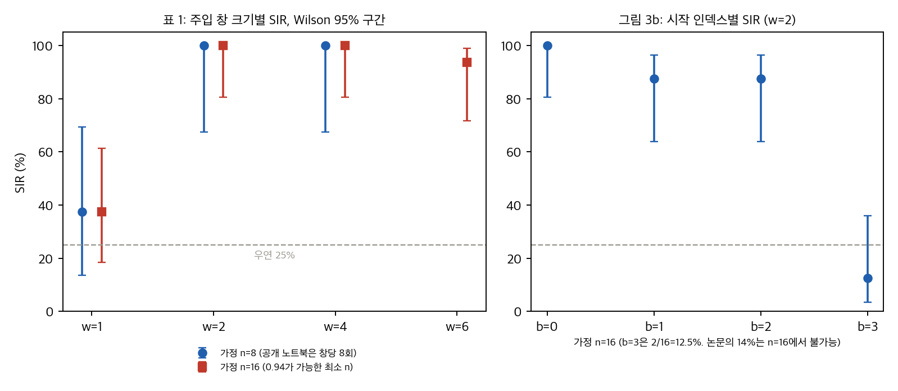
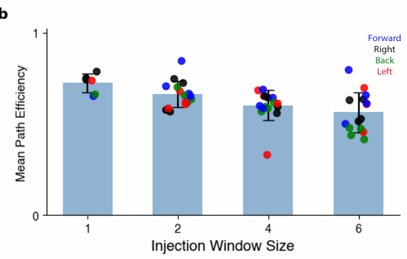
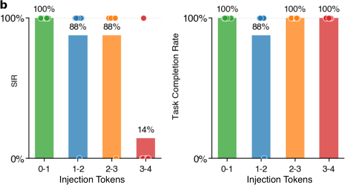
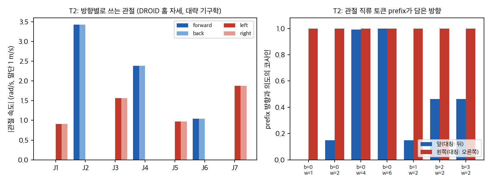
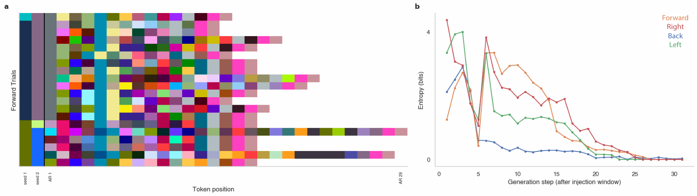
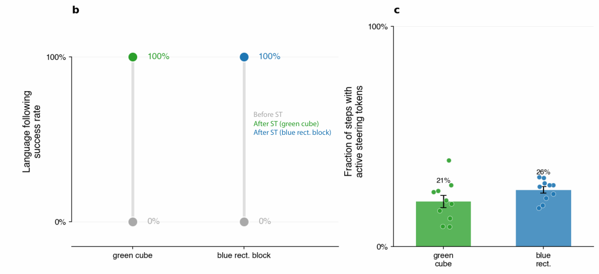
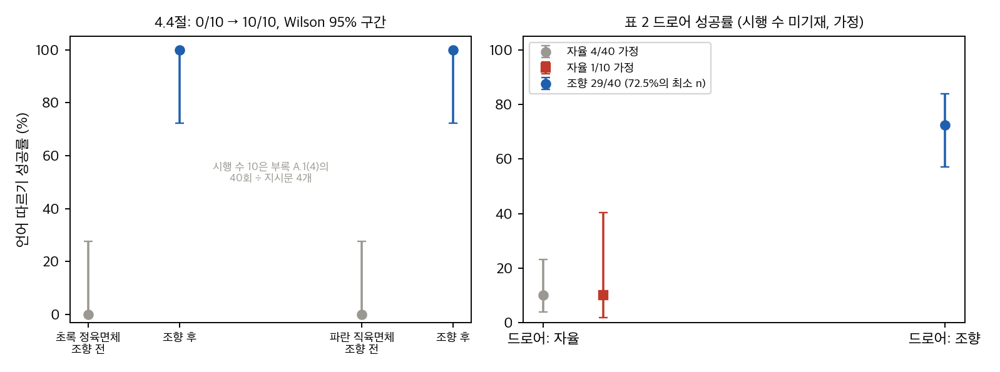

> **논문:** Jason Chan, Jonathan C. Kao. *Steering Autoregressive Vision-Language-Action Policies via Action Token Intervention.* CoRL 2026 포스터, arXiv:2606.15021 (v1, 2026-06-12).
> 코드는 저자 계정의 openpi 포크(Apache-2.0)가 있습니다. 논문과 프로젝트 페이지가 이 저장소를 링크하지는 않아서 저자 코드로 추정했습니다. 이 글의 논문 그림은 저자가 그린 그래프 패널 네 장(출처 표기)이고, 나머지는 우리가 그린 그래프입니다.

## 논문이 묻는 것

VLA가 작은 실수를 하면 사람은 바로 고칠 방향을 압니다. 그러나 언어 지시는 세밀한 궤적 보정에 약하고, 원격 조작은 정책의 능력을 통째로 버립니다. Token Steering(TS)은 사람의 방향 입력을 정책이 쓰는 **행동 토큰** 자체로 바꿔 디코딩 중에 끼워 넣습니다.

π0-FAST는 행동 청크를 DCT와 BPE로 압축한 토큰 열로 생성합니다. TS는 키보드 방향을 말단 속도로, 의사역행렬로 관절 속도로, 시간축으로 복제해 FAST 토큰으로 인코딩한 뒤, 정책이 디코딩하는 토큰 열의 앞쪽 w개(시작 b)를 이 토큰으로 강제합니다. 나머지는 정책이 이어 생성합니다. 학습이 필요 없고, 가중치도 건드리지 않습니다. 실험은 DROID(Franka + Robotiq) 위의 공개 π0-FAST-DROID 하나입니다.

## 이 글에서 확인한 것

**1. 시행 수가 논문에 없습니다.** 가장 자연스러운 읽기는 창 크기별 16회입니다. 표 1의 SIR 0.38, 1.00, 1.00, 0.94가 모두 정수 비율이 되는 공통 시행 수는 40 이하에서 16, 32, 34뿐이고, 8회면 0.94는 나올 수 없습니다. 저자가 공개한 노트북에는 창당 궤적이 8개뿐이라 일부일 가능성이 큽니다. 16회로 보면 w = 1은 6/16, w = 2는 16/16이고 Fisher p = 0.0002입니다. 첫 토큰 하나(w = 1)로는 부족하다는 방향은 확실합니다. w = 2와 w = 6(16/16 대 15/16)은 구별되지 않습니다.

*그래프 (우리가 그림). 시행 수가 없어 n = 8과 n = 16을 가정했습니다. 오른쪽 b = 3은 2/16(12.5%)로 그렸습니다. 논문의 14%는 n = 16에서 정수 비율이 되지 못하고, 프로젝트 페이지는 12%로 적습니다.*

*그림 2b (논문 원문). © 저자, CC BY 4.0, 출처 arXiv:2606.15021. 평균 경로 효율은 성공 시행만의 평균이라 창 크기마다 평균의 구성이 다릅니다. 부록 B.2의 "시작과 끝 사이 거리" 정의는 블록을 집고 그릇으로 돌아오는 궤적에서 0이 되어, 본문 4.1의 "블록까지 직선 거리" 정의와 맞지 않습니다.*

**2. "저주파 토큰이 더 효과적이다"는 설계가 주파수와 관절 위치를 구별하지 못합니다.** §4.2는 w = 2로 시작 인덱스 b를 0에서 3까지 훑으며 SIR이 100%에서 떨어지는 것을 보고, 앞쪽(저주파) 토큰이 전역 방향을 정한다고 해석합니다. 그런데 조향 청크는 같은 관절 속도 벡터를 모든 시간 단계에 복제한 것이라, DCT에서 직류(k = 0) 계수만 0이 아닙니다. FAST의 평탄화는 같은 주파수의 모든 차원을 먼저 늘어놓으므로, 앞쪽 8개 위치는 관절 1–8의 직류 계수이고 고주파는 위치 8부터입니다. b ∈ [0, 3]과 w = 2는 위치 0–4, 곧 관절 1–5의 직류 안에 모두 들어갑니다. 위치가 달라지는 것은 주파수가 아니라 **어느 관절의 값인가**입니다. (BPE가 인접 토큰을 병합하면 위치와 계수가 정확히 1:1이 아닐 수 있습니다. 저자 코드 로그에서는 비영 관절 속도 7개 입력이 9개 토큰이 되어 대략 1:1에 가깝습니다.)

*그림 3b (논문 원문). © 저자, CC BY 4.0, 출처 arXiv:2606.15021. b = 0, 1, 2, 3에서 SIR은 100%, 88%, 88%, 14%입니다.*

간단한 토이로 prefix가 실제 담는 방향 정보를 계산했습니다(Panda 기구학 대략, DROID 홈 자세). 이 자세에서 앞·뒤 운동은 짝수 관절만, 왼·오른쪽 운동은 홀수 관절만 씁니다. w = 1은 관절 1(베이스 회전)뿐이라 앞·뒤 의도가 prefix에 들어 있지 않습니다. 논문의 "첫 토큰은 방향 정보가 부족하다"는 이 운동학으로 설명됩니다. 반면 b = 3의 급락은 이 토이로 설명되지 않습니다. prefix만 보면 b = 3에서도 네 방향이 구별됩니다. 정책이 나머지를 어떻게 채우는지가 걸려 있어 이 토이에는 들어 있지 않습니다. 그림 3의 요인을 가르려면 청크에 시간 변화(가감속)를 넣어 고주파 계수를 일부러 0이 아니게 한 뒤 같은 스윕을 해야 합니다.

*그래프 (우리가 그림). 가정: 토큰 하나가 계수 하나, DROID 홈 자세, 공구 끝 0.21 m. 정책은 포함하지 않았으므로 SIR의 예측값이 아니라 prefix 자체의 방향 정보입니다.*

**3. 엔트로피와 언어 교정에는 읽는 법의 주의가 있습니다.** §4.3은 주입 뒤 엔트로피가 붕괴하지 않는다고 하지만 주입이 없는 대조 곡선이 없습니다. 그림 4b에서 뒤 방향은 스텝 5 이후 0.3–0.6 bit에 머뭅니다. 공식 코드의 기본 디코딩은 온도 0의 탐욕이라, "정책이 다양한 토큰을 생성한다"는 해석은 확률적 샘플링이 아니라 장면 의존성을 본 것입니다. 본문은 "3번째 토큰의 엔트로피가 작다"고 쓰지만, 그림 4b의 첫 점(3번째 토큰)은 방향에 따라 약 1.2–4.5 bit(그림 판독 값)이고 가장 낮은 곳은 스텝 5입니다.

*그림 4 (논문 원문). © 저자, CC BY 4.0, 출처 arXiv:2606.15021.*

언어 교정(§4.4)은 π0-FAST가 0%였던 두 지시문에서 조향으로 100%가 됩니다. 지시문당 10회(부록 A.1의 40회 ÷ 4)라 0/10 대 10/10, 100%의 Wilson 하한은 72%입니다. 다만 조향 입력은 정답 물체의 방향을 직접 알려 주는 것이라 언어 이해를 고치는 것은 아니고, 위치를 지시하는 것입니다. 본문은 조향 토큰이 전체 토큰의 25% 미만이라 하지만 그림 5c는 21%와 26%를 보입니다. 단위가 토큰이면 창 2는 시퀀스 8–36 토큰 중 5.6–25%라서, 25%는 실험 결과가 아니라 설계상 상한입니다.

*그림 5b, 5c (논문 원문). © 저자, CC BY 4.0, 출처 arXiv:2606.15021. 5c의 축은 "조향 토큰이 있는 스텝의 비율"이고 값은 21%와 26%입니다.*

**4. 사용자 연구의 p값이 무엇의 p값인지 알 수 없습니다.** 7명이 두 과제를 했고, 표 2는 드로어 자율 10.0% 대 조향 72.5%, 스펀지 교환 16.7% 대 93.8%입니다. 시행 수는 어디에도 없습니다. 72.5%가 정수 비율이 되는 최소 시행 수는 40(29/40)이고, 7명이 같은 횟수씩 했다면 총 시행이 7의 배수여야 하는데 70회 이하에서는 맞는 값이 없습니다. 드로어 성공률의 시행 단위 검정은 어떤 가정에서도 보고된 p = 0.003보다 훨씬 작습니다(1/10 대 29/40이 p = 0.0005, 4/40 대 29/40이 p = 1e-8). 그 p값은 사용자 단위 같은 더 큰 분석 단위였을 가능성이 큽니다. 시간 p = 0.020은 자율 성공이 1회뿐이면 순위합 검정으로 나올 수 없고, 2–4회가 거의 완전히 분리될 때만 나옵니다. 스펀지의 16.7%와 93.8%는 "성공률"이 아니라 이동 3회 중 몇 회를 마쳤는지의 **진행률**입니다. 초록은 이를 success rate로 부르지만 본문은 자율 전체 성공이 0%라고 씁니다.

*그래프 (우리가 그림). 시행 수를 가정한 Wilson 95% 구간입니다.*

세부 불일치도 있습니다. 드로어 제한 시간은 800 timestep인데 자율 성공의 중앙 완료 시간이 74.0 s입니다(15 Hz면 800 스텝은 53 s). 제어 주파수가 쓰여 있지 않아 단정은 못 하지만, 루프가 10.8 Hz 이하였어야 합니다. 설정은 과제마다(속도 1.0, 0.5 m/s, 창 2, 4) 조정했다고 적혀 있습니다.

## 공식 코드와 맞춰 본 것

저자 포크(`8fb0a57`, 2026-05-08)의 디코딩 루프는 논문 §3.2와 일치합니다. 강제 토큰이 KV 캐시에 일반 토큰처럼 들어가고 나머지는 정책이 생성합니다. 그러나 방법의 절반은 코드에 없습니다.

- 키보드, 말단 속도에서 관절 속도로의 변환, 크기 m, 키 입력의 처리는 저장소에 없고 단위·스케일이 논문에도 없습니다. 조향 입력은 정규화를 거치지 않고 원시 관절 속도 값으로 토큰화되는 것으로 읽힙니다.
- 창 w와 시작 b는 함수 안 상수로, 스윕은 코드를 고쳐 가며 한 것으로 보입니다. 주파수 실험 파일의 주석과 값(`freq_offset = 5`, "skip first two")이 서로 맞지 않습니다.
- SIR, 경로 효율, 엔트로피의 평가 코드와 원자료가 없습니다. 노트북은 궤적 그림만 그립니다.
- 공개 로그는 행동 horizon 32 시절의 출력으로 현재 코드(10)와 다릅니다.

## 한계와 읽는 법

TS는 가장 가벼운 인간 개입 지점을 보여 줍니다. 디코딩 루프 한 줄을 고쳐 정책 가중치와 학습 없이 방향을 줄 수 있다는 점은 의미가 있습니다. 하지만 이 논문의 수치로는 정책 출력에 사람 속도를 더하는 단순 혼합이나 확산 정책 조향보다 낫다고도, 순수 원격 조작보다 부드럽다고도 말할 수 없습니다. 비교 대상이 없습니다. 재현에 필요한 시행 수, 분석 단위, 클라이언트 코드가 공개되면 더 확실히 읽을 수 있습니다.

분석 문서 전체(재계산 스크립트, 토이, 코드 대조 15개 항목)는 이 글과 함께 올린 분석 노트 저장소에 있습니다.

## 자료

- [통합 리포트 PDF](report/report_public.pdf)
- [01. 논문 분석: Token Steering (arXiv:2606.15021)](analysis/01_paper_analysis.md)
- [02. 선행연구와 관련 저장소](analysis/02_prior_work.md)
- [03. 수치 재계산, 일관성 검사, 토이 실험](analysis/03_analysis.md)
- [04. 공식 코드 대조와 구현 가능성](analysis/04_code_verification.md)
