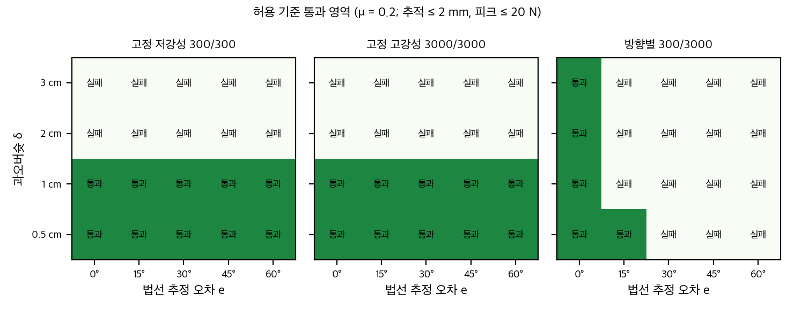
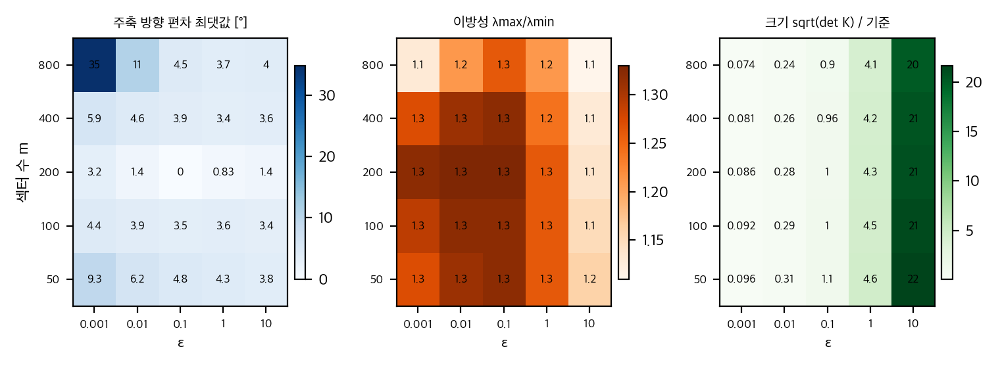

# 03. 재계산과 유도

이 문서의 재계산은 `analysis/user_study_check.py`(사용자 연구), `analysis/contact_toy.py`(접촉 toy), `analysis/label_toy.py`(라벨 추정과 식별)로 만들었고, 결과는 같은 이름의 `*_results.json`에 있습니다. 모두 numpy·scipy 1스레드, 수 초 안에 끝납니다.

**입력의 한계:** 원자료(참가자 × 시행 기록)는 공개되지 않았습니다. 프로젝트 페이지의 `static/data/*.json`은 조건·과제마다 시간열 하나입니다(예: high_vase_force.json은 0–27 s, 약 1만 9천 점, 참가자 키 없음). 대표 시행 한 번이라 통계에 쓸 수 없습니다. 따라서 재계산은 Table I의 평균·SD·검정 통계량과 Fig. 3의 성공률 막대에서 읽은 참가자별 성공 횟수에서만 합니다.

## 1. 사용자 연구 (n = 18) 재계산

### 1.1 Fig. 3 판독과 검산

Fig. 3의 성공률 막대는 참가자 수를 성공 횟수(0/3–3/3)별로 쌓은 것입니다. 막대 합이 18인지, 평균(성공 수/54)이 Table I과 맞는지, SD가 맞는지로 판독을 검산했습니다.

| 과제 | 조건 | 0/3, 1/3, 2/3, 3/3 (참가자 수) | 성공 / 54 | 평균 (보고) | SD (보고) |
|---|---|---|---|---|---|
| Vase | Low | 2, 2, 3, 11 | 41 | 0.76 (0.76) | 0.36 (0.36) |
| Vase | SC | 0, 0, 7, 11 | 47 | 0.87 (0.87) | 0.17 (0.17) |
| Vase | High | 8, 8, 1, 1 | 13 | 0.24 (0.24) | 0.28 (0.28) |
| Peg | Low | 3, 3, 3, 9 | 36 | 0.67 (0.67) | 0.40 (0.40) |
| Peg | SC | 1, 2, 3, 12 | 44 | 0.81 (0.81) | 0.31 (0.31) |
| Peg | High | 1, 3, 7, 7 | 38 | 0.70 (0.70) | 0.30 (0.30) |
| Door | Low | 0, 3, 3, 12 | 45 | 0.83 (0.83) | 0.26 (0.26) |
| Door | SC | 0, 5, 6, 7 | 38 | 0.70 (0.70) | 0.28 (0.28) |
| Door | High | 8, 4, 5, 1 | 17 | 0.31 (0.31) | 0.33 (0.33) |

- 9개 막대 모두 합이 18이고, 평균과 SD가 보고값과 0.01 이내로 맞습니다. 따라서 판독은 신뢰할 만합니다.
- 조건당 시행이 3회로 같아서 참가자 평균 성공률 = 전체 성공 수/54입니다.

**시간 분석의 n:** Vase 9, Peg 14, Door 10(그림 3 "n=" 표기). 그런데 Door High의 0/3이 8명이라 Door의 시간 분석 n = 18 − 8 = 10과 맞습니다. Vase는 0/3이 High에 8명, Low에 2명이라 합집합 9명(겹침 1)과 맞습니다.

### 1.2 검정 통계량의 내부 일관성

| 검정 | 재계산 | 보고 | 판정 |
|---|---|---|---|
| 반복측정 ANOVA ηp² (11개) | F·df로 계산 | 모두 일치 (0.291–0.502) | ✅ |
| ANOVA p 수준(별표) | F와 df로 계산 | 별 개수와 일치 (예 Peg 힘 p=0.0029 → **) | ✅ |
| 시간 ANOVA df | 2(n−1) | Vase df₂=16 → n=9, Peg 26 → n=14, Door 18 → n=10 | ✅ |
| Friedman 성공률 W = χ²/(n(k−1)) | χ² 20.13, 3.21, 19.77 | W 0.559, 0.089, 0.549 | ✅ |
| Friedman p | χ²₂ | Vase 4×10⁻⁵, Peg 0.20, Door 5×10⁻⁵ | ✅ (Peg p = 0.201 보고) |

Table I의 통계량은 서로 맞습니다. 그러나 그것이 본문 쌍별 검정이 맞다는 증거는 아닙니다(§1.6).

### 1.3 성공률 쌍별 비교 (독립 근사)

쌍체 자료가 없어서 참가자 단위 **Mann–Whitney**(독립 표본)로 근사했습니다. Holm은 과제 안에서 세 쌍에 적용했습니다.

| 과제 | 쌍 | p (MWU, 독립) | Holm | 그림 3 표기 |
|---|---|---|---|---|
| Vase | SC – High | 0.00000 (<10⁻⁴) | <0.001 | ** (r = .95) |
| Vase | Low – High | 0.0002 | 0.0005 | ** (r = .94) |
| Vase | SC – Low | 0.62 | 0.62 | 없음 |
| Peg | SC – High | 0.17 | 0.51 | 없음 |
| Peg | SC – Low | 0.25 | 0.51 | 없음 |
| Door | SC – High | 0.0015 | 0.0030 | ** (r = .82) |
| Door | Low – High | 0.0001 | 0.0002 | ** (r = .97) |
| Door | SC – Low | 0.13 | 0.13 | 없음 |

- 그림 3의 유의성 표시와 같은 패턴입니다. SC가 고강성보다 성공률이 높은 것은 Vase와 Door에서 확실하고, Peg에서는 차이가 없습니다. 본문 주장과 일치합니다.
- Door에서 저강성이 고강성보다 성공률이 높다는 점(Low–High r = .97)은 본문에 언급이 없습니다.

### 1.4 안전 주장: 최대 접촉력

본문 주장은 "SC는 고강성보다 힘이 작다(세 과제 모두, p<.05, d>.6)"와 "안전은 저강성과 비슷하다"입니다. 쌍체 자료가 없으므로 **Welch 독립 근사**와 **평균 차이의 95% 구간**으로 봅니다(Holm은 지표·과제 안에서).

| 과제 | SC − 고강성 (N) [95% 구간] | p (Holm) | SC − 저강성 (N) [95% 구간] | p (Holm) |
|---|---|---|---|---|
| Vase | −58.2 [−82.6, −33.7] | 0.0001 | −1.3 [−20.4, 17.8] | 0.89 |
| Peg | −47.2 [−74.7, −19.7] | 0.006 | −15.6 [−33.3, 2.2] | 0.09 |
| Door | −37.8 [−69.9, −5.7] | 0.028 | **+22.7 [+4.9, +40.5]** | **0.028** |

1. **고강성 대비:** 세 과제 모두 SC의 힘이 작습니다. 독립 근사에서도 같은 결론이고, 그림 3 표기(Vase ***, Peg **, Door *)와 맞습니다. 주장은 확실합니다.
2. **저강성 대비 (Vase):** 평균이 1.3 N 차이로 같습니다. "비슷하다"는 주장과 맞습니다.
3. **저강성 대비 (Peg):** SC가 15.6 N 낮지만 구간이 0을 살짝 넘습니다. 그림 3에 괄호가 없어 본문도 유의하다고 하지 않습니다. 방향은 안전 쪽입니다.
4. **저강성 대비 (Door): 본문 주장과 어긋납니다.** SC의 최대 접촉력이 저강성보다 평균 22.7 N(55%) 큽니다. 그림 3 괄호 Low–SC에 "**, d = .84"가 있습니다(확대해서 확인). 쌍체 검정이 아니라도 독립 근사에서 p = 0.014입니다.

결론: 안전 주장은 "고강성보다 안전하다"는 확실하지만, "저강성과 비슷하다"는 Vase에서만 성립하고 Peg에서는 더 안전하며 Door에서는 저강성보다 **위험**합니다. 초록의 "safety comparable to a constant low stiffness"는 세 과제 중 한 과제에서 틀립니다.

### 1.5 효율 주장: 과제 시간

| 과제 | SC − 고강성 (s) [95% 구간] | 백분율 (구간) | p (Holm) | SC − 저강성 (s) | p (Holm) |
|---|---|---|---|---|---|
| Vase (n=9) | −8.3 [−18.2, +1.6] | −25% (−54%…+5%) | 0.093 (0.28) | −5.7 | 0.15 (0.29) |
| Peg (n=14) | +2.3 [−4.1, +8.6] | +10% (−19%…+39%) | 0.47 | −11.1 | 0.020 (0.039) |
| Door (n=10) | −3.5 [−11.4, +4.3] | −19% (−61%…+23%) | 0.35 (0.42) | −9.8 | 0.037 (0.11) |

- **저강성 대비:** Peg에서 유의(그림 3 "*, d = .88"), Door는 독립 근사에서 Holm 후 p = 0.11입니다. 본문은 Door를 유의하다고 하지만 쌍체 검정이라 차이가 있을 수 있습니다. Vase는 본문 p = .091(쌍체)이고 독립 근사는 0.15입니다.
- **고강성 대비:** 세 과제 모두 차이가 검정되지 않았습니다. 그러나 **차이가 없다는 것은 같다는 뜻이 아닙니다.** Peg의 구간은 SC가 약 19% 빠른 쪽부터 39% 느린 쪽까지 걸쳐 있습니다. "고강성과 맞먹는다"는 동등성 검정(TOST)이 없이는 주장할 수 없습니다.
- 본문은 SC와 고강성의 시간 비교를 보고하지 않습니다. 그림 3에도 그 쌍의 괄호가 없습니다. 따라서 "matching the efficiency of high stiffness"는 **검정되지 않은 주장**입니다.

### 1.6 쌍체 자료가 없어서 못 하는 것

- Table I의 쌍체 p(예 Vase 시간 .091)와 Wilcoxon p를 재현할 수 없습니다. 참가자 내 상관을 모르기 때문입니다.
- 독립 근사는 양(+)의 상관이 있을 때 쌍체 검정보다 보수적입니다. 그래서 여기서 얻은 p가 본문보다 큰 것(Vase 시간 0.15 대 0.091)은 자연스럽습니다. 방향이 맞아도 p 값 자체는 비교하지 않습니다.
- 그림 3의 d 표기(예 Vase 힘 SC–고강성 1.13)는 평균·SD에서 계산한 pooled d(1.62)와 맞지 않습니다. 쌍체 d_z를 썼을 것으로 보입니다. 그래서 d 값을 독립 근사와 맞추지 않습니다.
- 재현 요청: 참가자별 시행 기록(과제 × 조건 × 시행, 최대 힘, 완료 시간)과 참가자 ID가 있으면 쌍체 Wilcoxon·TOST를 바로 돌릴 수 있습니다. 이 데이터는 공개되지 않았습니다(`04` §2).

## 2. 라벨 생성의 가정 점검

Sec. III-C–D를 따라 가면 다음 값이 필요합니다. 논문에 없는 것은 표시했습니다.

| 단계 | 필요한 값 | 논문 | 영향 |
|---|---|---|---|
| 정규화 | 상태 s의 평균·분산(데이터셋) | 있음 | 이웃 거리에 영향 |
| 이웃 | k (> 과제 차원), 거리 | k 값 없음 | 시각 이웃이 다른 접촉 모드를 섞을 수 있음 |
| 섹터 | m, 분할 방식 | "예: 구면 격자" | 빈 섹터 수(m_valid)가 평균에 영향 |
| 대표 힘 | 95퍼센타일 | 있음 | 최대값 대비 이상치 민감도 |
| 정칙화 | ε (두 번: 섹터 행렬 εI, 역함수 h의 ε) | 값 없음 | §3 |
| 정규화 | κ_min, κ_max 백분위 | 값 없음 | 최종 이방성 범위를 결정 |
| 좌표 | 카메라 → 기저 회전 | 배포 때 설명 없음 | `04` §2 |

## 3. 섹터 로그 평균의 닫힌 해와 ε

### 3.1 유도

섹터 i의 대표 힘을 f̃_i = p_i u_i(단위 방향 u_i, 크기 p_i)라 하면 A_i = f̃_i f̃_iᵀ + εI는 고유값 p_i² + ε(방향 u_i), ε(수직 두 방향)를 가집니다. 따라서

   log A_i = log ε · I + (log(p_i² + ε) − log ε) u_i u_iᵀ = log ε · I + w_i u_i u_iᵀ,  w_i = log(1 + p_i²/ε)

   S_e = (1/m_valid) Σ_i log A_i = log ε · I + (1/m_valid) Σ_i w_i u_i u_iᵀ

K_e ∝ exp(S_e/2)이므로 **K_e의 고유벡터는 가중 방향 산포 행렬 Σ_i w_i u_i u_iᵀ의 고유벡터**이고, 고유값 비는 exp((s_1 − s_3)/2)입니다(s는 S_e의 고유값).

- 수치 검산: 닫힌 해와 행렬 로그를 직접 계산한 값의 차이는 최대 9×10⁻¹⁵입니다(`label_toy.py` A, skew 0·1 모두).
- 해석: 강성 방향은 "힘 크기의 로그에 비례하는 가중치로 섹터 방향을 모은 것"입니다. 힘이 클수록 w_i가 크지만 로그라서 크기 차이가 압축됩니다.

### 3.2 공분산 방식과 로그 평균: 방향은 같고 크기는 다르다

같은 힘 자료(4000개, 방향 균등 또는 접선 80%)에서 세 방식을 비교했습니다(법선 = z축, 고유값 비 λ_max/λ_min).

| 힘 자료 | 방식 | 최대 고유벡터와 법선 각 | 고유값 비 |
|---|---|---|---|
| 방향 균등 | 논문 (섹터 log 평균, ε = 0.1) | 0.8° | 1.34 |
| 방향 균등 | 공분산 (Duan식, K = √E[ffᵀ]) | 0.3° | 2.98 |
| 접선 80% | 논문 | 0.8° | 1.34 |
| 접선 80% | 공분산 | 1.2° | 3.24 |

- **방향은 두 방법이 모두 법선을 찾습니다.** 그래서 논문의 방향 편향 주장(공분산은 자주 샘플된 방향으로 치우친다)은 이 toy에서 확인되지 않았습니다. 법선 방향 힘이 가장 커서 두 방식 모두 법선을 찾습니다. 샘플 빈도와 힘 크기가 어긋날 때의 편향은 시험하지 않았습니다.
- **크기(이방성)는 방법에 따라 2배 넘게 다릅니다.** 같은 자료에서 로그 평균 라벨은 공분산보다 덜 이방성입니다. 실제로 학습되는 라벨의 대비는 이 선택에 따라 달라집니다. 논문은 이 선택의 효과를 보고하지 않습니다.

### 3.3 ε에 대한 민감도

| ε (N²) | 1e-3 | 1e-2 | 1e-1 | 1 | 10 |
|---|---|---|---|---|---|
| 고유값 비 (접선 80%) | 1.34 | 1.35 | 1.34 | 1.26 | 1.15 |

- ε가 10⁻³–10⁻¹ 사이에서는 비율이 거의 같습니다. 이유는 p_i² ≫ ε이면 w_i − w_j ≈ log(p_i²/p_j²)로 ε가 상쇄되기 때문입니다.
- ε가 p² 수준(이 toy에서 p ≈ √ε ≈ 0.3–3 N)이 되면 이방성이 줄어듭니다. 약한 접촉 신호가 ε에 묻히는 것입니다.
- 결론: ε는 "잡음 바닥"이라서 크기 척도(N²)에 따라 의미가 달라집니다. 논문의 ε 값과 힘 단위(N)가 주어져야 재현할 수 있습니다.

### 3.4 팽창 효과 (swelling)

섹터별 K_i = A_i^{1/2}의 유클리드 평균과 로그 평균(= exp(mean log K_i))을 비교했습니다.

- det(유클리드 평균) = 0.94, det(로그 평균) = 0.095. **비율 약 10배.** 유클리드 평균은 K_i 사이의 기하를 무시하고 부피를 키웁니다.
- 이 점에서 논문의 로그-유클리드 선택은 타당합니다(Sec. III-C). 다만 이득의 크기는 이 toy에서만 보였고, 실제 데이터에서 얼마나 큰지는 모릅니다.

### 3.5 로봇 강성으로의 변환

- h(λ) = 1/(λ + ε)는 단조 감소이므로 "환경이 단단한 방향에서 로봇은 무르다"를 만족합니다. 다만 ε를 **두 번** 쓰므로(섹터 εI와 h의 ε) 두 ε를 따로 튜닝해야 합니다.
- κ_min, κ_max 백분위 정규화와 [0, 1] 자르기 때문에, 라벨 대비는 데이터셋 전체의 분위수로 다시 정해집니다. 논문은 이 백분위를 밝히지 않았습니다.
- 정책 출력은 [0, 1]이고 배포에서 [300, 3000]으로 선형 변환합니다. 최소 고유값이 0이면 그 방향은 항상 300 N/m가 됩니다. 이 바닥의 빈도는 논문에 없습니다.

## 4. 접촉 toy와 법선 오차의 해석식

### 4.1 모델과 설정

- 2D, 질량 1 kg 점 로봇, 벽 법선 n = (0, 1). 벽은 k_env = 5000 N/m 스프링, 쿨롱 마찰 μ = 0.4.
- 조작자 목표: 1 s 동안 2 cm 위에서 −δ까지 내려온 뒤 접선으로 0.05 m/s 이동. 목표 위치에 0.5 mm 잡음.
- 제어: F = K(x_d − x) + D(ẋ_d − ẋ), D = 1.4√k (축별, 논문 Sec. IV-C와 같은 규칙). 질량 1 kg이면 ζ = 0.7.
- 지표: F_peak(전 구간 최대), F_ss(2–3 s 평균 접촉력), track(2–3 s 접선 추적 오차 RMS). 시드 5개 평균.
- 해석 대상은 "조작자가 벽을 δ만큼 과하게 누르는" 상황입니다. δ는 조작 과오버슛을 나타냅니다.

### 4.2 세 설정의 결과 (δ = 1 cm)

| 설정 | F_peak (N) | F_ss (N) | 해석식 F_ss | 접선 추적 RMS (mm) |
|---|---|---|---|---|
| 고정 저강성 (300/300) | 2.97 | 2.83 | 2.83 | 3.72 |
| 고정 고강성 (3000/3000) | 19.36 | 18.76 | 18.75 | 2.45 |
| 방향별 (법선 300, 접선 3000) | 2.96 | 2.83 | 2.83 | **0.33** |

- 정상상태 힘은 F_ss = k_env K_n δ/(K_n + k_env)입니다. 시뮬레이션과 해석식이 맞습니다.
- 추적 오차는 정상상태에서 **마찰 지연** μF_n/K_t가 지배합니다. 저강성 μ·2.83/300 = 3.8 mm, 고강성 μ·18.8/3000 = 2.5 mm, 방향별 μ·2.83/3000 = 0.38 mm. 시뮬레이션 값(3.72, 2.45, 0.33)과 맞습니다.
- 등방 K는 F_ss와 마찰 지연이 함께 움직여 트레이드오프를 피할 수 없습니다. 방향별 K는 법선 강성으로 힘을, 접선 강성으로 추적을 따로 고릅니다.

### 4.3 과오버슛 δ에 따른 스케일

| δ | 저강성 F_ss / 추적 | 고강성 F_ss / 추적 | 방향별 F_ss / 추적 |
|---|---|---|---|
| 0.5 cm | 1.4 N / 1.8 mm | 9.4 N / 1.2 mm | 1.4 N / 0.1 mm |
| 1.0 cm | 2.8 N / 3.7 mm | 18.8 N / 2.5 mm | 2.8 N / 0.3 mm |
| 2.0 cm | 5.7 N / 7.5 mm | 37.5 N / 5.0 mm | 5.7 N / 0.7 mm |

- F_ss는 δ에 선형입니다. 힘 목표는 법선 강성으로 정해지고, 조작 과오버슛은 힘으로 나타납니다. 그래서 **안전은 법선 강성이 결정**합니다.
- 추적 오차도 δ에 선형입니다. 이것은 마찰 지연 때문입니다. 방향별 K는 접선 강성이 커서 지연이 작습니다.

### 4.4 등방 스윕과 방향별 스윕의 파레토

| k (N/m) | 300 | 500 | 800 | 1200 | 1800 | 2400 | 3000 |
|---|---|---|---|---|---|---|---|
| 등방: F_ss (N) | 2.83 | 4.55 | 6.90 | 9.68 | 13.25 | 16.23 | 18.78 |
| 등방: 추적 (mm) | 3.72 | 3.59 | 3.40 | 3.18 | 2.90 | 2.65 | 2.45 |
| 방향별 (k_t = 3000): 추적 (mm) | 0.33 | 0.56 | 0.87 | 1.24 | 1.72 | 2.11 | 2.45 |

- 같은 F_ss에서 방향별 K의 추적 오차가 등방 K보다 낮습니다(예: F_ss ≈ 9.7 N에서 등방 3.18 mm, 방향별 1.24 mm). 파레토 전선이 방향별 쪽으로 밀려 있습니다. 그림 `contact_pareto.png`.
- 이것은 **법선을 정확히 알 때**의 결과입니다. 아래 §4.5가 그 조건을 깹니다.

### 4.5 법선 추정 오차: 힘은 그대로, 추적이 깨진다

접선이 자유롭다고 하고(μ = 0) 정상상태를 풀면, 법선 유효 강성은 **Schur 보수**입니다.

   K_eff = det K / K_xx,  F = δ K_eff k_env / (K_eff + k_env),  e_x = K_xy F / (K_xx K_eff)

K = R(e) diag(k_n, k_t) R(e)ᵀ이면 det K = k_n k_t(회전 불변), K_xx = k_n sin²e + k_t cos²e, K_xy = (k_t − k_n) sin e cos e입니다.

| 법선 추정 오차 e | K_eff (N/m) | F 해석식 = 시뮬레이션 (N) | e_x 해석식 / 시뮬레이션 (mm) |
|---|---|---|---|
| 0° | 300 | 2.83 = 2.83 | 0.00 / 0.05 |
| 10° | 308 | 2.90 = 2.90 | 1.49 / 1.44 |
| 20° | 335 | 3.14 = 3.14 | 3.03 / 2.98 |
| 30° | 387 | 3.59 = 3.59 | 4.67 / 4.61 |
| 45° (해석식만) | 545 | 4.91 | 7.4 |
| 60° (해석식만) | 923 | 7.79 | 10.1 |
| 90° (해석식만) | 3000 | 18.75 | 0 |

μ = 0 시뮬레이션은 해석식과 소수 둘째 자리까지 맞습니다. 마찰이 있으면(μ = 0.4) 추적 RMS는 0.33 → 1.82 → 3.42 → 5.19 mm로 커지고 F_ss는 2.7–3.0 N으로 거의 그대로입니다.

**읽는 법:**
- 작은 법선 오차(≤ 20°)에서는 **힘이 거의 그대로**입니다. 힘은 법선 강성 k_n에 가까운 K_eff가 정하고, 접선 강성이 크면 K_eff ≈ k_n이기 때문입니다.
- 오차는 **접선 추적으로 나타납니다.** e_x ∝ K_xy, 즉 (k_t − k_n) sin e cos e에 비례합니다. 조작자는 힘이 아니라 "미끄러짐"을 봅니다.
- 오차가 더 커지면 결국 힘도 커집니다. 90°에서는 K_eff = k_t(3000)가 되어 힘이 고강성 수준(18.75 N)까지 올라갑니다. 그 전 구간에서는 추적 오차가 먼저 커집니다(예: 20°에서 추적 3 mm, 힘은 +11%).
- 실제로는 정책이 틀린 법선을 K로 낼 때, 그 오차가 **영상에서 식별되는가**(§5)가 핵심입니다.

## 5. 식별 가능성 toy: 접촉 상태가 영상에 없을 때

- 상태 s = (θ, d): 벽 각도 θ(±30°), 거리 d ∈ [0, 1]. 접촉 c = [d < 0.3].
- 라벨: 접촉이면 R(θ) diag(300, 3000) R(θ)ᵀ, 아니면 1000·I. 정규화해서 ‖K‖_F = 1.
- 영상: 벽 각도는 항상 보입니다(2θ의 cos, sin). 거리 d는 (a) 안 보이거나 (b) 잡음 σ로 보인다고 가정.
- 예측: k = 30 kNN 회귀, 학습 3000, 시험 1000.

| 입력 | 평균 오차 (정규화 ‖K‖_F) |
|---|---|
| 각도만 (거리 안 보임) | 0.287 |
| 각도 + 거리 (σ = 0.1) | 0.085 |
| 각도 + 거리 (σ = 0.02) | 0.032 |
| θ와 접촉 c를 직접 (오라클) | 0.0009 |

- **영상이 접촉 상태를 주지 않으면 라벨의 이방성 부분이 평균으로 흐려집니다.** 오차 0.29는 접촉일 때와 아닐 때 라벨 차이의 대략적인 크기입니다.
- 거리가 잡음 σ = 0.1로만 보여도 오차가 3배 줄어듭니다. 그러므로 "영상만으로 식별"은 **무엇이 보이는가**에 달려 있습니다.
- 한계: 접촉과 거리의 관계, 영상 잡음 모델은 가정입니다. 논문은 실제 영상에서 예측 정확도(라벨과 예측의 오차)를 보고하지 않습니다(`04` C10).

## 6. 숨은 가정 목록 (재현에 필요한데 논문에 없는 것)

1. 라벨 하이퍼파라미터: ε(섹터와 h에서 각각), m과 섹터 분할, k, κ_min·κ_max 백분위, 95퍼센타일, clamp, 정규화 기준 데이터셋.
2. 좌표 변환: 카메라 → 기저 회전을 배포 때 어떻게 적용하는지.
3. 정책: DINOv3 small 가중치 버전, MLP 학습률·epoch·배치·손실 가중치, 검증 셋.
4. 제어: 회전 강성·감쇠가 조건 간 다름(`01` §3.1), 축별 감쇠 규칙 d = 1.4√k의 질량 가정.
5. 실험: 조건당 시행 순서(고정 순서), 참가자 개별 자료, 쌍체 검정 결과.
6. 시뮬레이션: 물리 설정(마찰, 접촉 강성), 16회 시연의 과제 상태 분포, 재생 가능성.

## 추가 검증 (2026-11-11)

### 추가 검증 1: 방향별 강성의 이득이 유지되는 과오버슛·법선 오차 영역

**목적.** §3(접촉 모델)에서 방향별 강성은 법선이 맞을 때만 저강성의 힘과 고강성의 추적을 함께 준다. 과오버슛 δ, 법선 추정 오차 e, 마찰 μ를 격자로 바꿔, 방향별 강성이 허용 기준을 만족하는 영역이 고정 저·고강성 설계보다 넓은지, 어디서 깨지는지 본다.

**설정.** `analysis/extra_overshoot_map.py` (numpy, 약 3초). `contact_toy.py`의 2D 임피던스 접촉 모델을 그대로 썼다(질량 1 kg, 벽 5000 N/m, 접선 목표 0.05 m/s, 감쇠 1.4√k).
- 격자: δ ∈ {0.5, 1, 2, 3} cm × e ∈ {0, 15, 30, 45, 60}° × μ ∈ {0, 0.2, 0.4, 0.6}, 80점. 시드 5개의 평균이다.
- 설계: 고정 저강성 300/300, 고정 고강성 3000/3000, 방향별 법선 300 / 접선 3000 N/m.
- 허용 기준(시작 전에 정함): 접선 추적 RMS ≤ 2 mm이고 피크 접촉력 ≤ 20 N. 기준 값은 논문에 없고 내가 정한 값이므로, 결론은 이 기준에 달려 있다.

**결과.**
- 통과 칸 수(80점 중): 고정 저강성 35, 고정 고강성 30, 방향별 20. 고정 둘 중 하나라도 통과한 칸은 40이다.
- 방향별 설계만 통과한 칸은 8점이고, 모두 법선 오차 e = 0°였다.
- 법선 오차에 따른 추적 RMS(μ = 0, δ = 0.5 cm): e = 0°에서 0.05 mm, 15°에서 1.08 mm, 30°에서 2.29 mm, 45°에서 3.64 mm, 60°에서 5.02 mm. δ = 1 cm에서는 15°에서 2.2 mm로 기준을 넘는다. 방향별 설계의 피크 힘은 e = 0°에서 δ = 3 cm일 때 8.6 N이었고, 법선 오차가 커지면 24.5 N까지 올라 기준을 넘었다.

직접 그림(추가 검증 1): μ = 0.2에서 세 설계의 기준 통과 여부. 추적 RMS ≤ 2 mm, 피크 ≤ 20 N.

**결론.**
- 방향별 강성의 이득은 법선이 거의 맞을 때(오차 0°, 이 격자에서는 15°가 일부 칸에서 한계)에만 나타났다. 법선 오차 30° 이상에서는 격자 전체에서 방향별 설계가 기준을 통과하지 못했다. "법선만 맞으면 된다"는 §3의 결론은 맞지만, 법선이 어느 정도까지 틀려도 되는지는 이 기준에서 15° 안쪽이다.
- 고정 저강성은 법선과 무관하므로 μ ≤ 0.2에서 δ ≤ 1 cm이면 모든 e에서 통과했다(μ ≥ 0.4에서는 통과하지 않았다). 방향별 설계는 추가 오차 허용이 좁아서, 과오버슛이 작고 법선이 정확한 조건에서만 고정 저강성을 이겼다.
- 한계: 기준(2 mm, 20 N)을 바꾸면 통과 칸 수와 순서가 달라질 수 있다. 질량·벽 강성·감쇠는 가정이며, 마찰은 쿨롱 모델 하나다.

### 추가 검증 2: 라벨 추정기의 민감도 지도

**목적.** §2 라벨(섹터 로그 평균의 행렬 지수)은 섹터 수 m, 정칙화 ε, 크기 통계(95퍼센타일 또는 최댓값)에 따라 달라진다. 방향 정보는 안정하고 크기만 민감한지, 아니면 방향도 흔들리는지 본다.

**설정.** `analysis/extra_label_sens.py` (numpy, 약 3초). `label_toy.py`의 식 (1)–(2)를 그대로 썼다. 접촉력은 접선 쪽으로 치우친 분포(skew = 1)이고 샘플은 4000개, 시드 5개다.
- 격자: m ∈ {50, 100, 200, 400, 800} × ε ∈ {10⁻³, 10⁻², 10⁻¹, 1, 10} × 크기 통계 {95퍼센타일, 최댓값}.
- 기준: m = 200, ε = 0.1, 95퍼센타일. 같은 시드의 기준 라벨과 주축 방향의 각도 차이를 본다.
- 측정: 주축 방향 편차(°), 이방성 λmax/λmin, 크기 sqrt(det K)의 기준 대비 비.

**결과.**
- 주축 방향 편차의 격자 중앙값은 2.8°다(최댓값 통계 기준). 대부분의 칸에서 편차는 1–5°였다.
- 방향이 흔들린 곳은 ε이 작을 때다(최댓값 통계 기준). m = 800, ε = 10⁻³에서 평균 15.0°(최대 36.9°), m = 50, ε = 10⁻³에서 평균 7.5°였다. m = 800, ε = 10⁻²에서도 평균 5.1°(최대 11.3°)였다.
- 크기는 ε에 따라 크게 변했다. ε이 한 자릿수 바뀔 때마다 sqrt(det K)가 약 3–5배 바뀌었고, 격자 전체 범위는 0.07배에서 22배였다. 크기 통계(95퍼센타일 대 최댓값)의 차이는 크기에 거의 영향이 없었다.
- 이방성 비율은 1.11–1.33으로 거의 등방이었다.

직접 그림(추가 검증 2): 섹터 수 m과 정칙화 ε에 따른 주축 방향 편차 최댓값, 이방성 비율, 크기 비(95퍼센타일 기준, 시드 5개 평균).

**결론.**
- 대부분의 격자에서 방향은 안정하고 크기만 민감하다는 가설이 맞다(중앙값 2.8°). 크기는 ε에 3–5배 민감하다. 따라서 라벨의 크기 척도(힘 세기)를 해석할 때 ε을 함께 보고해야 한다.
- 예외는 ε이 10⁻³–10⁻² 수준으로 작은 영역이다. 특히 섹터가 많은 m = 800에서 방향이 크게 흔들렸다. 섹터 수를 크게 잡을 때는 정칙화를 충분히 두어야 한다는 뜻이다.
- 이방성 비율이 1.1–1.3이라서, 이 힘 분포에서는 주축 방향 자체가 정보를 거의 담지 않는다. 방향 안정성은 "라벨이 등방에 가까울 때" 의미가 제한적이다. 이방성이 큰 분포(예: 접촉이 한 방향에 몰린 수집)에서 다시 봐야 한다.
- 한계: 힘 분포와 접촉력 모델은 label_toy의 가정이다. 논문이 쓴 ε 값은 보고되지 않았다.

### 추가 검증 3: 가림과 프레임 지연이 식별 오차를 얼마나 키우는가

**목적.** §4(식별 가능성)에서 접촉 상태가 영상에 없으면 라벨이 흐려진다. 여기서는 접촉 거리 관측에 가림과 프레임 지연을 넣었을 때 식별 오차가 얼마나 커지는지, 학습기를 kNN에서 작은 MLP로 바꾸면 손해가 줄어드는지 본다.

**설정.** `analysis/extra_ident_occlusion.py` (numpy, 약 70초). `label_toy.py` part B의 설정을 그대로 썼다(상태 (θ, d), 접촉 c = [d < 0.3], 라벨 K = 접촉 시 R(θ)diag(300, 3000)R(θ)ᵀ, 아니면 1000·I, ‖K‖_F = 1).
- 관측: 벽 각도 2θ는 항상 보인다. 접촉 거리 d는 가림 확률 p(0, 0.3, 0.6)로 사전 평균 0.5로 바뀌고 가림 표시가 붙는다. 지연 L(0, 2, 5 프레임, 1/30 s 단위)에서는 d_obs = d + s·L/30이고, 접근 속도 s ∈ U(−0.3, 0.3) m/s는 학습기가 모른다.
- 학습기: kNN(k = 30, label_toy와 같음), 작은 MLP(은닉 32, tanh, Adam 2000스텝, 학습률 0.01). 학습 3000, 시험 1000, 시드 5개.
- 기준선: 각도만, (θ, 참 d), (θ, 참 c).

**결과.** 행렬 오차(행별 ‖K̂ − K‖_F 평균, 시드 5개 평균).

| 가림 p | 지연 L | kNN | MLP |
|---|---|---|---|
| 0 | 0 | 0.026 | 0.045 |
| 0 | 2 | 0.027 | 0.045 |
| 0 | 5 | 0.033 | 0.049 |
| 0.3 | 0 | 0.104 | 0.113 |
| 0.3 | 2 | 0.105 | 0.113 |
| 0.3 | 5 | 0.109 | 0.116 |
| 0.6 | 0 | 0.183 | 0.186 |
| 0.6 | 2 | 0.183 | 0.186 |
| 0.6 | 5 | 0.185 | 0.188 |

기준선: 각도만 0.279, (θ, 참 d) kNN 0.025, (θ, 참 d) MLP 0.039, (θ, 참 c) kNN 0.0007.

**결론.**
- 가림이 식별 오차를 지배했다. 가림 0 → 0.3 → 0.6에서 kNN 오차는 0.026 → 0.104 → 0.183으로 늘었다. 가림 0.3 이상이면 각도만 쓴 0.279보다는 낫지만, 참 d를 본 0.025와는 거리가 멀다.
- 프레임 지연 5(약 0.17 s)는 오차를 0.002–0.007만 더했다. 지연 5프레임은 접근 속도 0.3 m/s에서 최대 ±5 cm의 거리 오차인데, 식별 오차 증가는 작았다. 라벨이 바뀌는 것은 접촉 경계(d = 0.3) 근처뿐이어서 이런 결과가 나온 것으로 보인다(추정, 확인하지 않았다).
- MLP가 kNN보다 나은 경우는 없었다. 이 설정(2000스텝, 튜닝 없음)에서는 "학습기를 MLP로 바꾸면 손해가 줄어든다"는 가설을 지지하지 못했다.
- 한계: 가림을 무작위로 주었다(실제 가림은 접촉 근처에서 더 자주 일어날 것이다). 학습기는 튜닝하지 않았고, 속도 분포와 접촉 경계는 가정이다.

### 추가 검증 4: MuJoCo 2링크 팔의 임피던스 폐루프에서 강성 설정 비교

**목적.** §4의 접촉 toy(해석식)와 §4.5의 법선 오차 결과가 MuJoCo 2링크 팔을 1 kHz 임피던스 제어로 돌린 폐루프에서도 나오는지 본다. 작은 MLP가 벽 법선 방향을 예측해 방향별 강성을 쓸 수 있는지도 본다.

**설정.** `analysis/extra_copilot_mujoco.py` → `analysis/extra_copilot_mujoco_results.json`. CPU, 스레드 4, 실행 11.5 s. torch 2.15.0, MuJoCo 4.0.0, numpy 1.26.4.
- 팔: 수평면 2링크, 링크 0.3 m, 링크 질량 0.05 kg, 팁 질량 1 kg(§4의 점 질량과 같은 유효 질량). 관절 토크 = Jᵀ F, 제어 1 kHz.
- 벽: 법선 n(θ) = (sin θ, cos θ)인 평면. 접촉은 k_env = 5000 N/m 스프링과 쿨롱 마찰 μ = 0.4로 계산해 팁에 외력으로 가한다. MuJoCo 접촉 파라미터는 쓰지 않았다.
- 조작자: 1 s 동안 표면 2 cm 위에서 −δ까지 내려간 뒤 0.05 m/s로 1 s 접선 이동한다. 측정은 F_peak, 2–3 s 평균 법선력 F_ss, 2–3 s 접선 추적 오차 RMS다.
- 임피던스: F = K(x_d − x) + D(ẋ_d − ẋ), K = k_n n̂n̂ᵀ + k_t t̂t̂ᵀ, 축별 D = 1.4√k.
- 예측기: MLP(입력 4 → 64 → 64 → 2, tanh). 벽 양 끝점 ±10 cm를 잡음 섞어 관측하고 (cos 2θ, sin 2θ)를 예측한다. 학습은 합성 자료 20,000개(법선 ±40°, 끝점 잡음 0–6 mm), Adam 3e-3, 3000 스텝, 마지막 배치 MSE 0.0012. 20 Hz로 갱신하고 지수 평활 0.2를 적용한다.
- 시험: (A) θ = 0에서 δ = 0.5, 1, 2 cm. (B) θ ~ U(−30°, 30°), δ = 1 cm, 시험 20회를 조건 사이에 짝지었다.

**결과.** (A) 법선 정확, 세 설정. 괄호 안은 접선 추적 RMS.

| δ | 고정 고강성 3000 F_ss (N) | 고정 저강성 300 F_ss (N) | 방향별 300/3000 F_ss (N) | 해석식 고강성 / 저강성·방향별 |
|---|---|---|---|---|
| 0.5 cm | 9.33 (1.29 mm) | 1.34 (2.25 mm) | 1.34 (0.23 mm) | 9.4 / 1.4 |
| 1.0 cm | 18.70 (2.54 mm) | 2.76 (4.13 mm) | 2.76 (0.41 mm) | 18.8 / 2.8 |
| 2.0 cm | 37.45 (5.04 mm) | 5.59 (7.90 mm) | 5.59 (0.79 mm) | 37.5 / 5.7 |

(B) δ = 1 cm, 시험 20회(평균, 표준편차는 F_ss 0.01 N 이하, 추적 0.04 mm 이하)

| 조건 | F_ss (N) | 추적 RMS (mm) | 법선 오차 (절댓값 평균) |
|---|---|---|---|
| 고정 고강성 3000 | 18.70 | 2.54 | — |
| 고정 저강성 300 | 2.76 | 4.17 | — |
| 방향별, 법선 정확 | 2.76 | 0.42 | 0 |
| 방향별, 법선 고정 오차 +20° | 3.55 | 2.42 | 20° |
| 방향별, MLP, 끝점 잡음 0 mm | 2.76 | 0.40 | 0.13° |
| 방향별, MLP, 끝점 잡음 2 mm | 2.76 | 0.41 | 0.19° |
| 방향별, MLP, 끝점 잡음 5 mm | 2.76 | 0.42 | 0.39° |

**결론.**
- 법선이 맞을 때 힘은 저강성과 같고(2.76 N), 추적은 고강성의 약 1/6이다(0.41 mm 대 2.54 mm). 세 δ 모두 해석식 F_ss와 맞고, 추적 오차 비율도 §4.3과 같은 방향이다. §4.2의 결론(방향별 강성은 힘과 추적을 분리한다)이 폐루프에서도 나온다.
- 법선 고정 오차 +20°에서는 추적이 2.4 mm로 나빠지고, 힘은 2.76 → 3.55 N으로 늘었다(+29%). §4.5의 해석식은 마찰이 없을 때 +11%이므로, 마찰이 있는 조건에서는 힘 증가가 더 크다.
- 작은 MLP는 끝점 잡음 5 mm에서도 법선을 평균 0.4° 안으로 예측했고, 방향별 강성의 이득(추적 0.42 mm)을 그대로 유지했다. 오차의 원천이 "벽 법선을 영상에서 읽는 것"으로 옮겨 갔다는 뜻이다. 실제 영상의 관측 오차, 벽 위치 오차, 카메라 좌표계 변환은 여기 없다.

**한계.**
- 2D이고 팁 질량 1 kg 한 값이다. 벽은 MuJoCo 접촉이 아니라 외력으로 계산했다. 팔의 관성은 실제 팔과 맞추지 않았다.
- 법선 범위는 ±30°(예측기 학습은 ±40°)이고, 시험은 조건당 20회다.
- 예측기는 벽의 양 끝점이 관측된다고 가정했다. 실제 손목 영상에서 끝점을 찾는 문제는 포함하지 않는다.
- 예측기 입력에 팁 위치는 넣지 않았다. 접촉이 없는 구간의 예측은 평가하지 않았다.

## 추가 검증 (2026-11-14): MuJoCo 접촉 벽에서 방향별 강성

**목적.** 추가 검증 4(2026-11-11)는 벽을 스프링-마찰 외력으로 계산했다. 이번에는 같은 2링크 팔에서 벽을 MuJoCo 접촉(정적 상자, 접촉 솔버)으로 만들어, 고강성·저강성·방향별 강성의 힘과 추적 결과가 접촉 모델을 바꿔도 남는지 본다.

**설정.** `analysis/extra_copilot_contact.py` → `analysis/extra_copilot_contact_results.json`. CPU, 결정론적(시드 없음), 조건당 3 s 시뮬레이션(1 kHz).
- 팔: 수평면 2링크(0.3 m + 0.3 m), 중력 0, 관절 감쇠 0.5, 팁은 질량 1 kg 구(반지름 5 mm). 관절 토크 = Jᵀ F(qfrc_applied).
- 벽: 정적 상자, 표면은 n·p = 0.45 m. 접촉 solref = (시간 상수 0.0149 s, 감쇠비 1), 마찰 μ = 0.4. solref 값은 유효 질량 1 kg에서 법선 강성이 약 5000 N/m 근처가 되도록 한 값이며, 실제 접촉 강성은 따로 측정하지 않았다.
- 임피던스: F = K(x_d − x) + D(ẋ_d − ẋ), K = k_n n̂n̂ᵀ + k_t t̂t̂ᵀ, D = 1.4(√k_n n̂n̂ᵀ + √k_t t̂t̂ᵀ).
- 조작자: 0–1 s에 표면 2 cm 앞에서 표면 δ 너머까지 밀고, 1–2 s에 접선으로 0.05 m/s로 이동한다.
- 측정: 법선 힘 최댓값(F_peak), 2–3 s 법선 힘 평균(F_ss), 2–3 s 접선 추적 오차 RMS.
- 조건: 고정 고강성 3000 N/m, 고정 저강성 300 N/m, 방향별(법선 300, 접선 3000), 방향별 법선 추정 +20° 오차.

**결과.** (A) θ = 0, 세 δ. 괄호는 추적 RMS.

| δ | 고정 고강성 F_ss (N) | 고정 저강성 F_ss (N) | 방향별 F_ss (N) |
|---|---|---|---|
| 0.5 cm | 29.8 (2.54 mm) | 3.00 (4.04 mm) | 2.99 (0.28 mm) |
| 1.0 cm | 44.8 (3.78 mm) | 4.50 (5.92 mm) | 4.49 (0.39 mm) |
| 2.0 cm | 74.7 (6.33 mm) | 7.48 (9.74 mm) | 7.46 (0.64 mm) |

(B) δ = 1 cm, 벽 각도 θ ∈ {−30°, −15°, 0°, 15°, 30°}. 다섯 각도의 결과가 모든 조건에서 같았다(표는 한 줄).

| 조건 | F_peak (N) | F_ss (N) | 추적 RMS (mm) |
|---|---|---|---|
| 고정 고강성 3000 | 47.9 | 44.8 | 3.78 |
| 고정 저강성 300 | 7.68 | 4.50 | 5.92 |
| 방향별, 법선 정확 | 7.33 | 4.49 | 0.39 |
| 방향별, 법선 +20° 오차 | 9.06 | 5.50 | 4.36 |

**결론.**
- 방향별 강성은 법선 힘을 저강성과 같게 두고(4.49 대 4.50 N), 추적은 고강성 수준으로 되살린다(0.39 mm 대 고강성 3.78 mm, 저강성 5.92 mm). 스프링 모형의 결론(추가 검증 4)이 접촉 솔버를 쓴 벽에서도 나온다.
- 힘 비율은 강성 비율과 같다. 저강성/고강성 힘 비율이 0.100으로, K 비율 0.1과 일치한다. 이는 이 설정에서 팁이 목표 깊이를 따라간다는 뜻이다.
- 법선 방향을 20° 잘못 알면 방향별 강성의 이득이 줄어든다. 추적은 0.39에서 4.36 mm로 저강성 수준에 가까워지고, 법선 힘은 +22%(4.49 → 5.50 N) 늘어난다. 이 증가는 스프링 모형(+29%)과 같은 방향이다.
- 벽 각도 θ에 따른 차이는 없다. 밑면(어깨)이 원점에 있고 중력이 없는 평면 팔이라 각도 전체를 돌려도 같은 문제이기 때문이다. 따라서 각도 예측의 가치는 중력이나 밑면 오프셋이 있는 실제 팔에서 드러난다. 이 모형에서는 각도 예측을 시험하지 않았다.
- 절대 힘은 스프링 모형과 다르다(고강성에서 44.8 N 대 18.7 N). 접촉 솔버의 침투·기하 때문이며, 접촉 강성을 5000 N/m로 맞추지 않았다. 비율 결론만 옮겨 쓴다.

**한계.**
- 2D 팔, 팁 질량 1 kg 한 값, 조건당 시험 1회(결정론적). 방향별 설정은 법선 강성 300과 접선 3000 한 쌍만 썼다.
- MLP 예측기는 이번에 다시 학습하지 않았다. 예측기의 입력(벽 끝점 관측)은 접촉 모델과 무관하므로 추가 검증 4의 결과(법선 평균 오차 0.4° 안, 끝점 잡음 5 mm)를 그대로 둔다.
- 접촉 솔버의 실제 법선 강성은 측정하지 않았다. 실제 로봇 팔의 관성·마찰·영상 관측은 포함하지 않았다.
