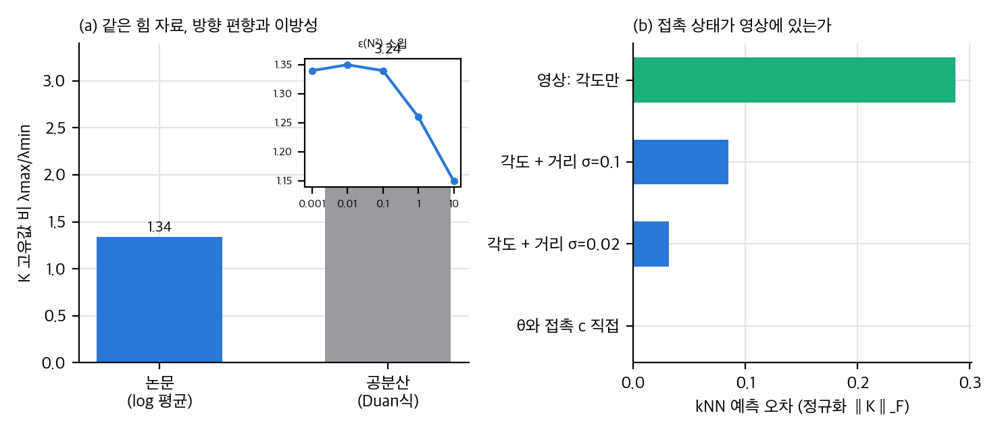
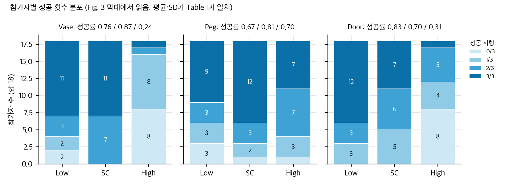
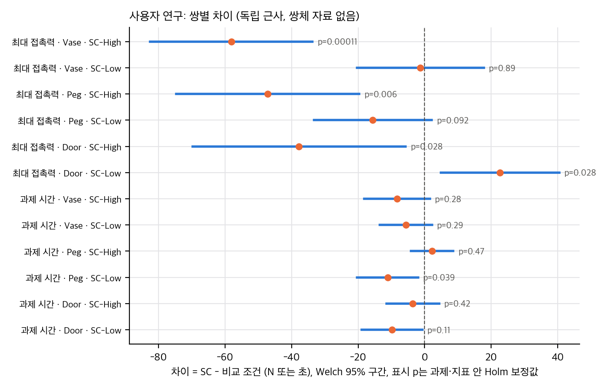
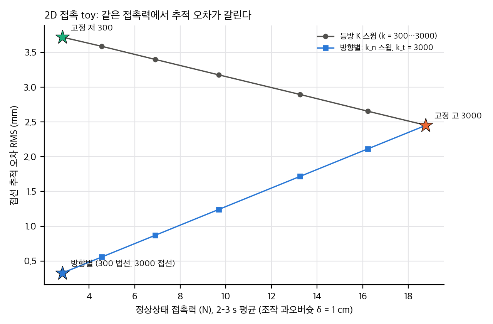

> **논문:** Yeping Wang 외 6명. *Stiffness Copilot: An Impedance Policy for Contact-Rich Teleoperation.* IROS 2026(채택), arXiv:2603.14068 (v2).
> 논문 그림은 라이선스(arXiv 비독점 배포) 때문에 싣지 않았습니다. 그림과 영상은 [프로젝트 페이지](https://stiffness-copilot.github.io)에서 볼 수 있습니다. 이 글의 그래프는 논문 Table I과 Fig. 3에서 읽은 수치와 직접 만든 toy로 그렸습니다. 방법 코드와 가중치는 공개되지 않았습니다.

## 한 줄 요약

사람은 손 자세만 명령하고, 정책은 손목 영상을 보고 방향별 강성 행렬을 고릅니다. 학습 라벨은 시뮬레이션의 접촉력에서 만듭니다. 사용자 연구의 "저강성만큼 안전하고 고강성만큼 빠르다"는 주장은 과제 세 개 중 두 개에서만 확인됩니다. 나머지 주장은 원자료 없이 검정할 수 없습니다.

## 1. 라벨: 접촉력 방향을 행렬 로그로 모은다

시뮬레이션에서 이웃 상태의 접촉력을 구면 섹터로 나누고, 섹터마다 평균 방향과 95퍼센타일 크기로 대표 힘을 만듭니다. 이 행렬들을 행렬 로그 공간에서 평균한 뒤 지수로 되돌리면 환경 강성의 방향과 크기가 나옵니다. 로봇은 환경이 단단한 방향에서 무르도록 고유값을 뒤집습니다.

- 평균의 닫힌 해를 유도하면 환경 강성의 고유벡터는 "힘 크기의 로그로 가중한 방향 산포"의 고유벡터입니다. 같은 식을 행렬 로그로 계산한 값과 10⁻¹⁴ 안에서 맞았습니다.
- 법선 방향은 로그 평균과 공분산 방식이 모두 0.8–1.2° 안에서 찾습니다. 그러나 고유값 비는 1.34 대 3.24로 방법에 따라 두 배 넘게 다릅니다.
- ε는 두 곳에 쓰이는데 논문에 값이 없습니다. p² ≫ ε인 영역에서는 고유값 비가 ε에 거의 무관합니다.
- 유클리드 평균은 로그 평균보다 행렬식이 약 10배 큽니다. 로그 평균을 쓴 이유는 이 점에서 타당합니다.

## 2. 사용자 연구: 본문 표를 다시 계산하다

Fig. 3의 성공률 막대에서 참가자별 성공 횟수를 읽어 검산했습니다. 아홉 막대 모두 합이 18이고, 평균과 SD가 Table I과 맞았습니다. 원자료가 없어서 쌍체 검정은 재현할 수 없고, 독립 표본 근사로 방향만 확인했습니다.

- **성공률:** 고강성보다 높다는 것은 Vase와 Door에서 확실합니다. Peg에서는 차이가 없습니다. 본문과 일치합니다.
- **최대 접촉력:** 고강성보다 작다는 것은 세 과제 모두 확실합니다.
- **저강성과 비교한 안전:** Vase는 같고 Peg는 더 낮습니다. 그런데 **Door에서는 저강성보다 22.7 N(55%) 큽니다**(독립 p = .014, 논문 그림 3 표기 **). "저강성과 비슷한 안전"이라는 초록 문장은 세 과제 중 두 과제에서만 성립합니다.
- **효율:** 고강성과의 시간 차이를 검정한 결과가 본문에 없습니다. Peg의 차이 구간은 SC가 19% 빠른 쪽부터 39% 느린 쪽까지입니다. 차이가 없다는 것은 같다는 뜻이 아닙니다.

## 3. 접촉 모델: 법선만 맞으면 힘은 저강성, 추적은 고강성

2D 점 로봇이 벽을 δ = 1 cm 과하게 누르는 상황을 만들었습니다. 법선을 정확히 안다고 가정하면, 방향별 강성(법선 300, 접선 3000 N/m)은 저강성과 같은 정상상태 힘(2.8 N)을 내면서 접선 추적 오차를 0.33 mm로 줄입니다(고강성 2.45, 저강성 3.72 mm).

법선이 틀리면 결과가 다릅니다. Schur 보수로 풀면 힘은 법선 강성에 가까운 값으로 거의 그대로이고, 오차는 접선 추적으로 나타납니다. 법선 오차 20°에서 추적 오차는 3 mm, 힘은 11% 증가합니다. 해석식과 시뮬레이션은 마찰을 뺀 조건에서 소수 둘째 자리까지 맞았습니다.

추가 검증에서 추적 2 mm와 피크 20 N을 기준으로 격자 80점을 보니, 두 고정 설계가 모두 기준을 못 넘는데 방향별 강성만 넘는 칸은 법선 오차 0°뿐이었습니다. 15°에서는 과오버슛 1 cm부터 추적 오차가 2 mm를 넘었습니다.

## 4. 식별 가능성: 접촉 상태가 영상에 없으면 라벨이 흐려진다

접촉 여부가 거리에만 달려 있을 때, 영상이 벽 각도만 보여 주면 라벨 예측 오차는 0.29입니다. 거리가 잡음 σ = 0.1로 보이면 0.085, σ = 0.02이면 0.032까지 줄어듭니다. 실제 영상에서 예측 정확도를 보고한 자료는 논문에 없습니다.

## 5. 구현할 수 있는지

- **공식 재현:** 불가능합니다. 방법 코드, 가중치, 시뮬레이터, 시연 데이터가 공개되지 않았습니다. 웹 저장소에는 뷰어와 내보내기 스크립트만 있고 라이선스가 없습니다.
- **수식과 toy:** 이 노트북에서 전부 검증했습니다.
- **정책 학습:** 백본(DINOv3 small)을 동결하고 작은 MLP를 얹는 구조라서 작은 장비로도 학습을 시도할 수 있어 보입니다. 다만 시뮬레이션 데이터가 필요합니다.
- **실물:** 임피던스 제어가 되는 팔, 손목 카메라, 힘 센서, 원격조작 장치가 있어야 합니다.
- **재구현 노력:** 라벨 생성 약 150줄, 정책 헤드 약 50줄, 임피던스 명령 약 50줄입니다. 가장 큰 장벽은 접촉이 있는 시뮬레이션 시연입니다.

## 6. 빠진 정보

- 라벨 하이퍼파라미터(ε, 섹터 수, 이웃 수, 백분위)
- 카메라 프레임에서 기저 프레임으로의 변환
- 세 조건의 회전 강성과 감쇠가 다르다는 점(교란)
- 참가자별 시행 원자료

## 7. 한 줄 평가

촉각 없이 영상만으로 방향별 임피던스를 예측하고, 주관 지표를 크게 올린 공유 제어 아이디어입니다. 라벨 식은 명확하고 검증하기 쉽습니다. 안전과 효율 주장은 실험 범위보다 넓게 쓰였습니다. 원자료가 공개되면 쌍체 검정과 동등성 검정을 다시 할 수 있습니다.

## 자료

- [통합 리포트 PDF](report/report_public.pdf)
- [01. 논문 분석: Stiffness Copilot](analysis/01_paper_analysis.md)
- [02. 선행연구와 관계](analysis/02_prior_work.md)
- [03. 재계산과 유도](analysis/03_analysis.md)
- [04. 주장 검증: 재계산, toy, 구현 가능성](analysis/04_claim_verification.md)
