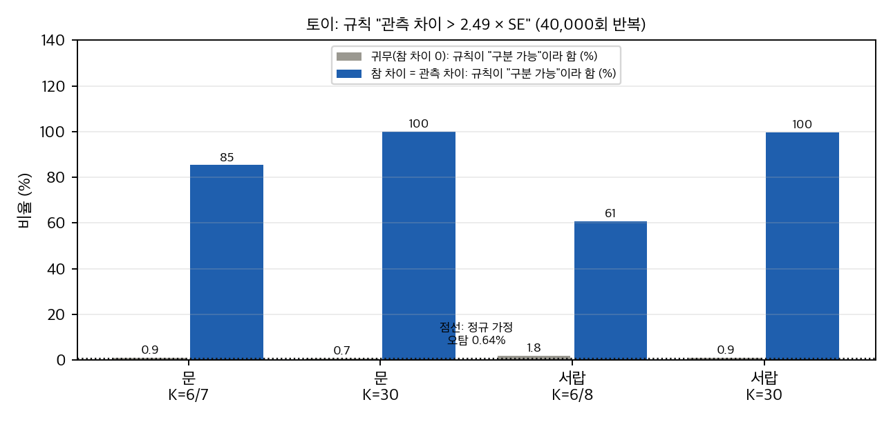
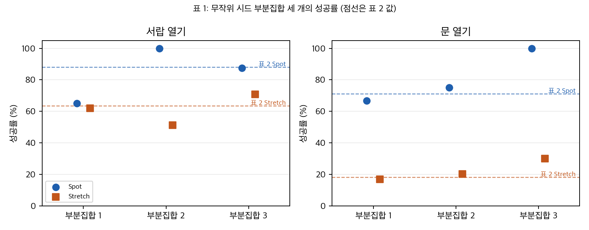
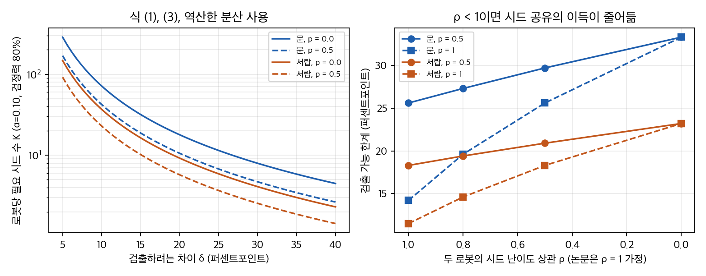

# 03. 수치 재계산, 일관성 검사, 토이

논문(v1)은 시드별 성공률이나 시도 단위 원자료를 싣지 않습니다. 그래서 보고된 값(표 1, 표 2, §5.1의 시도·시드 수, §5.3의 Welch 구간과 자유도)에서 **거꾸로 풀 수 있는 것**만 다시 계산했습니다. 모든 계산은 `analysis/recompute.py`(수 초, 결과 `recompute_results.json`)와 `analysis/toy_rule_check.py`(수 초, `toy_rule_check_results.json`)에 있습니다. 실행하거나 설치한 외부 코드는 없고, 로봇이나 가중치도 쓰지 않았습니다.

## 1. 집계와 정수 검사 (V1, V2)

**V1. 시도 수 합계와 집계 방식.**

- 62 + 130 + 88 + 288 = **568**로 §5.1의 총 시도 수와 맞습니다. Spot 62 + 88 = **150**도 "Spot 약 150회, 한 사람이 사흘"(§5.1)과 맞습니다.
- 표 2의 성공률은 시도 합산 비율이 아닙니다. 네 값 모두 분모(62, 130, 88, 288)에서 4자리로 일치하는 정수 성공 수가 없습니다. 가장 가까운 합산 비율은 문 Spot 44/62 = 0.7097(표 0.7109), 문 Stretch 23/130 = 0.1769(0.1802), 서랍 Spot 77/88 = 0.8750(0.8792), 서랍 Stretch 183/288 = 0.6354(0.6352)입니다. §3.1의 "과제 평균 → 시드 평균" 정의와 맞는 결과이며, 표 2가 시드 평균임을 확인한 것입니다(오류 아님).
- 시드당 시도 수(반올림 전): 문 Spot 10.3, 문 Stretch 18.6, 서랍 Spot 14.7, 서랍 Stretch 36.0. 시드당 과제 수 M_s와 반복 수 J는 논문에 없습니다.

**V2. 표 2 차이값과 z 합.** 문 0.7109 − 0.1802 = 0.5307(표와 일치), 서랍 0.8792 − 0.6352 = 0.2440(표는 0.2439, 반올림 전 값의 차이로 보입니다). z_{0.95} + z_{0.80} = 1.6449 + 0.8416 = **2.4865**로 "≈ 2.49"와 맞습니다.

## 2. 검출 한계와 Welch 구간 (V3, V4)

**V3. 한계값에서 SE를 거꾸로 풀면 본문 Welch 구간이 나옵니다.**

| 과제 | δ_min / 2.4865 = SE | 본문 구간(점)에서 구한 SE (반폭 / t_{0.975,ν}) | 차이 | 재계산 구간 |
|---|---|---|---|---|
| 문 (ν = 10.4) | 0.13392 | 0.13399 | 0.05% | 23.4 – 82.8 (본문과 같음) |
| 서랍 (ν = 12.9) | 0.09330 | 0.09343 | 0.13% | 4.2 – 44.6 (본문과 같음) |

표 2의 검출 한계와 §5.3의 Welch 구간은 **같은 SE에서 나온 것이 맞습니다.** 구간의 중심(53.1, 24.4점)도 차이값과 맞습니다. 이 점에서 표 2의 수치는 서로 일관됩니다.

**V4. 서랍의 Welch 자유도 12.9는 보고된 시드 수로는 불가능합니다.**

- Welch–Satterthwaite 자유도 ν = (a + b)² / (a²/(K₁−1) + b²/(K₂−1))는 코시–슈바르츠 부등식으로 **K₁ + K₂ − 2를 넘을 수 없습니다.**
- 문: K = 6, 7 → 상한 11. 보고 ν = 10.4는 가능합니다. 역산하면 시드 분산은 (Spot 0.036, Stretch 0.084) 또는 (0.062, 0.054) 두 해이고, 둘 다 평균이 주어졌을 때의 상한(Spot 0.247, Stretch 0.172) 아래입니다.
- 서랍: K = 6, 8 → **상한 12 < 보고 ν = 12.9**. §5.1의 시드 수(Spot 6, Stretch 8)로는 12.9가 나올 수 없습니다. 분석 단위가 시드 수와 다른 무엇이거나(예: Spot이 6이 아니라 7시드 이상), 시드 수 또는 ν 표기가 틀렸을 가능성이 있습니다. 어느 쪽인지 원자료 없이는 가릴 수 없습니다. 이 불일치가 구간 폭(4.2–44.6)에 미치는 영향은 작습니다(t_{0.975}: ν = 12.9에서 2.162, ν = 12에서 2.179).

## 3. 판정 규칙과 p값 (V5, V7)

**V5. "관측 차이 > 검출 한계"는 z > 2.49와 같은 말입니다.**

| 과제 | z = 차이/SE | Welch t 양측 p (ν 보고값) | 정규 양측 p | 한계(z 합 2.4865) | 한계(중심 t, t.95 + t.80) | 차이 > 한계(z) | 차이 > 한계(t) |
|---|---|---|---|---|---|---|---|
| 문 | 3.96 | 0.0025 | 0.0001 | 0.333 | 0.359 | 예 | 예 |
| 서랍 | 2.61 | 0.0215 | 0.0089 | 0.232 | 0.2465 | 예 | **아니오** (차이 0.2439) |

- 규칙 "차이 > 2.49·SE"는 정규 근사에서 양측 p < 0.0129(한쪽 0.64%)를 요구합니다. 그래서 α = 0.10으로 시작했지만 실제 판정은 훨씬 엄격한 기준과 같습니다. 반대로 관측된 차이로 "검정력"을 말하는 것은 사후 검정력 논의에 해당합니다. 관측 z 하나의 함수라 새 정보가 없고 서랍의 "관측 검정력"은 0.83일 뿐입니다.
- 시드 수가 6–8개일 때 정규 분위수는 낙관적입니다. ν ≈ 10–13의 t 분위수를 쓰면 한계가 8% 정도 늘어나고(문 0.359, 서랍 0.2465), **서랍은 관측 차이 0.2439가 한계 0.2465 아래로 내려가 "distinguishable"이 사라집니다.** 서랍의 Welch 양측 p는 0.0215이고 95% 구간도 0을 포함하지 않으므로 "차이가 있다"는 결론 자체가 뒤집히는 것은 아닙니다. 논문이 쓴 "구분 가능" 판정 규칙이 경계에 있다는 뜻입니다(저자도 "경계 근처"라고 씀).

**V7. 시도 단위 검정은 시드 군집을 무시해 증거를 크게 부풀립니다.** 표 2 비율에서 반올림한 성공 수(문 44/62 대 23/130, 서랍 77/88 대 183/288)를 Fisher 검정하면 문 p = 9e-13, 서랍 p = 1e-5입니다. 시드 단위 Welch는 문 0.0025, 서랍 0.0215로 각각 약 10⁹배, 10³배 큽니다(`recompute_results.json` V7). 논문의 시드 단위 틀이 필요한 이유를 보여 주는 수치이며, 정수 성공 수는 근사입니다.

## 4. 표 1 부분집합 (V8)

- **범위(최대 − 최소).** Spot: 서랍 35.0점(65.0–100.0), 문 33.3점(66.7–100.0). Stretch: 서랍 19.4점, 문 13.2점. "Spot에서 변동이 크다"(§5.2)는 이 범위 비교와 맞습니다. 다만 부분집합 개수가 3개, 크기와 겹침은 미기재입니다.
- **순위 뒤집힘.** 표 1에서 Spot 부분집합 i와 Stretch 부분집합 j를 짝지은 9쌍 중, 서랍은 (Spot 1 = 65.0) < (Stretch 3 = 70.7)의 **1쌍**뿐이고 문은 **0쌍**입니다. 논문이 든 예가 바로 그 1쌍입니다(§5.2). "순위가 뒤집힐 수 있다"는 맞지만 사후에 고른 극단 쌍입니다. 로봇 사이에 독립 시드를 쓰는 설계에서는 이런 짝이 실제로 가능합니다.
- **표 2와의 관계.** 세 부분집합의 평균(서랍 Spot 84.2, Stretch 61.3, 문 Spot 80.6, Stretch 22.3)은 표 2의 값(87.9, 63.5, 71.1, 18.0)과 다릅니다. 세 부분집합이 시드를 나눠 가졌다면 같아야 하므로 부분집합이 겹치거나 크기가 다르거나 표 2가 다른 시드 집합일 수 있습니다. "same seeds" 행(서랍 92.7/58.1, 문 86.3/12.8)과 표 2의 관계도 적혀 있지 않습니다. 정의 불명으로 남깁니다(오류로 단정하지 않음).

## 5. 필요 시드 수와 분산 추정의 불확실성 (V9, V10)

**V9. 역산한 분산으로 식 (1)과 (3)을 계획표로 만들면**(두 로봇의 시드 분산이 같다는 §3.3의 가정, V6의 시도 잡음 비율 사용, ρ = 1):

| 과제 | 한 시드 점수의 분산 V | σ²_seed | B/J | δ = 0.30 | 0.20 | 0.10 | 0.05 |
|---|---|---|---|---|---|---|---|
| 문 (p = 0) | 0.0579 | 0.0474 | 0.0105 | 8 | 18 | 72 | 287 |
| 문 (p = 0.5) | | | | 5 | 11 | 43 | 170 |
| 서랍 (p = 0) | 0.0298 | 0.0225 | 0.0073 | 5 | 10 | 37 | 148 |
| 서랍 (p = 0.5) | | | | 3 | 6 | 23 | 92 |

(로봇당 필요 시드 수, α = 0.10, 검정력 80%. α = 0.05이면 약 1.27배.) 문에서 δ = 0.10을 독립 시드로 가르려면 로봇당 시드 72개가 필요하고 시드당 시도가 10–19회이면 로봇당 약 700–1,400회입니다. 이번 연구의 총 568회와 비교됩니다. 이 표는 논문 값에서 우리가 가정을 얹어 만든 계획용 추정이며, 아래 V10 때문에 오차가 큽니다.

**V10. 시드 6–8개로 추정한 분산은 불안정합니다.** 표본 분산의 95% 구간(카이제곱)은 K = 6이면 0.39–6.02배, K = 7이면 0.42–4.85배, K = 8이면 0.44–4.14배이고 K = 30에서도 0.63–1.81배입니다. 식 (1)의 K는 V에 비례하므로 파일럿(§3.3 끝)에서 얻은 계획값은 이만큼 흔들립니다. 논문도 "계획 추정이지 정확한 요구량이 아니다"라고 쓰지만 폭은 적지 않았습니다.

**설정 공간.** 3×4 격자에서 빈 위치 6개 선택은 C(12,6) = 924가지이고, 채운 6칸이 문 또는 서랍이라는 기능 구분만 보면 924 × 2⁶ = 59,136가지입니다(삽입물 82종까지 세면 훨씬 큼). "시드를 외워서 과적합할 수 없다"는 주장(§1)에는 기능 수준에서 6만 개 정도의 배치가 상한이라는 점이 필요한 맥락이지만, 정책이 일반 문·서랍 조작을 배우면 되는 규모라 과적합 방지 효과가 얼마나 큰지는 별개의 문제입니다(우리 추정).

## 6. 혼합 설계 (V6)

**유도.** 공유 시드 pK개에서는 쌍별 차이의 분산이 2B/J, 나머지 (1−p)K개에서는 두 독립 추정의 합 2(σ² + B/J)이므로

Var(Δ̂) = (1/K²)[pK·2B/J + (1−p)K·2(σ² + B/J)] = (2/K)[(1−p)σ² + B/J].

부록 C가 "덧셈 근사"라고 부르는 식 (2)는 논문의 쌍체 모형(시드 난이도 효과가 두 로봇에 같음, ρ = 1, 두 로봇의 σ²가 같음) 아래에서 **정확히** 성립합니다. ρ < 1이면 공유 시드의 쌍별 차이 분산이 2σ²(1−ρ) + 2B/J가 되어

Var(Δ̂) = (2/K)[(1 − pρ)σ² + B/J].

**표 2 오른쪽 열에서 시도 잡음 비율을 거꾸로 풀면.** 한계는 √분산에 비례하므로 (m_{0.5}/m₀)² = ((1−p)σ² + B/J)/(σ² + B/J), p = 0.5. 문은 (0.256/0.333)² = 0.591 → B/J : σ² = 0.223, 시도 잡음이 V의 **18%**. 서랍은 (0.183/0.232)² = 0.622 → 0.323, **24%**입니다. 시드당 시도를 독립인 한 번씩으로 본다는 단순한 이항 잡음 추정(p(1−p)/n_seed의 두 로봇 평균: 문 0.0139, 서랍 0.0068)을 V(같은 분산 가정: 0.0579, 0.0298)로 나눈 값은 각각 24%, 23%로 대체로 비슷합니다. 즉 오른쪽 열은 식 (2)와 일관되고 추정이 모순되지 않습니다. 원자료와 어떤 시드가 공유였는지가 없어 완전한 재현은 못 합니다.

**두 가지 해석 주의.**

1. 오른쪽 열은 "관측"이 아니라 분산 성분에 식 (2)를 적용한 **계획 값**입니다. 본문 문장 "We observe that this reduces the detectable margin"(§5.3)은 계산 결과를 관측처럼 쓴 것입니다. 이번 실험에서 실제로 몇 시드가 공유였는지는 적혀 있지 않습니다.
2. 식 (2)는 ρ = 1을 가정합니다. 문 한계 25.6점은 ρ = 0.8에서 27.3, ρ = 0.5에서 29.7점(서랍 18.3 → 19.4 → 20.9)입니다. 시드를 완전히 공유하는 p = 1의 한계는 ρ = 1에서 14.2(문)·11.5(서랍)점이지만 ρ = 0.5에서는 25.6·18.3점으로 p = 0.5, ρ = 1과 같아집니다. 서로 다른 몸체는 같은 장면에서 어려워하는 지점이 다를 수 있어(예를 들어 닿는 높이와 자세가 다름, 우리 가설) ρ가 1보다 작을 가능성이 큽니다. **이번 연구에는 같은 시드를 두 로봇이 모두 수행한 데이터("same seeds" 행)가 있으므로 ρ를 추정할 수 있었을 텐데 보고하지 않았습니다.**

## 7. 토이: "관측 차이 > 2.49 × SE" 규칙의 소표본 거동

`analysis/toy_rule_check.py`(numpy, 약 2초, 40,000회). 시드별 참 성공률을 Beta(평균 μ, 분산 σ²_seed)에서 뽑고 시드마다 n_s번 시도해 이항 표본으로 시드 점수를 만듭니다. μ, K, n_s는 논문 값, σ²는 V9의 역산값입니다. 독립 시드, Welch SE입니다.

| 상황 | 문 K=6/7 | 서랍 K=6/8 | 문 K=30 | 서랍 K=30 |
|---|---|---|---|---|
| 귀무(참 차이 0): 규칙이 "구분 가능"이라 함 | 0.93% | 1.82% | 0.69% | 0.86% |
| 귀무: t 분위수 규칙 | 0.47% | 1.25% | 0.62% | 0.81% |
| 귀무: Welch p < 0.05 | 3.2% | 5.0% | 4.9% | 5.1% |
| 참 차이 = 관측 차이: 규칙이 "구분 가능" | 85% | **61%** | 100% | 99.6% |
| 참 차이 = 관측 차이: Welch p < 0.05 | 89% | 67% | 100% | 99.9% |
| 95% 구간 포함 확률(귀무) | 96.8% | 95.0% | 95.1% | 94.9% |

- 정규 가정의 오탐은 한쪽 0.64%입니다. 시드가 적으면 서랍에서 1.8%까지 올라가지만 낮은 값이고, K = 30에서는 가까워집니다. 즉 이 규칙은 **오탐은 작게 억제하고 검출은 놓치는 보수적인 규칙**입니다.
- 참 차이가 관측값과 같을 때도 서랍에서는 "구분 가능"이 61%만 나옵니다(문 85%). 표 2의 "distinguishable"은 한 번의 표본에서 나온 결과이며, 서랍은 같은 실험을 다시 하면 거의 40%는 뒤집힐 수 있는 경계 사례입니다. 저자도 "경계 근처"라고 썼습니다.
- 한계: 시드 분산이 두 로봇에서 같다는 가정, Beta 분포 가정, 시드당 시도 수 고정, 시드 난이도 상관 ρ = 0(독립 시드 설계라 해당 없음). 논문 데이터 재현이 아니라 규칙의 성질을 보는 참고용입니다.

*그래프: 우리가 그림. 토이 규칙 검사의 오탐과 검출 비율(40,000회 반복, 한 시드).*

## 8. 검사 요약

| 번호 | 검사 | 결과 |
|---|---|---|
| V1 | 시도 합 568, Spot 150, 집계 방식 | 일치. 표 2는 시드 평균(시도 합산 아님) |
| V2 | 차이값, z 합 2.49 | 일치 (서랍 0.2440 대 0.2439 반올림) |
| V3 | 한계값 ↔ Welch 구간 | 정확히 일치 (SE 차이 0.05%, 0.13%) |
| V4 | Welch 자유도 상한 K₁ + K₂ − 2 | **서랍 ν = 12.9 > 12 불가**, 문 10.4 ≤ 11 가능 |
| V5 | 한계 규칙과 p값 | 문 p = 0.0025, 서랍 0.0215. 서랍은 t 분위수 한계에서 "구분 가능" 소멸 |
| V6 | 혼합 설계 한계 25.6/18.3에서 시도 잡음 비율 | 18%, 24%. 이항 잡음 추정(24%, 23%)과 대체로 맞음. ρ = 1 가정에 의존 |
| V7 | 시도 단위 대 시드 단위 검정 | 시도 단위 Fisher p가 10⁹배(문), 10³배(서랍) 작음. 군집 무시 시 과장 |
| V8 | 표 1 순위 뒤집힘 | 9쌍 중 서랍 1쌍, 문 0쌍. 부분집합의 정의 불명, 평균이 표 2와 다름 |
| V9 | 필요 시드 수 | 문 δ = 0.10: 72(p = 0), 43(p = 0.5). 서랍 37, 23 (추정) |
| V10 | 분산 추정 불확실성 | K = 6이면 0.39–6.0배, 계획 K가 같은 비율로 흔들림 |

그림: 아래는 표 1과 계획 곡선입니다.

*그래프: 우리가 그림. 표 1의 값을 다시 그렸습니다. 점선은 표 2 값.*

*그래프: 우리가 그림. 왼쪽은 식 (1), (3)에 V9의 역산 분산을 넣은 필요 시드 수, 오른쪽은 시드 난이도 상관 ρ에 따른 검출 한계(V6).*
