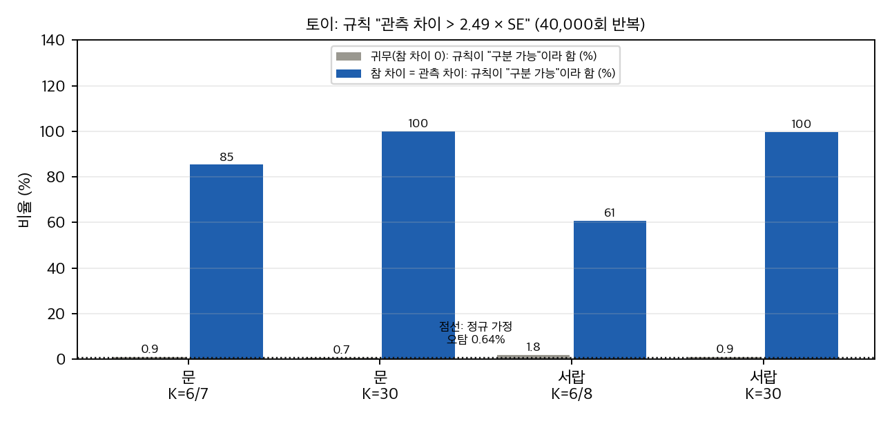
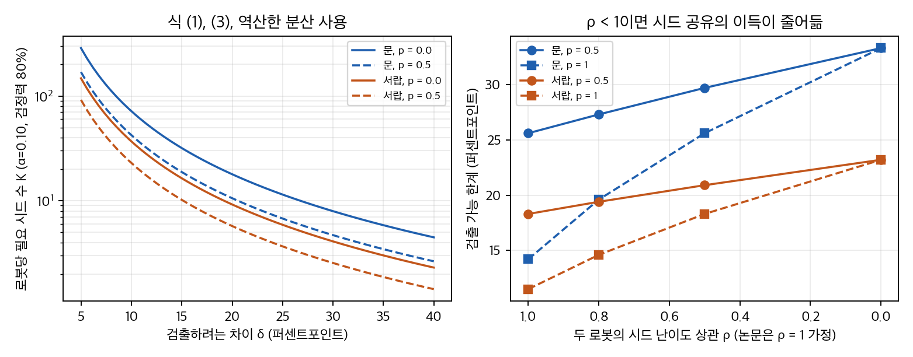
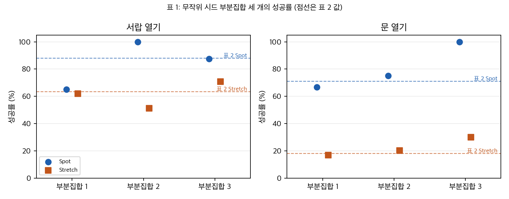

> **논문:** Elias Gläßer, Gülhan Şikaroğlu, Pavlo Kupyn, Marc Pollefeys, Zuria Bauer, Hermann Blum. *Benchmarking Real-World Robotic Manipulation through Stochastic Challenges.* CoRL 2026 포스터, arXiv:2611.12804 (v1, 2026-11-09).
> 벤치마크 생성기와 서버는 공개되어 있지 않고, 프로젝트 페이지 저장소는 정적 사이트입니다. 이 글의 그림은 논문 그림 1(출처 표기)과 우리가 그린 그래프입니다.

## 논문이 묻는 것

실물 조작 벤치마크는 같은 물체와 같은 배치를 반복해서 비교 가능성을 얻습니다. 그러면 평가 장면이 미리 알려져 과적합하기 쉽습니다. 이 논문은 장면 집합이 아니라 **장면을 뽑는 분포**를 표준화합니다. 시드 하나가 선반 배치 하나를 정하고, 어느 연구실이든 시드로 장면을 다시 지어 자기 로봇으로 시도합니다. 같은 분포에서 뽑았다면 로봇과 소프트웨어가 달라도 성공률을 통계적으로 비교할 수 있다는 것이 가설입니다.

통계 틀의 핵심은 분산 분해입니다. 한 시드의 점수 분산은 시드 간 난이도 차이 σ²_seed와 시도 잡음 B/J의 합이고, 시도를 아무리 늘려도 σ²_seed/K는 줄지 않습니다. 두 로봇을 독립 시드로 비교하면 필요한 시드 수는 K ≥ 2(z+z)²(σ² + B/J)/δ²이고, 시드의 일부(비율 p)를 공유하면 σ² 항이 (1−p)배가 됩니다. 실험은 IKEA KALLAX 선반에서 Hello Robot Stretch 3와 Boston Dynamics Spot을 서로 다른 두 연구실에서 돌려 문 열기와 서랍 열기를 비교합니다(568회, 시드 6–8개).

## 이 글에서 확인한 것

**1. 표 2의 수치는 서로 정확히 맞습니다.** 검출 한계를 2.4865(α = 0.10, 검정력 80%의 z 합)로 나누어 표준오차를 구하고 Welch 구간을 다시 만들면 문 23.4–82.8점, 서랍 4.2–44.6점으로 본문과 같습니다. 성공률은 시도 합산이 아니라 시드 평균이라 분모에서 나오는 정수 비율과 맞지 않는 것이 정상입니다. 시도 합계 568회와 Spot 150회도 맞습니다.

**2. 서랍의 Welch 자유도 12.9는 보고된 시드 수로는 만들 수 없습니다.** Welch–Satterthwaite 자유도는 두 표본의 시드 수 K₁ + K₂ − 2를 넘을 수 없습니다. 서랍은 Spot 6시드, Stretch 8시드라 상한이 12입니다. 문(ν = 10.4, 상한 11)은 가능합니다. 시드 수 표기나 분석 단위가 다른 것으로 보이지만 원자료가 없어 어느 쪽인지 가릴 수 없습니다.

**3. 서랍의 "구분 가능"은 경계 사례입니다.** 문은 Welch p = 0.0025로 분명합니다. 서랍은 p = 0.0215이고, "관측 차이 > 2.49 × SE"라는 판정 규칙은 정규 분위수를 씁니다. 시드가 6–8개일 때 t 분위수를 쓰면 한계가 0.232에서 0.2465로 올라가 관측 차이 0.2439가 그 아래로 내려갑니다. 같은 규칙으로 몬테카를로를 돌리면 참 차이가 관측값과 같을 때 "구분 가능"이 나오는 비율이 서랍 61%, 문 85%입니다. 오탐은 한쪽 0.9–1.8%로 작아 규칙은 보수적입니다. 저자도 서랍을 "결정 경계 근처"라고 적었습니다.

*그래프 (우리가 그림). 시드별 난이도를 Beta 분포로 가정한 토이(40,000회 반복, 한 시드). 시드 수 6–8개와 30개, 귀무와 관측 차이 두 경우의 비율입니다.*

**4. 시드 공유의 이득은 두 로봇의 시드 난이도가 같다는 가정에 기댑니다.** 식 (2)의 (1−p) 인수는 두 로봇의 시드 난이도 효과가 완전히 같다(상관 ρ = 1)는 모형에서만 정확합니다. ρ가 1보다 작으면 인수가 (1−pρ)가 됩니다. 표 2 오른쪽 열(p = 0.5)의 문 한계 25.6점은 ρ = 0.8에서 27.3, ρ = 0.5에서 29.7점입니다. 같은 시드를 두 로봇이 모두 수행한 데이터가 있어 ρ를 추정할 수 있지만 논문에는 그 값이 없습니다. 또 본문의 "관측한다"는 문장과 달리 오른쪽 열은 분산 성분에 식을 적용한 계획 값입니다.

*그래프 (우리가 그림). 왼쪽은 역산한 분산으로 만든 필요 시드 수(α = 0.10, 검정력 80%), 오른쪽은 ρ에 따른 검출 한계입니다.*

**5. 시도 단위로 합쳐 검정하면 증거가 크게 부풀려집니다.** 표 2 비율에서 반올림한 성공 수로 Fisher 검정을 하면 문은 p = 9e-13이고, 시드 단위 Welch는 0.0025입니다. 시드 군집을 무시하면 서랍에서도 10³배 차이가 납니다. 논문의 시드 단위 틀이 필요한 이유를 보여 줍니다.

**6. 시드 6개로 추정한 분산은 불안정합니다.** 표본 분산의 95% 구간은 0.39–6.0배입니다. 필요 시드 수는 분산에 비례하므로 계획 값도 같은 비율로 흔들립니다. 역산한 분산으로는 문에서 10점 차이를 독립 시드로 가르려면 로봇당 시드 약 72개(p = 0.5이면 43개)가 필요합니다. 이번 연구의 총 568회와 비교되는 규모입니다.

**7. 표 1의 순위 뒤집힘 예는 9쌍 중 1쌍입니다.** 서랍에서 Spot 부분집합 1(65.0%)이 Stretch 부분집합 3(70.7%)보다 낮은 쌍이 논문의 예이고, 나머지 8쌍과 문의 9쌍에는 뒤집힘이 없습니다. 부분집합의 크기와 겹침, 표 2와의 관계는 적혀 있지 않습니다.

*그래프 (우리가 그림). 표 1의 값을 다시 그렸습니다. 점선은 표 2의 값입니다.*

**8. 논문과 프로젝트 페이지가 다르고, 부록의 모형 결과가 없습니다.** 빈칸 규칙은 논문이 "빈 위치 6개를 비복원으로 고른다", 프로젝트 페이지와 웹 앱(요청 변수 `empty_probability`)은 "각 위치를 확률 0.5로 비운다"입니다. 빈칸 수의 분산이 0인지 이항 분포인지가 다릅니다. 부록 D는 로지스틱 혼합효과 모형을 적합했다고 쓰지만 결과가 어디에도 없습니다. 논문이 제시한 세 질문 중 첫째(다른 연구실이 시드 구성을 다시 지을 수 있는가)는 측정하지 않았습니다.

## 구현할 수 있는가

통계 틀(필요 시드 수 계산, 시드 공유 설계의 ρ 민감도, 소표본 규칙)은 일반 노트북의 CPU에서 구현하고 시험할 수 있습니다. 이 글의 재계산과 토이가 그 일부입니다. 논문의 실험(두 로봇, 두 연구실, 568회)은 로봇과 사전 스캔, 평가 스택, 외부 LLM API가 필요해 재현할 수 없습니다. 벤치마크 생성기와 서버는 비공개라 재구현해야 하며, 삽입물 82종 목록이 없어 축소판이 됩니다.

## 한계와 남은 질문

원자료(시드별 성공)와 공유 시드 목록이 없어 서랍 자유도 불일치의 원인, ρ, 표 1 부분집합의 정의를 가리지 못했습니다. 시도 잡음 비율은 표 2 오른쪽 열에서 역산했고 이항 잡음 추정과 대체로 맞았지만 완전한 재현은 아닙니다. 웹 앱은 클라이언트 번들만 정적으로 읽었고 서버가 시드를 어떻게 고르고 저장하는지는 확인하지 못했습니다.

## 자료

- 재계산과 토이: `analysis/recompute.py`, `analysis/toy_rule_check.py`
- 분석 문서: 01 논문 분석, 02 선행연구와 코드 표, 03 재계산과 토이, 04 주장 검증
- 라이선스: 논문은 arXiv에서 CC BY 4.0이며, 그림은 그림 1 삽화 한 장만 출처와 함께 실었습니다.

## 자료

- [통합 리포트 PDF](report/report_public.pdf)
- [01. 논문 분석: Benchmarking Real-World Robotic Manipulation through Stochastic Challenges (arXiv:2611.12804)](analysis/01_paper_analysis.md)
- [02. 선행연구와 관련 자료](analysis/02_prior_work.md)
- [03. 수치 재계산, 일관성 검사, 토이](analysis/03_analysis.md)
- [04. 주장 검증 (공식 코드 없음)](analysis/04_claim_verification.md)
