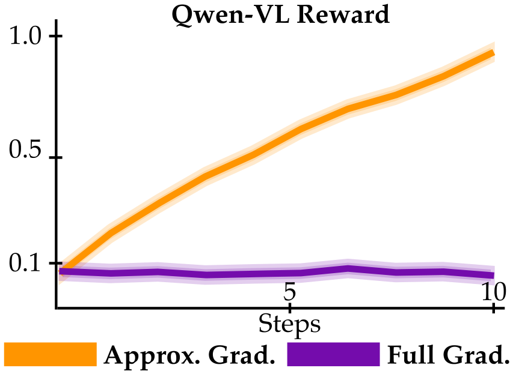
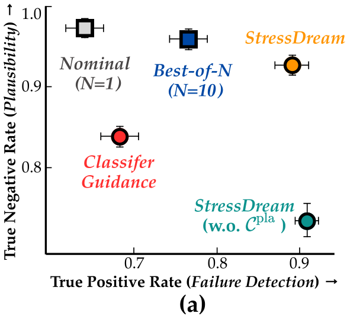
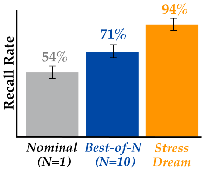
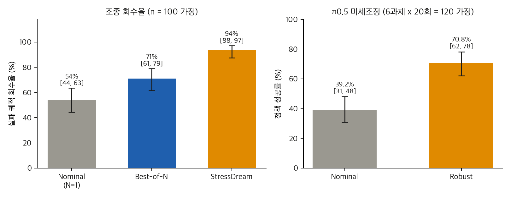
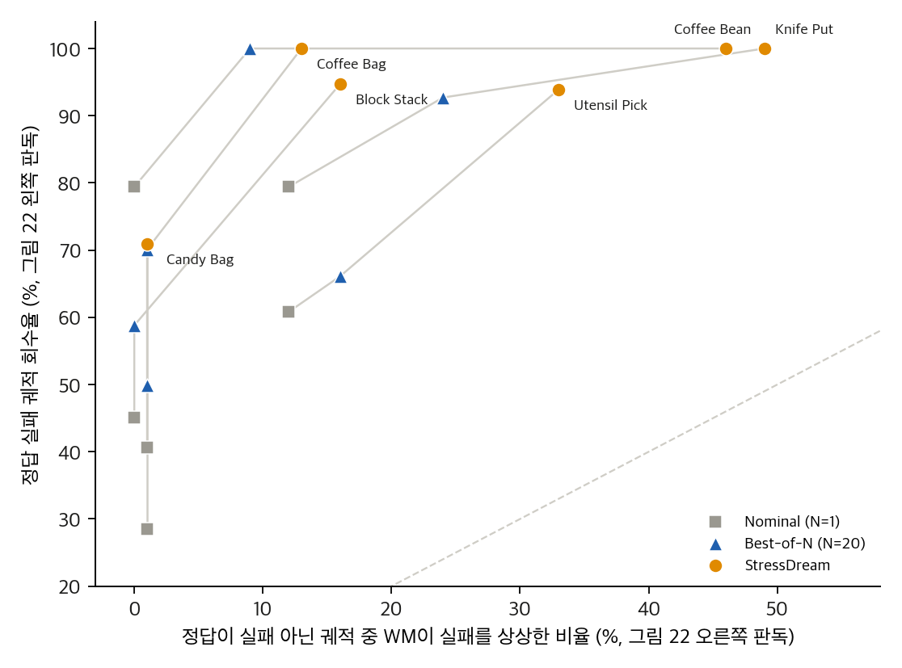
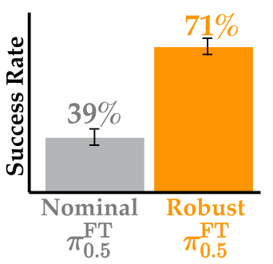
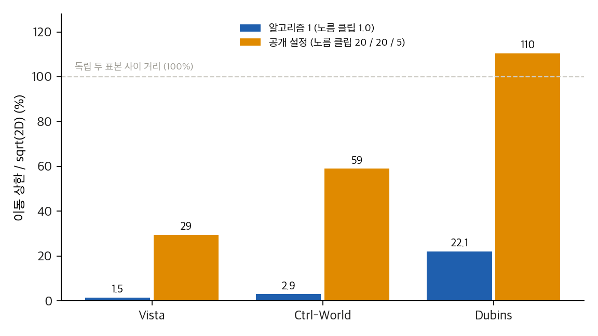
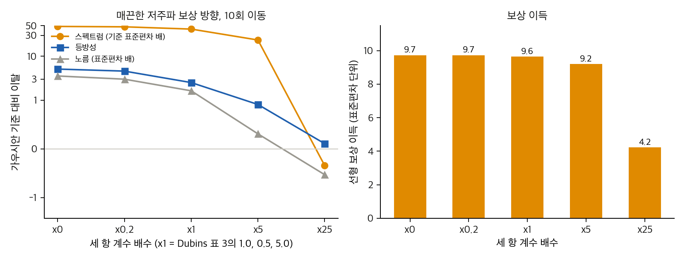

> **논문:** Junwon Seo, Sushant Veer, Ran Tian, Wenhao Ding, Apoorva Sharma, Karen Leung, Edward Schmerling, Marco Pavone, Andrea Bajcsy. *StressDream: Steering Video World Models for Robust Policy Evaluation and Improvement.* CoRL 2026 포스터, arXiv:2606.00267 (v2, 2026-10-06).
> 공식 코드는 GitHub CMU-IntentLab/StressDream(MIT)에 있습니다. 이 글의 논문 그림 네 장은 CC BY 4.0이며 출처를 적었고, 나머지 그래프는 직접 그렸습니다. "그림 판독 값"은 그림을 렌더링해 읽은 값(오차 약 ±1 %p)이고, 논문에 없는 시행 수는 가정이라고 문장에 적었습니다.

## 논문이 묻는 것

행동 조건부 영상 세계모델은 같은 행동에서도 여러 미래를 만들 수 있습니다. 그런데 정책 평가와 개선에는 보통 한두 개의 공칭 상상만 씁니다. StressDream은 확산 모델의 **초기 잡음을 기울기로 최적화**해 "커피콩이 쏟아진다" 같은 글로 지정한 사건 쪽으로 상상을 이동시킵니다. 목적은 두 가지입니다. VLM의 yes/no 로그 확률 차이를 보상으로 쓰는 의미 목적, 그리고 잡음이 가우시안의 타이피컬 셋(노름, 블록 등방성, 스펙트럼 백색성)을 벗어나지 않게 하는 목적입니다. 반복 확산 전체를 역전파하지 않고 생성 결과의 기울기를 잡음 기울기의 스칼라 배로 근사합니다.

*그림 14 (논문 원문, Ctrl-World). © 저자, CC BY 4.0, 출처 arXiv:2606.00267.*

## 이 글에서 확인한 것

**1. 실패 회수율 54% → 94%는 분명하지만, 함께 읽을 값이 있습니다.**

*그림 2(a) (논문 원문, Dubins 실험, 패널 (b) 제외). © 저자, CC BY 4.0, 출처 arXiv:2606.00267.*

*그림 5 (논문 원문). © 저자, CC BY 4.0, 출처 arXiv:2606.00267.*

실패 궤적 100개(시행 수 n = 100 가정)에서 94%의 Wilson 95% 구간은 [87.5, 97.2]이고, Nominal 54%와의 Fisher p = 5e-11입니다. 부록 그림 22의 오른쪽 패널은 정답이 실패가 아닌 궤적 중 세계모델이 실패를 상상한 비율을 보여 줍니다. 그림 판독 값으로 StressDream의 이 비율은 과제 평균 26%(Nominal 4%, Best-of-N 9%)입니다. 논문은 이 값을 엄밀한 거짓 양성 비율로 읽지 말라고 적고, 위험했지만 우연히 성공한 시연일 수 있다는 해석을 듭니다. 이 해석은 가능하지만 이 데이터로 검증되지는 않습니다. 회수율에서 이 비율을 뺀 값의 과제 평균은 Nominal 0.51, Best-of-N 0.65, StressDream 0.67이고, Knife Put과 Coffee Bean에서는 Best-of-N이 더 높습니다.

*직접 그린 그래프. 그림 5와 그림 8의 값을 시행 수 가정(100, 120)으로 다시 그렸습니다.*

*직접 그린 그래프. 그림 22의 과제별 값(그림 판독 값). 회색 선은 같은 과제의 세 방법입니다.*

**2. 정책 성공률 39% → 71%는 방향이 일관되고, 비교군은 하나입니다.**

*그림 8 (논문 원문). © 저자, CC BY 4.0, 출처 arXiv:2606.00267.*

과제당 20회, 6과제(분모 120 가정)이면 39%와 71%는 47/120과 85/120으로만 읽힙니다. Fisher p = 1.3e-6이고 6과제 모두 Robust가 높습니다. 다만 비교군은 모든 시연에 1.0을 주는 균일 가중 하나입니다. 같은 비율을 무작위로 0.1로 내리거나 공칭 세계모델로 가중하는 대조가 있으면 조종 자체의 몫을 더 분명히 말할 수 있습니다. 그림 26의 막대 12개 중 3개는 과제당 20회가 만드는 5 %p 격자에서 1.4–2.2 %p 벗어나 있어, 과제별 시행 수가 모두 20인지 저자 확인이 필요합니다.

**3. 타이피컬 셋 통계는 한 방향의 큰 이동에 둔감합니다.** 알고리즘 1이 허용하는 이동 상한은 반복 수 x 노름 클립이고, Vista 설정(반복 20)에서 이동 20이 노름을 √(D+20²) − √D = 0.21, 즉 표준편차(0.707)의 0.29배만 바꿉니다. 로그밀도는 200 nat 줄지만 그 표준편차가 679 nat이라 역시 0.29배입니다. 같은 이동이 보상 방향으로는 20 표준편차입니다.

*직접 그린 그래프. 반복 수 x 노름 클립으로 계산한 상한이며 실측 이동이 아닙니다. 공개 코드 설정은 노름 클립이 20, 20, 5라서 상한이 29%, 59%, 110%입니다.*

D = 1,024짜리 토이(선형 보상, 논문 4.2절 식, 스펙트럼 구간 수 8 가정)에서도 같은 경향이 보입니다. 보상 방향이 매끈한 저주파일 때 Dubins 표 3 계수(x1)로는 스펙트럼 통계가 가우시안 기준의 약 30배(0.642)에서 0.561로만 내려가고, 기준 근처(0.016)로 돌리려면 계수를 25배로 올려야 했으며 그때 보상 이득이 9.7에서 4.2로 줄었습니다.

*직접 그린 그래프. 토이 T1의 결과이며 VLM 보상이나 실제 세계모델과 무관합니다.*

**4. 공개 코드는 논문 서술과 설정이 다릅니다.** 이 부분은 정적 읽기만 했고 코드를 실행하지 않았습니다. Dubins 설정은 모멘텀 0.9(논문 부록 B.5는 모멘텀 없음)이고, 등방성 Gram 항 계수가 0.0이라 표 3의 λ2 = 0.5는 표준편차 항에 해당합니다. Vista의 기본 보상은 X-CLIP 확률이고 Qwen은 선택 옵션입니다. 기울기 노름 클립은 알고리즘 1의 1.0 대신 20(Vista, Ctrl-World)과 5(Dubins)입니다. 표 5와 6의 λ2가 코드의 서로 다른 계수에 대응하고, 표에 없는 계수(kl_coeff = 10)가 스펙트럼 항에 곱해집니다.

**5. 평가와 기준선 코드, 드라이빙 미세조정 가중치는 저장소에 없습니다.** Best-of-N, Classifier Guidance, 회수율·TPR/TNR 평가, 표 4의 밀도 대리 모델, π0.5 가중 미세조정이 없어 그림 2, 4, 5, 6, 8을 저장소로 재현하는 경로가 없습니다. 허브에는 Ctrl-World 과제별 체크포인트 여섯 개(각 9.28 GB)가 있습니다.

**6. 표기 몇 곳은 확인이 필요합니다.** Best-of-N의 N이 그림 5에서는 10, 그림 21과 22에서는 20, 그림 23에서는 40개 대 20단계입니다. 전체 기울기를 쓰는 Dubins에서 표 1의 비용 식으로는 조종 10회가 Best-of-N 약 20회분의 계산량입니다. 평가용 실패 궤적 100개가 표 7의 세계모델 미세조정 궤적(합 1,040, 평균 173, 본문은 "약 150")과 분리되었는지, 오차 막대가 무엇인지는 논문에 적혀 있지 않습니다.

## 한계와 읽는 법

논문 스스로 적은 한계(프롬프트 품질 의존, 보상 해킹, 그럴듯함이 세계모델 분포로 한정, 분포 밖 사건은 상상 불가)는 그대로 유효합니다. 이 글의 수치는 시행 수 가정과 그림 판독 값에 기대므로, 과제별 개수와 오차 막대의 정의에 대한 저자 확인이 필요합니다. 공식 코드는 실행하지 않았고 가중치와 데이터는 받지 않았습니다. 논문 v1(2026-05-29)과 v2는 수치가 같고 URL, 코드 링크 문장, 각주, 참고문헌이 달라졌습니다.

분석 문서, 재계산 스크립트와 결과는 함께 올린 자료(`analysis/`)에 있습니다.

## 자료

- [통합 리포트 PDF](report/report_public.pdf)
- [01. 논문 분석: StressDream (arXiv:2606.00267 v2)](analysis/01_paper_analysis.md)
- [02. 선행연구와 관련 저장소](analysis/02_prior_work.md)
- [03. 수치 재계산, 일관성 검사, 토이](analysis/03_analysis.md)
- [04. 공식 코드 대조와 구현 가능성](analysis/04_code_verification.md)
