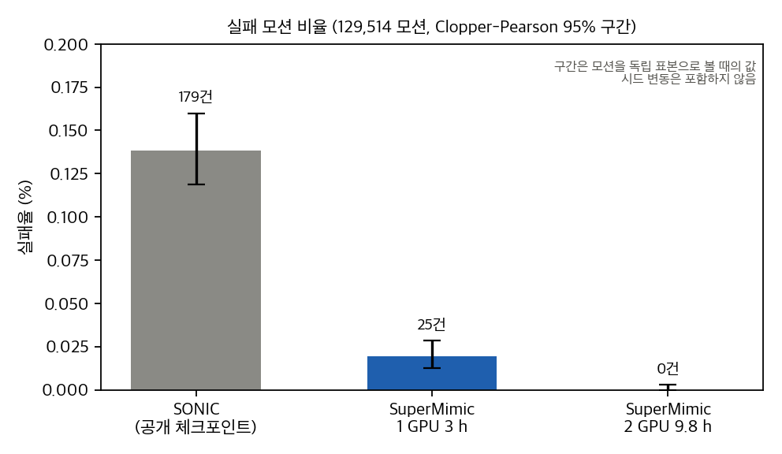
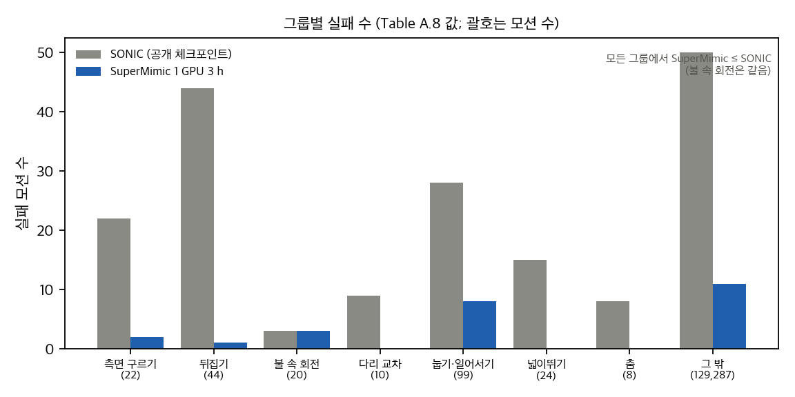
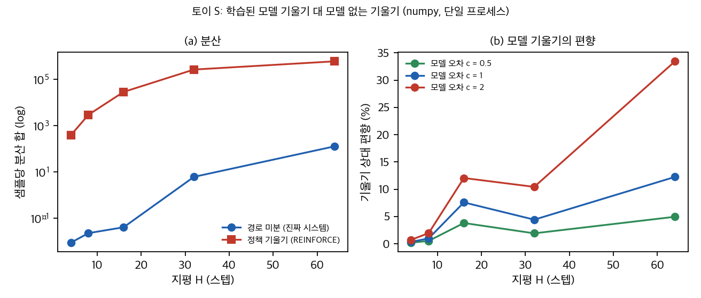
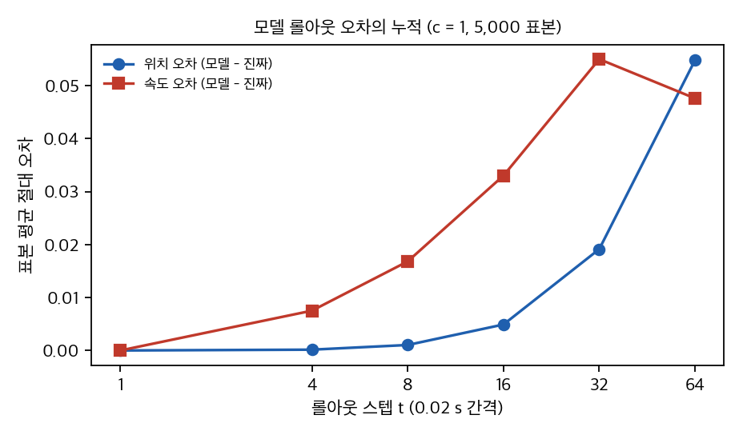

> **논문:** Qiayuan Liao, Yiyang Shao, Junfeng Long, Kevin Zakka, Roberto Horowitz, Pieter Abbeel, Koushil Sreenath. *SuperMimic: Scaling Humanoid Whole-Body Control with One Differentiable World Model.* CoRL 2026 구두 발표, arXiv:2610.28480 (v2, 2026-11-09).
> 공식 코드는 `HybridRobotics/supermimic`(Apache-2.0)입니다. 이 글은 코드를 정적으로만 읽었고 실행하지 않았습니다. 논문 배포 라이선스는 arXiv 비독점이라 논문 그림은 싣지 않고, 우리가 만든 그래프만 씁니다.

---

## 논문이 묻는 것

휴머노이드 전신 제어는 많은 사람 모션을 추적하는 방향으로 가고 있습니다. 그런데 모션 수가 늘수록 모델 없는 강화학습(PPO)의 계산량도 늘어납니다. 대표 추적기 SONIC은 128개 GPU로 7일(약 21,000 GPU-h)을 씁니다.

SuperMimic의 질문은 이렇습니다. 모든 모션이 같은 몸의 물리를 따른다면, 그 물리를 학습한 미분 가능 모델 하나로 정책을 미분할 수 있지 않을까요? 이 글은 그 질문에 대한 답과 그 답의 근거가 얼마나 단단한지 봅니다.

## 방법: 한 루프에서 세 단계

1. 현재 정책이 시뮬레이터에서 전이를 모아 버퍼에 넣습니다.
2. 같은 버퍼의 짧은 창(k = 8 스텝)으로 world model을 맞춥니다.
3. 고정된 world model 위에서 H = 32 스텝의 상상 롤아웃을 만들고, 반환을 정책에 BPTT로 역전파합니다. 32 스텝을 넘는 반환은 비평가가 맡습니다.

PPO가 시뮬레이터 롤아웃의 우도비로 기울기를 추정하는 것과 달리, 이 방법은 모델의 자코비안으로 반환을 직접 미분합니다. 논문은 이 덕분에 기울기 분산이 작다고 주장합니다.

## 숫자를 다시 계산해 보았습니다

| 항목 | 논문 값 | 재계산 |
|---|---|---|
| 벽시계 비율 | 50배 이상 | 168 h / 3 h = 56배 |
| GPU-h 비율 | 1000배 이상 | 21,504 / 3 = 7,168배 |
| H100 대 L40 보정, 가장 유리한 가정 | (없음) | 그래도 1,300배 이상 |
| 실패 모션 | 25 대 179 (129,514개) | 0.019% 대 0.138% |
| 실패 차이의 유의성 | (없음) | Fisher p ≈ 7×10⁻³⁰ (독립 가정). 쌍체 정보가 없어도 McNemar 정확 p는 10⁻²⁹ 아래 |
| 표 A.7, A.8 합계 | 본문과 일치 | 일치 |

그래프: Table A.8의 실패 수를 129,514 모션으로 나눈 비율과 Clopper-Pearson 95% 구간. 구간은 모션을 독립 표본으로 볼 때의 값이며 시드 변동은 포함하지 않습니다. 우리가 그린 그래프입니다.

그래프: 그룹별 실패 수(Table A.8 값). SuperMimic 1 GPU 3시간은 모든 그룹에서 SONIC보다 적거나 같습니다. 우리가 그린 그래프입니다.

몇 가지는 조심해서 읽어야 합니다.

- **기준선 비용은 측정값이 아니라 SONIC 보고값입니다.** 다른 GPU(L40)와 다른 데이터(611 h 대 264.56 h)로 얻은 값입니다.
- **시드가 1개입니다.** 본문은 "여러 시드를 돌렸다"고 하지만 그림에는 변동이 없고, 속도 실험은 "정책당 시드 1개"라고 적혀 있습니다.
- **평가 규칙이 SONIC 자체 규칙과 다릅니다.** SuperMimic의 학습 종료 규칙으로 두 정책을 모두 판정했습니다.
- **학습한 모션을 평가합니다.** 같은 129,514 모션이 학습과 평가에 모두 쓰였습니다. 일반화는 이 실험으로 알 수 없습니다.

## 토이로 본 BPTT의 분산

논문의 핵심 주장 하나는 "모델을 통한 BPTT의 기울기는 PPO보다 분산이 작다"입니다. 이를 확인하려고 numpy 토이 하나를 만들었습니다. 2차원 선형 시스템에 약한 비선형 항을 넣고, 학습된 모델은 선형으로 맞췄습니다.

그래프: 토이 결과. (a) 샘플당 분산 합. 경로 미분은 정책 기울기보다 10³–10⁶배 작습니다(비선형 없는 시스템 기준). (b) 모델 기울기의 상대 편향. 모델 오차 c = 1에서 H = 64일 때 12%입니다. 우리가 만든 결과입니다.

- 두 추정량은 편향이 없습니다(같은 기울기의 추정량, REINFORCE 평균이 경로 미분 평균과 z ≤ 2.3 안에서 일치).
- 분산 차이는 큽니다. 다만 두 분산 모두 H와 함께 커집니다.
- 모델 편향은 H와 모델 오차가 커질수록 커집니다. 방향(코사인)은 대부분 0.99 이상으로 맞습니다.
- 이 토이의 H = 32 정책 개선에서는 모델 편향의 최종 비용이 0.01 이하였습니다. J ≈ −23 기준입니다.

그래프: 모델 롤아웃 오차의 누적(c = 1, 5,000 표본). 위치 오차는 8 스텝에서 0.001, 32 스텝에서 0.019, 64 스텝에서 0.055까지 커집니다. 우리가 만든 결과입니다.

이 결과는 H = 32 상상 롤아웃에서 모델 오차가 이미 무시할 수 없다는 것을 보여 줍니다. 논문이 비평가를 따로 둔 이유와 맞습니다. 다만 토이는 2차원이고 접촉이 없으므로 G1 규모에 그대로 옮길 수는 없습니다.

## 공식 저장소를 읽었습니다

공식 저장소(커밋 abc124c)를 정적으로 읽어 논문 표와 대조했습니다.

- **일치하는 것.** 동역학 MLP (2048)³, 정책 (2048, 1024, 512, 256), 비평가 (256, 128), H = 32, 상상 배치 4096, k = 8, 재설정 분포 50/40/10, 추적 보상 가중치와 std, 종료 임계 0.25 m와 0.8, 관절 한계 가중치 −2.
- **다른 것.** 기본 정책 입력은 잡음 있는 proprio 10프레임이 아니라 rep_state 1프레임입니다. 속도 명령 범위는 논문 부록 G.1보다 좁습니다(y 방향 ±0.5 대 ±1.32). 다중 GPU 코드와 학습률 코사인 감소는 저장소에 없습니다.
- **확인 못한 것.** 129,514 모션을 평가하는 스크립트와 SONIC 평가 방법은 저장소에 없습니다.

즉 알고리즘은 공개 코드와 맞지만, 논문의 2-GPU 결과와 정확한 평가 설정은 저장소만으로 재현할 수 없습니다.

## 이 맥에서 재현할 수 있을까

- **공식 학습 파이프라인: 불가.** 저장소는 NVIDIA GPU와 MuJoCo Warp를 전제합니다.
- **알고리즘 재구현 (PyTorch): 가능.** 식 1–3과 학습 알고리즘이 명확해 1–2주 정도로 옮길 수 있다고 봅니다(추정).
- **소형 G1 MuJoCo CPU 환경: 조건부.** 자산 다운로드와 CPU 처리량 측정이 필요합니다.
- **실물 G1: 불가.**

## 남는 질문

1. 주 결과는 몇 개의 시드로 얻었는가? 시드별 실패 수는?
2. SONIC을 같은 264 h 데이터로 다시 학습하면 어떻게 되는가?
3. 공개 저장소의 기본 설정과 논문 실험 설정은 어떻게 다른가?
4. Fig 3(b)의 목표 반환 값은 무엇인가?

---

## 출처와 범위

- 논문 본문과 부록 표, 그림 번호는 arXiv v2 기준입니다. v1과 v2의 수치는 같습니다.
- 공식 코드 정적 읽기: `HybridRobotics/supermimic` (Apache-2.0), 의존 저장소 `HybridRobotics/mjlab_research` (Apache-2.0). 실행, 설치, 가중치 다운로드는 하지 않았습니다.
- 그래프와 토이는 이 글 작성자가 만든 것입니다. 논문 그림은 싣지 않았습니다.
- 자세한 근거는 분석 노트(`publish/git/`의 01–04 문서)를 보세요.

## 자료

- [통합 리포트 PDF](report/report_public.pdf)
- [SuperMimic: 논문 분석 (arXiv:2610.28480)](analysis/01_paper_analysis.md)
- [SuperMimic: 선행연구와 자료 계보](analysis/02_prior_work.md)
- [SuperMimic: 수치 재계산, 일관성 검사, 토이 검증](analysis/03_analysis.md)
- [SuperMimic: 논문 ↔ 공식 코드 대조와 구현 가능성](analysis/04_code_verification.md)
