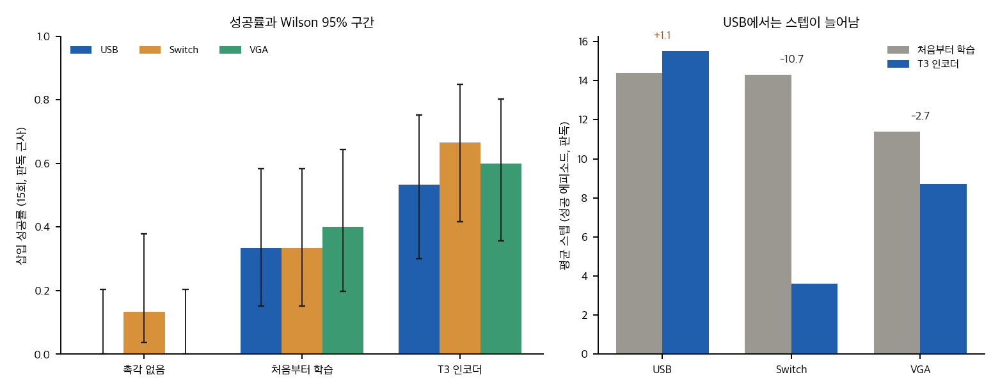
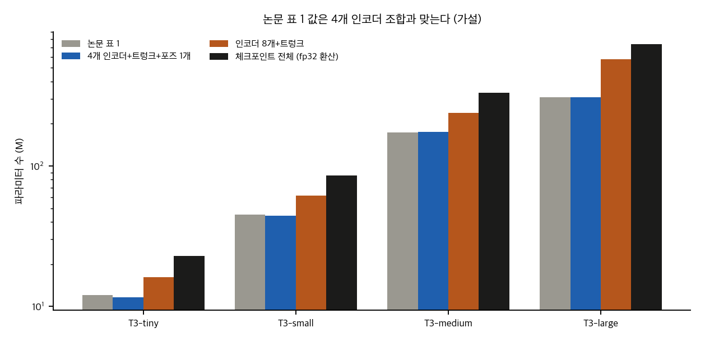
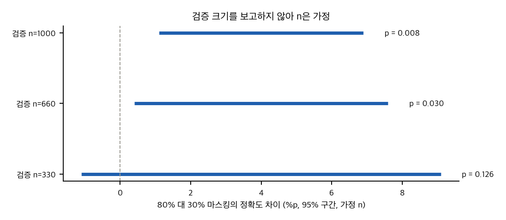

> **논문:** Jialiang Zhao, Yuxiang Ma, Lirui Wang, Edward H. Adelson. *Transferable Tactile Transformers for Representation Learning Across Diverse Sensors and Tasks.* CoRL 2024, PMLR 270:3766–3779, arXiv:2406.13640 (v3, 2024-10-06).
> 공식 코드는 GitHub alanzjl/t3(MIT)에 있습니다. 이 글의 그래프는 논문 수치를 우리가 다시 그린 것입니다. 논문 그림은 싣지 않았습니다.

## 논문이 묻는 것

카메라 기반 촉각 센서는 형태, 조명, 마커, 카메라 수가 제각각입니다. 센서가 바뀌거나 과제가 바뀌면 데이터를 다시 모으고 인코더를 처음부터 학습하는 일이 반복됩니다. T3는 이 문제에 대해 구조로 답합니다. 센서마다 ViT 인코더를 하나씩 두고, 그 뒤에 모든 센서가 공유하는 트렁크를 두고, 과제마다 디코더를 붙입니다.

학습 재료도 함께 묶었습니다. 공개 촉각 데이터셋 여러 개와 저자들이 새로 모은 데이터를 합친 FoTa입니다. 13개 센서, 11개 과제, 3,083,452장입니다. 여기서 중요한 점은 데이터가 **정렬되어 있지 않다**는 것입니다. 같은 물체를 두 센서로 같은 순간에 잰 짝이 없어도 공유 표현을 배우려고 합니다.

학습은 세 단계입니다. 마스크 재구성(MAE)으로 전체 데이터를 쓰고, 레이블이 있는 과제로 지도 사전학습을 하고, 필요하면 새 과제에 미세조정합니다.

## 이 글에서 확인한 것

**1. 삽입 실험은 촉각 없음 대비 우위가 확실하고, 처음부터 학습한 촉각 대비 우위는 불확실합니다.** 0.4 mm 간격의 전자 부품 세 개를 PCB에 꽂는 과제에서 과제당 15회를 했습니다. 촉각 없음은 두 어려운 부품을 한 번도 못 꽂았습니다. T3와 처음부터 학습한 촉각의 차이는 세 과제 모두에서 Fisher 검정 p > 0.1입니다. 세 과제를 합치면 p = 0.03이지만 과제를 같은 확률로 보는 가정이 필요합니다.

*그래프 (우리가 그림). 논문 그림 4c의 막대를 픽셀로 읽었습니다(±0.01). 시도 수는 과제당 15회로 맞췄습니다. USB 막대의 값은 15회 분수와 맞지 않아 참고용입니다.*

**2. 초록의 "25%"와 "53%"는 %p입니다.** 세 부품 평균 성공률은 T3 0.59, 처음부터 학습 0.35, 촉각 없음 0.05 정도입니다. 차이는 약 25 %p와 약 55 %p입니다. 상대 증가로 읽으면 처음부터 학습 대비 72%입니다. 논문은 단위를 정하지 않았습니다. 같은 문제가 사전학습 "중앙값 24%"에도 있습니다.

**3. 그림 캡션의 "가장 낮은 평균 에피소드 길이"는 한 부품에서 성립하지 않습니다.** 스위치와 VGA는 T3가 스텝을 줄였지만(10.7과 2.7 스텝 감소), USB는 14.4에서 15.5로 늘었습니다.

**4. 파라미터 수 표는 공식 체크포인트와 맞지 않습니다.** 표는 medium 174M, large 308M이라고 씁니다. 공식 체크포인트를 파일 크기로 세면 인코더 8개, 트렁크, 포즈 디코더 4개가 들어 medium은 331M입니다. 인코더 4개와 트렁크, 포즈 디코더 1개만 세면 표의 네 값과 1M 안에서 맞습니다. 논문이 실제로 그렇게 셌을 가능성이 있지만 본문으로는 확인할 수 없습니다.

*그래프 (우리가 그림). 논문 표 1 값과 공식 체크포인트 파일 크기를 fp32 4바이트로 나눈 값입니다. 체크포인트 크기로 세는 방식은 근사입니다.*

**5. 마스킹 80%가 최선이라는 주장은 4 %p 차이에 기대고 있습니다.** 85%(30%)와 89%(80%)의 차이입니다. 검증 세트 크기와 반복 실험이 없어서 구간을 구하려면 검증 크기를 가정해야 합니다. 검증 크기를 330으로 두면 p = 0.13, 1000으로 두면 p = 0.008입니다. 공식 코드의 기본 마스킹 비율은 0.4입니다.

*그래프 (우리가 그림). 그림 3b의 두 값(85%, 89%)을 가정한 검증 크기별 차이 구간입니다. 실제 검증 크기는 논문에 없습니다.*

## 구현 가능성 (이 맥 기준)

M4 Pro에 CUDA가 없어서 사전학습은 불가능합니다. 데이터 392.5 GB와 GPU 학습이 필요합니다. 삽입 실험도 Franka와 촉각 센서가 있어야 합니다.

공식 체크포인트로 특징을 뽑는 것은 가능합니다. tiny(91 MB)와 small(341 MB)은 설치와 다운로드만 하면 CPU와 MPS에서 돌릴 수 있습니다. 큰 모델은 다운로드가 더 큽니다(1.3 GB, 2.9 GB). 구조를 줄여 다시 짜는 것은 2–3주로 추정합니다. 논문의 주장을 검증하는 효과는 작습니다.

## 남은 질문

- 공개 설정은 마스킹 기본값이 0.4이고 본문 최적값은 0.8입니다. 사전학습 체크포인트가 어느 쪽으로 학습됐는지 릴리스에 없습니다.
- 갠트리 데이터(6개 프로브 분류와 3D 포즈)는 본문에서 사전학습 제외라고 하지만, 설정 파일 일부는 학습에 쓸 수 있게 되어 있습니다.
- 두 센서 쌍으로만 제로샷 전이를 보였습니다. 센서 간 유사도를 어떻게 판단할지는 논문에 없습니다.

## 링크

- 논문: https://arxiv.org/abs/2406.13640
- 공식 코드: https://github.com/alanzjl/t3 (MIT, 마지막 push 2024-06-21)
- 프로젝트 페이지: https://t3.alanz.info/
- 데이터와 체크포인트: https://huggingface.co/datasets/alanz-mit/FoundationTactile

## 자료

- [통합 리포트 PDF](report/report_public.pdf)
- [01. 논문 분석: T3 (Transferable Tactile Transformers)](analysis/01_paper_analysis.md)
- [02. 선행연구와 공개 자원](analysis/02_prior_work.md)
- [03. 재계산, 검정, 일관성 검사](analysis/03_analysis.md)
- [04. 공식 코드 대조와 구현 가능성](analysis/04_code_verification.md)
