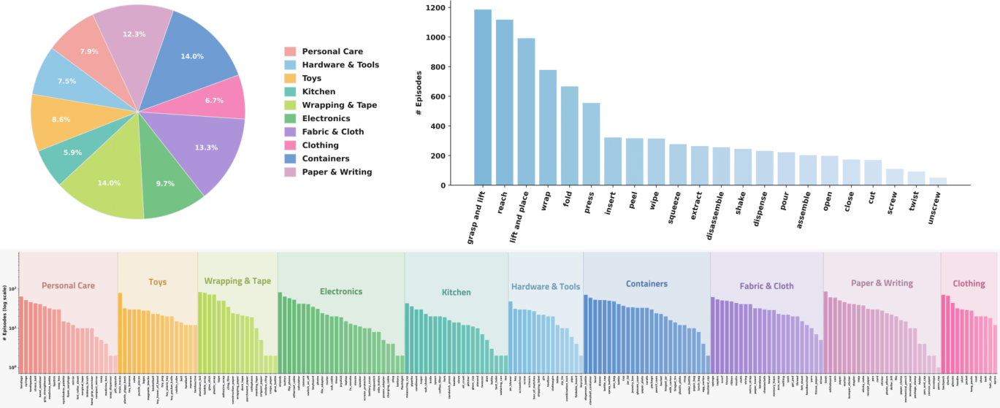
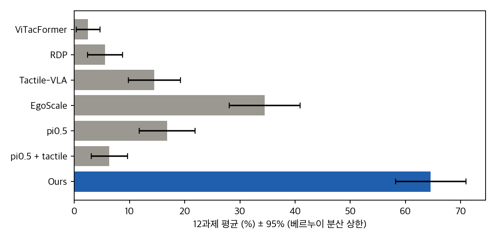
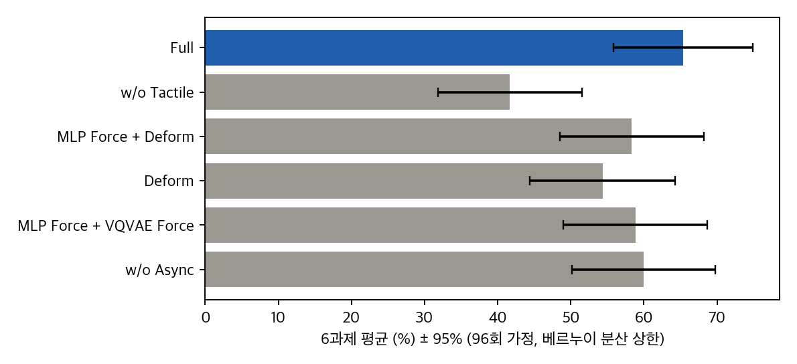
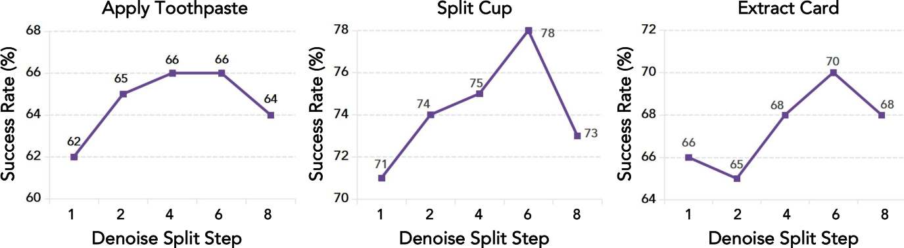
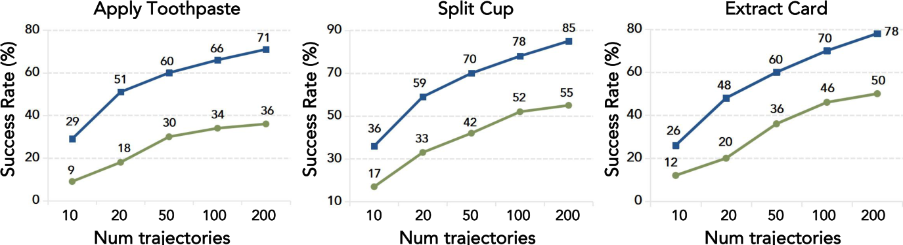
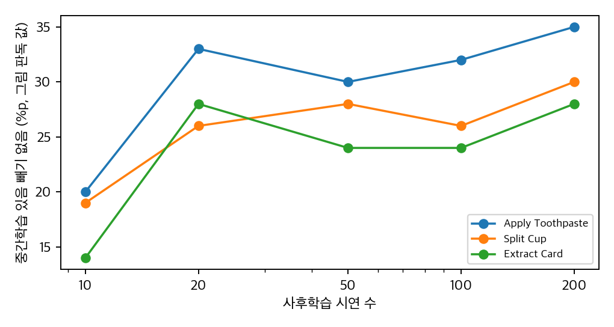
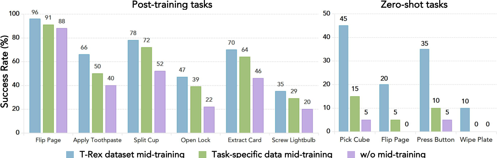

> **논문:** Dantong Niu, Zhuoyang Liu, Zekai Wang 외. *T-Rex: Tactile-Reactive Dexterous Manipulation.* CoRL 2026 포스터, arXiv:2606.17055 (v2, 2026-06-18).
> 공식 코드는 GitHub ZhuoyangLiu2005/T-Rex(MIT)에 있습니다. 이 글의 논문 그림은 저자가 그린 그래프 네 장(출처 표기)이고, 나머지는 우리가 그린 그래프입니다.

## 논문이 묻는 것

촉각은 시각보다 훨씬 빠르게 변합니다. 기존 VLA는 촉각을 쓰지 않거나, 느린 정책 주기에 정적 인코더로 붙입니다. T-Rex는 행동 생성(흐름 매칭)의 노이즈 제거 구간을 둘로 나눕니다. 큰 시각 모델이 τ=1에서 0.4까지(6단계)를 맡고, 작은 촉각 전문가(0.62B)가 캐시된 시각 문맥을 재사용해 0.4에서 0까지(4단계)를 촉각과 함께 마무리합니다. 학습은 22,889시간 인간 영상 사전학습, 100시간 로봇 촉각 중간학습, 과제별 약 100회 시연 사후학습의 세 단계입니다.

*그림 2 (논문 원문). © 저자, CC BY 4.0, 출처 arXiv:2606.17055. 객체 범주, 동작 단위, 객체별 분포.*

## 이 글에서 확인한 것

**1. 평균 우위는 분명합니다.** 12과제 평균은 65 대 35(EgoScale)로 30점 차이이고, 12과제 모두 앞섭니다. 과제당 16회(논문 §5.1)를 가정하면 합산 비교(192회 대 192회)는 이진 근사 Fisher p ≈ 5e-9입니다. 상대 증가로는 약 87%입니다. 다만 가장 강한 기준선 대비 개별 과제의 차이는 16회로는 각각 가려지지 않았습니다(Fisher, Holm 보정 후 0개). 16 대 16 비교의 최소 검출 차이가 약 50점이기 때문입니다.

*그래프 (우리가 그림). 표 1의 12과제 평균과 95% 구간(베르누이 분산 상한, 과제당 16회 가정).*

**2. 표 1의 값은 루브릭 점수로 읽는 것이 맞습니다.** 84개 값 중 63개는 16회 이진 성공으로는 만들어지지 않는 값입니다(예: 1%). 부록 F의 부분 점수 루브릭 평균이라고 보는 것이 자연스럽습니다. 표 캡션의 "success rate"는 이 점을 따로 밝히지 않습니다.

**3. 촉각 제거의 효과는 분명하고, 세부 설계의 효과는 방향만 일관됩니다.** 표 2의 여섯 과제에서 촉각 입력을 제거하면 65에서 42로 내려갑니다(p ≈ 0.0007, 96회 대 96회 가정). VQ-VAE를 빼면 −7, 비동기를 빼면 −5로 모든 절제가 여섯 과제 모두에서 같은 방향이지만, 이 크기는 96회 대 96회 비교의 최소 검출 차이(약 20점)보다 작습니다. 저자 확인이 필요한 부분은 "촉각 제거" 행이 재학습인지 추론 시 비활성화인지입니다.

*그래프 (우리가 그림). 표 2 평균과 95% 구간(96회 가정, 베르누이 분산 상한).*

**4. 분할 단계 곡선은 잡음 폭과 비슷합니다.** 그림 4(그림 판독 값)에서 Kslow=6이 가장 높지만 곡선 폭이 4–7점이고 지점당 표준오차 상한은 약 11–12점입니다. 선택한 지점이 표 2 값과 같아 같은 평가에서 고른 것으로 보입니다.

*그림 4 (논문 원문). © 저자, CC BY 4.0, 출처 arXiv:2606.17055.*

**5. 중간학습은 데이터 효율에서 가장 일관된 신호입니다.** 그림 5(그림 판독 값)의 15개 쌍 모두 중간학습이 높고, 평균 격차는 17.7–31.0점입니다. 중간학습 20개의 성능이 중간학습 없음 200개와 비슷합니다. 한 곳이 다릅니다. Apply Toothpaste의 "중간학습 없음, 100회"는 그림 5에서 34, 표 3과 그림 6에서 40입니다(저자 확인이 필요합니다).

*그림 5 (논문 원문). © 저자, CC BY 4.0, 출처 arXiv:2606.17055.*

*그래프 (우리가 그림). 그림 5 판독 값에서 중간학습 있음과 없음의 격차(16회 가정).*

*그림 6 (논문 원문). © 저자, CC BY 4.0, 출처 arXiv:2606.17055.*

**6. 데이터 공개 범위와 길이 통계는 확인이 필요합니다.** 본문은 100시간 데이터를 공개한다고 쓰지만 공개 저장소는 5,464 에피소드, 약 50.7시간입니다. 100시간÷7,755 에피소드는 평균 46.4초인데 부록 G의 중앙값은 29.8초(사분위 21.0–41.1초)이고, 공개 데이터의 평균은 33.4초입니다. 총 시간 표기 방식의 차이일 가능성이 있습니다.

## 공식 코드와 논문의 차이

main 브랜치는 사후학습과 추론, 텔레옵 스택, VQ-VAE를 담고, 사전·중간학습 코드는 별도 브랜치에 있습니다. 구조(청크 16, 10단계, 분할 0.4, 손실 가중치, 전문가 크기)는 본문과 맞습니다. 읽으면서 본문에 없거나 다르게 보인 설정은 다음과 같습니다.

- 호출 주기: 본문 ~5/~20 Hz, 공개 기본 설정은 30 Hz 명령에 청크 16 전체 실행, 오프셋 0/4/8/12이므로 명목 1.9/7.5 Hz입니다(비율 4는 같음).
- 클라이언트가 느린 청크와 정제 청크를 균등 평균하는 시간 집계가 기본으로 켜져 있습니다.
- 촉각 드롭아웃 0.1, 비전 타워 동결, 미래 시각 정렬의 코사인 손실 같은 설정이 본문에 없습니다.
- 촉각 전문가 훈련에서 KV 문맥과 입력 잡음이 서로 독립으로 뽑힙니다(추론에서는 같은 계보).
- 추론 서버가 인증 없이 pickle 소켓을 엽니다. 신뢰하지 않는 네트워크에서는 쓰지 않는 편이 안전합니다.

## 이 글의 한계

시행별 원자료가 없어 부분 점수의 분산은 베르누이 상한으로 처리했습니다. 그림 4–6 값은 그림 라벨을 읽은 것이고, 표 2·3과 그림의 시행 수는 16회로 가정했습니다. 공식 코드는 실행하지 않았고 가중치와 데이터는 받지 않았습니다.

## 자료

- [통합 리포트 PDF](report/report_public.pdf)
- [01. 논문 분석: T-Rex (arXiv:2606.17055)](analysis/01_paper_analysis.md)
- [02. 선행연구와 관련 저장소](analysis/02_prior_work.md)
- [03. 수치 재계산과 일관성 검사](analysis/03_analysis.md)
- [04. 공식 코드와 논문 대조 (정적 읽기)](analysis/04_code_verification.md)
