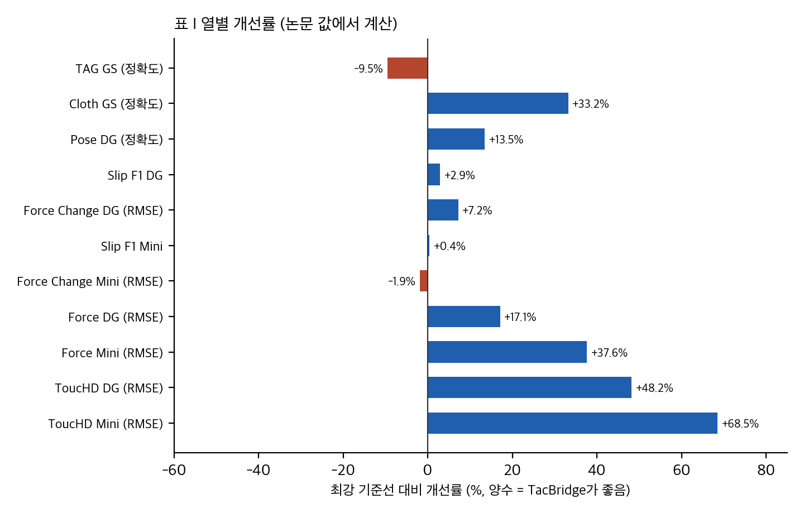
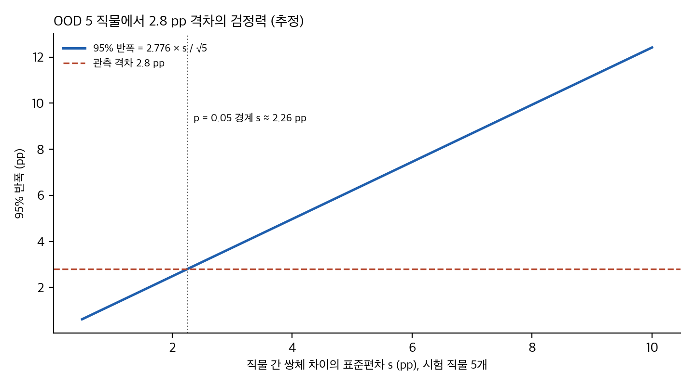

> **논문:** Yongji Fu, Yijiong Lin, Yi Zhou, Yi Qi, Guanqun Cao. *TacBridge: Learning Unified Tactile Representations through Cross-Sensor Correspondence.* arXiv:2611.20939 (v1, 2026-11-16). 학회 표기는 찾지 못했습니다. 공식 코드와 프로젝트 페이지도 확인하지 못했습니다.
> 이 글의 그림은 우리가 논문 수치로 그린 그래프입니다. 논문 그림은 쓰지 않았습니다.

## 논문이 묻는 것

광학 촉각 센서는 같은 접촉을 센서마다 다르게 봅니다. 조명, 탄성체, 마커 배치가 다르기 때문입니다. 기존 방법은 여러 센서 데이터를 같은 특징 공간에 넣는 데 그쳤습니다. 이 논문은 질문을 바꿉니다. **같은 접촉 사건을 두 센서가 함께 본 쌍**이 있다면, 센서 차이와 접촉 차이를 나눌 수 있지 않을까요?

## 방법

세 단계입니다.

1. 여러 센서의 촉각 영상으로 마스크 오토인코더를 사전학습합니다. 프레임과 프레임 차분을 함께 복원합니다.
2. 같은 접촉의 쌍을 써서, 한 센서의 보이는 패치로 다른 센서의 영상을 복원하는 손실을 더합니다. 목표 영상은 정답으로만 쓰고 입력에는 넣지 않습니다.
3. 인코더를 고정하고 조건부 흐름 모델로 목표 센서 영상을 생성합니다.

쌍 데이터는 두 곳에서 옵니다. 실측 TacQuad(DIGIT, GelSight Mini, DuraGel)와 시뮬 ToucHD-Sim(9개 센서 외형)입니다.

## 수치를 다시 계산해 보니

**맞는 것.** 하위 과제 표(표 I)에서 11개 지표 중 9개가 최고입니다. 힘과 ToucHD 오차는 최강 기준선보다 17%에서 69% 낮습니다. 번역 표(표 II)에서는 7개 지표 모두 최고입니다. 표의 숫자끼리도 본문과 맞습니다.

그래프: 표 I의 열별 개선률. 우리가 논문 값에서 계산했습니다. 양수는 TacBridge가 최강 기준선보다 좋다는 뜻입니다.

**확인이 어려운 것.**
- **시드와 샘플 수가 없습니다.** 표 I과 II에 표준편차나 신뢰구간이 없어 차이가 우연인지 판단할 수 없습니다.
- **번역 표의 1만 5천 쌍은 216개 접촉의 순서쌍입니다.** 독립 단위는 접촉 216개입니다.
- **실센서 번역에는 정답이 없습니다.** 번역 정확도는 시뮬 쌍에서만 측정했습니다.

**모순되는 것.** 서론은 TacQuad가 "동기화된" 실측 관측을 준다고 씁니다. 하지만 실험 절은 그 쌍이 "진행률을 맞춘" 것이며 동기 기록이 아니라고 씁니다. 두 설명은 함께 맞을 수 없습니다.

## 가장 약한 고리: 직물 다섯 개

실로봇 실험은 직물 속성 24개를 맞힙니다. 미본 직물 5개에서 TacBridge는 73.0%, 가장 가까운 기준선은 70.2%입니다.

그래프: 시험 직물 5개일 때 2.8 pp 격차의 95% 반폭. 직물별 점수가 없어 표준편차는 가정입니다.

같은 직물의 325장은 같은 속성 벡터를 가지므로, 독립 단위는 장이 아니라 직물입니다. 이 설정에서 2.8 pp 격차가 p < 0.05가 되려면 직물 간 쌍체 차이의 표준편차가 약 2.3 pp 이하여야 합니다. 이 값은 직접 확인할 수 없어 방향만 말할 수 있습니다.

## 가장 필요한 빠진 실험

이 논문의 핵심 주장은 쌍 손실이 표현을 개선한다는 것입니다. 그런데 쌍을 뺀 같은 구조의 절제 실험이 없습니다. 기준선이 같은 사전학습 데이터와 예산으로 학습됐는지도 본문에 없습니다. 이 두 가지가 있어야 주장이 성립합니다.

## 재현할 수 있나

공식 코드, 체크포인트, 데이터 공개가 확인되지 않았습니다. 이 맥(Apple M4 Pro, CUDA 없음)에서 논문 결과를 재현하는 것은 불가능합니다. 식을 옮겨 작은 장난감 검사를 하는 것은 약 1주, 공개 데이터 일부로 축소 사전학습과 선형 탐침 비교까지 하면 약 2–4주로 추정합니다. 이 추정은 측정 전입니다.

## 정리

TacBridge는 촉각 쌍을 표현 학습에 쓰는 방향이 흥미롭습니다. 다만 수치 주장은 시드 없이 보고되어 검정할 수 없고, 실로봇 일반화는 직물 다섯 개에 기대고 있습니다. 쌍 손실의 효과를 증명하는 절제 실험이 나오기 전까지는 방향으로만 읽는 편이 맞습니다.

## 자료

- [통합 리포트 PDF](report/report_public.pdf)
- [01. 논문 분석: TacBridge (arXiv:2611.20939)](analysis/01_paper_analysis.md)
- [02. 선행연구와 자료 탐색: TacBridge (arXiv:2611.20939)](analysis/02_prior_work.md)
- [03. 수치 재계산과 일관성 검사: TacBridge (arXiv:2611.20939)](analysis/03_analysis.md)
- [04. 주장 검증: TacBridge (arXiv:2611.20939)](analysis/04_claim_verification.md)
