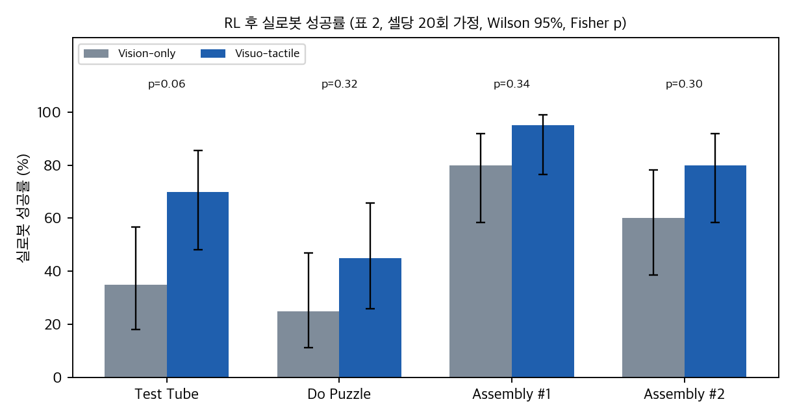
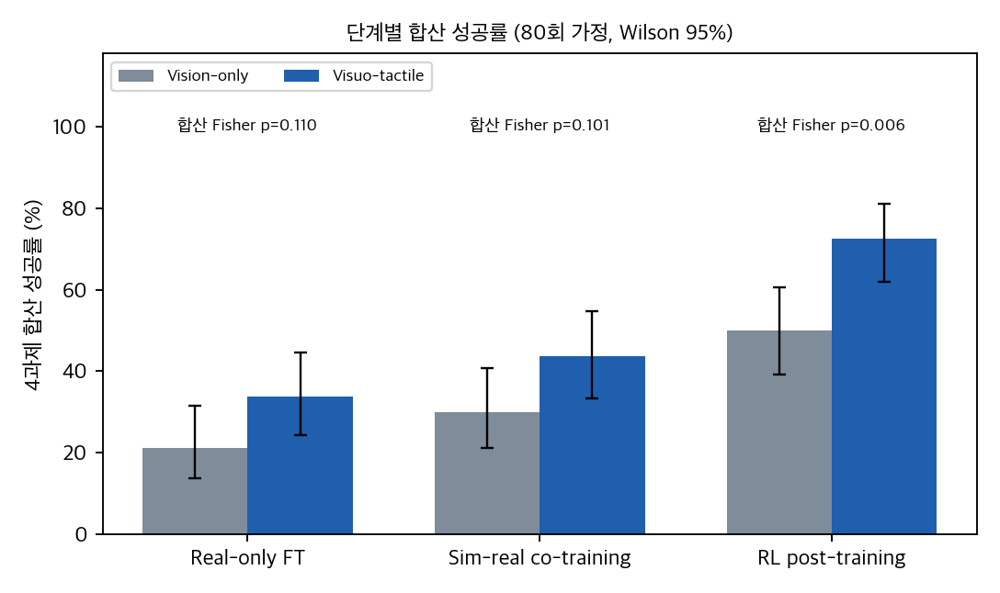
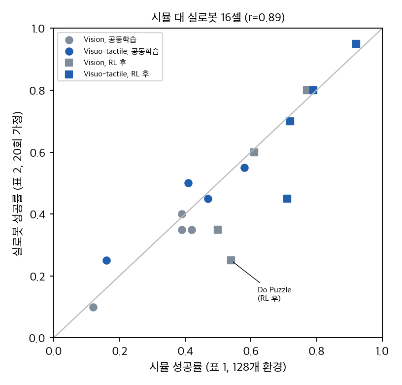

> **논문:** Siyu Ma, Yuqi Liang, Chang Yu 외. *TacCoRL: Integrating Tactile Feedback into VLA via Simulation.* CoRL 2026 포스터, arXiv:2606.11743 (v1, 2026-06-10).
> 공식 코드는 찾지 못했습니다(프로젝트 페이지 저장소는 웹사이트뿐입니다). 이 글의 그림은 모두 우리가 그린 그래프입니다. 논문은 arXiv 비독점 배포 라이선스라서 논문 그림은 싣지 않았습니다.

## 논문이 묻는 것

카메라는 물체를 쥔 손이 가리는 접촉면을 보지 못합니다. 촉각이 그 자리를 채워 주지만, 촉각 데이터로 큰 모델을 사전학습하기는 어렵습니다. TacCoRL은 이미 있는 VLA(π0.5)에 촉각 토큰을 붙이고, 시뮬레이션에서 후학습해 실제 로봇으로 옮깁니다.

- **촉각 인터페이스.** 최근 10프레임의 taxel 이력(4 × 32 × 12 = 1536개)을 작은 CNN으로 토큰화합니다. 임계값(0.4)을 넘는 taxel이 하나라도 있을 때만 주의에 들어가는 접촉 게이트가 있습니다.
- **공동학습.** 실 시연 50개와 시뮬 시연 200개(텔레옵 20개를 MimicGen으로 확장)를 α = 0.5로 섞습니다.
- **앵커 있는 RL.** 희소 성공 보상 PPO에 실데이터 flow-matching 손실을 더합니다(β = 1.0).

## 이 글에서 확인한 것

수치는 논문 표 1·2에서 가져와 다시 계산했습니다. 실로봇 표는 셀당 20회로 읽었습니다(§4.2가 "과제당 20회"라고 쓰고 모든 값이 0.05의 배수입니다). 시뮬은 병렬 환경 128개 평가입니다.

**1. 초록의 72.5% 대 50.0%는 표와 맞습니다.** 표 2에서 RL 후학습한 시각-촉각 정책은 네 과제 평균 72.5%이고, 같은 RL을 한 시각 전용 정책은 50.0%입니다. 시각 전용 실데이터 미세조정은 21.25%입니다. 초록의 "baseline"이 어느 쪽인지에 따라 촉각의 기여와 RL의 기여가 다르게 읽힙니다.

**2. 촉각 효과는 네 과제를 합치면 분명하고, 과제 하나씩은 시행 수가 모자랍니다.** RL 후 합산 58/80 대 40/80은 Fisher p = 0.0056입니다. 과제별로는 Test Tube 14/20 대 7/20(p = 0.056), Do Puzzle 9/20 대 5/20(p = 0.32), Assembly #1 19/20 대 16/20(p = 0.34), Assembly #2 16/20 대 12/20(p = 0.30)입니다. 네 과제 모두 방향이 같습니다. 한 과제에서 50% 대 72.5%를 20회로 구별할 확률은 약 20%(시행 수 20 가정, 시뮬레이션 계산)이고, 80%의 검정력에는 과제당 약 73회가 필요합니다.

*그래프 1. 표 2의 RL 후 성공률과 Wilson 95% 구간(셀당 20회 가정), 위에 과제별 Fisher p. 우리가 그린 그래프입니다.*

**3. 앞 단계에서는 합산해도 촉각 효과가 분명하지 않습니다.** 실데이터만 미세조정(33.75% 대 21.25%)과 공동학습(43.75% 대 30.0%)은 합산 p = 0.11, 0.10입니다. RL 단계에서 이득이 커졌다는 해석과, 앞 단계의 효과가 시행 수 때문에 보이지 않는다는 해석이 모두 가능합니다. RL 대 공동학습은 시각-촉각에서 p = 0.0004입니다.

*그래프 2. 단계별 4과제 합산 성공률(80회 가정)과 Wilson 95% 구간. 우리가 그린 그래프입니다.*

**4. 시뮬과 실로봇은 대체로 맞고 Do Puzzle에서 벌어집니다.** 16개 셀(공동학습 8, RL 후 8)의 Pearson r = 0.89입니다. 공동학습 직후는 평균 4.6%p 차이이고, RL 후 Do Puzzle은 시뮬이 시각 전용 +29%p, 시각-촉각 +26%p 높습니다. 나머지 RL 후 셀은 Test Tube 시각 전용(+15%p)을 빼면 ±3%p 안입니다. 이유는 논문에 없고, 조각 세 개를 연달아 놓는 긴 과제라서 접촉 모델의 작은 차이가 쌓였을 가능성이 있습니다.

*그래프 3. 표 1(시뮬)과 표 2(실로봇) 성공률의 대응. 실로봇은 셀당 20회 가정이고, 우리가 그린 그래프입니다.*

**5. 앵커 효과는 한 과제의 20회 결과입니다.** Assembly #2에서 β = 0일 때 실 성공 9/20(45%), β = 1.0일 때 16/20(80%)으로 Fisher p = 0.048입니다. β = 0.1과 1.0은 모두 80%라서, 이 구간에 둔감하다는 읽기와 20회의 해상도 한계라는 읽기가 모두 가능합니다. α(0.95 → 0.5)의 실로봇 효과(40% → 45%)는 20회로는 구별되지 않고, 시뮬 최고 성공률(42.9% → 70.3%)에서 더 분명합니다.

**6. 표와 본문 사이에 정의가 필요한 값이 있습니다.** 저자 확인이 필요한 항목입니다.
- Table 4의 앵커 에피소드는 200개이고 §4.2의 실 시연은 과제당 50개입니다.
- §4.5의 42.9%는 n = 128의 소수 첫째 자리 반올림 값이 아닙니다(55/128 = 42.97). 같은 문단의 70.3%(90/128)와 14.1%(18/128)는 맞습니다. 분모나 "best"의 정의가 본문에 없습니다.
- 표 1의 시각-촉각 Assembly #2는 0.79이고, §4.5는 같은 과제의 β = 1.0 "best simulator success"를 92% 초과라고 씁니다. 최종값과 최고값의 차이로 읽힙니다.
- 그림 6에서 읽은 Do Puzzle 곡선 끝값(그림 판독, 시각 전용 약 65%, 시각-촉각 약 77%)은 표 1의 0.54와 0.71보다 높습니다.

**7. 설계 요소별 절제가 없습니다.** 접촉 게이트를 없앤 변형, 이력 길이 L, 촉각 주입 위치(prefix와 suffix)를 바꾼 실험이 논문에 없습니다. 게이트가 "접촉 밖에서 사전학습 행동을 유지한다"는 서술은 이 글에서 검증할 근거를 찾지 못했습니다.

## 구현할 수 있는가

공식 코드, 데이터, 체크포인트는 공개되어 있지 않습니다(2026-11-23 확인). 논문 수치의 재현은 π0.5 학습과 RLinf 기반 PPO(GPU), PiPER 양손 로봇과 촉각 패드 4개가 필요합니다. 접촉 게이트와 촉각 토큰, SPSA 컨트롤러 식별, 앵커 있는 PPO의 원리는 작은 합성 환경에서 CPU로 확인할 수 있습니다.

## 같이 보면 좋은 글

같은 문제 설정의 앞선 연구는 VT-Refine(시각-촉각 양손 조립의 시뮬 미세조정)이고, 공동학습 + RL 조합은 RL-Co와 이어집니다. 두 방법을 같은 과제에서 비교한 실험은 TacCoRL 논문에 없습니다.

## 자료

- [통합 리포트 PDF](report/report_public.pdf)
- [01. 논문 분석: TacCoRL (arXiv:2606.11743)](analysis/01_paper_analysis.md)
- [02. 선행연구와 관련 저장소](analysis/02_prior_work.md)
- [03. 수치 재계산과 일관성 검사](analysis/03_analysis.md)
- [04. 주장 검증과 구현 가능성 (공식 코드 없음)](analysis/04_claim_verification.md)
