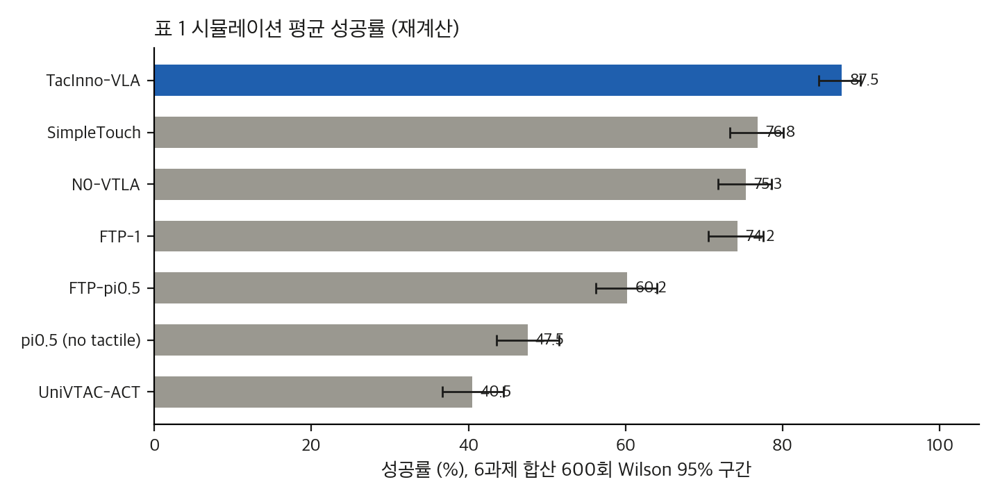
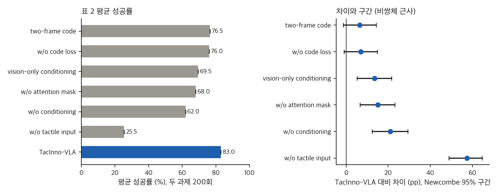
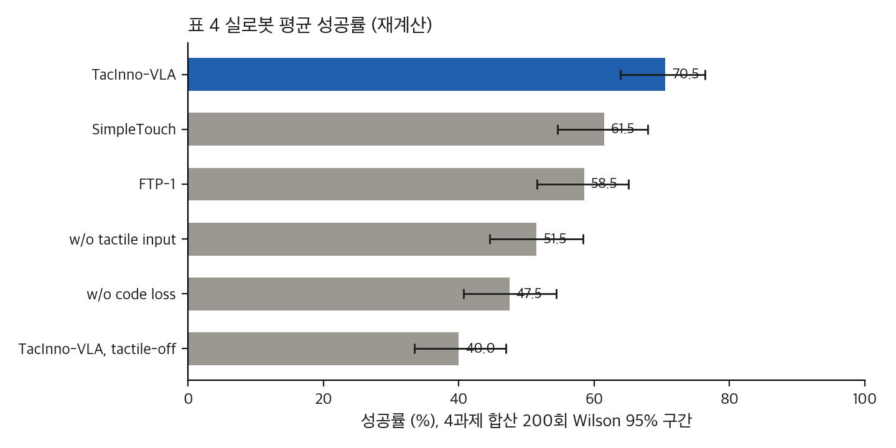

> **논문:** Weile Li, Yunfan Lou, Muqing Shi, Zihao Zhang, Zhenbiao Huang, Boxian Yao, Xiyu Zhu, Zhibo Pang. *TacInno: Teaching Vision-Language-Action Models the Contact Dynamics Beyond Vision and Action.* arXiv:2611.26405 (v1, 2026-11-19). 학회 표기 없음.
> 공식 코드는 GitHub LisavilaLee/TacInno(Apache-2.0)에 있습니다. 이 글의 그래프는 논문 표의 값으로 우리가 다시 그린 것입니다. 논문 그림은 넣지 않았습니다.

## 논문이 묻는 것

촉각 센서는 로봇이 자기 행동에 대해 접촉이 어떻게 반응하는지를 잽니다. 그래서 촉각 변화의 많은 부분, 예를 들어 그리퍼가 닫힐 때 젤이 변형되는 모양은 영상과 실행한 행동만으로 이미 예측됩니다. 촉각을 그대로 넣으면 정책은 이 예측 가능한 부분에 학습 신호를 낭비하고, 촉각 입력을 거의 쓰지 않게 됩니다.

TacInno는 이 예측 가능한 부분을 빼고, 영상과 행동으로 설명되지 않는 잔차, 즉 **촉각 혁신(tactile innovation)**만 학습 목표로 씁니다. 잔차는 16비트 이산 코드로 압축되고, 정책은 현재 관측에서 이 코드를 예측하는 보조 손실을 받습니다. 배포할 때는 코드를 만드는 토크나이저와 보조 헤드를 모두 뗍니다.

## 결과를 다시 계산해 보기

논문의 표 값으로 평균, 구간, 검정을 다시 계산했습니다. 원자료(에피소드별 결과)는 공개되지 않아서 대부분 비쌍체 근사입니다.

*그림 1. 시뮬레이션 여섯 과제의 평균 성공률(표 1 재계산)과 600회 합산 Wilson 95% 구간. 우리가 그렸습니다.*

- 시뮬레이션 평균은 87.5%로, 가장 강한 기준선(SimpleTouch 76.8%)보다 10.7 pp 높습니다. 근사 95% 구간은 6.4–15.0 pp입니다.
- 하지만 차이의 대부분은 Lift Can(88 대 65)과 Pull-out Key(94 대 54)에서 나옵니다. 나머지 네 과제에서는 차이가 없거나 오히려 낮습니다.

*그림 2. 절제 실험(표 2)의 두 과제 평균과 TacInno-VLA 대비 차이의 Newcombe 95% 구간. 비쌍체 근사이며 우리가 그렸습니다.*

- 영상과 행동을 조건으로 준 토크나이저(조건 없음 대비 −21 pp), 주의 마스크(−15 pp), 촉각 입력(−57.5 pp)의 효과는 뚜렷합니다.
- 두 프레임 코드(−6.5 pp, p = 0.11)와 코드 손실 제거(−7 pp, p = 0.08)는 이 근사에서는 확실하지 않습니다. 논문 표 2에는 시도 수가 없어서 더 판단하기 어렵습니다.

촉각을 끄는 검사(tactile-off test)가 가장 강한 증거입니다. Lift Can에서 TacInno-VLA는 88%에서 0%로 떨어집니다(McNemar 정확 검정, p ≈ 6e−27). 기준선 대부분은 크게 떨어지지 않습니다.

*그림 3. 실로봇 네 과제의 평균 성공률(표 4 재계산)과 200회 합산 Wilson 95% 구간. 우리가 그렸습니다.*

- 실로봇 평균은 70.5%입니다. 대 SimpleTouch 차이 9.0 pp는 p = 0.057로 0.05 수준에서 유의하지 않습니다. 대 FTP-1 12.0 pp(p = 0.012)와 코드 손실 제거 대비 23 pp(p ≈ 3e−6)는 더 강한 증거입니다.

## 공식 코드와 논문이 다른 부분

공식 저장소를 정적으로만 읽었습니다. 실행하거나 가중치를 받지 않았습니다. 논문과 다른 설정이 몇 가지 보입니다.

- **학습 절차가 과제마다 다릅니다.** Insert Hole과 Lift Can은 여섯 과제 공동 학습을 먼저 거치고, 나머지 네 과제는 π0.5에서 바로 학습합니다. 논문은 모든 정책이 같은 50 시연으로 학습했다고만 씁니다.
- **고유감각 토큰 수가 다릅니다.** Lift Can의 시뮬 설정은 관절 8 단계 기록을 씁니다. 논문은 현재 관절 하나라고 설명합니다.
- **평가 세부가 빠져 있습니다.** 공식 평가는 행동 한계를 기본값의 2배로 씁니다. 시뮬레이터 오류 에피소드를 버리고 유효 100 에피소드를 채우는 규칙도 있습니다. 논문에는 없습니다.

## 구현 가능성

| 수준 | 이 맥(M4 Pro, CUDA 없음)에서 |
|---|---|
| 토크나이저 재학습, VLA 학습 | 불가 (코드가 CUDA에 고정, GPU 80 GB 이상) |
| 시뮬레이션 평가 | 불가 (추정: Isaac Sim과 RTX급 GPU 필요) |
| 실로봇 | 불가 (Franka FR3와 촉각 센서 필요) |
| 추론 검사 | 조건부 (MPS 포팅과 가중치 다운로드 승인 필요, 추정 1–2주) |

## 한계와 확인할 것

- 표 3의 Lift Bottle은 25 시드로, 본문은 100 에피소드로 적었습니다. 시도 수가 어긋납니다.
- 본문의 "실행 구간을 맞춘 기준선 값(82.0, 79.3, 78.0, 68.0%)"과 "같은 시드의 91.3%"는 표에 없어 확인할 수 없습니다.
- 논문에 별도의 한계 절이 없습니다.

## 정리

TacInno의 생각은 간단합니다. 영상과 행동으로 이미 설명되는 촉각 변화를 학습 목표에서 빼면, 정책은 접촉에서만 생기는 신호를 배웁니다. 촉각을 끄면 성능이 떨어진다는 검사 결과는 이 방향을 뒷받침합니다. 다만 실로봇 우위는 아직 경계선이고, 절제 실험의 일부는 시도 수가 없어 확인이 더 필요합니다.

## 자료

- [통합 리포트 PDF](report/report_public.pdf)
- [01. 논문 분석: TacInno](analysis/01_paper_analysis.md)
- [02. 선행연구와 관련 저장소](analysis/02_prior_work.md)
- [03. 수치 재계산과 일관성 검사](analysis/03_analysis.md)
- [04. 공식 코드 대조: TacInno](analysis/04_code_verification.md)
