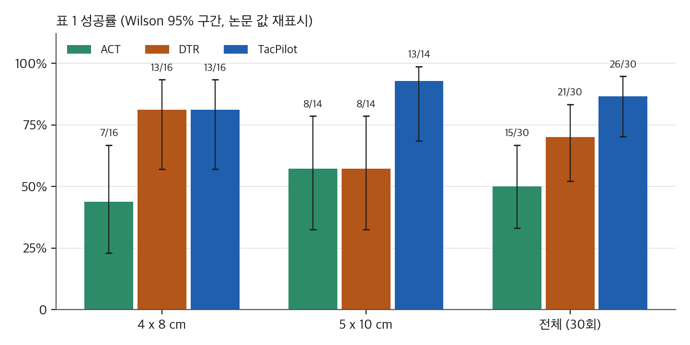
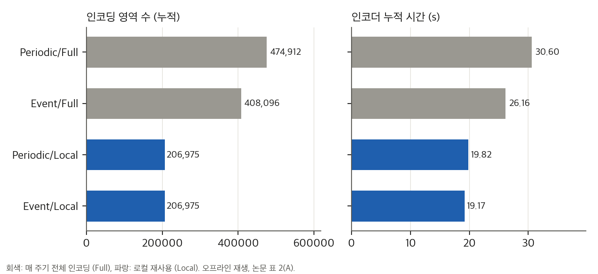

> **논문:** Yunzhen Zhang, Yuxiao Zhu, Jie Yang, Yufeng Miao, Bing Luo. *TacPilot: Does Touch Need to Be Everywhere?* arXiv:2611.23804 (v1, 2026-11-18). 학회 표기는 없습니다.
> 공식 코드와 프로젝트 페이지는 찾지 못했습니다. 이 글의 그림은 우리가 그린 그래프 두 장입니다. 논문 그림은 arXiv 비독점 라이선스라서 싣지 않았습니다.

## 논문이 묻는 것

촉각은 접촉이 일어나는 손가락 끝에서 정보를 줍니다. 그런데 촉각 신호가 바뀐다고 해서 행동을 고칠 필요는 없고, 행동을 고치고 있다고 해서 새 촉각 특징이 필요하지도 않습니다. TacPilot은 이 두 결정을 나눕니다. 언제 어느 영역의 촉각 특징을 다시 계산할지 정하고, 보정 잔차를 적용할지를 따로 게이트합니다. 시각 정책은 고정합니다.

## 방법

- **변화 감지.** 원시 촉각의 인접 샘플 변화와 기준값 대비 드리프트가 임계 τ1을 넘은 영역만 다시 인코딩합니다.
- **영역 재사용.** 두 손가락 68 taxel을 32 영역으로 나누고, 그래프 이웃까지 확장해서 바뀐 영역만 계산합니다.
- **말단 공간 잔차.** 번역, 회전, 그리퍼 명령에 bounded 잔차를 더합니다. 자세 게이트와 그리퍼 게이트가 따로 켜집니다.

## 숫자로 읽기

*그래프: 논문 표 1의 성공률과 Wilson 95% 구간. 우리가 그렸습니다. 시뮬 30회, 탐색적 개발 평가입니다.*

시뮬 실린더 세우기에서 TacPilot은 30회 중 26회(86.7%)를 성공했습니다. 같은 설정의 시각 전용 ACT는 15회, DTR은 21회입니다. 차이를 검정하면 다음과 같습니다.

- **TacPilot 대 시각 전용 ACT:** Fisher p = 0.005. 차이가 확인됩니다.
- **TacPilot 대 DTR:** Fisher p = 0.21. 쌍체로 보아도 최소 p는 0.0625입니다. 차이는 확인되지 않습니다.
- **군당 필요한 시도 수:** 관측된 차이를 80% 검정력으로 보려면 약 95회가 필요합니다.

DTR과 TacPilot은 학습 방식도 다릅니다. DTR은 온라인 SAC로, TacPilot은 행동 복제로 학습합니다. 릴리스 기억 규칙도 TacPilot에만 있습니다. 논문도 이 차이 때문에 게이트 효과로 결과를 돌리기 어렵다고 씁니다.

*그래프: 논문 표 2(A)의 인코딩 영역 수와 인코더 시간 (오프라인 재생). 우리가 그렸습니다.*

## 56%는 어디서 나온 값인가

논문의 로컬 재사용은 영역 수를 474,912에서 206,975로 줄입니다(−56.4%). 이 값은 **오프라인 재생**에서 잰 것입니다. 폐루프 평가는 접촉 중 모든 영역을 다시 계산하므로, 86.7%는 이 절약 없이 얻은 결과입니다.

이벤트 기반 시점은 로컬 재사용과 함께 쓰면 영역 수와 인코더 호출 수를 줄이지 않습니다. 두 방식 모두 206,975 영역, 9,290 호출입니다. 이벤트만 쓸 때는 영역이 14.1% 줄지만, 재사용을 켜면 그 이득은 사라집니다.

## 이 글이 보여 주지 않는 것

- 공식 코드가 없어서 논문 식을 코드와 대조할 수 없습니다.
- 학습 데모 수, τ1, 잔차 경계 B의 단위가 본문에 없습니다.
- 실로봇 네 과제는 스냅숏만 있고 성공 횟수가 없습니다.

## 구현 가능성

이 맥에서 재현할 수는 없습니다. 시뮬 모델과 학습 설정을 새로 만들어야 하고, 실로봇은 필요합니다. 할 수 있는 것은 표 재계산과 영역 재사용 규칙을 CPU에서 다시 세어 보는 토이입니다.

## 자료

- [통합 리포트 PDF](report/report_public.pdf)
- [01. 논문 분석: TacPilot (arXiv:2611.23804)](analysis/01_paper_analysis.md)
- [02. 선행연구, 공식 저장소, 관련 분석](analysis/02_prior_work.md)
- [03. 수치 재계산과 일관성 검사](analysis/03_analysis.md)
- [04. 주장 검증 (공식 코드 없음)](analysis/04_claim_verification.md)
