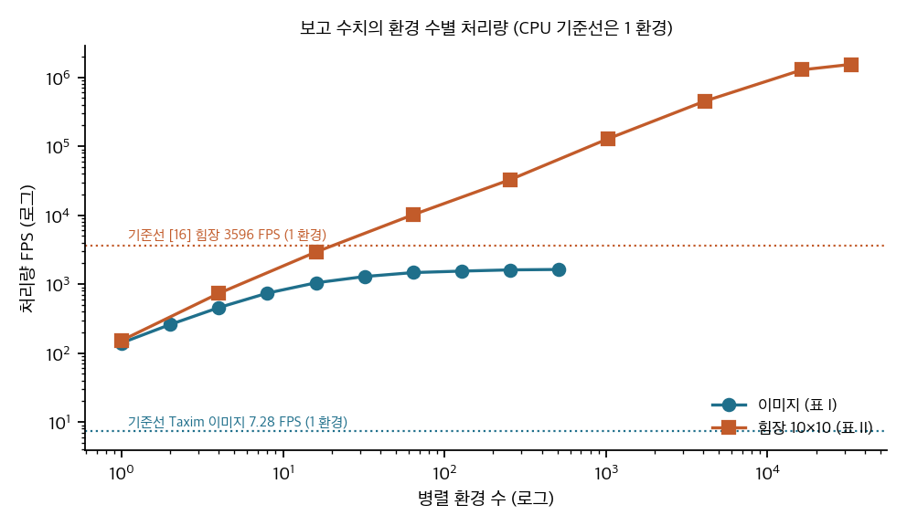
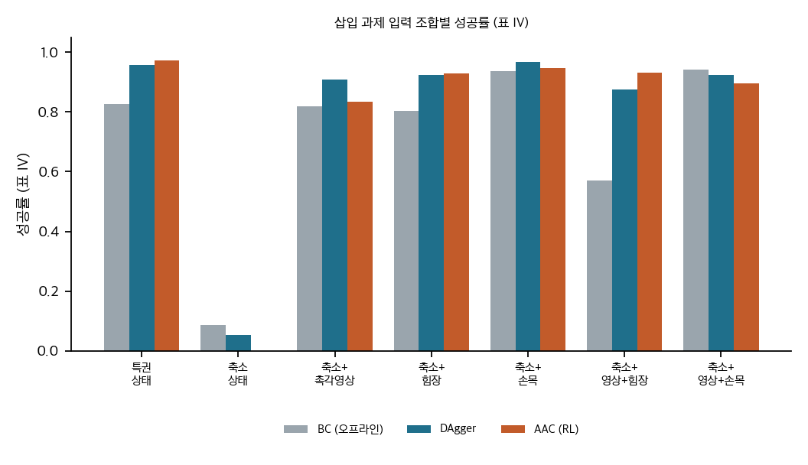
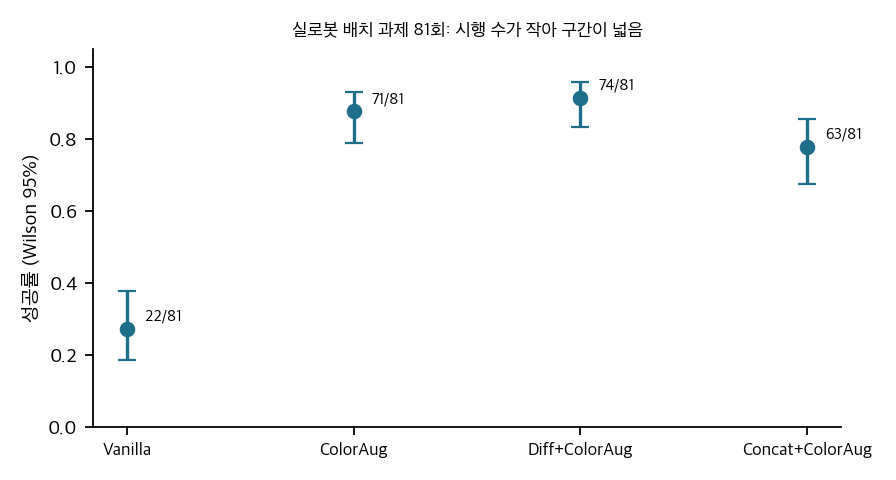

> **논문:** Iretiayo Akinola, Jie Xu, Jan Carius, Dieter Fox, Yashraj Narang. *TacSL: A Library for Visuotactile Sensor Simulation and Learning.* IEEE Transactions on Robotics 41 (2025), 2645–2661. arXiv:2408.06506 (v2, 2025-03-08).
> 공식 코드는 GitHub `isaac-sim/IsaacGymEnvs`의 `tacsl` 브랜치에 있습니다(보관 상태, 지원 중단). 이 글의 그림은 우리가 논문 수치로 그린 그래프 세 장입니다. 논문 그림은 arXiv 라이선스가 비배타적이라 싣지 않았습니다.

## 논문이 묻는 것

촉각 센서로 접촉이 많은 조작을 배우려면 대량의 경험이 필요합니다. 실제 센서로 모으기는 느리고 닳습니다. 시뮬레이션에서 모으려면 두 가지가 필요합니다. 접촉 물리(고무 막이 눌리는 모양과 힘)와 촉각 영상(카메라가 본 것처럼 보이는 그림)을 빠르게 만드는 것, 그리고 그 위에서 돌아가는 학습 방법입니다.

TacSL은 두 가지를 한 GPU 안에서 함께 풉니다. 접촉은 암묵적 스프링으로 안정화하고, 촉각 영상은 깊이 영상을 보정된 룩업 테이블로 RGB로 바꿉니다. 학습 쪽에는 특권 정보를 가진 교사 정책에서 촉각 학생 정책을 만드는 증류(BC, DAgger)와, 교사 크리틱을 재사용하는 새 방법 AACD가 들어 있습니다.

## 속도 주장은 병렬도에 따라 다릅니다

초록은 촉각 영상과 접촉 힘을 "200배 이상" 빠르게 만든다고 말합니다. 표를 다시 계산하면 이렇습니다.

- 촉각 영상, 512 환경 GPU: 1631 FPS. 기준선 Taxim은 CPU 한 코어에서 7.28 FPS입니다. 224배입니다.
- 같은 촉각 영상, **1 환경**: 140 FPS. 19배입니다.
- 힘장, 32768 환경: 1541043 FPS. 기준선 [16]은 1 환경에서 3596 FPS입니다. 428배입니다.
- 힘장, **1 환경**: 152 FPS. 기준선보다 24배 느립니다. 64 환경부터 기준선을 넘습니다.

GPU의 병렬 처리량을 CPU 단일 환경과 비교한 숫자입니다. 연구실에서 쓸 때는 병렬 환경을 몇 개 돌릴지부터 정해야 합니다.

*그림 1 (자체 그래프). 논문 표 I, II 수치로 그림. 출처 arXiv:2408.06506.*

## 학습 방법은 입력에 따라 결과가 다릅니다

삽입 과제에서 세 학습 방법을 일곱 입력 조합으로 비교했습니다. 온라인 방법(DAgger, AAC)이 BC보다 낫다는 본문 주장은 촉각 입력에서 대체로 맞습니다. 그러나 손목 카메라와 촉각 영상을 함께 쓰면 BC가 0.941로 가장 높고, DAgger는 0.925, AAC는 0.897입니다. 축소된 상태만 쓰면 온라인 방법은 오히려 낮습니다.

*그림 2 (자체 그래프). 논문 표 IV 수치로 그림. 출처 arXiv:2408.06506.*

## 실로봇에서 영상 증강이 핵심입니다

배치 과제를 81회 실제 로봇에서 평가했습니다. 증강 없이 학습한 정책은 27%, 색과 기하를 증강한 정책은 88%입니다. 두 결과 사이 차이는 p ≈ 2e−15로 매우 큽니다. 차이 나는 방향이 명확해서 이 부분은 주장을 강하게 지지합니다. 반면 차이 조건 Diff(현재 영상에서 빈 센서 영상을 뺀 것)는 88%에서 91%로 올랐을 뿐이고 81회로는 구별되지 않습니다.

*그림 3 (자체 그래프). 논문 본문 그림 12 수치로 그림. 출처 arXiv:2408.06506.*

본문의 Concat+ColorAug 77.9%는 81회 시도에서 나올 수 없는 값입니다(63/81 = 77.8%). 소수 첫째 자리 오류로 보입니다.

## 공식 코드에 없는 것

공식 저장소는 Isaac Gym용 TacSL 코드를 제공합니다. 다음 항목은 저장소에서 찾지 못했습니다.

- DAgger와 BC 학습 코드. 논문의 증류 실험을 재현할 수 없습니다.
- AACD 구현. 2단계 학습의 크리틱 재사용을 설정하는 한 줄만 있습니다.
- 학습 중 물리 무작위화와 영상 증강. 설정 기본값이 꺼져 있고, 공개 학습 스크립트도 켜지 않습니다.

또한 촉각 힘장 계산에서 댐핑 항은 주석 처리되어 있습니다. 논문 식에는 있는 항입니다.

센서 모듈 파일 여섯 개에는 "사용하려면 NVIDIA의 명시적 라이선스가 필요하다"는 문구가 붙어 있습니다. 저장소 루트의 BSD 3 라이선스와 충돌합니다. 그래서 이 글은 코드를 옮기거나 실행하지 않았습니다. 논문의 식을 읽고 다시 구현하는 방향이 안전합니다.

## 맥에서 할 수 있는 것

이 맥(Apple M4 Pro, CUDA 없음)에서는 공식 코드를 실행할 수 없습니다. Isaac Gym은 Linux와 CUDA 환경이 필요하고, 후속인 Isaac Lab 센서는 Isaac Sim과 NVIDIA GPU가 필요합니다. 다음 두 가지는 CPU에서 할 수 있습니다.

- 접촉 식 (9)의 대수 검산. 무작위 2만 개 입력에서 잔차가 8e−11 수준이었습니다.
- 힘장 식을 numpy로 다시 구현해 법선 힘과 마찰 방향을 확인하는 것.

## 정리

TacSL은 촉각 시뮬레이션과 학습 도구를 한 곳에 모은 중요한 기반입니다. 그러나 "200배"라는 숫자는 병렬 GPU와 CPU 단일 환경의 비교이고, 학습 우위는 입력에 따라 다릅니다. 공식 코드는 지원이 끝났고 핵심 학습 방법이 빠져 있습니다. 후속 Isaac Lab 센서가 실험적으로 공개되어 있으니, 연구에 쓴다면 그쪽이 현실적인 출발점일 것입니다.

## 자료

- [통합 리포트 PDF](report/report_public.pdf)
- [TacSL 논문 분석 (arXiv:2408.06506)](analysis/01_paper_analysis.md)
- [TacSL 선행연구와 관련 저장소 (02)](analysis/02_prior_work.md)
- [TacSL 재계산과 검정 (03)](analysis/03_analysis.md)
- [TacSL 공식 코드 대조 (04)](analysis/04_code_verification.md)
