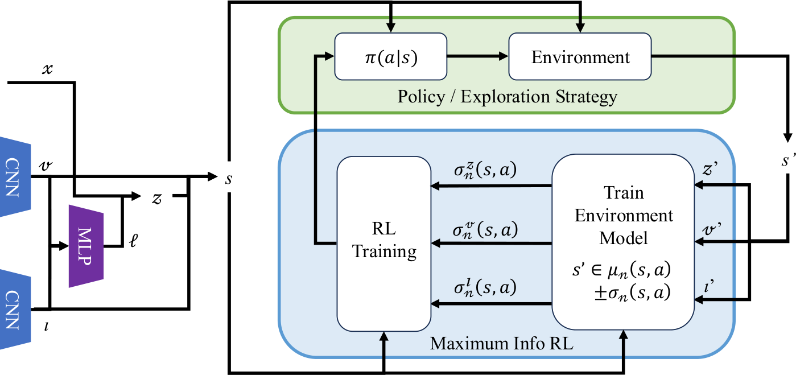
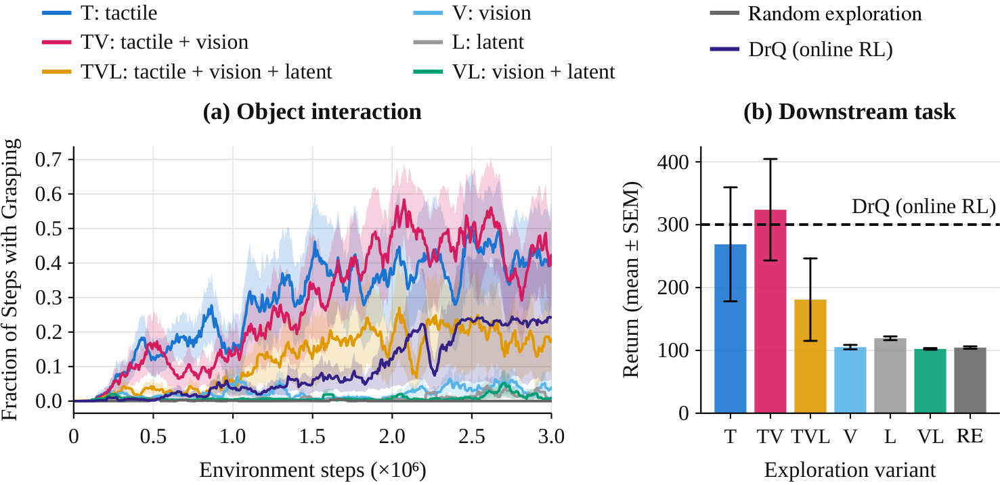
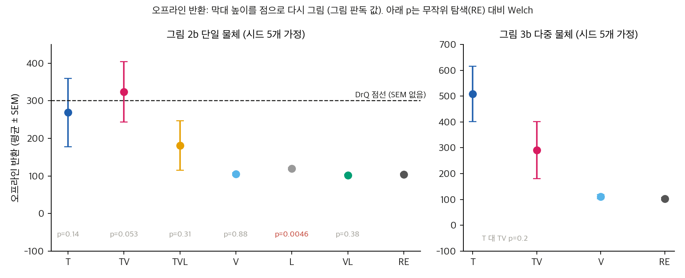
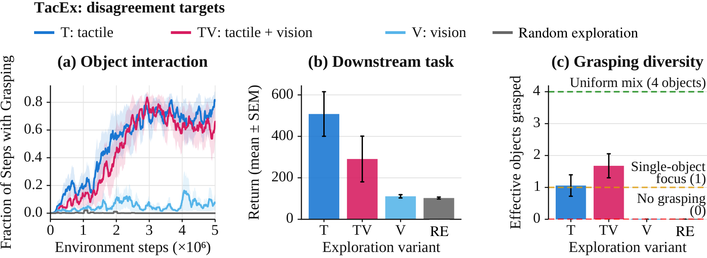
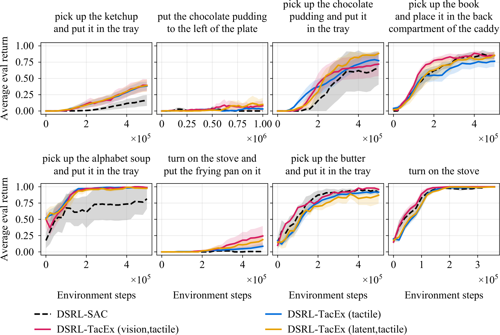
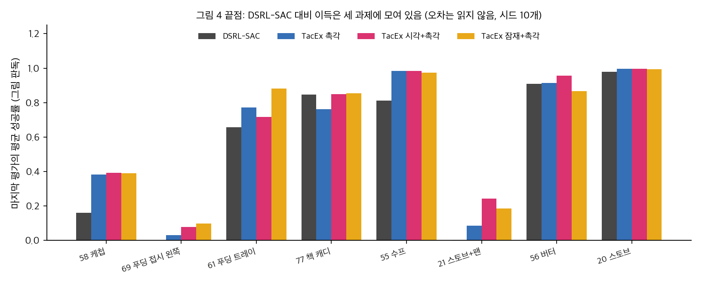
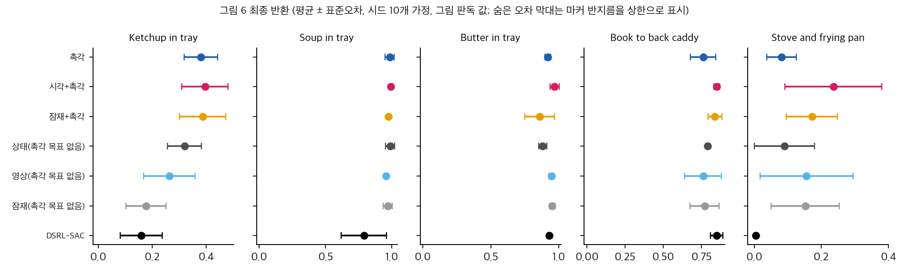

> **논문:** Klemens Iten, Alexander Proshkin, Bhavya Sukhija, Stelian Coros, Andreas Krause, Pieter Abbeel, Carmelo Sferrazza. *Tactile Curiosity Drives Robot Interaction.* CoRL 2026 포스터, arXiv:2609.40134 (v3, 2026-10-13).
> 공식 코드는 GitHub klemensiten/tacex에 있습니다(라이선스 파일 없음). 이 글의 논문 그림은 차트와 도식만 출처를 적어 실었고, 나머지는 우리가 그린 그래프입니다. 논문에는 결과 표가 없어 그림의 벡터 좌표에서 값을 읽었습니다. 그렇게 읽은 값과 시드 수를 가정한 검정에는 문장마다 "(그림 판독 값)", "(시드 n 가정)"을 적었습니다.

## 논문이 묻는 것

강화학습은 행동을 무작위로 뽑아 탐색하기 때문에 학습 시간 대부분을 접촉이 없는 자유 공간 움직임에 씁니다. 모델 불일치(앙상블이 다음 상태를 서로 다르게 예측하는 정도)로 호기심을 주는 방법도 접촉과 상관없이 모든 방향의 불확실성을 같게 보상합니다. 저자들은 조작에서는 **촉각의 불확실성**이 "배울 것이 있는 곳"을 가장 잘 가리킨다고 주장합니다.

TacEx는 MaxInfoRL의 정보 이득 보너스를 모달리티별로 쪼갭니다. 앙상블이 다음 상태의 잠재(z), 영상(v), 촉각(ι)을 예측하고, 각 불일치의 노름을 가중해 더합니다(식 4). 촉각 항에 큰 가중을 주면 정책이 접촉 쪽으로 끌려 들어가는 구조입니다. 실험은 두 가지입니다. 외부 보상 없이 탐색해 모은 데이터로 오프라인 pick-and-place를 학습하고(그림 2, 3), LIBERO-90의 접촉 과제 8개에서 고정된 π0의 확산 잡음을 조종하는 RL(DSRL)에 촉각 보너스를 얹습니다(그림 4–6). 모두 시뮬레이션입니다.

*그림 1 (논문 원문, 도식 부분). © 저자, CC BY 4.0, 출처 arXiv:2609.40134 (v3).*

## 이 글에서 확인한 것

**1. 촉각 불일치는 접촉을 분명히 늘립니다.** 외부 보상이 없는데도 촉각 불일치(T)와 촉각+영상(TV)은 잡는 단계 비율이 각각 0.40과 0.39(끝 10% 평균, 그림 판독 값)에 이릅니다. 영상만, 잠재만, 영상+잠재, 무작위 탐색은 0.04 이하입니다. 세 모달리티를 모두 쓰는 TVL은 0.17로 절반 아래입니다. 잠재 항이 촉각 비중을 희석한다는 저자의 설명과 같은 방향이지만, 본문은 TVL을 따로 다루지 않습니다.

*그림 2 (논문 원문, 차트 두 개). © 저자, CC BY 4.0, 출처 arXiv:2609.40134 (v3). 위쪽의 롤아웃 프레임은 싣지 않았습니다.*

**2. 하류 오프라인 반환의 이득은 시드 5개로 확정되지 않습니다.** 막대 높이를 읽으면 T 269, TV 324, 무작위 105입니다(그림 판독 값, SEM 65–91). 무작위와의 차이는 TV가 p ≈ 0.05, T가 p ≈ 0.14입니다(Welch, 시드 5개 가정). 반환이 0이 아니라 약 100에서 시작한다는 점도 함께 읽어야 합니다. 온라인 DrQ 점선(300)은 T, TV와 오차 안이고, DrQ의 학습 예산은 본문에 없습니다. v3에서 이 부분의 문장이 "더 좋은 오프라인 반환을 얻는다"에서 "더 높을 수 있다"로 바뀌었습니다. 읽은 값과 같은 방향입니다. 80% 검정력으로 가르려면 T 대 무작위는 팔당 시드 약 12개, TV 대 무작위는 약 6개가 필요합니다(추정).

*그래프 (우리가 그림). 그림 2b와 3b의 막대를 점으로 다시 그렸습니다(그림 판독 값, 시드 5개 가정). p는 무작위 탐색 대비 Welch 검정입니다.*

**3. 다중 물체에서는 촉각이 집중하고, 영상을 더하면 다양해집니다.** 유효 물체 수는 T가 1.06 ± 0.34, TV가 1.68 ± 0.38입니다(그림 판독 값). 본문은 TV를 "약 2"라고 적습니다. 하류 반환은 T 508, TV 291로 T가 1.75배이지만 p ≈ 0.20(시드 5개 가정)이라, "slightly better"보다는 시드 5개로 구분되지 않는 차이로 읽는 편이 맞습니다.

*그림 3 (논문 원문, 차트 세 개). © 저자, CC BY 4.0, 출처 arXiv:2609.40134 (v3). 위쪽의 롤아웃 프레임은 싣지 않았습니다.*

**4. LIBERO 확산 조종의 개선은 과제 세 개에 모여 있습니다.** 초록은 "하류 성능이 substantially 개선된다"고 적습니다. 그림 4의 끝점(그림 판독 값)에서 시각+촉각이 DSRL-SAC보다 0.10 넘게 높은 과제는 8개 중 케첩(0.39 대 0.16), 알파벳 수프(0.99 대 0.81), 스토브와 프라이팬(0.24 대 0.00)입니다. 기준선이 이미 0.9 이상인 과제가 둘이고, 한 과제(푸딩을 접시 왼쪽에)는 모든 방법이 0.1 이하입니다. 책 캐디(77번)에서 촉각 변형은 기준선보다 낮습니다(0.76 대 0.85). 본문도 "효과는 과제에 따라 다르다"고 적습니다.

*그림 4 (논문 원문). © 저자, CC BY 4.0, 출처 arXiv:2609.40134 (v3).*

*그래프 (우리가 그림). 그림 4의 끝점을 읽은 값입니다(그림 판독 값, 오차는 읽지 않음).*

**5. 촉각 목표가 필요하다는 비교는 그림 6에서 제한적으로만 보입니다.** 5개 과제의 최종 반환(시드 10개 가정)을 읽으면, 시각+촉각이 촉각 목표 없는 보너스(상태, 영상, 잠재 중 최고)보다 높다는 직접 비교는 5개 중 4개에서 p ≥ 0.48입니다. 상태 불일치는 케첩에서 0.32 ± 0.06으로 촉각 0.38 ± 0.06과 구분되지 않고, 수프에서는 거의 같습니다. 본문의 "시각+촉각이 다섯 과제 모두에서 가장 높은 평균"은 읽은 값에서 맞습니다. 2위와의 차이는 0.002–0.064로 오차 막대 안입니다. SAC와의 15개 비교(TacEx 세 가지 × 5과제)는 Holm 보정 뒤 모두 유의하지 않고, 과제 단위로 모은 짝지은 t 검정은 p ≈ 0.047(과제 5개)입니다.

*그래프 (우리가 그림). 그림 6의 최종 반환을 읽은 값입니다(시드 10개 가정, 그림 판독 값). 마커 아래에 숨은 오차 막대는 마커 반지름을 상한으로 두었습니다.*

## 공식 코드와 논문의 차이

공식 저장소(JAX)에는 탐색 학습기와 LIBERO 조종 학습기, 기준선이 모두 있습니다. 표 1의 대부분의 값은 실험 런처와 맞습니다. 다음은 정적으로 읽은 차이입니다(코드는 실행하지 않았습니다).

- **무보상 탐색 환경이 고정된 서브모듈에 없습니다.** 코드는 `tactile_envs.envs.exploration`을 불러오는데, 서브모듈의 고정 커밋(2024-07-08) 파일 목록의 `tactile_envs/envs/` 아래에는 `insertion.py`와 두 개의 외부 포크 폴더(`robosuite/`, `Gymnasium-Robotics/`)만 있습니다. 하류 오프라인 SAC 코드도 없습니다. 그림 2, 3은 이 저장소만으로 되짚을 수 없습니다.
- **식 4와 코드의 계산 모양이 다릅니다.** 논문은 모달리티별 노름의 가중합이고, 코드는 앙상블 표준편차를 고정 우연적 표준편차 1e-3으로 나눈 비의 `log(1 + 비)`를 차원 평균해 표준화합니다. DSRL 학습기의 가중치는 선택 마스크뿐이라 ω_ι ≫ ω_v 같은 비율은 표현되지 않습니다. 논문의 실험도 ω ∈ {0, 1}만 씁니다.
- **탐색 학습기의 앙상블 목표가 DSRL 학습기와 다르게 읽힙니다.** 영상과 촉각 블록의 목표가 다음 관측이 아니라 현재 관측의 임베딩으로 보입니다. 의도된 설계일 수도 있고, 코드를 실행해 확인하지 않았습니다.
- **표 1의 설명과 코드가 다른 곳이 있습니다.** 촉각 인코더는 표 1에서 MLP, 그림 1과 코드에서 CNN입니다. "UTD 20 경사 스텝/환경 스텝"은 코드에서 조종 전이(질의) 하나당 20회입니다.
- **합산 촉각 "보상" 기준선은 과제 보상을 쓰지 않습니다.** 합산 촉각 신호로 보상을 교체해 학습하므로, 그림 6의 해당 칸(0.00–0.09)은 촉각 크기만 최대화한 SAC의 결과입니다.

README 예시만 따라 하면 표 1과 다른 설정(동역학 모델 학습률 3e-4, 그리퍼 종류)으로 학습됩니다. 표 1은 런처 `launcher_ablate.py` 계열과 맞습니다.

## 이 맥에서 구현할 수 있을까

논문 수치의 재현은 이 맥(Apple M4 Pro, 약 24 GiB, MPS, CUDA 없음)에서 불가능합니다. LIBERO 확산 조종은 π0 가중치와 CUDA JAX가 전제이고, 무보상 탐색은 환경이 저장소에 없습니다. 보너스 계산의 numpy 이식은 끝냈고(수 초), 소형 MuJoCo 환경에서 모달리티별 불일치 보너스를 직접 재구현하는 일은 새 설치 없이 가능합니다(노력 2–3주 추정, 측정 전).

## 한계

- 결과가 모두 그림이라 읽기 오차(축 한 칸의 1% 안팎)와 시드 수 가정이 p 값에 들어 있습니다. 시드별 값이 공개되면 다시 계산해야 합니다.
- 논문은 시뮬레이션만 다루고, 촉각 잡음, 센서 마모, 실제 하드웨어는 평가하지 않았다고 스스로 밝힙니다.
- 이 글은 코드를 실행하지 않았습니다. 코드와의 차이는 모두 정적으로 읽은 결과입니다. 저자 확인이 필요한 항목이 있습니다(앙상블 목표, 기준선 설정).

## 자료

- [통합 리포트 PDF](report/report_public.pdf)
- [01. 논문 분석: Tactile Curiosity Drives Robot Interaction (TacEx)](analysis/01_paper_analysis.md)
- [02. 선행연구와 관련 저장소 (TacEx)](analysis/02_prior_work.md)
- [03. 수치 재계산, 일관성 검사, 주장 판정 (TacEx)](analysis/03_analysis.md)
- [04. 공식 코드와 논문의 대조 (TacEx)](analysis/04_code_verification.md)
